<div align="center">

#  Pinpoint

**Point at your running app. Say what should change. Your coding agent gets it.**

[](https://github.com/gowtham012/pinpoint/actions/workflows/test.yml)
[](https://www.npmjs.com/package/pinpoint-bridge)
[](LICENSE)
[](https://glama.ai/mcp/servers/gowtham012/pinpoint)
[](https://github.com/hesreallyhim/awesome-claude-code)
[](https://github.com/gowtham012/pinpoint/stargazers)
[](https://mcprush.com/to/pinpoint-mcp?ref=badge)

**[gowtham012.github.io/PinPoint](https://gowtham012.github.io/PinPoint/)**

**English** ·
[తెలుగు](docs/i18n/README.te.md) ·
[हिन्दी](docs/i18n/README.hi.md) ·
[தமிழ்](docs/i18n/README.ta.md) ·
[简体中文](docs/i18n/README.zh-CN.md) ·
[日本語](docs/i18n/README.ja.md) ·
[한국어](docs/i18n/README.ko.md) ·
[Español](docs/i18n/README.es.md) ·
[Français](docs/i18n/README.fr.md) ·
[Deutsch](docs/i18n/README.de.md) ·
[Português](docs/i18n/README.pt-BR.md) ·
[Русский](docs/i18n/README.ru.md) ·
[العربية](docs/i18n/README.ar.md)

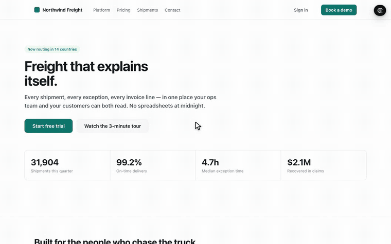

<sub>Click an element, say what should change, your agent gets it. · <a href="docs/demo.mp4">full-speed video</a></sub>

</div>

---

Click an element on your local dev site, type what should change, and your coding agent receives it
with everything it needs to find the code: the **selector**, **DOM path**, **computed styles**, the
**React/Vue component chain**, a **source-file hint** and a **cropped screenshot**. No screenshots
piling up in Downloads, no describing "the third button on the left".

It works for **behaviour**, not only looks. *"Disable this until the form is valid"* or *"save the
draft before closing"* are fine notes: the agent treats the element as where to start, then follows it
into the handlers, state, API calls and backend behind it.

Building a native app? The same works on the **[iOS Simulator](#-native-ios-apps)** and the
**[Android emulator](#-android-emulator)**.

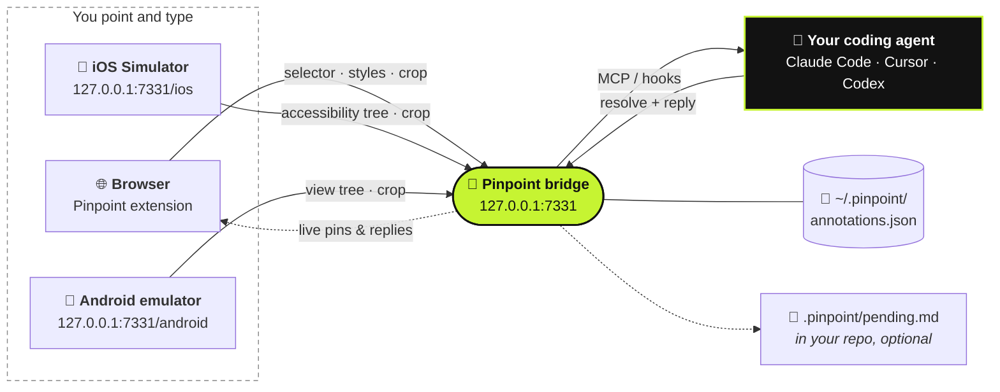

## Contents

- [Quick start](#-quick-start)
- [Using it](#-using-it)
- [Talking it through](#-talking-it-through)
- [How your agent finds out](#-how-your-agent-finds-out)
- [Native iOS apps](#-native-ios-apps)
- [Android emulator](#-android-emulator)
- [Connecting other agents](#-connecting-other-agents)
- [Reference](#-reference): commands, MCP tools, what a note contains
- [Troubleshooting](#-troubleshooting)
- [Safety and privacy](#-safety-and-privacy)

## How it compares

| | Who drives | What the agent gets |
|---|---|---|
| **Pinpoint** | **You** point and say what should change | Selector, styles, component chain, source hint, crop |
| Playwright MCP, computer-use | The agent navigates and clicks | Whatever it finds by browsing |
| A pasted screenshot | You | Pixels only, so it guesses which control you meant |

Pinpoint never touches the page itself, so it composes with browser automation instead of competing
with it: point at the thing, let the agent change the code, let your tests drive the browser.

## 🚀 Quick start

**You need** Node 18+ and a Chromium browser (Chrome, Edge, Brave, Arc, Opera, Vivaldi), or
[Firefox 140+](#-browsers).

**1. Install**

```bash
git clone https://github.com/gowtham012/pinpoint
node pinpoint/bridge/cli.js setup
```

`setup` asks a few questions. Every one has a default, so pressing Enter all the way through works.
It wires up Claude Code, Cursor and Codex (whichever you have), installs the Claude Code hooks, and
starts the bridge.

**2. Load the extension.** Chrome doesn't let a terminal load an extension into your profile, so setup
opens the extensions page and copies the folder path for you: turn on **Developer mode**, click **Load
unpacked**, paste. The terminal confirms **✓ Pinpoint is live in Chrome** by itself.

**3. Restart Claude Code once**, so it reads the new MCP server and hooks.

**Try it:** open your dev site (or [the demo page](#a-page-to-try-it-on)), press **⌥⇧A** /
**Alt+Shift+A**, click an element, type what should change, then **⌘↩** / **Ctrl+Enter**. Type anything
in Claude Code and your note comes along.

> [!TIP]
> Want every step spelled out? See [docs/quick-install.md](docs/quick-install.md).
> Only building a native iOS or Android app? Skip the clone:
> `npx -y pinpoint-bridge`, then `claude mcp add pinpoint -s user -- npx -y pinpoint-bridge mcp`.

<details>
<summary><b>Setup in detail, doing it by hand, Windows and <code>file://</code></b></summary>

`setup` asks:

- **which project's UI you want to annotate**: the repo your agent will edit
- **web app, native iOS app, Android app, or both** (web and iOS): web gets the browser extension;
  iOS gets the [Simulator picker](#-native-ios-apps), Android the [emulator picker](#-android-emulator).
  Setup checks for Xcode, Maestro and Java (iOS) or adb (Android) and says how to get whichever is
  missing (it installs none of them).
- **which agents to wire up**: `claude mcp add` for Claude Code, `<project>/.cursor/mcp.json` for
  Cursor, `~/.codex/config.toml` for Codex. Existing entries are merged, never replaced, and the TOML
  file is backed up first.
- **whether to install the Claude Code hooks**, which bring pending notes in with your next message
- **which browser** to load the extension into (only the ones you have)

Then it registers the launcher behind the popup's **Start bridge** button and starts the bridge.
Non-interactive: `node pinpoint/bridge/cli.js setup ~/code/my-app --yes` (add `--for ios`,
`--for android` or `--for both`; the default is `web`).

**By hand.** The order matters: `$PWD` is baked into the MCP entry, so step 2 runs from
`pinpoint/bridge` before the bridge takes over the terminal.

```bash
# 1. get it
git clone https://github.com/gowtham012/pinpoint
cd pinpoint/bridge && npm install

# 2. wire up Claude Code (once, from this folder)
claude mcp add pinpoint -s user -- node "$PWD/cli.js" mcp
node cli.js install-hooks ~/code/my-app                  # notes arrive without being asked
node cli.js install-native-host --project ~/code/my-app   # optional: the popup's "Start bridge" button

# 3. load extension/ unpacked at chrome://extensions (Developer mode on)
# 4. start the bridge, and leave it running
node cli.js --project ~/code/my-app
```

`--project` is optional: it keeps `<repo>/.pinpoint/pending.md` current for agents that read a file
instead of MCP.

**`file://` pages.** Chrome keeps them off by default: `chrome://extensions` → Pinpoint → **Details** →
**Allow access to file URLs**, then reload.

**Windows.** `$PWD` works in PowerShell and Git Bash but not `cmd.exe`; run `node cli.js --help` and
copy the `claude mcp add …` line it prints, which has the full path. `install-native-host` is macOS
and Linux only; on Windows, start the bridge in a terminal.

**Also listed on** the [official MCP Registry](https://registry.modelcontextprotocol.io)
(`io.github.gowtham012/pinpoint`), [cursor.directory](https://cursor.directory/plugins/pinpoint)
(one-click **Add to Cursor**) and [Glama](https://glama.ai/mcp/servers/gowtham012/pinpoint) and [mcprush](https://mcprush.com/gowtham012/pinpoint-mcp) (grade A). Those
install the MCP server only; web pages still need the extension and bridge.
</details>

## 🖱️ Using it

While the bridge runs, a small bar sits in the top-right corner of your page.

| | | |
|---|---|---|
| 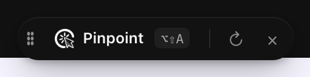 | 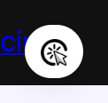 | 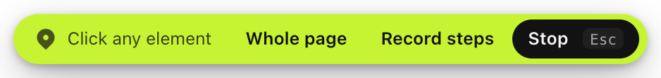 |
| Shows the shortcut, and lights up while your agent works. | Settles to a dot after a few seconds. Hover to bring it back. | Picking. The bar lets clicks through so it never blocks your target. |

1. Click the bar (or **⌥⇧A** / **Alt+Shift+A**) to start marking.
2. Click an element, or **drag** a box around a group (*"make these cards two-up on mobile"*).
3. Type what should change and press **⌘↩** / **Ctrl+Enter**. You're ready for the next one.
4. **Esc** or **Stop** when you're done.

<table>
<tr>
<td width="50%">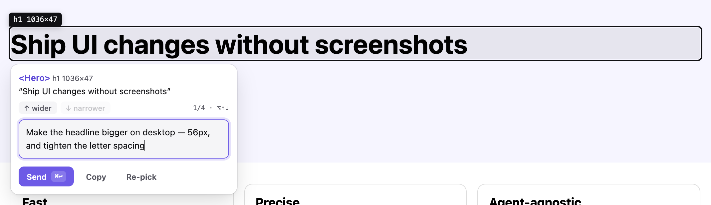</td>
<td width="50%">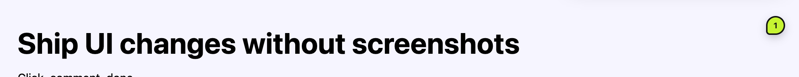</td>
</tr>
<tr>
<td>The popover names exactly what you picked, so two near-identical buttons can't be confused.</td>
<td>A numbered pin sticks to the element. It survives reloads, shows in every tab on that page, and disappears when the agent finishes.</td>
</tr>
</table>

- **Move the bar** by dragging its grip anywhere on the page; it stays there on that site.
- **The counter** on the bar lists everything marked on this page. Click a row to jump to it.
- **The ×** hides the bar for that site; the toolbar popup brings it back.
- **Pins follow their element** on apps that rebuild their DOM, and hide rather than sit on the wrong
  element when theirs is gone.
- **No bridge running?** **Send** copies a ready-to-paste prompt instead, so nothing is lost.
- **Record steps.** While picking, press **Record steps** on the bar and click through the bug as you
  normally would. Clicks still reach the page and each becomes a step (element, label, URL, a small
  crop), across navigations in the same tab. **Done** writes one note (10 steps at most); **Esc**
  throws the recording away. Your agent gets them as *Steps to reproduce*.
- **Dictate.** Press the mic in the comment box and talk; the text is added to what you typed. Chrome
  and Safari on secure pages (localhost counts); the browser's own speech service does the
  transcribing. Not on Firefox.
- **What went wrong comes along.** Each note carries the page's uncaught errors and failed requests
  from the minute before you marked it, redacted in the browser first (query strings, tokens and
  secrets removed). Only attached when something actually went wrong.

**Where it runs.** Only on local development pages: `localhost`, `127.0.0.1`, `.local` / `.test` /
`.localhost` hosts, and `file://` once allowed. Anywhere else (a staging URL, a LAN address for phone
testing) the toolbar popup turns it on for one tab.

## 💬 Talking it through

A note is a conversation, not a one-way ticket.

- **The agent can ask back.** If a request is ambiguous it asks instead of guessing. The question shows
  on the pin (a **?**) and as a toast; answer in the notes panel and the note goes back with the whole
  conversation.
- **You read the reply in the browser.** A finished note stays in the panel with the agent's own note
  on what it changed. Agents must write one: "done" is not an answer.
- **Accept / Not quite.** When the agent finishes, a card shows its reply with **Accept** and **Not
  quite**. Not quite opens the note again so you can say what is still wrong.
- **Not quite right later?** Every finished note in the panel has **Reply…**. Say what's still wrong
  and it reopens.
- **Before / After.** A few seconds after a note is resolved, Pinpoint takes a fresh crop of the
  element. Done notes in the panel show **Before** and **After** side by side.
- **Drafts.** **Draft** (or **⇧⌘↩**) marks something without sending it. **Send** on the bar hands
  every draft over at once.
- **The whole page.** While picking, **Whole page** makes a note about the page itself (*"the spacing
  feels cramped everywhere"*), with a screenshot.

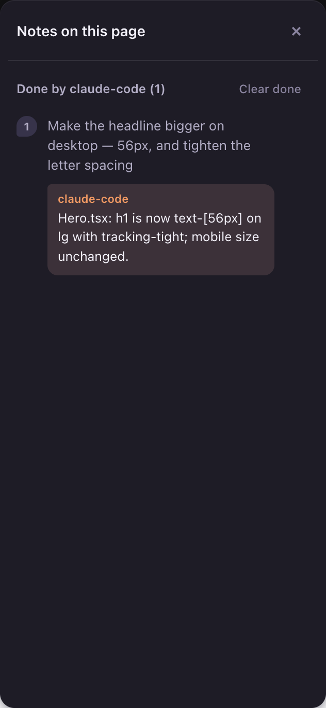

**When the page moves under a pin**, the agent is told the element may be stale instead of being handed
a selector that has gone bad. `recheck_annotation` looks again right now and returns a fresh crop next
to the original.

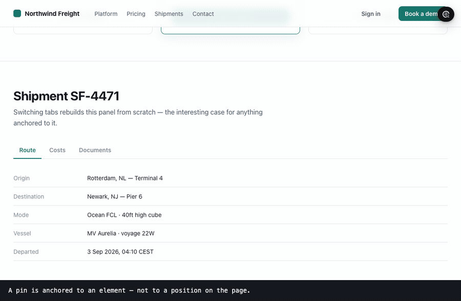

<sub>The same two notes, twice. The panel is rebuilt from scratch: note 1 re-finds its element among brand-new nodes, note 2 admits it isn't on this view.</sub>

<details>
<summary><b>Starting the bridge from the browser, and several agents at once</b></summary>

**Start / restart from the browser.** `install-native-host` registers a tiny launcher with Chrome
(and Brave, Edge, Arc, Chromium, Vivaldi, Opera) and Firefox. The popup's **Start bridge** then works, and the
**↻** on the bar restarts the bridge after you pull a new build. The launcher can do one thing: run
this repo's own `cli.js` on a port number from the popup's setting, never from the page.

**Several agents.** Agents introduce themselves over MCP, so the bar names the one working
(`claude-code`, `cursor-vscode`, `codex`) and each reply is attributed. `wait_for_annotation` hands each
new note to exactly one waiting agent, so two agents share the queue instead of doing the same note.
</details>

## 🔔 How your agent finds out

Three ways, strongest first. Using all three is fine.

| | How | Setup |
|---|---|---|
| **Hooks** (automatic) | Pending notes ride along with your next message. Prints nothing when nothing is pending. | `node cli.js install-hooks <repo>` (setup does it) |
| **MCP** (on request) | The server tells the agent to check whenever you talk about a UI or feature change. | the MCP entry |
| **Watch loop** (hands-off) | Say *"watch pinpoint and apply each change as it comes in"*; each note arrives the moment you hit Send. | nothing |

The comment is the instruction, and it can be about how something **looks** or what it **does**. The
more you say about the outcome (*"should"*, *"instead of"*, *"when … then …"*), the less the agent
guesses.

## 📱 Native iOS apps

A native app has no DOM, so this path reads the **accessibility tree**. It works for SwiftUI, UIKit,
React Native and Flutter apps, with nothing added to your app.

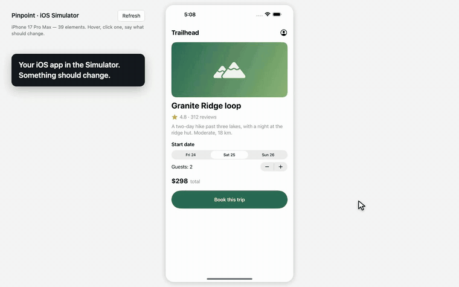

<sub>Hover, click, say what should change; your agent gets the identifier, tree path, frame and a crop, asks if it must, and replies when it's done. · <a href="docs/demo-ios.mp4">full-speed video</a> · <a href="docs/demo-ios-vertical.mp4">vertical</a></sub>

<table>
<tr>
<td width="50%">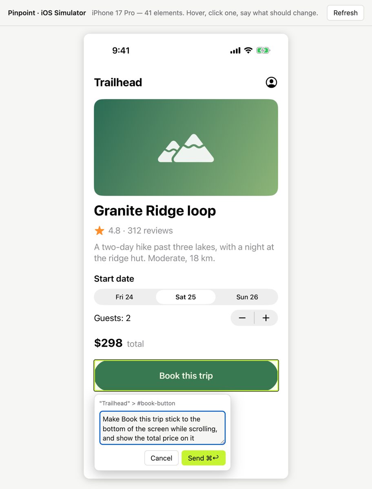</td>
<td width="50%">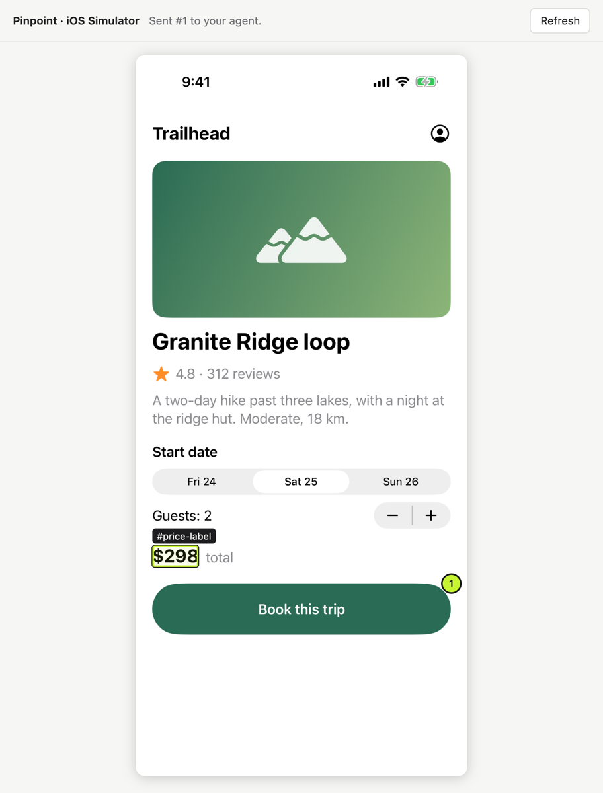</td>
</tr>
</table>

**You need** Xcode with a booted Simulator and [Maestro](https://maestro.dev) (which needs Java; a
Homebrew `openjdk` is found even off your PATH).

With the bridge running, open **http://127.0.0.1:7331/ios** (setup opens it for you). Hover to see each
element, click one, type, **⌘↩**. The agent gets the `accessibilityIdentifier` (your `testID`), label,
tree path, frame and a crop. Press **R** after the app changes.
The picker also shows the agent's side: a **?** pin opens its question with a box to answer, and a
finished note shows its reply with **Accept** and **Not quite** (reopen it with a follow-up), as in the browser.

**No app handy?** `bash demo/ios/run.sh` builds **Trailhead**, a one-screen SwiftUI demo, with `swiftc`
alone and launches it on the booted Simulator.

<details>
<summary><b>Limits and timing</b></summary>

There's no source-file hint or component chain (the tree has neither; give elements an identifier and
the agent greps for it), no styles, and no `recheck_annotation`. The first load waits ~10 s while
Maestro starts its on-device driver; after that each refresh takes about a second. Every Maestro on
your Mac shares one driver, so if another one restarts it, the bridge starts a fresh Maestro and tries
once more. If the first load takes minutes, close idle Claude Code sessions that have the Maestro MCP
server.
</details>

## 🤖 Android emulator

The same picker as `/ios`, reading the Android **view tree** through adb. Nothing is added to your app
and there is no driver to install.

<table>
<tr>
<td width="50%">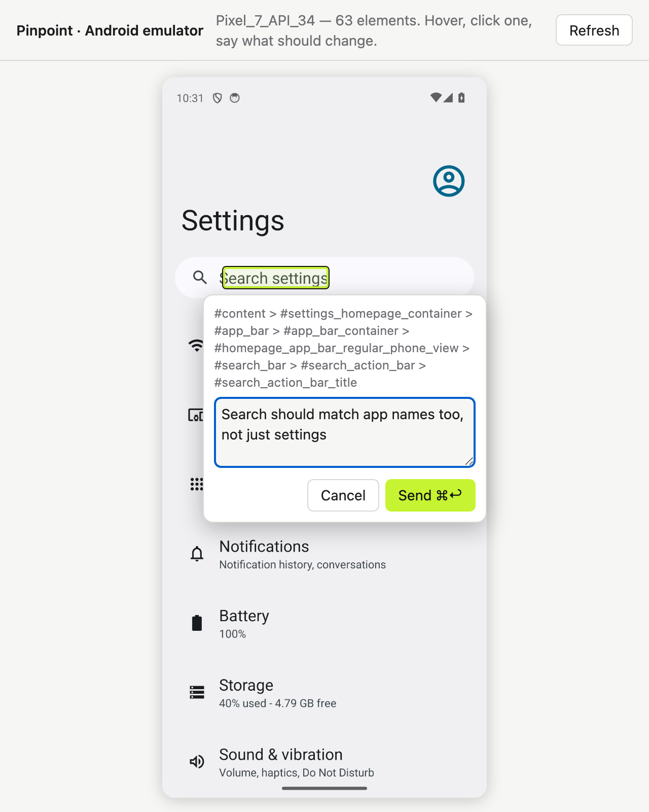</td>
<td width="50%">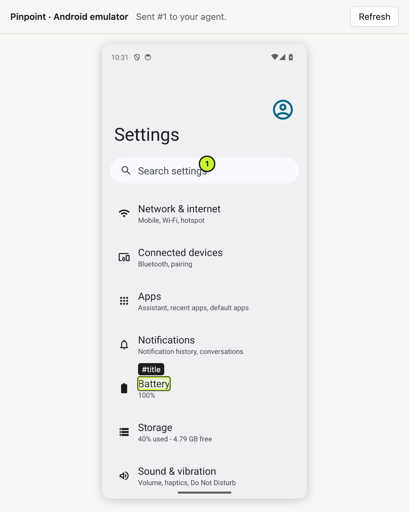</td>
</tr>
</table>

**You need** `adb` from the Android SDK (Android Studio installs it) and a running emulator.

With the bridge running, open **http://127.0.0.1:7331/android**. Hover, click, type, send. The agent
gets the element's `resource-id`, content-desc, text, class, its place in the view tree and a crop.
`node bridge/cli.js setup --for android` checks for adb and points you at the picker.

<details>
<summary><b>Finding adb, and which device is read</b></summary>

Pinpoint looks for adb in `$ANDROID_HOME`, `$ANDROID_SDK_ROOT` and Android Studio's default SDK
folder, then on your `PATH`. With one emulator running, that one is used. With several, or to read a
physical device, set `ANDROID_SERIAL` to its serial (as `adb devices` lists it) and restart the
bridge. A phone is never picked unless you name it. Like iOS, there's no source-file hint, no styles
and no `recheck_annotation`: give views an id and the agent greps for it.
</details>

## 🔌 Connecting other agents

The simplest entry runs the published package: `npx -y pinpoint-bridge mcp`. It talks to whichever
bridge is running. Restart the editor afterwards.

<details>
<summary><b>Cursor</b>: one click from <a href="https://cursor.directory/plugins/pinpoint">cursor.directory</a>, or <code>.cursor/mcp.json</code></summary>

```json
{ "mcpServers": { "pinpoint": { "command": "npx", "args": ["-y", "pinpoint-bridge", "mcp"] } } }
```
</details>

<details>
<summary><b>Codex CLI</b>: <code>~/.codex/config.toml</code></summary>

```toml
[mcp_servers.pinpoint]
command = "npx"
args = ["-y", "pinpoint-bridge", "mcp"]
```
</details>

<details>
<summary><b>Any MCP client over HTTP</b>, or <b>no MCP at all</b></summary>

**HTTP:** `http://127.0.0.1:7331/mcp` (Streamable HTTP, stateless). Windsurf, Cline, Continue, Zed and
Gemini CLI all take a URL.

**No MCP:** run the bridge with `--project <repo>` and it keeps `<repo>/.pinpoint/pending.md` current.
Tell any agent *"read .pinpoint/pending.md and apply it"*; it finishes each with
`node cli.js resolve <id>`. Or use **Copy prompt** in the popover and paste into any chat.

To pin an agent to your clone instead of npm, use the absolute path to `cli.js` (copy the line
`node cli.js --help` prints).
</details>

## 🌐 Browsers

| Browser | Status |
|---|---|
| **Chrome, Brave, Arc, Opera, Vivaldi** | ✅ Load unpacked. Verified in CI on headless Chromium. |
| **Edge** | ✅ Load unpacked: the same package as Chrome. |
| **Firefox 140+** | ✅ An addons.mozilla.org package built by `bash tools/make-firefox-zip.sh`. Store listing pending. No dictation. |
| **Safari** | ✅ Built with `bash tools/make-safari.sh` (needs Xcode). No component chain, source hint or page errors. |

<details>
<summary><b>Edge and Firefox</b></summary>

**Edge** takes the Chrome package as is. For **Start bridge**, run
`node bridge/cli.js install-native-host --id <edge id>` once (Edge gives the extension its own id).

**Firefox 140+.** Until the addons.mozilla.org listing is live, load the zip from
`about:debugging` → **This Firefox** → **Load Temporary Add-on**. If Firefox withheld access to local
sites, press **Grant access to local sites** in the popup. Then run
`node bridge/cli.js install-native-host` once for **Start bridge**, or paste the output of
`node bridge/cli.js token` into the popup.
</details>

<details>
<summary><b>What differs on Safari</b></summary>

Safari doesn't take unpacked extensions, so `tools/make-safari.sh` wraps it in a small macOS app and
prints the four Safari settings to flip (the key one, **Develop ▸ Allow Unsigned Extensions**, resets
every time Safari quits). Safari doesn't support `"world": "MAIN"` content scripts, so `inspector.js`
can't read React fibers or Vue instances: you lose the **component chain and source-file hint**, and
**page errors** (they need the MAIN world too). Failed requests come along only where Safari supports
`webRequest`. Everything else works. Safari has no native host to hand over the bridge token, so the popup asks for
it once: run `node bridge/cli.js token` and paste the output. For the Mac App Store,
`TEAM=<your team id> bash tools/make-safari.sh --release` exports a signed build.
</details>

## 📚 Reference

<details>
<summary><b>Commands</b> (run from <code>pinpoint/bridge</code>)</summary>

```
node cli.js [start]            start the bridge (default command)
node cli.js mcp                run as a stdio MCP server
node cli.js status             is it running? how many pending?
node cli.js print              pending annotations as markdown  (--consume also resolves them)
node cli.js resolve <id...> --note "what you changed"
                               mark done — the pin disappears and your note is shown as the reply
node cli.js install-hooks [dir]  wire up Claude Code
node cli.js install-native-host   let the popup's "Start bridge" button start the bridge
                               (--uninstall removes it; --id <id> allows a second checkout)
node cli.js token              print the extension token (Safari asks for it once)
node cli.js clear              delete everything
node cli.js --help

http://127.0.0.1:7331/ios      the iOS Simulator picker, served by the running bridge
http://127.0.0.1:7331/android  the Android emulator picker (needs adb)

--port <n>       default 7331, or $PINPOINT_PORT (set the same number in the popup)
--project <dir>  mirror pending annotations into <dir>/.pinpoint/
--print          echo each new annotation to stdout as it arrives
$PINPOINT_HOME   where annotations are stored (default ~/.pinpoint)
$PINPOINT_AFTER_DELAY  ms after a resolve before the After crop (default 3000, 0 turns it off)
$ANDROID_SERIAL  which Android device to read, when it isn't the one running emulator
```
</details>

<details>
<summary><b>MCP tools</b></summary>

| tool | purpose |
|---|---|
| `get_pending_annotations` | everything pending as a markdown task list, each with its screenshot |
| `list_annotations` | one line per annotation |
| `get_annotation` | full detail + screenshot for one id or pin number |
| `recheck_annotation` | re-find the element in the live page and report what changed, with a fresh crop next to the original |
| `resolve_annotation` | mark done → the pin disappears in the browser within a second |
| `reply_annotation` | ask the developer a question instead of guessing; their answer comes back as pending, with the conversation |
| `wait_for_annotation` | block until the developer sends the next one |
| `clear_annotations` | wipe everything |

Resource: `pinpoint://pending` (markdown).
</details>

<details>
<summary><b>What a note contains</b></summary>

```
comment          "make this full-width on mobile"          ← the only instruction
page             url, title, viewport, scroll
element          tag, id, classes, a CSS selector built from stable attributes where they exist
                 (`button[data-action="next"]` rather than `:nth-of-type(2)`; shadow DOM via
                 "host >>> inner"), DOM path, rendered text, trimmed outerHTML, role/aria/data-*
                 attributes, bounding box, ~25 computed style properties, and a fingerprint
                 (tag + text + key attributes) used to verify a pin is still on the right element
                 + reuse, when it is one of several: the component and how many times it is on the
                 page (an estimate on plain HTML), and whether you meant this one or all of them
source           framework (react/vue/svelte/angular/astro), component chain,
                 file:line where the dev build exposes it — or, in a production build, from the
                 page's own source maps (same origin only; method: "sourcemap")
screenshot       PNG of just the element (+8px), long edge ≤1200px
context          only when something went wrong: uncaught errors and failed requests from the
                 minute before, redacted in the browser
steps            recorded notes only: up to 10 clicks, each with selector, label, URL and a crop
after            on done notes: a fresh crop taken after the resolve
```

From the iOS Simulator, `element` carries the accessibility identifier, label, text, value, tree path
and frame instead; `source` is `ios-native` and `page.url` is `ios-simulator://<device name>`. From
the Android emulator it is the `resource-id`, content-desc, text, class, tree path and bounds;
`source` is `android-native` and `page.url` is `android-emulator://<avd>`.

For exact `file:line` on React 19 or Next, add a dev-only inspector plugin
(`vite-plugin-react-inspector`, `@react-dev-inspector`). Pinpoint reads their `data-source`
attributes, as well as React's `_debugSource`/`_debugStack` and Vue's `__file`.
</details>

## 🩺 Troubleshooting

<details>
<summary>No bar appears on the page</summary>

The bar only shows while the bridge runs. Check `node cli.js status` from `pinpoint/bridge`. If the
bridge is up, the page probably isn't one Pinpoint injects into automatically (see *Where it runs*):
open the toolbar popup and turn it on for that tab.
</details>

<details>
<summary>Nothing at all on a <code>file://</code> page</summary>

`chrome://extensions` → Pinpoint → **Details** → **Allow access to file URLs**, then reload.
</details>

<details>
<summary>The toolbar dot never turns green</summary>

The bridge isn't running, or it's on a different port: the popup's **Port** and the bridge's `--port`
must match. If `node cli.js status` says the port *answers, but it is NOT the pinpoint bridge*,
something else owns it: start the bridge with `--port 7332` and set 7332 in the popup.
</details>

<details>
<summary><code>port 7331 is already in use</code></summary>

Usually the bridge is already running in another terminal, so you're done. Otherwise pick a free port
as above. Don't run two bridges at once: they share one store file.
</details>

<details>
<summary>A note has no screenshot</summary>

The picture is taken just after your comment is stored, so the comment is never lost. If the page
navigated or the tab closed in that moment, the note records why. The comment, selector and styles are
all still there.
</details>

<details>
<summary>Claude Code doesn't mention my notes</summary>

Hooks are read when a session starts: restart once after `install-hooks`. Check that
`<your repo>/.claude/settings.json` has two entries containing `print --hook` and that their path still
exists (moving your clone breaks it; re-run `install-hooks`). You can always say *"apply my pinpoint
annotations"*.
</details>

<details>
<summary>"Start bridge" says setup is needed, or can't find Node</summary>

Run `node cli.js install-native-host` once (again, if you moved the repo), then quit and reopen the
browser. The launcher bakes in an absolute path to node; if node moved (new nvm version, Homebrew
upgrade), re-run it.
</details>

<details>
<summary>You want a clean slate</summary>

`node cli.js clear`. `~/.pinpoint/annotations.json` is the only state outside your repo.
</details>

## 🔒 Safety and privacy

- The bridge listens on `127.0.0.1` only and refuses requests carrying a web page's `Origin`.
- The extension must present the token in `~/.pinpoint/token`.
- Everything scraped from a page is labelled **untrusted** where it reaches your agent; only your typed
  comment is presented as an instruction.
- Screenshots live inside `~/.pinpoint/annotations.json`, not as loose files.

[SECURITY.md](SECURITY.md) has the full trust-boundary notes (including why `<all_urls>` is needed) and
[PRIVACY.md](PRIVACY.md) says exactly what is collected, where it's stored, and the one place it goes:
the coding agent you connect.

## A page to try it on

`demo/index.html` is a self-contained demo site (no build, no network) with card grids for region
drags, near-identical buttons, a tab panel that rebuilds itself, a dense table and a form.

```bash
cd demo && python3 -m http.server 8080     # then open http://localhost:8080
```

## 🧪 Testing

```bash
cd test && npm install && npx playwright install chromium && npm test
```

210 tests. `bridge.test.mjs` covers the daemon, CLI, hooks, the iOS picker and every MCP tool over
stdio and Streamable HTTP. `e2e.test.mjs` loads the extension into headless Chromium and drives real
pages: React, Vue, shadow DOM, iframes, strict CSP, a 3,600-node stress page, DPR 2, cross-tab sync and
a form that rebuilds its whole DOM.

<details>
<summary><b>The other suites</b></summary>

| file | covers |
|---|---|
| `android-bridge.test.mjs` | finding adb, picking the device, parsing the view tree, the `/android` routes |
| `e2e-picker.test.mjs` | the `/ios` and `/android` picker pages in headless Chromium |
| `ui-bridge.test.mjs`, `ui-flow.test.mjs`, `ui-after.test.mjs` | Accept, page context, recorded steps, Before / After |
| `ui-redact.test.mjs` | the page-context redaction rules |
| `ship-edge.test.mjs`, `ship-firefox.test.mjs`, `e2e-ship.test.mjs` | the Edge upload, the Firefox package and native host, the store zip and the popup's Firefox paths |
| `ship-windows.test.mjs` | how setup quotes commands for `cmd.exe` |
</details>

See [CONTRIBUTING.md](CONTRIBUTING.md).

## Roadmap

- Native source hints for React Native and Flutter, via an optional dev-only package
- CSS source mapping via `chrome.debugger` (which rule set this colour, and where)

## ⭐ Star history

<a href="https://star-history.com/#gowtham012/pinpoint&Date">
  <picture>
    <source media="(prefers-color-scheme: dark)" srcset="https://api.star-history.com/svg?repos=gowtham012/pinpoint&type=Date&theme=dark">
    
  </picture>
</a>

## Contributing

Issues and pull requests are welcome; see [CONTRIBUTING.md](CONTRIBUTING.md). There's no build step:
clone, `npm install` in `bridge/`, load `extension/` unpacked. Every behaviour change comes with a test.

## Licence

MIT, see [LICENSE](LICENSE). Release notes are in [CHANGELOG.md](CHANGELOG.md).
