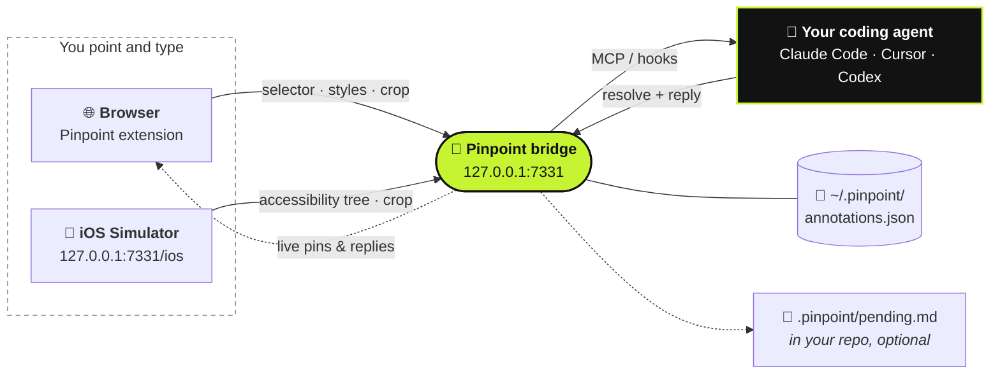

<div dir="rtl">

<div align="center">

# 📍 Pinpoint

**أشِر إلى تطبيقك وهو يعمل. قل ما الذي يجب أن يتغيّر. وسيصل طلبك إلى الـ coding agent.**

[](https://github.com/gowtham012/pinpoint/actions/workflows/test.yml)
[](https://www.npmjs.com/package/pinpoint-bridge)
[](../../LICENSE)
[](https://glama.ai/mcp/servers/gowtham012/pinpoint)
[](https://github.com/hesreallyhim/awesome-claude-code)
[](https://github.com/gowtham012/pinpoint/stargazers)

[English](../../README.md) ·
[తెలుగు](README.te.md) ·
[हिन्दी](README.hi.md) ·
[தமிழ்](README.ta.md) ·
[简体中文](README.zh-CN.md) ·
[日本語](README.ja.md) ·
[한국어](README.ko.md) ·
[Español](README.es.md) ·
[Français](README.fr.md) ·
[Deutsch](README.de.md) ·
[Português](README.pt-BR.md) ·
[Русский](README.ru.md) ·
**العربية**

<sub>هذه نسخة مترجمة؛ الـ README الإنجليزي هو المرجع المعتمد وقد يكون أحدث منها.</sub>


<sub>انقر على عنصر، قل ما يجب أن يتغيّر، والـ agent يستلمه. · <a href="../demo.mp4">الفيديو بالسرعة الكاملة</a></sub>

</div>

---

انقر على عنصر في موقع التطوير المحلي، واكتب ما يجب أن يتغيّر، فيصل ذلك إلى الـ coding agent ومعه كل ما
يحتاجه للعثور على الكود: الـ **selector**، والـ **DOM path**، والـ **computed styles**، وسلسلة
**مكوّنات React/Vue** (component chain)، و**تلميح لملف المصدر** (source-file hint)، و**لقطة شاشة مقصوصة**
للعنصر. لا مزيد من لقطات الشاشة المتراكمة في مجلد Downloads، ولا مزيد من وصف "الزر الثالث على اليسار".

ويعمل مع **السلوك** وليس الشكل فقط. *"عطّل هذا الزر إلى أن يصبح النموذج صالحًا"* أو *"احفظ المسودة قبل
الإغلاق"* ملاحظات مقبولة تمامًا: يعتبر الـ agent العنصر نقطة البداية، ثم يتتبّعه إلى الـ handlers والـ
state واستدعاءات الـ API والـ backend التي تقف خلفه.

تبني تطبيقًا أصليًا (native)؟ الأمر نفسه يعمل على **[iOS Simulator](#-تطبيقات-ios-الأصلية)**.

<div dir="ltr">



</div>

## المحتويات

- [البدء السريع](#-البدء-السريع)
- [طريقة الاستخدام](#-طريقة-الاستخدام)
- [التحاور حول الملاحظة](#-التحاور-حول-الملاحظة)
- [كيف يعرف الوكيل بملاحظاتك](#-كيف-يعرف-الوكيل-بملاحظاتك)
- [تطبيقات iOS الأصلية](#-تطبيقات-ios-الأصلية)
- [ربط وكلاء آخرين](#-ربط-وكلاء-آخرين)
- [المرجع](#-المرجع): الأوامر، أدوات MCP، ومحتوى الملاحظة
- [حل المشكلات](#-حل-المشكلات)
- [الأمان والخصوصية](#-الأمان-والخصوصية)

## مقارنة مع البدائل

| | من يقود | ما الذي يحصل عليه الـ agent |
|---|---|---|
| **Pinpoint** | **أنت** تُشير وتقول ما يجب أن يتغيّر | الـ selector، الـ styles، الـ component chain، تلميح المصدر، لقطة مقصوصة |
| Playwright MCP، computer-use | الـ agent يتنقّل وينقر بنفسه | ما يعثر عليه أثناء التصفّح |
| لقطة شاشة ملصوقة | أنت | بكسلات فقط، فيُخمّن أي عنصر تحكّم تقصد |

لا يلمس Pinpoint الصفحة نفسها أبدًا، لذا فهو يتكامل مع أدوات أتمتة المتصفح بدلًا من أن ينافسها: أشِر إلى
الشيء، ودع الـ agent يعدّل الكود، ودع اختباراتك تقود المتصفح.

## 🚀 البدء السريع

**تحتاج إلى** Node 18+ ومتصفح مبني على Chromium (Chrome، Edge، Brave، Arc، Opera، Vivaldi).

**1. التثبيت**

<div dir="ltr">

```bash
git clone https://github.com/gowtham012/pinpoint
node pinpoint/bridge/cli.js setup
```

</div>

يطرح `setup` بضعة أسئلة، ولكل منها قيمة افتراضية، لذا يكفي أن تضغط Enter حتى النهاية. يقوم بربط Claude
Code وCursor وCodex (أيّها كان مثبتًا لديك)، ويثبّت الـ hooks الخاصة بـ Claude Code، ثم يشغّل الـ bridge.

**2. حمّل الـ extension.** لا يسمح Chrome للـ terminal بتحميل extension في ملفك الشخصي، لذا يفتح setup
صفحة الـ extensions وينسخ لك مسار المجلد: فعّل **Developer mode** (وضع المطوّر)، وانقر **Load unpacked**
(تحميل غير مضغوط)، ثم الصق المسار. سيؤكّد الـ terminal من تلقاء نفسه برسالة **✓ Pinpoint is live in Chrome**.

**3. أعد تشغيل Claude Code مرة واحدة** ليقرأ الـ MCP server والـ hooks الجديدة.

**جرّبه:** افتح موقع التطوير (أو [صفحة العرض التجريبية](#صفحة-للتجربة))، واضغط **⌥⇧A** /
**Alt+Shift+A**، وانقر على عنصر، واكتب ما يجب أن يتغيّر، ثم **⌘↩** / **Ctrl+Enter**. اكتب أي شيء في
Claude Code وستصل ملاحظتك معه.

> [!TIP]
> تريد كل خطوة بالتفصيل؟ راجع [docs/quick-install.md](../quick-install.md).
> تبني تطبيق iOS أصليًا فقط؟ لا داعي للـ clone:
> `npx -y pinpoint-bridge`، ثم `claude mcp add pinpoint -s user -- npx -y pinpoint-bridge mcp`.

<details>
<summary><b>الإعداد بالتفصيل، والإعداد يدويًا، وWindows و<code>file://</code></b></summary>

يسأل `setup` عن:

- **أي مشروع تريد إضافة ملاحظات على واجهته**: الـ repo الذي سيعدّله الـ agent
- **تطبيق ويب، أم تطبيق iOS أصلي، أم كلاهما**: الويب يحصل على الـ extension الخاصة بالمتصفح؛ وiOS يحصل على
  [أداة الاختيار في الـ Simulator](#-تطبيقات-ios-الأصلية). يتحقّق setup من وجود Xcode وMaestro وJava
  ويخبرك كيف تحصل على الناقص منها (لا يثبّت أيًّا منها بنفسه).
- **أي agents يربطها**: `claude mcp add` لـ Claude Code، و`<project>/.cursor/mcp.json` لـ Cursor،
  و`~/.codex/config.toml` لـ Codex. يتم دمج الإعدادات الموجودة ولا تُستبدل أبدًا، ويُنسخ ملف الـ TOML
  احتياطيًا أولًا.
- **هل يثبّت الـ hooks الخاصة بـ Claude Code**، وهي التي تُدخل الملاحظات المعلّقة مع رسالتك التالية
- **أي متصفح** ستُحمَّل فيه الـ extension (المتصفحات المثبتة لديك فقط)

بعد ذلك يسجّل الـ launcher الذي يقف خلف زر **Start bridge** (تشغيل الـ bridge) في الـ popup، ويشغّل الـ bridge.
بدون أسئلة تفاعلية: `node pinpoint/bridge/cli.js setup ~/code/my-app --yes` (أضف `--for ios` أو
`--for both`؛ الافتراضي هو `web`).

**يدويًا.** الترتيب مهم: قيمة `$PWD` تُثبَّت داخل إعداد الـ MCP، لذا تُنفَّذ الخطوة 2 من داخل
`pinpoint/bridge` قبل أن يستولي الـ bridge على الـ terminal.

<div dir="ltr">

```bash
# 1. get it
git clone https://github.com/gowtham012/pinpoint
cd pinpoint/bridge && npm install

# 2. wire up Claude Code (once, from this folder)
claude mcp add pinpoint -s user -- node "$PWD/cli.js" mcp
node cli.js install-hooks ~/code/my-app                  # notes arrive without being asked
node cli.js install-native-host --project ~/code/my-app   # optional: the popup's "Start bridge" button

# 3. load extension/ unpacked at chrome://extensions (Developer mode on)
# 4. start the bridge, and leave it running
node cli.js --project ~/code/my-app
```

</div>

الخيار `--project` اختياري: يُبقي `<repo>/.pinpoint/pending.md` محدّثًا للـ agents التي تقرأ ملفًا بدلًا
من MCP.

**صفحات `file://`.** يعطّلها Chrome افتراضيًا: `chrome://extensions` ← Pinpoint ← **Details** (التفاصيل) ←
**Allow access to file URLs** (السماح بالوصول إلى عناوين الملفات)، ثم أعد تحميل الصفحة.

**Windows.** يعمل `$PWD` في PowerShell وGit Bash لكن ليس في `cmd.exe`؛ شغّل `node cli.js --help` وانسخ
سطر `claude mcp add …` الذي يطبعه، ففيه المسار الكامل. الأمر `install-native-host` خاص بـ macOS وLinux
فقط؛ على Windows شغّل الـ bridge من terminal.

**موجود أيضًا في** [MCP Registry الرسمي](https://registry.modelcontextprotocol.io)
(`io.github.gowtham012/pinpoint`)، و[cursor.directory](https://cursor.directory/plugins/pinpoint)
(بنقرة واحدة عبر **Add to Cursor**)، و[Glama](https://glama.ai/mcp/servers/gowtham012/pinpoint). هذه
تثبّت الـ MCP server فقط؛ صفحات الويب ما زالت تحتاج إلى الـ extension والـ bridge.
</details>

## 🖱️ طريقة الاستخدام

أثناء عمل الـ bridge، يظهر شريط صغير في الزاوية العلوية اليمنى من صفحتك.

| | | |
|---|---|---|
|  |  |  |
| يعرض الاختصار، ويُضيء أثناء عمل الـ agent. | ينكمش إلى نقطة بعد بضع ثوانٍ. مرّر المؤشر فوقه ليعود. | وضع الاختيار. يسمح الشريط بمرور النقرات فلا يحجب العنصر المستهدف أبدًا. |

1. انقر على الشريط (أو **⌥⇧A** / **Alt+Shift+A**) لبدء التحديد.
2. انقر على عنصر، أو **اسحب** مربعًا حول مجموعة عناصر (*"اجعل هذه البطاقات اثنتين في كل صف على الجوال"*).
3. اكتب ما يجب أن يتغيّر واضغط **⌘↩** / **Ctrl+Enter**. أصبحت جاهزًا للملاحظة التالية.
4. **Esc** أو **Stop** (إيقاف) عند الانتهاء.

<table>
<tr>
<td width="50%"></td>
<td width="50%"></td>
</tr>
<tr>
<td>تُسمّي النافذة المنبثقة بدقة ما اخترته، فلا يمكن الخلط بين زرّين شبه متطابقين.</td>
<td>يلتصق دبوس مرقّم بالعنصر. يبقى بعد إعادة التحميل، ويظهر في كل تبويب مفتوح على تلك الصفحة، ويختفي عندما ينتهي الـ agent.</td>
</tr>
</table>

- **حرّك الشريط** بسحب مقبضه إلى أي مكان في الصفحة؛ وسيبقى هناك على ذلك الموقع.
- **العدّاد** على الشريط يعرض كل ما تم تحديده في هذه الصفحة. انقر على أي صف للانتقال إليه.
- **علامة ×** تُخفي الشريط لذلك الموقع؛ والـ popup في شريط الأدوات يُعيده.
- **الدبابيس تتبع عناصرها** في التطبيقات التي تعيد بناء الـ DOM، وتختفي بدلًا من أن تستقر على عنصر خاطئ
  إذا زال عنصرها.
- **لا يوجد bridge يعمل؟** زر **Send** (إرسال) ينسخ لك prompt جاهزًا للصق بدلًا من ذلك، فلا يضيع شيء.

**أين يعمل.** فقط على صفحات التطوير المحلية: `localhost`، و`127.0.0.1`، والـ hosts المنتهية بـ `.local` /
`.test` / `.localhost`، و`file://` بعد السماح بها. في أي مكان آخر (عنوان staging، أو عنوان على الشبكة
المحلية لاختبار الجوال) يمكنك تفعيله لتبويب واحد من الـ popup في شريط الأدوات.

## 💬 التحاور حول الملاحظة

الملاحظة محادثة، وليست تذكرة باتجاه واحد.

- **يمكن للـ agent أن يسألك.** إذا كان الطلب غامضًا فإنه يسأل بدلًا من أن يُخمّن. يظهر السؤال على الدبوس
  (علامة **?**) وكإشعار منبثق (toast)؛ أجب في لوحة الملاحظات وستعود الملاحظة ومعها المحادثة كاملة.
- **تقرأ الرد في المتصفح.** تبقى الملاحظة المنجزة في اللوحة ومعها تعليق الـ agent نفسه عمّا غيّره. والـ
  agents ملزمة بكتابته: كلمة "تم" ليست إجابة.
- **ليس كما أردت تمامًا؟** كل ملاحظة منجزة فيها **Reply…** (رد). قل ما الذي ما زال خطأً وستُعاد فتحها.
- **المسودات.** **Draft** (مسودة) (أو **⇧⌘↩**) تحدّد شيئًا دون إرساله. و**Send** على الشريط يسلّم كل
  المسودات دفعة واحدة.
- **الصفحة كاملة.** أثناء الاختيار، يتيح لك **Whole page** (الصفحة كاملة) كتابة ملاحظة عن الصفحة نفسها
  (*"المسافات تبدو ضيقة في كل مكان"*)، مع لقطة شاشة.


**عندما تتغيّر الصفحة تحت دبوس**، يُبلَّغ الـ agent بأن العنصر قد يكون قديمًا (stale) بدلًا من أن يُعطى
selector لم يعد صالحًا. والأداة `recheck_annotation` تعيد البحث فورًا وتُرجع لقطة مقصوصة جديدة بجانب
الأصلية.


<sub>الملاحظتان نفسهما، مرتين. يُعاد بناء اللوحة من الصفر: الملاحظة 1 تعثر على عنصرها مجددًا بين nodes جديدة تمامًا، والملاحظة 2 تعترف بأنه غير موجود في هذا العرض.</sub>

<details>
<summary><b>تشغيل الـ bridge من المتصفح، وتشغيل عدة agents في الوقت نفسه</b></summary>

**التشغيل وإعادة التشغيل من المتصفح.** يسجّل `install-native-host` أداة launcher صغيرة لدى Chrome (وكذلك
Brave وEdge وArc وChromium وVivaldi وOpera). بعدها يعمل زر **Start bridge** في الـ popup، ويعيد زر
**↻** على الشريط تشغيل الـ bridge بعد أن تسحب build جديدًا. الـ launcher لا يستطيع إلا شيئًا واحدًا: تشغيل
`cli.js` الخاص بهذا الـ repo على رقم port مأخوذ من إعدادات الـ popup، وليس من الصفحة أبدًا.

**عدة agents.** تعرّف الـ agents بنفسها عبر MCP، لذا يُظهر الشريط اسم الـ agent الذي يعمل حاليًا
(`claude-code`، `cursor-vscode`، `codex`) ويُنسب كل رد إلى صاحبه. وتسلّم `wait_for_annotation` كل ملاحظة
جديدة إلى agent واحد فقط من المنتظرين، فيتقاسم الـ agents الطابور بدلًا من العمل على الملاحظة نفسها.
</details>

## 🔔 كيف يعرف الوكيل بملاحظاتك

ثلاث طرق، من الأقوى إلى الأضعف. ولا مانع من استخدامها جميعًا.

| | الطريقة | الإعداد |
|---|---|---|
| **Hooks** (تلقائي) | الملاحظات المعلّقة ترافق رسالتك التالية. لا يُطبع شيء إذا لم يكن هناك ما هو معلّق. | `node cli.js install-hooks <repo>` (يقوم به setup) |
| **MCP** (عند الطلب) | يخبر الـ server الـ agent بأن يتحقّق كلما تحدثت عن تغيير في الواجهة أو في ميزة. | إعداد الـ MCP |
| **Watch loop** (بدون تدخّل) | قل *"watch pinpoint and apply each change as it comes in"* (راقب pinpoint وطبّق كل تغيير فور وصوله)؛ فتصل كل ملاحظة لحظة ضغطك على Send. | لا شيء |

التعليق هو التعليمات، ويمكن أن يكون عن **شكل** الشيء أو عمّا **يفعله**. وكلما وصفت النتيجة أكثر
(*"يجب أن"*، *"بدلًا من"*، *"عندما … فإن …"*)، قلّ تخمين الـ agent.

## 📱 تطبيقات iOS الأصلية

التطبيق الأصلي لا يملك DOM، لذا يقرأ هذا المسار **شجرة إمكانية الوصول** (accessibility tree). يعمل مع
تطبيقات SwiftUI وUIKit وReact Native وFlutter، دون إضافة أي شيء إلى تطبيقك.

<table>
<tr>
<td width="50%"></td>
<td width="50%"></td>
</tr>
</table>

**تحتاج إلى** Xcode مع Simulator مُشغَّل، و[Maestro](https://maestro.dev) (الذي يحتاج إلى Java؛ ويتم العثور على
`openjdk` المثبّت عبر Homebrew حتى لو لم يكن في الـ PATH).

مع تشغيل الـ bridge، افتح **http://127.0.0.1:7331/ios** (يفتحها setup لك). مرّر المؤشر لرؤية كل عنصر،
وانقر على أحدها، واكتب، ثم **⌘↩**. يحصل الـ agent على `accessibilityIdentifier` (أي الـ `testID` لديك)،
والـ label، ومسار الشجرة، والـ frame، ولقطة مقصوصة. اضغط **R** بعد أن يتغيّر التطبيق.

**لا يوجد تطبيق في متناولك؟** الأمر `bash demo/ios/run.sh` يبني **Trailhead**، وهو تطبيق SwiftUI تجريبي من
شاشة واحدة، باستخدام `swiftc` وحده، ثم يشغّله على الـ Simulator المُشغَّل.

<details>
<summary><b>القيود والتوقيت</b></summary>

لا يوجد تلميح لملف المصدر ولا component chain (الشجرة لا تحتوي على أي منهما؛ أعطِ العناصر معرّفًا
(identifier) وسيبحث الـ agent عنه بـ grep)، ولا styles، ولا `recheck_annotation`. التحميل الأول ينتظر نحو 10
ثوانٍ ريثما يشغّل Maestro الـ driver الخاص به على الجهاز؛ وبعد ذلك يستغرق كل تحديث نحو ثانية. كل نسخ Maestro
على جهاز الـ Mac تتشارك driver واحدًا، فإذا أعادت نسخة أخرى تشغيله، يبدأ الـ bridge نسخة Maestro جديدة
ويحاول مرة أخرى. إذا استغرق التحميل الأول دقائق، فأغلق جلسات Claude Code الخاملة التي تحتوي على Maestro MCP
server.
</details>

## 🔌 ربط وكلاء آخرين

أبسط إعداد يشغّل الحزمة المنشورة: `npx -y pinpoint-bridge mcp`. وهي تتواصل مع أي bridge يعمل حاليًا. أعد
تشغيل المحرّر بعدها.

<details>
<summary><b>Cursor</b>: بنقرة واحدة من <a href="https://cursor.directory/plugins/pinpoint">cursor.directory</a>، أو عبر <code>.cursor/mcp.json</code></summary>

<div dir="ltr">

```json
{ "mcpServers": { "pinpoint": { "command": "npx", "args": ["-y", "pinpoint-bridge", "mcp"] } } }
```

</div>
</details>

<details>
<summary><b>Codex CLI</b>: <code>~/.codex/config.toml</code></summary>

<div dir="ltr">

```toml
[mcp_servers.pinpoint]
command = "npx"
args = ["-y", "pinpoint-bridge", "mcp"]
```

</div>
</details>

<details>
<summary><b>أي MCP client عبر HTTP</b>، أو <b>بدون MCP إطلاقًا</b></summary>

**HTTP:** ‏`http://127.0.0.1:7331/mcp` (Streamable HTTP، عديم الحالة stateless). كل من Windsurf وCline
وContinue وZed وGemini CLI يقبل عنوان URL.

**بدون MCP:** شغّل الـ bridge مع `--project <repo>` وسيُبقي `<repo>/.pinpoint/pending.md` محدّثًا. قل لأي
agent *"read .pinpoint/pending.md and apply it"* (اقرأ الملف وطبّقه)؛ وسيُنهي كل ملاحظة بـ
`node cli.js resolve <id>`. أو استخدم **Copy prompt** (نسخ الـ prompt) في النافذة المنبثقة والصقه في أي محادثة.

لربط agent بنسختك المحلية (clone) بدلًا من npm، استخدم المسار المطلق إلى `cli.js` (انسخ السطر الذي
يطبعه `node cli.js --help`).
</details>

## 🌐 المتصفحات

| المتصفح | الحالة |
|---|---|
| **Chrome، Edge، Brave، Arc، Opera، Vivaldi** | ✅ عبر Load unpacked. تم التحقق منه في CI على Chromium بدون واجهة (headless). |
| **Safari** | ✅ يُبنى باستخدام `bash tools/make-safari.sh` (يحتاج إلى Xcode). بدون component chain ولا تلميح للمصدر. |
| **Firefox** | ⏳ ليس بعد. |

<details>
<summary><b>ما الذي يختلف في Safari</b></summary>

لا يقبل Safari الـ extensions غير المضغوطة، لذا يغلّفها `tools/make-safari.sh` داخل تطبيق macOS صغير ويطبع
إعدادات Safari الأربعة التي يجب تغييرها (أهمها **Develop ▸ Allow Unsigned Extensions**، الذي يُعاد ضبطه في
كل مرة يُغلق فيها Safari). لا يدعم Safari الـ content scripts من نوع `"world": "MAIN"`، لذا لا يستطيع
`inspector.js` قراءة React fibers أو Vue instances: فتخسر **الـ component chain وتلميح ملف المصدر**. كل ما
عدا ذلك يعمل. ليس في Safari native host لتسليم الـ token الخاص بالـ bridge، لذا يطلبه الـ popup منك مرة
واحدة: شغّل `node bridge/cli.js token` والصق الناتج. وللنشر على Mac App Store، يُصدّر الأمر
`TEAM=<your team id> bash tools/make-safari.sh --release` نسخة build موقّعة.
</details>

## 📚 المرجع

<details>
<summary><b>الأوامر</b> (تُشغَّل من <code>pinpoint/bridge</code>)</summary>

<div dir="ltr">

```
node cli.js [start]            start the bridge (default command)
node cli.js mcp                run as a stdio MCP server
node cli.js status             is it running? how many pending?
node cli.js print              pending annotations as markdown  (--consume also resolves them)
node cli.js resolve <id...> --note "what you changed"
                               mark done — the pin disappears and your note is shown as the reply
node cli.js install-hooks [dir]  wire up Claude Code
node cli.js install-native-host   let the popup's "Start bridge" button start the bridge
                               (--uninstall removes it; --id <id> allows a second checkout)
node cli.js token              print the extension token (Safari asks for it once)
node cli.js clear              delete everything
node cli.js --help

http://127.0.0.1:7331/ios      the iOS Simulator picker, served by the running bridge

--port <n>       default 7331, or $PINPOINT_PORT (set the same number in the popup)
--project <dir>  mirror pending annotations into <dir>/.pinpoint/
--print          echo each new annotation to stdout as it arrives
$PINPOINT_HOME   where annotations are stored (default ~/.pinpoint)
```

</div>
</details>

<details>
<summary><b>أدوات MCP</b></summary>

| الأداة | الغرض |
|---|---|
| `get_pending_annotations` | كل ما هو معلّق على شكل قائمة مهام markdown، ومع كل مهمة لقطة الشاشة الخاصة بها |
| `list_annotations` | سطر واحد لكل ملاحظة |
| `get_annotation` | التفاصيل الكاملة + لقطة الشاشة لـ id واحد أو رقم دبوس |
| `recheck_annotation` | إعادة العثور على العنصر في الصفحة الحية والإبلاغ عمّا تغيّر، مع لقطة مقصوصة جديدة بجانب الأصلية |
| `resolve_annotation` | تحديدها كمنجزة ← يختفي الدبوس في المتصفح خلال ثانية |
| `reply_annotation` | طرح سؤال على المطوّر بدلًا من التخمين؛ وتعود إجابته كملاحظة معلّقة، ومعها المحادثة |
| `wait_for_annotation` | الانتظار (blocking) إلى أن يرسل المطوّر الملاحظة التالية |
| `clear_annotations` | مسح كل شيء |

المورد (Resource): ‏`pinpoint://pending` (markdown).
</details>

<details>
<summary><b>محتوى الملاحظة</b></summary>

<div dir="ltr">

```
comment          "make this full-width on mobile"          ← the only instruction
page             url, title, viewport, scroll
element          tag, id, classes, a CSS selector built from stable attributes where they exist
                 (`button[data-action="next"]` rather than `:nth-of-type(2)`; shadow DOM via
                 "host >>> inner"), DOM path, rendered text, trimmed outerHTML, role/aria/data-*
                 attributes, bounding box, ~25 computed style properties, and a fingerprint
                 (tag + text + key attributes) used to verify a pin is still on the right element
source           framework (react/vue/svelte/angular/astro), component chain,
                 file:line where the dev build exposes it
screenshot       PNG of just the element (+8px), long edge ≤1200px
```

</div>

من iOS Simulator، يحمل `element` بدلًا من ذلك الـ accessibility identifier والـ label والنص والقيمة ومسار
الشجرة والـ frame؛ وتكون قيمة `source` هي `ios-native`، وقيمة `page.url` هي `ios-simulator://<device name>`.

للحصول على `file:line` دقيق في React 19 أو Next، أضف inspector plugin للتطوير فقط
(`vite-plugin-react-inspector`، `@react-dev-inspector`). يقرأ Pinpoint الـ attributes ‏`data-source`
الخاصة بها، وكذلك `_debugSource`/`_debugStack` في React و`__file` في Vue.
</details>

## 🩺 حل المشكلات

<details>
<summary>لا يظهر الشريط في الصفحة</summary>

لا يظهر الشريط إلا أثناء عمل الـ bridge. تحقّق بالأمر `node cli.js status` من داخل `pinpoint/bridge`. إذا كان
الـ bridge يعمل، فالأرجح أن الصفحة ليست من الصفحات التي يُحقن فيها Pinpoint تلقائيًا (راجع *أين يعمل*):
افتح الـ popup في شريط الأدوات وفعّله لذلك التبويب.
</details>

<details>
<summary>لا شيء إطلاقًا في صفحة <code>file://</code></summary>

`chrome://extensions` ← Pinpoint ← **Details** ← **Allow access to file URLs**، ثم أعد تحميل الصفحة.
</details>

<details>
<summary>النقطة في شريط الأدوات لا تتحوّل إلى الأخضر أبدًا</summary>

الـ bridge لا يعمل، أو يعمل على port مختلف: يجب أن يتطابق **Port** في الـ popup مع `--port` في الـ bridge.
إذا قال `node cli.js status` إن الـ port *answers, but it is NOT the pinpoint bridge* (يستجيب، لكنه ليس
الـ bridge الخاص بـ pinpoint)، فهناك برنامج آخر يستخدمه: شغّل الـ bridge مع `--port 7332` واضبط 7332 في
الـ popup.
</details>

<details>
<summary><code>port 7331 is already in use</code></summary>

عادةً يكون الـ bridge يعمل أصلًا في terminal آخر، وبذلك لا داعي لفعل شيء. وإلا فاختر port متاحًا كما سبق.
لا تشغّل نسختين من الـ bridge في الوقت نفسه: فهما تتشاركان ملف تخزين واحدًا.
</details>

<details>
<summary>ملاحظة بدون لقطة شاشة</summary>

تُلتقط الصورة مباشرة بعد حفظ تعليقك، لذا لا يضيع التعليق أبدًا. إذا انتقلت الصفحة أو أُغلق التبويب في تلك
اللحظة، تسجّل الملاحظة السبب. ويبقى التعليق والـ selector والـ styles كلها موجودة.
</details>

<details>
<summary>Claude Code لا يذكر ملاحظاتي</summary>

تُقرأ الـ hooks عند بدء الجلسة: أعد التشغيل مرة واحدة بعد `install-hooks`. تأكّد من أن
`<your repo>/.claude/settings.json` يحتوي على إدخالين يتضمّنان `print --hook` وأن مسارهما ما زال موجودًا
(نقل الـ clone يكسره؛ أعد تشغيل `install-hooks`). ويمكنك دائمًا أن تقول *"apply my pinpoint annotations"*
(طبّق ملاحظات pinpoint الخاصة بي).
</details>

<details>
<summary>زر "Start bridge" يقول إن الإعداد مطلوب، أو لا يجد Node</summary>

شغّل `node cli.js install-native-host` مرة واحدة (ومرة أخرى إذا نقلت الـ repo)، ثم أغلق المتصفح وأعد فتحه.
يحفظ الـ launcher مسارًا مطلقًا إلى node؛ فإذا تغيّر مكان node (إصدار nvm جديد، أو ترقية Homebrew)، أعد تشغيل
الأمر.
</details>

<details>
<summary>تريد البدء من الصفر</summary>

`node cli.js clear`. الملف `~/.pinpoint/annotations.json` هو الحالة الوحيدة الموجودة خارج الـ repo الخاص بك.
</details>

## 🔒 الأمان والخصوصية

- يستمع الـ bridge على `127.0.0.1` فقط، ويرفض الطلبات التي تحمل `Origin` لصفحة ويب.
- يجب أن تقدّم الـ extension الـ token الموجود في `~/.pinpoint/token`.
- كل ما يُستخرج من الصفحة يُوسَم بأنه **untrusted** (غير موثوق) عند وصوله إلى الـ agent؛ وتعليقك الذي كتبته
  وحده يُقدَّم على أنه تعليمات.
- تُحفظ لقطات الشاشة داخل `~/.pinpoint/annotations.json`، وليس كملفات متفرّقة.

يحتوي [SECURITY.md](../../SECURITY.md) على الملاحظات الكاملة حول حدود الثقة (بما في ذلك سبب الحاجة إلى
`<all_urls>`)، ويوضّح [PRIVACY.md](../../PRIVACY.md) بالضبط ما الذي يُجمع، وأين يُخزَّن، والمكان الوحيد الذي
يذهب إليه: الـ coding agent الذي تربطه.

## صفحة للتجربة

الملف `demo/index.html` موقع تجريبي مستقل (بدون build، وبدون شبكة) يحتوي على شبكات بطاقات لتجربة سحب
المناطق، وأزرار شبه متطابقة، ولوحة تبويبات تعيد بناء نفسها، وجدول كثيف، ونموذج.

<div dir="ltr">

```bash
cd demo && python3 -m http.server 8080     # then open http://localhost:8080
```

</div>

## 🧪 الاختبارات

<div dir="ltr">

```bash
cd test && npm install && npx playwright install chromium && npm test
```

</div>

152 اختبارًا. يغطّي `bridge.test.mjs` الـ daemon والـ CLI والـ hooks وأداة الاختيار في iOS وكل أداة MCP عبر
stdio وStreamable HTTP. ويحمّل `e2e.test.mjs` الـ extension في Chromium بدون واجهة (headless) ويقود صفحات
حقيقية: React، وVue، وshadow DOM، وiframes، وCSP صارم، وصفحة ضغط فيها 3,600 node، وDPR 2، والمزامنة بين
التبويبات، ونموذج يعيد بناء الـ DOM بالكامل. راجع [CONTRIBUTING.md](../../CONTRIBUTING.md).

## خارطة الطريق

- دعم Android emulator
- Firefox
- تلميحات المصدر الأصلية لـ React Native وFlutter، عبر حزمة اختيارية للتطوير فقط
- ربط مصدر الـ CSS عبر `chrome.debugger` (أي قاعدة حدّدت هذا اللون، وأين)

## المساهمة

الـ issues والـ pull requests مرحّب بها؛ راجع [CONTRIBUTING.md](../../CONTRIBUTING.md). لا توجد خطوة build:
اعمل clone، ثم `npm install` في `bridge/`، وحمّل `extension/` عبر Load unpacked. كل تغيير في السلوك يأتي
معه اختبار.

## الترخيص

MIT، راجع [LICENSE](../../LICENSE). ملاحظات الإصدارات موجودة في [CHANGELOG.md](../../CHANGELOG.md).

</div>
