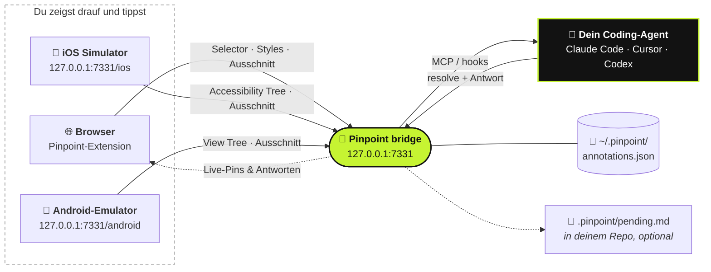

<div align="center">

#  Pinpoint

**Zeig auf deine laufende App. Sag, was sich ändern soll. Dein Coding-Agent bekommt es.**

[](https://github.com/gowtham012/pinpoint/actions/workflows/test.yml)
[](https://www.npmjs.com/package/pinpoint-bridge)
[](../../LICENSE)
[](https://glama.ai/mcp/servers/gowtham012/pinpoint)
[](https://github.com/hesreallyhim/awesome-claude-code)
[](https://github.com/gowtham012/pinpoint/stargazers)

[English](../../README.md) ·
[తెలుగు](README.te.md) ·
[हिन्दी](README.hi.md) ·
[தமிழ்](README.ta.md) ·
[简体中文](README.zh-CN.md) ·
[日本語](README.ja.md) ·
[한국어](README.ko.md) ·
[Español](README.es.md) ·
[Français](README.fr.md) ·
**Deutsch** ·
[Português](README.pt-BR.md) ·
[Русский](README.ru.md) ·
[العربية](README.ar.md)

<sub>Dies ist eine Übersetzung; maßgeblich ist das <a href="../../README.md">englische README</a>, das auch aktueller sein kann.</sub>


<sub>Element anklicken, sagen, was sich ändern soll, dein Agent bekommt es. · <a href="../demo.mp4">Video in voller Geschwindigkeit</a></sub>

</div>

---

Klick auf ein Element deiner lokalen Dev-Site, tipp ein, was sich ändern soll, und dein Coding-Agent
bekommt es mit allem, was er braucht, um den Code zu finden: den **Selector**, den **DOM-Pfad**, die
**Computed Styles**, die **React/Vue-Komponentenkette**, einen **Hinweis auf die Quelldatei** und einen
**zugeschnittenen Screenshot**. Keine Screenshots mehr, die sich im Downloads-Ordner stapeln, kein
Beschreiben von „dem dritten Button links“.

Das funktioniert auch für **Verhalten**, nicht nur fürs Aussehen. *„Deaktivier das, bis das Formular
gültig ist“* oder *„speicher den Entwurf vor dem Schließen“* sind völlig in Ordnung: Der Agent nimmt das
Element als Startpunkt und folgt ihm dann in die Handler, den State, die API-Calls und das Backend
dahinter.

Du baust eine native App? Das Gleiche funktioniert im **[iOS Simulator](#-native-ios-apps)** und im
**[Android-Emulator](#-android-emulator)**.



## Inhalt

- [Schnellstart](#-schnellstart)
- [Benutzung](#-benutzung)
- [Im Dialog klären](#-im-dialog-klären)
- [Wie dein Agent davon erfährt](#-wie-dein-agent-davon-erfährt)
- [Native iOS-Apps](#-native-ios-apps)
- [Android-Emulator](#-android-emulator)
- [Andere Agents anbinden](#-andere-agents-anbinden)
- [Referenz](#-referenz): Befehle, MCP-Tools, was eine Notiz enthält
- [Fehlerbehebung](#-fehlerbehebung)
- [Sicherheit und Datenschutz](#-sicherheit-und-datenschutz)

## Im Vergleich

| | Wer steuert | Was der Agent bekommt |
|---|---|---|
| **Pinpoint** | **Du** zeigst drauf und sagst, was sich ändern soll | Selector, Styles, Komponentenkette, Quellhinweis, Ausschnitt |
| Playwright MCP, Computer-Use | Der Agent navigiert und klickt | Was auch immer er beim Browsen findet |
| Ein eingefügter Screenshot | Du | Nur Pixel, also rät er, welches Control du gemeint hast |

Pinpoint fasst die Seite selbst nie an. Es ergänzt Browser-Automatisierung also, statt mit ihr zu
konkurrieren: Du zeigst auf die Stelle, der Agent ändert den Code, und deine Tests steuern den Browser.

## 🚀 Schnellstart

**Du brauchst** Node 18+ und einen Chromium-Browser (Chrome, Edge, Brave, Arc, Opera, Vivaldi) oder
[Firefox 140+](#-browser).

**1. Installieren**

```bash
git clone https://github.com/gowtham012/pinpoint
node pinpoint/bridge/cli.js setup
```

`setup` stellt ein paar Fragen. Jede hat einen Standardwert, du kannst also einfach durchgehend Enter
drücken. Es richtet Claude Code, Cursor und Codex ein (je nachdem, was du hast), installiert die
Claude-Code-Hooks und startet die Bridge.

**2. Extension laden.** Chrome erlaubt es keinem Terminal, eine Extension in dein Profil zu laden.
Deshalb öffnet setup die Extensions-Seite und kopiert dir den Ordnerpfad: Schalte **Developer mode**
(Entwicklermodus) ein, klick auf **Load unpacked** (Entpackte Erweiterung laden) und füg den Pfad ein.
Das Terminal bestätigt **✓ Pinpoint is live in Chrome** von selbst.

**3. Claude Code einmal neu starten**, damit es den neuen MCP-Server und die Hooks einliest.

**Ausprobieren:** Öffne deine Dev-Site (oder [die Demo-Seite](#eine-seite-zum-ausprobieren)), drück
**⌥⇧A** / **Alt+Shift+A**, klick auf ein Element, tipp ein, was sich ändern soll, dann **⌘↩** /
**Ctrl+Enter**. Schreib irgendetwas in Claude Code, und deine Notiz kommt mit.

> [!TIP]
> Du willst jeden Schritt ausführlich? Siehe [docs/quick-install.md](../quick-install.md).
> Du baust nur eine native iOS- oder Android-App? Dann spar dir das Klonen:
> `npx -y pinpoint-bridge`, danach `claude mcp add pinpoint -s user -- npx -y pinpoint-bridge mcp`.

<details>
<summary><b>Setup im Detail, Einrichtung von Hand, Windows und <code>file://</code></b></summary>

`setup` fragt:

- **für welches Projekt du die UI annotieren willst**: das Repo, das dein Agent bearbeiten wird
- **Web-App, native iOS-App, Android-App oder beides** (Web und iOS): Web bekommt die
  Browser-Extension, iOS den [Simulator-Picker](#-native-ios-apps), Android den
  [Emulator-Picker](#-android-emulator). Setup prüft, ob Xcode, Maestro und Java (iOS) bzw. adb
  (Android) vorhanden sind, und sagt dir, wie du an das Fehlende kommst (es installiert selbst nichts
  davon).
- **welche Agents eingerichtet werden sollen**: `claude mcp add` für Claude Code,
  `<project>/.cursor/mcp.json` für Cursor, `~/.codex/config.toml` für Codex. Bestehende Einträge werden
  zusammengeführt, nie ersetzt, und die TOML-Datei wird vorher gesichert.
- **ob die Claude-Code-Hooks installiert werden sollen**, die offene Notizen mit deiner nächsten
  Nachricht mitschicken
- **in welchen Browser** die Extension geladen werden soll (nur die, die du installiert hast)

Danach registriert es den Launcher hinter dem **Start bridge**-Button im Popup und startet die Bridge.
Nicht-interaktiv: `node pinpoint/bridge/cli.js setup ~/code/my-app --yes` (ergänze `--for ios`,
`--for android` oder `--for both`; Standard ist `web`).

**Von Hand.** Die Reihenfolge ist wichtig: `$PWD` wird fest in den MCP-Eintrag geschrieben, deshalb
läuft Schritt 2 aus `pinpoint/bridge`, bevor die Bridge das Terminal übernimmt.

```bash
# 1. get it
git clone https://github.com/gowtham012/pinpoint
cd pinpoint/bridge && npm install

# 2. wire up Claude Code (once, from this folder)
claude mcp add pinpoint -s user -- node "$PWD/cli.js" mcp
node cli.js install-hooks ~/code/my-app                  # notes arrive without being asked
node cli.js install-native-host --project ~/code/my-app   # optional: the popup's "Start bridge" button

# 3. load extension/ unpacked at chrome://extensions (Developer mode on)
# 4. start the bridge, and leave it running
node cli.js --project ~/code/my-app
```

`--project` ist optional: Damit bleibt `<repo>/.pinpoint/pending.md` aktuell, für Agents, die eine Datei
lesen statt MCP zu nutzen.

**`file://`-Seiten.** Chrome sperrt sie standardmäßig: `chrome://extensions` → Pinpoint → **Details** →
**Allow access to file URLs** (Zugriff auf Datei-URLs zulassen), dann neu laden.

**Windows.** `$PWD` funktioniert in PowerShell und Git Bash, aber nicht in `cmd.exe`. Führ
`node cli.js --help` aus und kopier die ausgegebene Zeile `claude mcp add …`, die den vollständigen Pfad
enthält. `install-native-host` gibt es nur für macOS und Linux; unter Windows startest du die Bridge in
einem Terminal.

**Außerdem gelistet** in der [offiziellen MCP Registry](https://registry.modelcontextprotocol.io)
(`io.github.gowtham012/pinpoint`), auf [cursor.directory](https://cursor.directory/plugins/pinpoint)
(mit einem Klick über **Add to Cursor**) und bei [Glama](https://glama.ai/mcp/servers/gowtham012/pinpoint).
Diese installieren nur den MCP-Server; für Webseiten brauchst du trotzdem Extension und Bridge.
</details>

## 🖱️ Benutzung

Solange die Bridge läuft, sitzt eine kleine Leiste oben rechts auf deiner Seite.

| | | |
|---|---|---|
|  |  |  |
| Zeigt den Shortcut und leuchtet, während dein Agent arbeitet. | Schrumpft nach ein paar Sekunden zu einem Punkt. Hover drüber, dann kommt sie zurück. | Auswahlmodus. Die Leiste lässt Klicks durch, damit sie dein Ziel nie verdeckt. |

1. Klick auf die Leiste (oder **⌥⇧A** / **Alt+Shift+A**), um mit dem Markieren zu beginnen.
2. Klick auf ein Element oder **zieh** einen Rahmen um eine Gruppe (*„diese Cards auf Mobile zweispaltig“*).
3. Tipp ein, was sich ändern soll, und drück **⌘↩** / **Ctrl+Enter**. Schon bist du bereit für die nächste.
4. **Esc** oder **Stop**, wenn du fertig bist.

<table>
<tr>
<td width="50%"></td>
<td width="50%"></td>
</tr>
<tr>
<td>Das Popover benennt genau, was du ausgewählt hast, sodass zwei fast identische Buttons nicht verwechselt werden können.</td>
<td>Ein nummerierter Pin klebt am Element. Er übersteht Reloads, erscheint in jedem Tab mit dieser Seite und verschwindet, wenn der Agent fertig ist.</td>
</tr>
</table>

- **Leiste verschieben:** Zieh sie am Griff an eine beliebige Stelle der Seite; dort bleibt sie für diese Site.
- **Der Zähler** auf der Leiste listet alles auf, was auf dieser Seite markiert ist. Klick auf eine Zeile, um hinzuspringen.
- **Das ×** blendet die Leiste für diese Site aus; über das Toolbar-Popup holst du sie zurück.
- **Pins folgen ihrem Element** auch in Apps, die ihr DOM neu aufbauen, und verstecken sich lieber, als
  auf dem falschen Element zu sitzen, wenn ihres weg ist.
- **Keine Bridge aktiv?** Dann kopiert **Send** stattdessen einen fertigen Prompt zum Einfügen, damit
  nichts verloren geht.
- **Record steps** (Schritte aufzeichnen). Drück im Auswahlmodus **Record steps** auf der Leiste und
  klick dich ganz normal durch den Bug. Die Klicks kommen weiterhin bei der Seite an, und jeder wird zu
  einem Schritt (Element, Label, URL, ein kleiner Ausschnitt), auch über Navigationen im selben Tab
  hinweg. **Done** schreibt eine Notiz (höchstens 10 Schritte); **Esc** verwirft die Aufzeichnung. Dein
  Agent bekommt sie als *Steps to reproduce*.
- **Diktieren.** Drück auf das Mikrofon im Kommentarfeld und sprich; der Text wird an das angehängt, was
  du getippt hast. Chrome und Safari auf sicheren Seiten (localhost zählt dazu); die Transkription
  übernimmt der eigene Spracherkennungsdienst des Browsers. Nicht unter Firefox.
- **Was schiefging, kommt mit.** Jede Notiz enthält die nicht abgefangenen Fehler und fehlgeschlagenen
  Requests der Seite aus der Minute, bevor du sie markiert hast, vorher schon im Browser geschwärzt
  (Query-Strings, Tokens und Secrets entfernt). Wird nur angehängt, wenn tatsächlich etwas schiefging.

**Wo es läuft.** Nur auf lokalen Entwicklungsseiten: `localhost`, `127.0.0.1`, Hosts mit `.local` /
`.test` / `.localhost` und `file://`, sobald erlaubt. Überall sonst (eine Staging-URL, eine LAN-Adresse
zum Testen am Handy) schaltest du es über das Toolbar-Popup für einen Tab ein.

## 💬 Im Dialog klären

Eine Notiz ist ein Gespräch, kein Ticket in eine Richtung.

- **Der Agent kann nachfragen.** Ist eine Anfrage mehrdeutig, fragt er, statt zu raten. Die Frage
  erscheint am Pin (ein **?**) und als Toast; antworte im Notizen-Panel, und die Notiz geht mit dem
  ganzen Gesprächsverlauf zurück.
- **Die Antwort liest du im Browser.** Eine erledigte Notiz bleibt im Panel, zusammen mit der eigenen
  Notiz des Agents dazu, was er geändert hat. Agents müssen eine schreiben: „erledigt“ ist keine Antwort.
- **Accept / Not quite** (Annehmen / Nicht ganz). Wenn der Agent fertig ist, zeigt eine Karte seine
  Antwort mit **Accept** und **Not quite**. Not quite öffnet die Notiz wieder, damit du sagen kannst, was
  noch nicht stimmt.
- **Später doch nicht ganz richtig?** Jede erledigte Notiz im Panel hat **Reply…** (Antworten…). Sag,
  was noch nicht stimmt, und sie wird wieder geöffnet.
- **Before / After** (Vorher / Nachher). Ein paar Sekunden nachdem eine Notiz erledigt wurde, nimmt
  Pinpoint einen frischen Ausschnitt des Elements auf. Erledigte Notizen im Panel zeigen **Before** und
  **After** nebeneinander.
- **Entwürfe.** **Draft** (Entwurf, oder **⇧⌘↩**) markiert etwas, ohne es abzuschicken. **Send** auf der
  Leiste übergibt alle Entwürfe auf einmal.
- **Die ganze Seite.** Im Auswahlmodus erstellt **Whole page** (Ganze Seite) eine Notiz zur Seite selbst
  (*„der Abstand wirkt überall gedrängt“*), mit Screenshot.


**Wenn sich die Seite unter einem Pin verändert**, erfährt der Agent, dass das Element veraltet sein
könnte, statt einen inzwischen ungültigen Selector zu bekommen. `recheck_annotation` schaut sofort noch
einmal nach und liefert einen frischen Ausschnitt neben dem ursprünglichen.


<sub>Dieselben zwei Notizen, zweimal. Das Panel wird komplett neu aufgebaut: Notiz 1 findet ihr Element zwischen brandneuen Nodes wieder, Notiz 2 gibt zu, dass es in dieser Ansicht nicht vorhanden ist.</sub>

<details>
<summary><b>Die Bridge aus dem Browser starten, und mehrere Agents gleichzeitig</b></summary>

**Start / Neustart aus dem Browser.** `install-native-host` registriert einen winzigen Launcher bei
Chrome (sowie Brave, Edge, Arc, Chromium, Vivaldi, Opera) und Firefox. Danach funktioniert **Start bridge** im
Popup, und das **↻** auf der Leiste startet die Bridge neu, nachdem du einen neuen Build gezogen hast.
Der Launcher kann genau eine Sache: das `cli.js` aus diesem Repo auf einem Port ausführen, der aus der
Popup-Einstellung kommt, niemals von der Seite.

**Mehrere Agents.** Agents stellen sich über MCP vor, daher nennt die Leiste den, der gerade arbeitet
(`claude-code`, `cursor-vscode`, `codex`), und jede Antwort wird zugeordnet. `wait_for_annotation` gibt
jede neue Notiz an genau einen wartenden Agent, sodass sich zwei Agents die Queue teilen, statt dieselbe
Notiz doppelt zu bearbeiten.
</details>

## 🔔 Wie dein Agent davon erfährt

Drei Wege, der stärkste zuerst. Alle drei gleichzeitig zu nutzen ist kein Problem.

| | Wie | Setup |
|---|---|---|
| **Hooks** (automatisch) | Offene Notizen reisen mit deiner nächsten Nachricht mit. Gibt nichts aus, wenn nichts offen ist. | `node cli.js install-hooks <repo>` (macht setup für dich) |
| **MCP** (auf Anfrage) | Der Server weist den Agent an nachzusehen, sobald du über eine UI- oder Feature-Änderung sprichst. | der MCP-Eintrag |
| **Watch-Loop** (ohne Zutun) | Sag *„watch pinpoint and apply each change as it comes in“*; jede Notiz kommt in dem Moment an, in dem du auf Send drückst. | nichts |

Der Kommentar ist die Anweisung, und er kann sich darauf beziehen, wie etwas **aussieht** oder was es
**tut**. Je mehr du über das gewünschte Ergebnis sagst (*„soll“*, *„statt“*, *„wenn … dann …“*), desto
weniger muss der Agent raten.

## 📱 Native iOS-Apps

Eine native App hat kein DOM, deshalb liest dieser Weg den **Accessibility Tree**. Das funktioniert für
SwiftUI-, UIKit-, React-Native- und Flutter-Apps, ohne dass du deiner App etwas hinzufügen musst.

<table>
<tr>
<td width="50%"></td>
<td width="50%"></td>
</tr>
</table>

**Du brauchst** Xcode mit einem gebooteten Simulator und [Maestro](https://maestro.dev) (das Java
benötigt; ein `openjdk` aus Homebrew wird auch gefunden, wenn es nicht in deinem PATH liegt).

Öffne bei laufender Bridge **http://127.0.0.1:7331/ios** (setup öffnet es für dich). Hover, um jedes
Element zu sehen, klick eins an, tipp, **⌘↩**. Der Agent bekommt den `accessibilityIdentifier` (deine
`testID`), das Label, den Tree-Pfad, den Frame und einen Ausschnitt. Drück **R**, nachdem sich die App
verändert hat.

**Keine App zur Hand?** `bash demo/ios/run.sh` baut **Trailhead**, eine SwiftUI-Demo mit einem einzigen
Screen, nur mit `swiftc` und startet sie im gebooteten Simulator.

<details>
<summary><b>Einschränkungen und Timing</b></summary>

Es gibt keinen Quelldatei-Hinweis und keine Komponentenkette (der Tree hat beides nicht; gib Elementen
einen Identifier, dann greppt der Agent danach), keine Styles und kein `recheck_annotation`. Der erste
Ladevorgang dauert ~10 s, während Maestro seinen On-Device-Treiber startet; danach braucht jeder Refresh
etwa eine Sekunde. Alle Maestro-Instanzen auf deinem Mac teilen sich einen Treiber. Startet eine andere
ihn neu, startet die Bridge ein frisches Maestro und versucht es noch einmal. Wenn der erste Ladevorgang
Minuten dauert, schließ inaktive Claude-Code-Sessions, die den Maestro-MCP-Server geladen haben.
</details>

## 🤖 Android-Emulator

Derselbe Picker wie `/ios`, nur liest er den Android-**View-Tree** über adb. Deiner App wird nichts
hinzugefügt, und es gibt keinen Treiber zu installieren.

<table>
<tr>
<td width="50%"></td>
<td width="50%"></td>
</tr>
</table>

**Du brauchst** `adb` aus dem Android SDK (Android Studio installiert es mit) und einen laufenden
Emulator.

Öffne bei laufender Bridge **http://127.0.0.1:7331/android**. Hover, klick, tipp, abschicken. Der Agent
bekommt die `resource-id` des Elements, content-desc, Text, Klasse, seine Position im View-Tree und einen
Ausschnitt. `node bridge/cli.js setup --for android` prüft, ob adb da ist, und verweist dich auf den
Picker.

<details>
<summary><b>adb finden, und welches Gerät gelesen wird</b></summary>

Pinpoint sucht adb in `$ANDROID_HOME`, `$ANDROID_SDK_ROOT` und im Standard-SDK-Ordner von Android
Studio, danach in deinem `PATH`. Läuft genau ein Emulator, wird der verwendet. Bei mehreren, oder um ein
physisches Gerät zu lesen, setz `ANDROID_SERIAL` auf dessen Seriennummer (so, wie `adb devices` sie
auflistet) und starte die Bridge neu. Ein Handy wird nie ausgewählt, wenn du es nicht ausdrücklich
nennst. Wie bei iOS gibt es keinen Quelldatei-Hinweis, keine Styles und kein `recheck_annotation`: Gib
Views eine ID, dann greppt der Agent danach.
</details>

## 🔌 Andere Agents anbinden

Der einfachste Eintrag nutzt das veröffentlichte Paket: `npx -y pinpoint-bridge mcp`. Es spricht mit
der Bridge, die gerade läuft. Starte den Editor danach neu.

<details>
<summary><b>Cursor</b>: mit einem Klick über <a href="https://cursor.directory/plugins/pinpoint">cursor.directory</a>, oder <code>.cursor/mcp.json</code></summary>

```json
{ "mcpServers": { "pinpoint": { "command": "npx", "args": ["-y", "pinpoint-bridge", "mcp"] } } }
```
</details>

<details>
<summary><b>Codex CLI</b>: <code>~/.codex/config.toml</code></summary>

```toml
[mcp_servers.pinpoint]
command = "npx"
args = ["-y", "pinpoint-bridge", "mcp"]
```
</details>

<details>
<summary><b>Beliebiger MCP-Client über HTTP</b>, oder <b>ganz ohne MCP</b></summary>

**HTTP:** `http://127.0.0.1:7331/mcp` (Streamable HTTP, stateless). Windsurf, Cline, Continue, Zed und
Gemini CLI akzeptieren alle eine URL.

**Ohne MCP:** Starte die Bridge mit `--project <repo>`, dann hält sie `<repo>/.pinpoint/pending.md`
aktuell. Sag einem beliebigen Agent *„read .pinpoint/pending.md and apply it“*; er schließt jede Notiz
mit `node cli.js resolve <id>` ab. Oder nutz **Copy prompt** (Prompt kopieren) im Popover und füg ihn in
einen beliebigen Chat ein.

Um einen Agent an deinen Klon statt an npm zu binden, verwende den absoluten Pfad zu `cli.js` (kopier
die Zeile, die `node cli.js --help` ausgibt).
</details>

## 🌐 Browser

| Browser | Status |
|---|---|
| **Chrome, Brave, Arc, Opera, Vivaldi** | ✅ Load unpacked. In der CI auf Headless Chromium verifiziert. |
| **Edge** | ✅ Load unpacked: dasselbe Paket wie für Chrome. |
| **Firefox 140+** | ✅ Ein addons.mozilla.org-Paket, gebaut mit `bash tools/make-firefox-zip.sh`. Store-Eintrag steht noch aus. Kein Diktieren. |
| **Safari** | ✅ Gebaut mit `bash tools/make-safari.sh` (braucht Xcode). Keine Komponentenkette, kein Quellhinweis, keine Seitenfehler. |

<details>
<summary><b>Edge und Firefox</b></summary>

**Edge** nimmt das Chrome-Paket unverändert. Für **Start bridge** führ einmal
`node bridge/cli.js install-native-host --id <edge id>` aus (Edge vergibt eine eigene ID für die
Extension).

**Firefox 140+.** Bis der Eintrag auf addons.mozilla.org live ist, lädst du das Zip über
`about:debugging` → **This Firefox** → **Load Temporary Add-on**. Hat Firefox den Zugriff auf lokale
Sites zurückgehalten, drück im Popup auf **Grant access to local sites**. Führ danach einmal
`node bridge/cli.js install-native-host` für **Start bridge** aus, oder füg die Ausgabe von
`node bridge/cli.js token` ins Popup ein.
</details>

<details>
<summary><b>Was unter Safari anders ist</b></summary>

Safari akzeptiert keine entpackten Extensions, daher verpackt `tools/make-safari.sh` sie in eine kleine
macOS-App und gibt die vier Safari-Einstellungen aus, die du umstellen musst (die wichtigste,
**Develop ▸ Allow Unsigned Extensions**, wird bei jedem Beenden von Safari zurückgesetzt). Safari
unterstützt keine Content Scripts mit `"world": "MAIN"`, daher kann `inspector.js` keine React Fibers
oder Vue-Instanzen lesen: Dir fehlen die **Komponentenkette und der Quelldatei-Hinweis** sowie die
**Seitenfehler** (auch die brauchen die MAIN world). Fehlgeschlagene Requests kommen nur dort mit, wo
Safari `webRequest` unterstützt. Alles andere funktioniert. Safari hat keinen Native Host, der den Bridge-Token übergeben könnte, also fragt das Popup
einmal danach: Führ `node bridge/cli.js token` aus und füg die Ausgabe ein. Für den Mac App Store
exportiert `TEAM=<your team id> bash tools/make-safari.sh --release` einen signierten Build.
</details>

## 📚 Referenz

<details>
<summary><b>Befehle</b> (aus <code>pinpoint/bridge</code> ausführen)</summary>

```
node cli.js [start]            start the bridge (default command)
node cli.js mcp                run as a stdio MCP server
node cli.js status             is it running? how many pending?
node cli.js print              pending annotations as markdown  (--consume also resolves them)
node cli.js resolve <id...> --note "what you changed"
                               mark done — the pin disappears and your note is shown as the reply
node cli.js install-hooks [dir]  wire up Claude Code
node cli.js install-native-host   let the popup's "Start bridge" button start the bridge
                               (--uninstall removes it; --id <id> allows a second checkout)
node cli.js token              print the extension token (Safari asks for it once)
node cli.js clear              delete everything
node cli.js --help

http://127.0.0.1:7331/ios      the iOS Simulator picker, served by the running bridge
http://127.0.0.1:7331/android  the Android emulator picker (needs adb)

--port <n>       default 7331, or $PINPOINT_PORT (set the same number in the popup)
--project <dir>  mirror pending annotations into <dir>/.pinpoint/
--print          echo each new annotation to stdout as it arrives
$PINPOINT_HOME   where annotations are stored (default ~/.pinpoint)
$PINPOINT_AFTER_DELAY  ms after a resolve before the After crop (default 3000, 0 turns it off)
$ANDROID_SERIAL  which Android device to read, when it isn't the one running emulator
```
</details>

<details>
<summary><b>MCP-Tools</b></summary>

| Tool | Zweck |
|---|---|
| `get_pending_annotations` | alles Offene als Markdown-Taskliste, jeweils mit Screenshot |
| `list_annotations` | eine Zeile pro Annotation |
| `get_annotation` | alle Details + Screenshot für eine ID oder Pin-Nummer |
| `recheck_annotation` | das Element in der Live-Seite neu finden und melden, was sich geändert hat, mit frischem Ausschnitt neben dem ursprünglichen |
| `resolve_annotation` | als erledigt markieren → der Pin verschwindet im Browser innerhalb einer Sekunde |
| `reply_annotation` | dem Entwickler eine Frage stellen statt zu raten; seine Antwort kommt als offen zurück, mit dem Gesprächsverlauf |
| `wait_for_annotation` | blockieren, bis der Entwickler die nächste schickt |
| `clear_annotations` | alles löschen |

Resource: `pinpoint://pending` (Markdown).
</details>

<details>
<summary><b>Was eine Notiz enthält</b></summary>

```
comment          "make this full-width on mobile"          ← the only instruction
page             url, title, viewport, scroll
element          tag, id, classes, a CSS selector built from stable attributes where they exist
                 (`button[data-action="next"]` rather than `:nth-of-type(2)`; shadow DOM via
                 "host >>> inner"), DOM path, rendered text, trimmed outerHTML, role/aria/data-*
                 attributes, bounding box, ~25 computed style properties, and a fingerprint
                 (tag + text + key attributes) used to verify a pin is still on the right element
source           framework (react/vue/svelte/angular/astro), component chain,
                 file:line where the dev build exposes it
screenshot       PNG of just the element (+8px), long edge ≤1200px
context          only when something went wrong: uncaught errors and failed requests from the
                 minute before, redacted in the browser
steps            recorded notes only: up to 10 clicks, each with selector, label, URL and a crop
after            on done notes: a fresh crop taken after the resolve
```

Aus dem iOS Simulator enthält `element` stattdessen den Accessibility Identifier, Label, Text, Wert,
Tree-Pfad und Frame; `source` ist `ios-native` und `page.url` ist `ios-simulator://<device name>`. Aus
dem Android-Emulator sind es `resource-id`, content-desc, Text, Klasse, Tree-Pfad und Bounds; `source`
ist `android-native` und `page.url` ist `android-emulator://<avd>`.

Für exakte `file:line`-Angaben unter React 19 oder Next füg ein reines Dev-Inspector-Plugin hinzu
(`vite-plugin-react-inspector`, `@react-dev-inspector`). Pinpoint liest deren `data-source`-Attribute,
ebenso wie `_debugSource`/`_debugStack` von React und `__file` von Vue.
</details>

## 🩺 Fehlerbehebung

<details>
<summary>Auf der Seite erscheint keine Leiste</summary>

Die Leiste erscheint nur, solange die Bridge läuft. Prüf das mit `node cli.js status` aus
`pinpoint/bridge`. Läuft die Bridge, ist die Seite wahrscheinlich keine, in die sich Pinpoint
automatisch einklinkt (siehe *Wo es läuft*): Öffne das Toolbar-Popup und schalte es für diesen Tab ein.
</details>

<details>
<summary>Auf einer <code>file://</code>-Seite passiert gar nichts</summary>

`chrome://extensions` → Pinpoint → **Details** → **Allow access to file URLs**, dann neu laden.
</details>

<details>
<summary>Der Punkt in der Toolbar wird nie grün</summary>

Die Bridge läuft nicht, oder sie läuft auf einem anderen Port: **Port** im Popup und `--port` der Bridge
müssen übereinstimmen. Meldet `node cli.js status`, dass der Port *answers, but it is NOT the pinpoint
bridge*, belegt etwas anderes den Port: Starte die Bridge mit `--port 7332` und trag 7332 im Popup ein.
</details>

<details>
<summary><code>port 7331 is already in use</code></summary>

Meistens läuft die Bridge schon in einem anderen Terminal, dann bist du fertig. Andernfalls wähl wie
oben einen freien Port. Starte nicht zwei Bridges gleichzeitig: Sie teilen sich eine Store-Datei.
</details>

<details>
<summary>Eine Notiz hat keinen Screenshot</summary>

Das Bild wird direkt nach dem Speichern deines Kommentars aufgenommen, der Kommentar geht also nie
verloren. Hat die Seite in diesem Moment navigiert oder wurde der Tab geschlossen, hält die Notiz den
Grund fest. Kommentar, Selector und Styles sind trotzdem alle da.
</details>

<details>
<summary>Claude Code erwähnt meine Notizen nicht</summary>

Hooks werden beim Start einer Session gelesen: Starte nach `install-hooks` einmal neu. Prüf, ob
`<your repo>/.claude/settings.json` zwei Einträge mit `print --hook` enthält und ob deren Pfad noch
existiert (wenn du deinen Klon verschiebst, bricht das; führ `install-hooks` erneut aus). Du kannst auch
jederzeit sagen: *„apply my pinpoint annotations“*.
</details>

<details>
<summary>„Start bridge“ meldet, dass Setup nötig ist, oder findet Node nicht</summary>

Führ `node cli.js install-native-host` einmal aus (bzw. erneut, wenn du das Repo verschoben hast), dann
beende den Browser und öffne ihn wieder. Der Launcher speichert einen absoluten Pfad zu node; wurde node
verschoben (neue nvm-Version, Homebrew-Upgrade), führ es erneut aus.
</details>

<details>
<summary>Du willst bei null anfangen</summary>

`node cli.js clear`. `~/.pinpoint/annotations.json` ist der einzige Zustand außerhalb deines Repos.
</details>

## 🔒 Sicherheit und Datenschutz

- Die Bridge lauscht nur auf `127.0.0.1` und lehnt Requests ab, die den `Origin` einer Webseite tragen.
- Die Extension muss den Token aus `~/.pinpoint/token` vorweisen.
- Alles, was von einer Seite ausgelesen wird, ist dort, wo es bei deinem Agent ankommt, als **untrusted**
  (nicht vertrauenswürdig) gekennzeichnet; nur dein getippter Kommentar wird als Anweisung präsentiert.
- Screenshots liegen in `~/.pinpoint/annotations.json`, nicht als lose Dateien.

[SECURITY.md](../../SECURITY.md) enthält die vollständigen Notizen zu den Vertrauensgrenzen (inklusive
der Begründung, warum `<all_urls>` nötig ist), und [PRIVACY.md](../../PRIVACY.md) beschreibt genau, was
erfasst wird, wo es gespeichert wird und an welchen einzigen Ort es geht: den Coding-Agent, den du
anbindest.

## Eine Seite zum Ausprobieren

`demo/index.html` ist eine in sich geschlossene Demo-Site (kein Build, kein Netzwerk) mit Card-Grids für
Bereichsauswahl per Ziehen, fast identischen Buttons, einem Tab-Panel, das sich selbst neu aufbaut, einer
dichten Tabelle und einem Formular.

```bash
cd demo && python3 -m http.server 8080     # then open http://localhost:8080
```

## 🧪 Tests

```bash
cd test && npm install && npx playwright install chromium && npm test
```

210 Tests. `bridge.test.mjs` deckt den Daemon, die CLI, die Hooks, den iOS-Picker und jedes MCP-Tool
über stdio und Streamable HTTP ab. `e2e.test.mjs` lädt die Extension in Headless Chromium und steuert
echte Seiten: React, Vue, Shadow DOM, iframes, strikte CSP, eine Stress-Seite mit 3.600 Nodes, DPR 2,
Tab-übergreifende Synchronisierung und ein Formular, das sein komplettes DOM neu aufbaut.

<details>
<summary><b>Die anderen Suites</b></summary>

| Datei | deckt ab |
|---|---|
| `android-bridge.test.mjs` | adb finden, das Gerät auswählen, den View-Tree parsen, die `/android`-Routen |
| `e2e-picker.test.mjs` | die Picker-Seiten `/ios` und `/android` in Headless Chromium |
| `ui-bridge.test.mjs`, `ui-flow.test.mjs`, `ui-after.test.mjs` | Accept, Seitenkontext, aufgezeichnete Schritte, Before / After |
| `ui-redact.test.mjs` | die Schwärzungsregeln für den Seitenkontext |
| `ship-edge.test.mjs`, `ship-firefox.test.mjs`, `e2e-ship.test.mjs` | den Edge-Upload, das Firefox-Paket und den Native Host, das Store-Zip und die Firefox-Pfade im Popup |
| `ship-windows.test.mjs` | wie setup Befehle für `cmd.exe` quotet |
</details>

Siehe [CONTRIBUTING.md](../../CONTRIBUTING.md).

## Roadmap

- Native Quellhinweise für React Native und Flutter, über ein optionales, reines Dev-Paket
- CSS-Source-Mapping über `chrome.debugger` (welche Regel diese Farbe gesetzt hat, und wo)

## Mitwirken

Issues und Pull Requests sind willkommen; siehe [CONTRIBUTING.md](../../CONTRIBUTING.md). Es gibt keinen
Build-Schritt: klonen, `npm install` in `bridge/`, `extension/` entpackt laden. Jede Verhaltensänderung
kommt mit einem Test.

## Lizenz

MIT, siehe [LICENSE](../../LICENSE). Release Notes stehen in [CHANGELOG.md](../../CHANGELOG.md).
