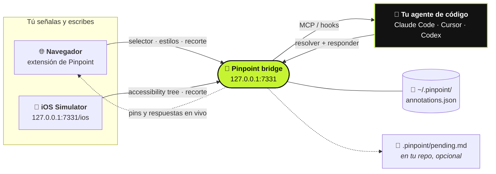

<div align="center">

# 📍 Pinpoint

**Señala tu app en ejecución. Di qué debería cambiar. Tu agente de código lo recibe.**

[](https://github.com/gowtham012/pinpoint/actions/workflows/test.yml)
[](https://www.npmjs.com/package/pinpoint-bridge)
[](../../LICENSE)
[](https://glama.ai/mcp/servers/gowtham012/pinpoint)
[](https://github.com/hesreallyhim/awesome-claude-code)
[](https://github.com/gowtham012/pinpoint/stargazers)

[English](../../README.md) ·
[తెలుగు](README.te.md) ·
[हिन्दी](README.hi.md) ·
[தமிழ்](README.ta.md) ·
[简体中文](README.zh-CN.md) ·
[日本語](README.ja.md) ·
[한국어](README.ko.md) ·
**Español** ·
[Français](README.fr.md) ·
[Deutsch](README.de.md) ·
[Português](README.pt-BR.md) ·
[Русский](README.ru.md) ·
[العربية](README.ar.md)

<sub>Esta es una traducción; el README en inglés es la referencia oficial y puede estar más actualizado.</sub>


<sub>Haz clic en un elemento, di qué debería cambiar y tu agente lo recibe. · <a href="../demo.mp4">vídeo a velocidad real</a></sub>

</div>

---

Haz clic en un elemento de tu sitio de desarrollo local, escribe qué debería cambiar, y tu agente de
código lo recibe con todo lo que necesita para encontrar el código: el **selector**, el **DOM path**,
los **computed styles**, la **cadena de componentes React/Vue**, una **pista del archivo fuente** y un
**screenshot recortado**. Nada de capturas acumulándose en Descargas, nada de describir "el tercer botón
de la izquierda".

Funciona para el **comportamiento**, no solo para el aspecto. *"Deshabilita esto hasta que el formulario
sea válido"* o *"guarda el borrador antes de cerrar"* son notas perfectamente válidas: el agente toma el
elemento como punto de partida y desde ahí sigue hasta los handlers, el estado, las llamadas a la API y
el backend que hay detrás.

¿Estás haciendo una app nativa? Lo mismo funciona en el **[iOS Simulator](#-apps-nativas-de-ios)**.



## Contenido

- [Inicio rápido](#-inicio-rápido)
- [Cómo se usa](#-cómo-se-usa)
- [Ida y vuelta con el agente](#-ida-y-vuelta-con-el-agente)
- [Cómo se entera tu agente](#-cómo-se-entera-tu-agente)
- [Apps nativas de iOS](#-apps-nativas-de-ios)
- [Conectar otros agentes](#-conectar-otros-agentes)
- [Referencia](#-referencia): comandos, herramientas MCP, qué contiene una nota
- [Solución de problemas](#-solución-de-problemas)
- [Seguridad y privacidad](#-seguridad-y-privacidad)

## Cómo se compara

| | Quién lleva el control | Qué recibe el agente |
|---|---|---|
| **Pinpoint** | **Tú** señalas y dices qué debería cambiar | Selector, estilos, cadena de componentes, pista del fuente, recorte |
| Playwright MCP, computer-use | El agente navega y hace clic | Lo que encuentre navegando |
| Un screenshot pegado | Tú | Solo píxeles, así que adivina a qué control te referías |

Pinpoint nunca toca la página en sí, así que se combina con la automatización del navegador en lugar de
competir con ella: señala la cosa, deja que el agente cambie el código y deja que tus tests controlen el
navegador.

## 🚀 Inicio rápido

**Necesitas** Node 18+ y un navegador Chromium (Chrome, Edge, Brave, Arc, Opera, Vivaldi).

**1. Instalar**

```bash
git clone https://github.com/gowtham012/pinpoint
node pinpoint/bridge/cli.js setup
```

`setup` te hace unas cuantas preguntas. Todas tienen un valor por defecto, así que basta con pulsar Enter
hasta el final. Configura Claude Code, Cursor y Codex (los que tengas), instala los hooks de Claude Code
y arranca el bridge.

**2. Carga la extensión.** Chrome no permite que una terminal cargue una extensión en tu perfil, así que
setup abre la página de extensiones y te copia la ruta de la carpeta: activa **Developer mode** (modo de
desarrollador), haz clic en **Load unpacked** (cargar descomprimida) y pega. La terminal confirma
**✓ Pinpoint is live in Chrome** por sí sola.

**3. Reinicia Claude Code una vez**, para que lea el nuevo servidor MCP y los hooks.

**Pruébalo:** abre tu sitio de desarrollo (o [la página de demo](#una-página-para-probarlo)), pulsa
**⌥⇧A** / **Alt+Shift+A**, haz clic en un elemento, escribe qué debería cambiar y luego **⌘↩** /
**Ctrl+Enter**. Escribe lo que sea en Claude Code y tu nota llega con ello.

> [!TIP]
> ¿Quieres cada paso explicado? Consulta [docs/quick-install.md](../quick-install.md).
> ¿Solo desarrollas una app nativa de iOS? Sáltate el clone:
> `npx -y pinpoint-bridge`, y luego `claude mcp add pinpoint -s user -- npx -y pinpoint-bridge mcp`.

<details>
<summary><b>Setup en detalle, a mano, Windows y <code>file://</code></b></summary>

`setup` pregunta:

- **de qué proyecto quieres anotar la UI**: el repo que editará tu agente
- **app web, app nativa de iOS, o ambas**: la web usa la extensión del navegador; iOS usa el
  [selector del Simulator](#-apps-nativas-de-ios). Setup comprueba si tienes Xcode, Maestro y Java y te
  dice cómo conseguir lo que falte (no instala ninguno).
- **qué agentes configurar**: `claude mcp add` para Claude Code, `<project>/.cursor/mcp.json` para
  Cursor, `~/.codex/config.toml` para Codex. Las entradas existentes se fusionan, nunca se reemplazan, y
  del archivo TOML se hace una copia de seguridad antes.
- **si instalar los hooks de Claude Code**, que traen las notas pendientes junto con tu siguiente mensaje
- **en qué navegador** cargar la extensión (solo los que tengas)

Después registra el launcher que hay detrás del botón **Start bridge** del popup y arranca el bridge.
Modo no interactivo: `node pinpoint/bridge/cli.js setup ~/code/my-app --yes` (añade `--for ios` o
`--for both`; por defecto es `web`).

**A mano.** El orden importa: `$PWD` queda fijado en la entrada MCP, así que el paso 2 se ejecuta desde
`pinpoint/bridge` antes de que el bridge ocupe la terminal.

```bash
# 1. get it
git clone https://github.com/gowtham012/pinpoint
cd pinpoint/bridge && npm install

# 2. wire up Claude Code (once, from this folder)
claude mcp add pinpoint -s user -- node "$PWD/cli.js" mcp
node cli.js install-hooks ~/code/my-app                  # notes arrive without being asked
node cli.js install-native-host --project ~/code/my-app   # optional: the popup's "Start bridge" button

# 3. load extension/ unpacked at chrome://extensions (Developer mode on)
# 4. start the bridge, and leave it running
node cli.js --project ~/code/my-app
```

`--project` es opcional: mantiene `<repo>/.pinpoint/pending.md` al día para los agentes que leen un
archivo en lugar de usar MCP.

**Páginas `file://`.** Chrome las tiene desactivadas por defecto: `chrome://extensions` → Pinpoint →
**Details** → **Allow access to file URLs**, y luego recarga.

**Windows.** `$PWD` funciona en PowerShell y Git Bash, pero no en `cmd.exe`; ejecuta `node cli.js --help`
y copia la línea `claude mcp add …` que imprime, que lleva la ruta completa. `install-native-host` es solo
para macOS y Linux; en Windows, arranca el bridge en una terminal.

**También aparece en** el [MCP Registry oficial](https://registry.modelcontextprotocol.io)
(`io.github.gowtham012/pinpoint`), [cursor.directory](https://cursor.directory/plugins/pinpoint)
(**Add to Cursor** con un clic) y [Glama](https://glama.ai/mcp/servers/gowtham012/pinpoint). Esos
instalan solo el servidor MCP; las páginas web siguen necesitando la extensión y el bridge.
</details>

## 🖱️ Cómo se usa

Mientras el bridge está en marcha, aparece una pequeña barra en la esquina superior derecha de tu página.

| | | |
|---|---|---|
|  |  |  |
| Muestra el atajo y se ilumina mientras tu agente trabaja. | Se reduce a un punto tras unos segundos. Pasa el ratón por encima para recuperarla. | Seleccionando. La barra deja pasar los clics para no tapar nunca tu objetivo. |

1. Haz clic en la barra (o **⌥⇧A** / **Alt+Shift+A**) para empezar a marcar.
2. Haz clic en un elemento, o **arrastra** un recuadro alrededor de un grupo (*"pon estas cards de dos en dos en móvil"*).
3. Escribe qué debería cambiar y pulsa **⌘↩** / **Ctrl+Enter**. Ya puedes ir a por el siguiente.
4. **Esc** o **Stop** (detener) cuando termines.

<table>
<tr>
<td width="50%"></td>
<td width="50%"></td>
</tr>
<tr>
<td>El popover nombra exactamente lo que seleccionaste, así que dos botones casi idénticos no se pueden confundir.</td>
<td>Un pin numerado se queda pegado al elemento. Sobrevive a las recargas, se muestra en todas las pestañas de esa página y desaparece cuando el agente termina.</td>
</tr>
</table>

- **Mueve la barra** arrastrando su asa a cualquier parte de la página; se queda ahí para ese sitio.
- **El contador** de la barra lista todo lo marcado en esta página. Haz clic en una fila para saltar a ello.
- **La ×** oculta la barra para ese sitio; el popup de la barra de herramientas la recupera.
- **Los pins siguen a su elemento** en apps que reconstruyen su DOM, y se ocultan en lugar de quedarse
  sobre el elemento equivocado cuando el suyo ya no está.
- **¿No hay bridge en marcha?** **Send** (enviar) copia en su lugar un prompt listo para pegar, así que no
  se pierde nada.

**Dónde funciona.** Solo en páginas de desarrollo local: `localhost`, `127.0.0.1`, hosts `.local` /
`.test` / `.localhost`, y `file://` una vez permitido. En cualquier otro sitio (una URL de staging, una
dirección de la LAN para probar en el móvil) el popup de la barra de herramientas lo activa para una pestaña.

## 💬 Ida y vuelta con el agente

Una nota es una conversación, no un ticket de ida.

- **El agente puede preguntarte.** Si una petición es ambigua, pregunta en lugar de adivinar. La pregunta
  aparece en el pin (un **?**) y como toast; responde en el panel de notas y la nota vuelve con toda la
  conversación.
- **Lees la respuesta en el navegador.** Una nota terminada se queda en el panel con la nota del propio
  agente sobre lo que cambió. Los agentes están obligados a escribirla: "hecho" no es una respuesta.
- **¿No quedó del todo bien?** Cada nota terminada tiene **Reply…** (responder). Di qué sigue mal y se
  vuelve a abrir.
- **Borradores.** **Draft** (borrador) (o **⇧⌘↩**) marca algo sin enviarlo. **Send** en la barra entrega
  todos los borradores de una vez.
- **La página entera.** Mientras seleccionas, **Whole page** (página entera) crea una nota sobre la propia
  página (*"el espaciado se siente apretado por todas partes"*), con un screenshot.


**Cuando la página cambia bajo un pin**, al agente se le avisa de que el elemento puede estar obsoleto en
lugar de pasarle un selector que ya no sirve. `recheck_annotation` vuelve a mirar en ese momento y
devuelve un recorte nuevo junto al original.


<sub>Las mismas dos notas, dos veces. El panel se reconstruye desde cero: la nota 1 vuelve a encontrar su elemento entre nodos completamente nuevos, la nota 2 admite que no está en esta vista.</sub>

<details>
<summary><b>Arrancar el bridge desde el navegador, y varios agentes a la vez</b></summary>

**Arrancar / reiniciar desde el navegador.** `install-native-host` registra un launcher diminuto en Chrome
(y en Brave, Edge, Arc, Chromium, Vivaldi, Opera). Así funciona el botón **Start bridge** del popup, y el
**↻** de la barra reinicia el bridge después de hacer pull de una nueva build. El launcher solo puede
hacer una cosa: ejecutar el propio `cli.js` de este repo en un número de puerto tomado de la
configuración del popup, nunca de la página.

**Varios agentes.** Los agentes se presentan por MCP, así que la barra nombra al que está trabajando
(`claude-code`, `cursor-vscode`, `codex`) y cada respuesta queda atribuida. `wait_for_annotation` entrega
cada nota nueva a exactamente un agente en espera, así que dos agentes se reparten la cola en lugar de
hacer la misma nota.
</details>

## 🔔 Cómo se entera tu agente

Tres formas, de la más fuerte a la más débil. Usar las tres a la vez está bien.

| | Cómo | Setup |
|---|---|---|
| **Hooks** (automático) | Las notas pendientes viajan con tu siguiente mensaje. No imprime nada cuando no hay nada pendiente. | `node cli.js install-hooks <repo>` (lo hace setup) |
| **MCP** (bajo petición) | El servidor le dice al agente que compruebe cada vez que hablas de un cambio de UI o de funcionalidad. | la entrada MCP |
| **Watch loop** (manos libres) | Di *"vigila pinpoint y aplica cada cambio según llegue"*; cada nota llega en el momento en que pulsas Send. | nada |

El comentario es la instrucción, y puede tratar de cómo **se ve** algo o de lo que **hace**. Cuanto más
digas sobre el resultado (*"debería"*, *"en lugar de"*, *"cuando … entonces …"*), menos tiene que
adivinar el agente.

## 📱 Apps nativas de iOS

Una app nativa no tiene DOM, así que esta vía lee el **accessibility tree** (árbol de accesibilidad).
Funciona con apps SwiftUI, UIKit, React Native y Flutter, sin añadir nada a tu app.

<table>
<tr>
<td width="50%"></td>
<td width="50%"></td>
</tr>
</table>

**Necesitas** Xcode con un Simulator arrancado y [Maestro](https://maestro.dev) (que necesita Java; se
detecta un `openjdk` de Homebrew aunque no esté en tu PATH).

Con el bridge en marcha, abre **http://127.0.0.1:7331/ios** (setup te lo abre). Pasa el ratón para ver
cada elemento, haz clic en uno, escribe, **⌘↩**. El agente recibe el `accessibilityIdentifier` (tu
`testID`), la etiqueta, el tree path, el frame y un recorte. Pulsa **R** después de que cambie la app.

**¿No tienes una app a mano?** `bash demo/ios/run.sh` compila **Trailhead**, una demo SwiftUI de una sola
pantalla, solo con `swiftc`, y la lanza en el Simulator arrancado.

<details>
<summary><b>Límites y tiempos</b></summary>

No hay pista del archivo fuente ni cadena de componentes (el árbol no tiene ninguna de las dos; dales un
identificador a los elementos y el agente hará grep para encontrarlo), ni estilos, ni
`recheck_annotation`. La primera carga espera ~10 s mientras Maestro arranca su driver en el dispositivo;
después, cada refresco tarda alrededor de un segundo. Todos los Maestro de tu Mac comparten un mismo
driver, así que si otro lo reinicia, el bridge arranca un Maestro nuevo y lo intenta una vez más. Si la
primera carga tarda minutos, cierra las sesiones inactivas de Claude Code que tengan el servidor MCP de
Maestro.
</details>

## 🔌 Conectar otros agentes

La entrada más sencilla ejecuta el paquete publicado: `npx -y pinpoint-bridge mcp`. Habla con el bridge
que esté en marcha. Reinicia el editor después.

<details>
<summary><b>Cursor</b>: con un clic desde <a href="https://cursor.directory/plugins/pinpoint">cursor.directory</a>, o <code>.cursor/mcp.json</code></summary>

```json
{ "mcpServers": { "pinpoint": { "command": "npx", "args": ["-y", "pinpoint-bridge", "mcp"] } } }
```
</details>

<details>
<summary><b>Codex CLI</b>: <code>~/.codex/config.toml</code></summary>

```toml
[mcp_servers.pinpoint]
command = "npx"
args = ["-y", "pinpoint-bridge", "mcp"]
```
</details>

<details>
<summary><b>Cualquier cliente MCP por HTTP</b>, o <b>sin MCP</b></summary>

**HTTP:** `http://127.0.0.1:7331/mcp` (Streamable HTTP, stateless). Windsurf, Cline, Continue, Zed y
Gemini CLI aceptan todos una URL.

**Sin MCP:** ejecuta el bridge con `--project <repo>` y mantendrá `<repo>/.pinpoint/pending.md` al día.
Dile a cualquier agente *"lee .pinpoint/pending.md y aplícalo"*; cierra cada nota con
`node cli.js resolve <id>`. O usa **Copy prompt** (copiar prompt) en el popover y pégalo en cualquier chat.

Para fijar un agente a tu clone en lugar de a npm, usa la ruta absoluta a `cli.js` (copia la línea que
imprime `node cli.js --help`).
</details>

## 🌐 Navegadores

| Navegador | Estado |
|---|---|
| **Chrome, Edge, Brave, Arc, Opera, Vivaldi** | ✅ **Load unpacked**. Verificado en CI con Chromium headless. |
| **Safari** | ✅ Se compila con `bash tools/make-safari.sh` (necesita Xcode). Sin cadena de componentes ni pista del fuente. |
| **Firefox** | ⏳ Todavía no. |

<details>
<summary><b>Qué cambia en Safari</b></summary>

Safari no acepta extensiones descomprimidas, así que `tools/make-safari.sh` la envuelve en una pequeña app
de macOS e imprime los cuatro ajustes de Safari que hay que activar (el clave, **Develop ▸ Allow Unsigned
Extensions**, se restablece cada vez que cierras Safari). Safari no soporta content scripts con
`"world": "MAIN"`, así que `inspector.js` no puede leer los fibers de React ni las instancias de Vue:
pierdes la **cadena de componentes y la pista del archivo fuente**. Todo lo demás funciona. Safari no
tiene native host para pasar el token del bridge, así que el popup te lo pide una vez: ejecuta
`node bridge/cli.js token` y pega la salida. Para la Mac App Store,
`TEAM=<your team id> bash tools/make-safari.sh --release` exporta una build firmada.
</details>

## 📚 Referencia

<details>
<summary><b>Comandos</b> (se ejecutan desde <code>pinpoint/bridge</code>)</summary>

```
node cli.js [start]            start the bridge (default command)
node cli.js mcp                run as a stdio MCP server
node cli.js status             is it running? how many pending?
node cli.js print              pending annotations as markdown  (--consume also resolves them)
node cli.js resolve <id...> --note "what you changed"
                               mark done — the pin disappears and your note is shown as the reply
node cli.js install-hooks [dir]  wire up Claude Code
node cli.js install-native-host   let the popup's "Start bridge" button start the bridge
                               (--uninstall removes it; --id <id> allows a second checkout)
node cli.js token              print the extension token (Safari asks for it once)
node cli.js clear              delete everything
node cli.js --help

http://127.0.0.1:7331/ios      the iOS Simulator picker, served by the running bridge

--port <n>       default 7331, or $PINPOINT_PORT (set the same number in the popup)
--project <dir>  mirror pending annotations into <dir>/.pinpoint/
--print          echo each new annotation to stdout as it arrives
$PINPOINT_HOME   where annotations are stored (default ~/.pinpoint)
```
</details>

<details>
<summary><b>Herramientas MCP</b></summary>

| herramienta | para qué sirve |
|---|---|
| `get_pending_annotations` | todo lo pendiente como lista de tareas en markdown, cada una con su screenshot |
| `list_annotations` | una línea por anotación |
| `get_annotation` | detalle completo + screenshot de un id o número de pin |
| `recheck_annotation` | vuelve a buscar el elemento en la página en vivo e informa de qué cambió, con un recorte nuevo junto al original |
| `resolve_annotation` | marca como hecho → el pin desaparece del navegador en menos de un segundo |
| `reply_annotation` | hace una pregunta al desarrollador en lugar de adivinar; su respuesta vuelve como pendiente, con la conversación |
| `wait_for_annotation` | se bloquea hasta que el desarrollador envía la siguiente |
| `clear_annotations` | lo borra todo |

Resource: `pinpoint://pending` (markdown).
</details>

<details>
<summary><b>Qué contiene una nota</b></summary>

```
comment          "make this full-width on mobile"          ← the only instruction
page             url, title, viewport, scroll
element          tag, id, classes, a CSS selector built from stable attributes where they exist
                 (`button[data-action="next"]` rather than `:nth-of-type(2)`; shadow DOM via
                 "host >>> inner"), DOM path, rendered text, trimmed outerHTML, role/aria/data-*
                 attributes, bounding box, ~25 computed style properties, and a fingerprint
                 (tag + text + key attributes) used to verify a pin is still on the right element
source           framework (react/vue/svelte/angular/astro), component chain,
                 file:line where the dev build exposes it
screenshot       PNG of just the element (+8px), long edge ≤1200px
```

Desde el iOS Simulator, `element` lleva en su lugar el accessibility identifier, la etiqueta, el texto, el
valor, el tree path y el frame; `source` es `ios-native` y `page.url` es `ios-simulator://<device name>`.

Para tener el `file:line` exacto en React 19 o Next, añade un plugin inspector solo para desarrollo
(`vite-plugin-react-inspector`, `@react-dev-inspector`). Pinpoint lee sus atributos `data-source`, además
del `_debugSource`/`_debugStack` de React y el `__file` de Vue.
</details>

## 🩺 Solución de problemas

<details>
<summary>No aparece ninguna barra en la página</summary>

La barra solo se muestra mientras el bridge está en marcha. Comprueba `node cli.js status` desde
`pinpoint/bridge`. Si el bridge está levantado, probablemente la página no es de las que Pinpoint inyecta
automáticamente (ver *Dónde funciona*): abre el popup de la barra de herramientas y actívalo para esa pestaña.
</details>

<details>
<summary>No aparece nada en una página <code>file://</code></summary>

`chrome://extensions` → Pinpoint → **Details** → **Allow access to file URLs**, y luego recarga.
</details>

<details>
<summary>El punto de la barra de herramientas nunca se pone verde</summary>

El bridge no está en marcha, o está en otro puerto: el **Port** del popup y el `--port` del bridge tienen
que coincidir. Si `node cli.js status` dice que el puerto *answers, but it is NOT the pinpoint bridge*,
otra cosa lo está usando: arranca el bridge con `--port 7332` y pon 7332 en el popup.
</details>

<details>
<summary><code>port 7331 is already in use</code></summary>

Normalmente el bridge ya está en marcha en otra terminal, así que no tienes que hacer nada más. Si no,
elige un puerto libre como arriba. No ejecutes dos bridges a la vez: comparten un mismo archivo de
almacenamiento.
</details>

<details>
<summary>Una nota no tiene screenshot</summary>

La imagen se captura justo después de guardar tu comentario, así que el comentario nunca se pierde. Si la
página navegó o la pestaña se cerró en ese momento, la nota registra el motivo. El comentario, el selector
y los estilos siguen ahí.
</details>

<details>
<summary>Claude Code no menciona mis notas</summary>

Los hooks se leen cuando empieza una sesión: reinicia una vez después de `install-hooks`. Comprueba que
`<your repo>/.claude/settings.json` tiene dos entradas que contienen `print --hook` y que su ruta sigue
existiendo (mover tu clone la rompe; vuelve a ejecutar `install-hooks`). Siempre puedes decir *"aplica mis
anotaciones de pinpoint"*.
</details>

<details>
<summary>"Start bridge" dice que hace falta el setup, o no encuentra Node</summary>

Ejecuta `node cli.js install-native-host` una vez (y otra vez si moviste el repo), luego cierra y vuelve a
abrir el navegador. El launcher lleva fijada una ruta absoluta a node; si node se movió (nueva versión de
nvm, actualización de Homebrew), vuelve a ejecutarlo.
</details>

<details>
<summary>Quieres empezar de cero</summary>

`node cli.js clear`. `~/.pinpoint/annotations.json` es el único estado fuera de tu repo.
</details>

## 🔒 Seguridad y privacidad

- El bridge escucha solo en `127.0.0.1` y rechaza las peticiones que llevan el `Origin` de una página web.
- La extensión tiene que presentar el token de `~/.pinpoint/token`.
- Todo lo que se extrae de una página va etiquetado como **untrusted** (no fiable) cuando llega a tu
  agente; solo el comentario que escribes se presenta como instrucción.
- Los screenshots se guardan dentro de `~/.pinpoint/annotations.json`, no como archivos sueltos.

[SECURITY.md](../../SECURITY.md) tiene las notas completas sobre los límites de confianza (incluido por qué
hace falta `<all_urls>`) y [PRIVACY.md](../../PRIVACY.md) explica exactamente qué se recoge, dónde se guarda
y el único sitio al que va: el agente de código que conectes.

## Una página para probarlo

`demo/index.html` es un sitio de demo autocontenido (sin build, sin red) con rejillas de cards para
arrastrar regiones, botones casi idénticos, un panel de pestañas que se reconstruye solo, una tabla densa
y un formulario.

```bash
cd demo && python3 -m http.server 8080     # then open http://localhost:8080
```

## 🧪 Tests

```bash
cd test && npm install && npx playwright install chromium && npm test
```

152 tests. `bridge.test.mjs` cubre el daemon, la CLI, los hooks, el selector de iOS y cada herramienta MCP
por stdio y Streamable HTTP. `e2e.test.mjs` carga la extensión en Chromium headless y controla páginas
reales: React, Vue, shadow DOM, iframes, CSP estricta, una página de estrés de 3.600 nodos, DPR 2,
sincronización entre pestañas y un formulario que reconstruye todo su DOM. Consulta
[CONTRIBUTING.md](../../CONTRIBUTING.md).

## Roadmap

- Soporte para el emulador de Android
- Firefox
- Pistas de fuente nativas para React Native y Flutter, mediante un paquete opcional solo para desarrollo
- Source mapping de CSS mediante `chrome.debugger` (qué regla puso este color, y dónde)

## Cómo contribuir

Los issues y pull requests son bienvenidos; consulta [CONTRIBUTING.md](../../CONTRIBUTING.md). No hay paso de
build: haz clone, `npm install` en `bridge/`, carga `extension/` descomprimida. Cada cambio de
comportamiento viene con su test.

## Licencia

MIT, ver [LICENSE](../../LICENSE). Las notas de versión están en [CHANGELOG.md](../../CHANGELOG.md).
