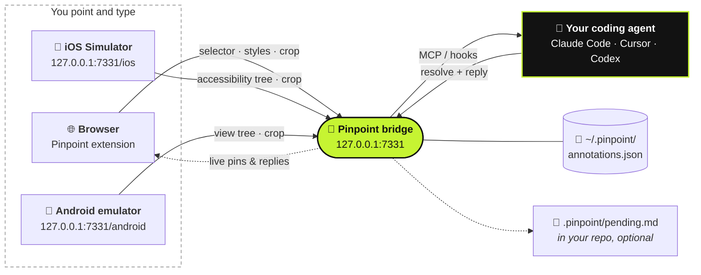

<div align="center">

#  Pinpoint

**Pointez votre app en cours d'exécution. Dites ce qui doit changer. Votre agent de code s'en charge.**

[](https://github.com/gowtham012/pinpoint/actions/workflows/test.yml)
[](https://www.npmjs.com/package/pinpoint-bridge)
[](../../LICENSE)
[](https://glama.ai/mcp/servers/gowtham012/pinpoint)
[](https://github.com/hesreallyhim/awesome-claude-code)
[](https://github.com/gowtham012/pinpoint/stargazers)

[English](../../README.md) ·
[తెలుగు](README.te.md) ·
[हिन्दी](README.hi.md) ·
[தமிழ்](README.ta.md) ·
[简体中文](README.zh-CN.md) ·
[日本語](README.ja.md) ·
[한국어](README.ko.md) ·
[Español](README.es.md) ·
**Français** ·
[Deutsch](README.de.md) ·
[Português](README.pt-BR.md) ·
[Русский](README.ru.md) ·
[العربية](README.ar.md)

<sub>Ceci est une traduction : le README en anglais fait référence et peut être plus récent.</sub>


<sub>Cliquez sur un élément, dites ce qui doit changer, votre agent s'en charge. · <a href="../demo.mp4">vidéo en vitesse réelle</a></sub>

</div>

---

Cliquez sur un élément de votre site de dev local, tapez ce qui doit changer, et votre agent de code le
reçoit avec tout ce qu'il lui faut pour trouver le code : le **selector**, le **DOM path**, les
**computed styles**, la **chaîne de composants React/Vue**, un **indice sur le fichier source** et une
**capture recadrée**. Fini les captures d'écran qui s'empilent dans Téléchargements, plus besoin de
décrire « le troisième bouton à gauche ».

Ça marche pour le **comportement**, pas seulement pour l'apparence. *« Désactive ce bouton tant que le
formulaire n'est pas valide »* ou *« enregistre le brouillon avant de fermer »* sont des notes tout à
fait valables : l'agent prend l'élément comme point de départ, puis remonte jusqu'aux handlers, au
state, aux appels d'API et au backend qui se trouvent derrière.

Vous développez une app native ? La même chose fonctionne dans le **[Simulateur iOS](#-apps-ios-natives)** et
l'**[émulateur Android](#-émulateur-android)**.



## Sommaire

- [Démarrage rapide](#-démarrage-rapide)
- [Utilisation](#-utilisation)
- [Dialoguer avec votre agent](#-dialoguer-avec-votre-agent)
- [Comment votre agent est prévenu](#-comment-votre-agent-est-prévenu)
- [Apps iOS natives](#-apps-ios-natives)
- [Émulateur Android](#-émulateur-android)
- [Connecter les autres agents](#-connecter-les-autres-agents)
- [Référence](#-référence) : commandes, outils MCP, contenu d'une note
- [Dépannage](#-dépannage)
- [Sécurité et confidentialité](#-sécurité-et-confidentialité)

## Comparaison

| | Qui pilote | Ce que reçoit l'agent |
|---|---|---|
| **Pinpoint** | **Vous** pointez et dites ce qui doit changer | Selector, styles, chaîne de composants, indice source, capture recadrée |
| Playwright MCP, computer-use | L'agent navigue et clique | Ce qu'il trouve en naviguant |
| Une capture d'écran collée | Vous | Des pixels uniquement, donc il devine de quel contrôle vous parlez |

Pinpoint ne touche jamais à la page elle-même : il se combine avec l'automatisation du navigateur au
lieu de lui faire concurrence. Pointez la chose, laissez l'agent modifier le code, laissez vos tests
piloter le navigateur.

## 🚀 Démarrage rapide

**Prérequis :** Node 18+ et un navigateur Chromium (Chrome, Edge, Brave, Arc, Opera, Vivaldi), ou
[Firefox 140+](#-navigateurs).

**1. Installer**

```bash
git clone https://github.com/gowtham012/pinpoint
node pinpoint/bridge/cli.js setup
```

`setup` pose quelques questions. Chacune a une valeur par défaut, donc appuyer sur Entrée jusqu'au bout
fonctionne. Il configure Claude Code, Cursor et Codex (ceux que vous avez), installe les hooks Claude
Code et démarre le bridge.

**2. Charger l'extension.** Chrome ne permet pas à un terminal de charger une extension dans votre
profil, donc setup ouvre la page des extensions et copie le chemin du dossier pour vous : activez
**Developer mode** (mode développeur), cliquez sur **Load unpacked** (charger l'extension non
empaquetée), collez. Le terminal confirme tout seul **✓ Pinpoint is live in Chrome**.

**3. Redémarrez Claude Code une fois**, pour qu'il prenne en compte le nouveau serveur MCP et les hooks.

**Essayez :** ouvrez votre site de dev (ou [la page de démo](#une-page-de-démo-pour-essayer)), appuyez
sur **⌥⇧A** / **Alt+Shift+A**, cliquez sur un élément, tapez ce qui doit changer, puis **⌘↩** /
**Ctrl+Enter**. Tapez n'importe quoi dans Claude Code et votre note arrive avec.

> [!TIP]
> Vous voulez chaque étape en détail ? Voir [docs/quick-install.md](../quick-install.md).
> Vous ne développez qu'une app iOS ou Android native ? Pas besoin de cloner :
> `npx -y pinpoint-bridge`, puis `claude mcp add pinpoint -s user -- npx -y pinpoint-bridge mcp`.

<details>
<summary><b>Setup en détail, installation manuelle, Windows et <code>file://</code></b></summary>

`setup` vous demande :

- **le projet dont vous voulez annoter l'UI** : le repo que votre agent va modifier
- **app web, app iOS native, app Android, ou les deux** (web et iOS) : le web utilise l'extension
  navigateur ; iOS utilise le [sélecteur du Simulateur](#-apps-ios-natives), Android le
  [sélecteur de l'émulateur](#-émulateur-android). Setup vérifie la présence de Xcode, Maestro et Java
  (iOS) ou d'adb (Android) et indique comment obtenir ce qui manque (il n'installe aucun d'eux).
- **quels agents configurer** : `claude mcp add` pour Claude Code, `<project>/.cursor/mcp.json` pour
  Cursor, `~/.codex/config.toml` pour Codex. Les entrées existantes sont fusionnées, jamais remplacées,
  et le fichier TOML est sauvegardé au préalable.
- **s'il faut installer les hooks Claude Code**, qui joignent les notes en attente à votre prochain message
- **dans quel navigateur** charger l'extension (uniquement ceux que vous avez)

Ensuite, il enregistre le lanceur derrière le bouton **Start bridge** (démarrer le bridge) de la popup
et démarre le bridge. En mode non interactif : `node pinpoint/bridge/cli.js setup ~/code/my-app --yes`
(ajoutez `--for ios`, `--for android` ou `--for both` ; la valeur par défaut est `web`).

**À la main.** L'ordre compte : `$PWD` est figé dans l'entrée MCP, donc l'étape 2 se lance depuis
`pinpoint/bridge` avant que le bridge ne prenne la main sur le terminal.

```bash
# 1. get it
git clone https://github.com/gowtham012/pinpoint
cd pinpoint/bridge && npm install

# 2. wire up Claude Code (once, from this folder)
claude mcp add pinpoint -s user -- node "$PWD/cli.js" mcp
node cli.js install-hooks ~/code/my-app                  # notes arrive without being asked
node cli.js install-native-host --project ~/code/my-app   # optional: the popup's "Start bridge" button

# 3. load extension/ unpacked at chrome://extensions (Developer mode on)
# 4. start the bridge, and leave it running
node cli.js --project ~/code/my-app
```

`--project` est optionnel : il maintient `<repo>/.pinpoint/pending.md` à jour pour les agents qui
lisent un fichier plutôt que MCP.

**Pages `file://`.** Chrome les bloque par défaut : `chrome://extensions` → Pinpoint → **Details** →
**Allow access to file URLs** (autoriser l'accès aux URL de fichier), puis rechargez.

**Windows.** `$PWD` fonctionne dans PowerShell et Git Bash mais pas dans `cmd.exe` ; lancez
`node cli.js --help` et copiez la ligne `claude mcp add …` qu'il affiche, qui contient le chemin
complet. `install-native-host` est réservé à macOS et Linux ; sous Windows, démarrez le bridge dans un
terminal.

**Également référencé sur** le [MCP Registry officiel](https://registry.modelcontextprotocol.io)
(`io.github.gowtham012/pinpoint`), [cursor.directory](https://cursor.directory/plugins/pinpoint)
(**Add to Cursor** en un clic) et [Glama](https://glama.ai/mcp/servers/gowtham012/pinpoint). Ceux-ci
n'installent que le serveur MCP ; les pages web ont toujours besoin de l'extension et du bridge.
</details>

## 🖱️ Utilisation

Tant que le bridge tourne, une petite barre se place dans le coin supérieur droit de votre page.

| | | |
|---|---|---|
|  |  |  |
| Affiche le raccourci, et s'allume pendant que votre agent travaille. | Se réduit à un point au bout de quelques secondes. Survolez-la pour la faire revenir. | Sélection en cours. La barre laisse passer les clics pour ne jamais masquer votre cible. |

1. Cliquez sur la barre (ou **⌥⇧A** / **Alt+Shift+A**) pour commencer à marquer.
2. Cliquez sur un élément, ou **faites glisser** un cadre autour d'un groupe (*« mets ces cartes par deux sur mobile »*).
3. Tapez ce qui doit changer et appuyez sur **⌘↩** / **Ctrl+Enter**. Vous pouvez enchaîner avec la suivante.
4. **Esc** ou **Stop** quand vous avez terminé.

<table>
<tr>
<td width="50%"></td>
<td width="50%"></td>
</tr>
<tr>
<td>La popover nomme exactement ce que vous avez sélectionné, donc impossible de confondre deux boutons presque identiques.</td>
<td>Un pin numéroté reste accroché à l'élément. Il survit aux rechargements, s'affiche dans chaque onglet ouvert sur cette page, et disparaît quand l'agent a terminé.</td>
</tr>
</table>

- **Déplacez la barre** en faisant glisser sa poignée n'importe où sur la page ; elle reste à cet endroit pour ce site.
- **Le compteur** de la barre liste tout ce qui a été marqué sur cette page. Cliquez sur une ligne pour y aller.
- **Le ×** masque la barre pour ce site ; la popup de la barre d'outils la fait revenir.
- **Les pins suivent leur élément** dans les apps qui reconstruisent leur DOM, et se masquent plutôt que
  de se poser sur le mauvais élément quand le leur a disparu.
- **Pas de bridge lancé ?** **Send** copie à la place un prompt prêt à coller, donc rien n'est perdu.
- **Enregistrer les étapes.** Pendant la sélection, appuyez sur **Record steps** dans la barre et
  reproduisez le bug comme d'habitude. Les clics atteignent toujours la page et chacun devient une
  étape (élément, label, URL, une petite capture recadrée), y compris à travers les navigations dans le
  même onglet. **Done** écrit une seule note (10 étapes au maximum) ; **Esc** jette l'enregistrement.
  Votre agent les reçoit sous le titre *Steps to reproduce*.
- **Dicter.** Appuyez sur le micro dans la zone de commentaire et parlez ; le texte s'ajoute à ce que
  vous avez tapé. Chrome et Safari sur les pages sécurisées (localhost compte) ; c'est le service vocal
  du navigateur lui-même qui fait la transcription. Pas sur Firefox.
- **Ce qui a planté vient avec.** Chaque note embarque les erreurs non interceptées et les requêtes en
  échec de la page dans la minute précédant le marquage, expurgées d'abord dans le navigateur (query
  strings, tokens et secrets retirés). Joint uniquement quand quelque chose a vraiment mal tourné.

**Où ça tourne.** Uniquement sur les pages de développement local : `localhost`, `127.0.0.1`, les hôtes
`.local` / `.test` / `.localhost`, et `file://` une fois autorisé. Partout ailleurs (une URL de staging,
une adresse LAN pour tester sur téléphone), la popup de la barre d'outils l'active pour un onglet.

## 💬 Dialoguer avec votre agent

Une note est une conversation, pas un ticket à sens unique.

- **L'agent peut poser des questions.** Si une demande est ambiguë, il demande au lieu de deviner. La
  question s'affiche sur le pin (un **?**) et dans un toast ; répondez dans le panneau des notes et la
  note repart avec toute la conversation.
- **Vous lisez la réponse dans le navigateur.** Une note terminée reste dans le panneau avec la note de
  l'agent sur ce qu'il a modifié. Les agents doivent en écrire une : « done » n'est pas une réponse.
- **Accept / Not quite.** Quand l'agent a terminé, une carte affiche sa réponse avec **Accept**
  (accepter) et **Not quite** (pas tout à fait). Not quite rouvre la note pour que vous puissiez dire
  ce qui ne va toujours pas.
- **Pas tout à fait ça, plus tard ?** Chaque note terminée dans le panneau a un bouton **Reply…**
  (répondre). Dites ce qui ne va toujours pas et elle se rouvre.
- **Before / After.** Quelques secondes après la résolution d'une note, Pinpoint prend une nouvelle
  capture recadrée de l'élément. Les notes terminées du panneau affichent **Before** (avant) et
  **After** (après) côte à côte.
- **Brouillons.** **Draft** (brouillon, ou **⇧⌘↩**) marque quelque chose sans l'envoyer. **Send** sur la
  barre transmet tous les brouillons d'un coup.
- **La page entière.** Pendant la sélection, **Whole page** (page entière) crée une note sur la page
  elle-même (*« l'espacement paraît trop serré partout »*), avec une capture d'écran.


**Quand la page bouge sous un pin**, l'agent est prévenu que l'élément est peut-être obsolète au lieu de
recevoir un selector devenu invalide. `recheck_annotation` réexamine la page sur-le-champ et renvoie
une nouvelle capture recadrée à côté de l'originale.


<sub>Les deux mêmes notes, deux fois. Le panneau est reconstruit de zéro : la note 1 retrouve son élément parmi des nœuds tout neufs, la note 2 reconnaît qu'il n'est pas sur cette vue.</sub>

<details>
<summary><b>Démarrer le bridge depuis le navigateur, et plusieurs agents à la fois</b></summary>

**Démarrer / redémarrer depuis le navigateur.** `install-native-host` enregistre un minuscule lanceur
auprès de Chrome (ainsi que Brave, Edge, Arc, Chromium, Vivaldi, Opera) et de Firefox. Le bouton **Start bridge** de
la popup fonctionne alors, et le **↻** de la barre redémarre le bridge après que vous avez récupéré un
nouveau build. Le lanceur ne sait faire qu'une chose : exécuter le propre `cli.js` de ce repo sur un
numéro de port issu du réglage de la popup, jamais de la page.

**Plusieurs agents.** Les agents se présentent via MCP, donc la barre affiche celui qui travaille
(`claude-code`, `cursor-vscode`, `codex`) et chaque réponse lui est attribuée. `wait_for_annotation`
confie chaque nouvelle note à un seul agent en attente, donc deux agents se partagent la file au
lieu de traiter la même note.
</details>

## 🔔 Comment votre agent est prévenu

Trois façons, de la plus robuste à la moins robuste. Utiliser les trois à la fois ne pose aucun problème.

| | Comment | Configuration |
|---|---|---|
| **Hooks** (automatique) | Les notes en attente accompagnent votre prochain message. N'affiche rien quand rien n'est en attente. | `node cli.js install-hooks <repo>` (setup s'en charge) |
| **MCP** (à la demande) | Le serveur demande à l'agent de vérifier dès que vous parlez d'un changement d'UI ou de fonctionnalité. | l'entrée MCP |
| **Watch loop** (sans intervention) | Dites *« watch pinpoint and apply each change as it comes in »* ; chaque note arrive dès que vous cliquez sur Send. | rien |

Le commentaire est l'instruction, et il peut porter sur l'**apparence** de quelque chose ou sur ce qu'il
**fait**. Plus vous décrivez le résultat attendu (*« devrait »*, *« au lieu de »*, *« quand … alors … »*),
moins l'agent devine.

## 📱 Apps iOS natives

Une app native n'a pas de DOM, donc ce chemin lit l'**arbre d'accessibilité**. Ça fonctionne avec les
apps SwiftUI, UIKit, React Native et Flutter, sans rien ajouter à votre app.

<table>
<tr>
<td width="50%"></td>
<td width="50%"></td>
</tr>
</table>

**Prérequis :** Xcode avec un Simulateur démarré et [Maestro](https://maestro.dev) (qui a besoin de
Java ; un `openjdk` Homebrew est trouvé même s'il n'est pas dans votre PATH).

Avec le bridge lancé, ouvrez **http://127.0.0.1:7331/ios** (setup l'ouvre pour vous). Survolez pour voir
chaque élément, cliquez sur l'un d'eux, tapez, **⌘↩**. L'agent reçoit l'`accessibilityIdentifier`
(votre `testID`), le label, le chemin dans l'arbre, le frame et une capture recadrée. Appuyez sur **R**
après une modification de l'app.

**Pas d'app sous la main ?** `bash demo/ios/run.sh` compile **Trailhead**, une démo SwiftUI d'un seul
écran, avec `swiftc` uniquement, et la lance sur le Simulateur démarré.

<details>
<summary><b>Limites et temps de réponse</b></summary>

Il n'y a ni indice sur le fichier source ni chaîne de composants (l'arbre ne contient ni l'un ni
l'autre ; donnez un identifiant à vos éléments et l'agent le cherchera avec grep), pas de styles, et pas
de `recheck_annotation`. Le premier chargement attend ~10 s le temps que Maestro démarre son driver sur
l'appareil ; ensuite, chaque rafraîchissement prend environ une seconde. Toutes les instances de Maestro
sur votre Mac partagent un seul driver, donc si une autre le redémarre, le bridge lance un nouveau
Maestro et réessaie une fois. Si le premier chargement prend plusieurs minutes, fermez les sessions
Claude Code inactives qui ont le serveur MCP Maestro.
</details>

## 🤖 Émulateur Android

Le même sélecteur que `/ios`, qui lit l'**arbre des vues** Android via adb. Rien n'est ajouté à votre
app et il n'y a aucun driver à installer.

<table>
<tr>
<td width="50%"></td>
<td width="50%"></td>
</tr>
</table>

**Prérequis :** `adb` du SDK Android (Android Studio l'installe) et un émulateur lancé.

Avec le bridge lancé, ouvrez **http://127.0.0.1:7331/android**. Survolez, cliquez, tapez, envoyez.
L'agent reçoit le `resource-id` de l'élément, son content-desc, son texte, sa classe, sa place dans
l'arbre des vues et une capture recadrée. `node bridge/cli.js setup --for android` vérifie la présence
d'adb et vous oriente vers le sélecteur.

<details>
<summary><b>Trouver adb, et quel appareil est lu</b></summary>

Pinpoint cherche adb dans `$ANDROID_HOME`, `$ANDROID_SDK_ROOT` et le dossier SDK par défaut d'Android
Studio, puis dans votre `PATH`. Avec un seul émulateur lancé, c'est celui-là qui est utilisé. S'il y en
a plusieurs, ou pour lire un appareil physique, définissez `ANDROID_SERIAL` avec son numéro de série
(tel que `adb devices` l'affiche) et redémarrez le bridge. Un téléphone n'est jamais choisi sans que
vous le nommiez. Comme pour iOS, il n'y a ni indice sur le fichier source, ni styles, ni
`recheck_annotation` : donnez un id à vos vues et l'agent le cherchera avec grep.
</details>

## 🔌 Connecter les autres agents

L'entrée la plus simple exécute le package publié : `npx -y pinpoint-bridge mcp`. Elle communique avec
le bridge qui tourne, quel qu'il soit. Redémarrez ensuite l'éditeur.

<details>
<summary><b>Cursor</b> : en un clic depuis <a href="https://cursor.directory/plugins/pinpoint">cursor.directory</a>, ou <code>.cursor/mcp.json</code></summary>

```json
{ "mcpServers": { "pinpoint": { "command": "npx", "args": ["-y", "pinpoint-bridge", "mcp"] } } }
```
</details>

<details>
<summary><b>Codex CLI</b> : <code>~/.codex/config.toml</code></summary>

```toml
[mcp_servers.pinpoint]
command = "npx"
args = ["-y", "pinpoint-bridge", "mcp"]
```
</details>

<details>
<summary><b>N'importe quel client MCP via HTTP</b>, ou <b>sans MCP du tout</b></summary>

**HTTP :** `http://127.0.0.1:7331/mcp` (Streamable HTTP, stateless). Windsurf, Cline, Continue, Zed et
Gemini CLI acceptent tous une URL.

**Sans MCP :** lancez le bridge avec `--project <repo>` et il maintient `<repo>/.pinpoint/pending.md` à
jour. Dites à n'importe quel agent *« read .pinpoint/pending.md and apply it »* ; il termine chaque note
avec `node cli.js resolve <id>`. Ou utilisez **Copy prompt** (copier le prompt) dans la popover et
collez-le dans n'importe quel chat.

Pour lier un agent à votre clone plutôt qu'à npm, utilisez le chemin absolu vers `cli.js` (copiez la
ligne qu'affiche `node cli.js --help`).
</details>

## 🌐 Navigateurs

| Navigateur | Statut |
|---|---|
| **Chrome, Brave, Arc, Opera, Vivaldi** | ✅ Load unpacked. Vérifié en CI sur Chromium headless. |
| **Edge** | ✅ Load unpacked : le même package que pour Chrome. |
| **Firefox 140+** | ✅ Un package addons.mozilla.org généré par `bash tools/make-firefox-zip.sh`. Fiche sur le store en attente. Pas de dictée. |
| **Safari** | ✅ Compilé avec `bash tools/make-safari.sh` (nécessite Xcode). Pas de chaîne de composants, d'indice source ni d'erreurs de page. |

<details>
<summary><b>Edge et Firefox</b></summary>

**Edge** prend le package Chrome tel quel. Pour **Start bridge**, lancez une fois
`node bridge/cli.js install-native-host --id <edge id>` (Edge attribue son propre id à l'extension).

**Firefox 140+.** Tant que la fiche addons.mozilla.org n'est pas en ligne, chargez le zip depuis
`about:debugging` → **This Firefox** → **Load Temporary Add-on**. Si Firefox a retenu l'accès aux sites
locaux, appuyez sur **Grant access to local sites** dans la popup. Ensuite, lancez une fois
`node bridge/cli.js install-native-host` pour **Start bridge**, ou collez la sortie de
`node bridge/cli.js token` dans la popup.
</details>

<details>
<summary><b>Ce qui change sur Safari</b></summary>

Safari n'accepte pas les extensions non empaquetées, donc `tools/make-safari.sh` l'enveloppe dans une
petite app macOS et affiche les quatre réglages Safari à activer (le plus important, **Develop ▸ Allow
Unsigned Extensions**, se réinitialise à chaque fermeture de Safari). Safari ne prend pas en charge
les content scripts `"world": "MAIN"`, donc `inspector.js` ne peut pas lire les fibers React ni les
instances Vue : vous perdez la **chaîne de composants et l'indice sur le fichier source**, ainsi que
les **erreurs de page** (elles ont aussi besoin du monde MAIN). Les requêtes en échec ne sont jointes que
là où Safari prend en charge `webRequest`. Tout le reste fonctionne. Safari n'a pas de native host pour transmettre le token du bridge, donc la popup le demande
une fois : lancez `node bridge/cli.js token` et collez la sortie. Pour le Mac App Store,
`TEAM=<your team id> bash tools/make-safari.sh --release` exporte un build signé.
</details>

## 📚 Référence

<details>
<summary><b>Commandes</b> (à lancer depuis <code>pinpoint/bridge</code>)</summary>

```
node cli.js [start]            start the bridge (default command)
node cli.js mcp                run as a stdio MCP server
node cli.js status             is it running? how many pending?
node cli.js print              pending annotations as markdown  (--consume also resolves them)
node cli.js resolve <id...> --note "what you changed"
                               mark done — the pin disappears and your note is shown as the reply
node cli.js install-hooks [dir]  wire up Claude Code
node cli.js install-native-host   let the popup's "Start bridge" button start the bridge
                               (--uninstall removes it; --id <id> allows a second checkout)
node cli.js token              print the extension token (Safari asks for it once)
node cli.js clear              delete everything
node cli.js --help

http://127.0.0.1:7331/ios      the iOS Simulator picker, served by the running bridge
http://127.0.0.1:7331/android  the Android emulator picker (needs adb)

--port <n>       default 7331, or $PINPOINT_PORT (set the same number in the popup)
--project <dir>  mirror pending annotations into <dir>/.pinpoint/
--print          echo each new annotation to stdout as it arrives
$PINPOINT_HOME   where annotations are stored (default ~/.pinpoint)
$PINPOINT_AFTER_DELAY  ms after a resolve before the After crop (default 3000, 0 turns it off)
$ANDROID_SERIAL  which Android device to read, when it isn't the one running emulator
```
</details>

<details>
<summary><b>Outils MCP</b></summary>

| outil | rôle |
|---|---|
| `get_pending_annotations` | tout ce qui est en attente sous forme de liste de tâches markdown, chacune avec sa capture d'écran |
| `list_annotations` | une ligne par annotation |
| `get_annotation` | détail complet + capture d'écran pour un id ou un numéro de pin |
| `recheck_annotation` | retrouve l'élément dans la page en direct et indique ce qui a changé, avec une nouvelle capture recadrée à côté de l'originale |
| `resolve_annotation` | marque comme terminé → le pin disparaît du navigateur en moins d'une seconde |
| `reply_annotation` | pose une question au développeur au lieu de deviner ; sa réponse revient en attente, avec la conversation |
| `wait_for_annotation` | bloque jusqu'à ce que le développeur envoie la suivante |
| `clear_annotations` | efface tout |

Ressource : `pinpoint://pending` (markdown).
</details>

<details>
<summary><b>Contenu d'une note</b></summary>

```
comment          "make this full-width on mobile"          ← the only instruction
page             url, title, viewport, scroll
element          tag, id, classes, a CSS selector built from stable attributes where they exist
                 (`button[data-action="next"]` rather than `:nth-of-type(2)`; shadow DOM via
                 "host >>> inner"), DOM path, rendered text, trimmed outerHTML, role/aria/data-*
                 attributes, bounding box, ~25 computed style properties, and a fingerprint
                 (tag + text + key attributes) used to verify a pin is still on the right element
source           framework (react/vue/svelte/angular/astro), component chain,
                 file:line where the dev build exposes it
screenshot       PNG of just the element (+8px), long edge ≤1200px
context          only when something went wrong: uncaught errors and failed requests from the
                 minute before, redacted in the browser
steps            recorded notes only: up to 10 clicks, each with selector, label, URL and a crop
after            on done notes: a fresh crop taken after the resolve
```

Depuis le Simulateur iOS, `element` contient à la place l'identifiant d'accessibilité, le label, le
texte, la valeur, le chemin dans l'arbre et le frame ; `source` vaut `ios-native` et `page.url` vaut
`ios-simulator://<device name>`. Depuis l'émulateur Android, ce sont le `resource-id`, le content-desc,
le texte, la classe, le chemin dans l'arbre et les bounds ; `source` vaut `android-native` et
`page.url` vaut `android-emulator://<avd>`.

Pour obtenir un `file:line` exact avec React 19 ou Next, ajoutez un plugin d'inspection réservé au dev
(`vite-plugin-react-inspector`, `@react-dev-inspector`). Pinpoint lit leurs attributs `data-source`,
ainsi que `_debugSource`/`_debugStack` de React et `__file` de Vue.
</details>

## 🩺 Dépannage

<details>
<summary>Aucune barre n'apparaît sur la page</summary>

La barre ne s'affiche que pendant que le bridge tourne. Vérifiez avec `node cli.js status` depuis
`pinpoint/bridge`. Si le bridge est lancé, la page n'est probablement pas de celles où Pinpoint
s'injecte automatiquement (voir *Où ça tourne*) : ouvrez la popup de la barre d'outils et activez-le
pour cet onglet.
</details>

<details>
<summary>Rien du tout sur une page <code>file://</code></summary>

`chrome://extensions` → Pinpoint → **Details** → **Allow access to file URLs**, puis rechargez.
</details>

<details>
<summary>Le point de la barre d'outils ne passe jamais au vert</summary>

Le bridge ne tourne pas, ou il est sur un autre port : le **Port** de la popup et le `--port` du bridge
doivent correspondre. Si `node cli.js status` indique que le port *answers, but it is NOT the pinpoint
bridge*, c'est que quelque chose d'autre l'occupe : démarrez le bridge avec `--port 7332` et mettez 7332
dans la popup.
</details>

<details>
<summary><code>port 7331 is already in use</code></summary>

En général, le bridge tourne déjà dans un autre terminal : il n'y a rien d'autre à faire. Sinon, choisissez un port
libre comme ci-dessus. Ne lancez pas deux bridges en même temps : ils partagent un seul fichier de
stockage.
</details>

<details>
<summary>Une note n'a pas de capture d'écran</summary>

L'image est prise juste après l'enregistrement de votre commentaire, donc le commentaire n'est jamais
perdu. Si la page a changé d'URL ou si l'onglet a été fermé à ce moment-là, la note en indique la raison. Le
commentaire, le selector et les styles sont toujours là.
</details>

<details>
<summary>Claude Code ne mentionne pas mes notes</summary>

Les hooks sont lus au démarrage d'une session : redémarrez une fois après `install-hooks`. Vérifiez que
`<your repo>/.claude/settings.json` contient deux entrées avec `print --hook` et que leur chemin existe
toujours (déplacer votre clone le casse ; relancez `install-hooks`). Vous pouvez toujours dire *« apply
my pinpoint annotations »*.
</details>

<details>
<summary>« Start bridge » indique qu'un setup est nécessaire, ou ne trouve pas Node</summary>

Lancez `node cli.js install-native-host` une fois (à nouveau, si vous avez déplacé le repo), puis
quittez et rouvrez le navigateur. Le lanceur fige un chemin absolu vers node ; si node a été déplacé
(nouvelle version nvm, mise à jour Homebrew), relancez-le.
</details>

<details>
<summary>Vous voulez repartir de zéro</summary>

`node cli.js clear`. `~/.pinpoint/annotations.json` est le seul état stocké en dehors de votre repo.
</details>

## 🔒 Sécurité et confidentialité

- Le bridge n'écoute que sur `127.0.0.1` et refuse les requêtes portant l'`Origin` d'une page web.
- L'extension doit présenter le token contenu dans `~/.pinpoint/token`.
- Tout ce qui est extrait d'une page est étiqueté **untrusted** (non fiable) là où ça atteint votre
  agent ; seul le commentaire que vous avez tapé est présenté comme une instruction.
- Les captures d'écran sont stockées dans `~/.pinpoint/annotations.json`, pas sous forme de fichiers épars.

[SECURITY.md](../../SECURITY.md) contient toutes les notes sur les frontières de confiance (y compris
pourquoi `<all_urls>` est nécessaire) et [PRIVACY.md](../../PRIVACY.md) précise exactement ce qui est
collecté, où c'est stocké, et le seul endroit où ça va : l'agent de code que vous connectez.

## Une page de démo pour essayer

`demo/index.html` est un site de démo autonome (pas de build, pas de réseau) avec des grilles de cartes
pour les sélections par glisser, des boutons presque identiques, un panneau à onglets qui se
reconstruit, un tableau dense et un formulaire.

```bash
cd demo && python3 -m http.server 8080     # then open http://localhost:8080
```

## 🧪 Tests

```bash
cd test && npm install && npx playwright install chromium && npm test
```

210 tests. `bridge.test.mjs` couvre le daemon, la CLI, les hooks, le sélecteur iOS et chaque outil MCP
via stdio et Streamable HTTP. `e2e.test.mjs` charge l'extension dans Chromium headless et pilote de
vraies pages : React, Vue, shadow DOM, iframes, CSP stricte, une page de stress de 3 600 nœuds, DPR 2,
synchronisation entre onglets et un formulaire qui reconstruit tout son DOM.

<details>
<summary><b>Les autres suites</b></summary>

| fichier | couvre |
|---|---|
| `android-bridge.test.mjs` | la recherche d'adb, le choix de l'appareil, le parsing de l'arbre des vues, les routes `/android` |
| `e2e-picker.test.mjs` | les pages des sélecteurs `/ios` et `/android` dans Chromium headless |
| `ui-bridge.test.mjs`, `ui-flow.test.mjs`, `ui-after.test.mjs` | Accept, le contexte de page, les étapes enregistrées, Before / After |
| `ui-redact.test.mjs` | les règles d'expurgation du contexte de page |
| `ship-edge.test.mjs`, `ship-firefox.test.mjs`, `e2e-ship.test.mjs` | l'upload Edge, le package Firefox et son native host, le zip pour le store et les chemins Firefox de la popup |
| `ship-windows.test.mjs` | la façon dont setup met les commandes entre guillemets pour `cmd.exe` |
</details>

Voir [CONTRIBUTING.md](../../CONTRIBUTING.md).

## Feuille de route

- Indices source natifs pour React Native et Flutter, via un package optionnel réservé au dev
- Source mapping CSS via `chrome.debugger` (quelle règle a défini cette couleur, et où)

## Contribuer

Les issues et pull requests sont les bienvenues ; voir [CONTRIBUTING.md](../../CONTRIBUTING.md). Il n'y
a pas d'étape de build : clonez, `npm install` dans `bridge/`, chargez `extension/` en non empaqueté.
Chaque changement de comportement s'accompagne d'un test.

## Licence

MIT, voir [LICENSE](../../LICENSE). Les notes de version sont dans [CHANGELOG.md](../../CHANGELOG.md).
