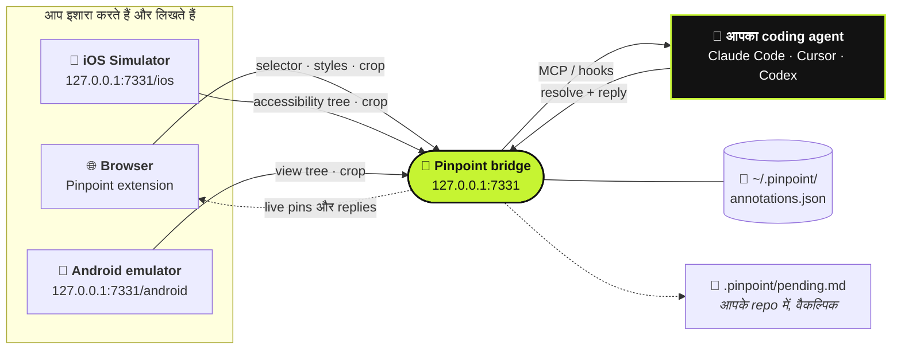

<div align="center">

# 📍 Pinpoint

**अपने चलते हुए ऐप की तरफ़ इशारा कीजिए। बताइए क्या बदलना है। आपका coding agent समझ जाएगा।**

[](https://github.com/gowtham012/pinpoint/actions/workflows/test.yml)
[](https://www.npmjs.com/package/pinpoint-bridge)
[](../../LICENSE)
[](https://glama.ai/mcp/servers/gowtham012/pinpoint)
[](https://github.com/hesreallyhim/awesome-claude-code)
[](https://github.com/gowtham012/pinpoint/stargazers)

[English](../../README.md) ·
[తెలుగు](README.te.md) ·
**हिन्दी** ·
[தமிழ்](README.ta.md) ·
[简体中文](README.zh-CN.md) ·
[日本語](README.ja.md) ·
[한국어](README.ko.md) ·
[Español](README.es.md) ·
[Français](README.fr.md) ·
[Deutsch](README.de.md) ·
[Português](README.pt-BR.md) ·
[Русский](README.ru.md) ·
[العربية](README.ar.md)

<sub>यह एक अनुवाद है; मूल संदर्भ अंग्रेज़ी README ही है, और वह इससे ज़्यादा नया हो सकता है।</sub>


<sub>एक element पर क्लिक कीजिए, बताइए क्या बदलना है, आपके agent तक पहुँच जाएगा। · <a href="../demo.mp4">पूरी स्पीड वाला वीडियो</a></sub>

</div>

---

अपनी लोकल dev साइट पर किसी element पर क्लिक कीजिए, लिखिए क्या बदलना चाहिए, और आपके coding agent को
वह सब मिल जाता है जो कोड ढूँढने के लिए चाहिए: **selector**, **DOM path**, **computed styles**,
**React/Vue component chain**, एक **source-file hint** और एक **cropped screenshot**। न Downloads फ़ोल्डर
में screenshots का ढेर, न "बाईं तरफ़ वाला तीसरा बटन" समझाने की झंझट।

यह सिर्फ़ दिखावट के लिए नहीं, **behaviour** के लिए भी काम करता है। *"फ़ॉर्म valid होने तक इसे disable रखो"* या
*"बंद करने से पहले draft सेव कर लो"* जैसे notes बिल्कुल ठीक हैं: agent उस element को शुरुआती बिंदु मानता है,
फिर उसके पीछे के handlers, state, API calls और backend तक पहुँचता है।

नेटिव ऐप बना रहे हैं? यही चीज़ **[iOS Simulator](#-नेटिव-ios-ऐप्स)** और
**[Android emulator](#-android-एमुलेटर)** पर भी चलती है।



## विषय-सूची

- [क्विक स्टार्ट](#-क्विक-स्टार्ट)
- [इस्तेमाल कैसे करें](#-इस्तेमाल-कैसे-करें)
- [बातचीत से सुलझाइए](#-बातचीत-से-सुलझाइए)
- [आपके agent को पता कैसे चलता है](#-आपके-agent-को-पता-कैसे-चलता-है)
- [नेटिव iOS ऐप्स](#-नेटिव-ios-ऐप्स)
- [Android एमुलेटर](#-android-एमुलेटर)
- [दूसरे agents को जोड़ना](#-दूसरे-agents-को-जोड़ना)
- [रेफ़रेंस](#-रेफ़रेंस): commands, MCP tools, एक note में क्या-क्या होता है
- [ट्रबलशूटिंग](#-ट्रबलशूटिंग)
- [सुरक्षा और प्राइवेसी](#-सुरक्षा-और-प्राइवेसी)

## दूसरे तरीक़ों से तुलना

| | कंट्रोल किसके हाथ में | agent को क्या मिलता है |
|---|---|---|
| **Pinpoint** | **आप** इशारा करते हैं और बताते हैं क्या बदलना है | Selector, styles, component chain, source hint, crop |
| Playwright MCP, computer-use | agent ख़ुद नेविगेट और क्लिक करता है | ब्राउज़ करके जो भी उसे मिल जाए |
| पेस्ट किया हुआ screenshot | आप | सिर्फ़ pixels, तो वह अंदाज़ा लगाता है कि आपका मतलब कौन-सा control था |

Pinpoint ख़ुद पेज को कभी नहीं छूता, इसलिए यह browser automation से मुक़ाबला नहीं करता बल्कि उसके साथ मिलकर
काम करता है: चीज़ की तरफ़ इशारा कीजिए, agent को कोड बदलने दीजिए, और ब्राउज़र चलाने का काम अपने tests को दीजिए।

## 🚀 क्विक स्टार्ट

**आपको चाहिए** Node 18+ और एक Chromium ब्राउज़र (Chrome, Edge, Brave, Arc, Opera, Vivaldi), या
[Firefox 140+](#-ब्राउज़र)।

**1. Install कीजिए**

```bash
git clone https://github.com/gowtham012/pinpoint
node pinpoint/bridge/cli.js setup
```

`setup` कुछ सवाल पूछता है। हर सवाल का एक default है, इसलिए शुरू से आख़िर तक बस Enter दबाते जाना भी चलेगा।
यह Claude Code, Cursor और Codex (जो भी आपके पास हो) को wire up करता है, Claude Code hooks install करता है,
और bridge शुरू कर देता है।

**2. Extension load कीजिए।** Chrome किसी terminal को आपकी profile में extension load नहीं करने देता, इसलिए setup
आपके लिए extensions पेज खोल देता है और फ़ोल्डर का path copy कर देता है: **Developer mode** (डेवलपर मोड) चालू कीजिए,
**Load unpacked** पर क्लिक कीजिए, और paste कर दीजिए। Terminal ख़ुद ही **✓ Pinpoint is live in Chrome** दिखाकर पुष्टि कर देता है।

**3. Claude Code को एक बार restart कीजिए**, ताकि वह नया MCP server और hooks पढ़ ले।

**आज़माइए:** अपनी dev साइट (या [demo पेज](#आज़माने-के-लिए-एक-पेज)) खोलिए, **⌥⇧A** /
**Alt+Shift+A** दबाइए, किसी element पर क्लिक कीजिए, लिखिए क्या बदलना है, फिर **⌘↩** / **Ctrl+Enter**। अब Claude Code
में कुछ भी टाइप कीजिए, आपका note साथ में पहुँच जाएगा।

> [!TIP]
> हर स्टेप विस्तार से देखना है? [docs/quick-install.md](../quick-install.md) देखिए।
> सिर्फ़ नेटिव iOS या Android ऐप बना रहे हैं? Clone की ज़रूरत नहीं:
> `npx -y pinpoint-bridge`, फिर `claude mcp add pinpoint -s user -- npx -y pinpoint-bridge mcp`।

<details>
<summary><b>Setup विस्तार से, हाथ से करना, Windows और <code>file://</code></b></summary>

`setup` पूछता है:

- **किस प्रोजेक्ट की UI पर annotate करना है**: वह repo जिसे आपका agent edit करेगा
- **web app, नेटिव iOS app, Android app, या दोनों** (web और iOS): web के लिए browser extension मिलता है;
  iOS के लिए [Simulator picker](#-नेटिव-ios-ऐप्स), Android के लिए [emulator picker](#-android-एमुलेटर)।
  Setup Xcode, Maestro और Java (iOS) या adb (Android) की जाँच करता है और जो भी नहीं है उसे पाने का
  तरीक़ा बताता है (इनमें से कुछ भी ख़ुद install नहीं करता)।
- **किन agents को wire up करना है**: Claude Code के लिए `claude mcp add`, Cursor के लिए `<project>/.cursor/mcp.json`,
  Codex के लिए `~/.codex/config.toml`। मौजूदा entries merge होती हैं, कभी replace नहीं होतीं, और TOML
  फ़ाइल का पहले backup लिया जाता है।
- **Claude Code hooks install करने हैं या नहीं**, जो pending notes को आपके अगले message के साथ ले आते हैं
- **किस browser** में extension load करना है (सिर्फ़ वही जो आपके पास हैं)

फिर यह popup के **Start bridge** (bridge शुरू करें) बटन के पीछे वाला launcher register करता है और bridge शुरू कर देता है।
Non-interactive: `node pinpoint/bridge/cli.js setup ~/code/my-app --yes` (`--for ios`,
`--for android` या `--for both` जोड़िए; default `web` है)।

**हाथ से।** क्रम ज़रूरी है: `$PWD` MCP entry में bake हो जाता है, इसलिए स्टेप 2 को
`pinpoint/bridge` से चलाना है, इससे पहले कि bridge terminal को घेर ले।

```bash
# 1. get it
git clone https://github.com/gowtham012/pinpoint
cd pinpoint/bridge && npm install

# 2. wire up Claude Code (once, from this folder)
claude mcp add pinpoint -s user -- node "$PWD/cli.js" mcp
node cli.js install-hooks ~/code/my-app                  # notes arrive without being asked
node cli.js install-native-host --project ~/code/my-app   # optional: the popup's "Start bridge" button

# 3. load extension/ unpacked at chrome://extensions (Developer mode on)
# 4. start the bridge, and leave it running
node cli.js --project ~/code/my-app
```

`--project` optional है: यह उन agents के लिए `<repo>/.pinpoint/pending.md` को अप-टू-डेट रखता है जो MCP की बजाय
फ़ाइल पढ़ते हैं।

**`file://` पेज।** Chrome इन्हें default रूप से बंद रखता है: `chrome://extensions` → Pinpoint → **Details** (विवरण) →
**Allow access to file URLs** (file URLs तक पहुँच दें), फिर reload कीजिए।

**Windows।** `$PWD` PowerShell और Git Bash में चलता है पर `cmd.exe` में नहीं; `node cli.js --help` चलाइए और
जो `claude mcp add …` लाइन वह print करता है उसे copy कर लीजिए, उसमें पूरा path होता है। `install-native-host` सिर्फ़ macOS
और Linux पर चलता है; Windows पर bridge को terminal में शुरू कीजिए।

**यहाँ भी listed है:** [official MCP Registry](https://registry.modelcontextprotocol.io)
(`io.github.gowtham012/pinpoint`), [cursor.directory](https://cursor.directory/plugins/pinpoint)
(one-click **Add to Cursor**) और [Glama](https://glama.ai/mcp/servers/gowtham012/pinpoint)। ये सिर्फ़
MCP server install करते हैं; web पेजों के लिए extension और bridge फिर भी चाहिए।
</details>

## 🖱️ इस्तेमाल कैसे करें

जब तक bridge चल रहा है, आपके पेज के ऊपर-दाएँ कोने में एक छोटा bar रहता है।

| | | |
|---|---|---|
|  |  |  |
| Shortcut दिखाता है, और जब आपका agent काम कर रहा हो तो चमक उठता है। | कुछ सेकंड बाद एक dot बन जाता है। Hover कीजिए, वापस आ जाएगा। | Picking चल रही है। Bar क्लिक्स को अपने आर-पार जाने देता है, ताकि वह आपके target के आड़े कभी न आए। |

1. Marking शुरू करने के लिए bar पर क्लिक कीजिए (या **⌥⇧A** / **Alt+Shift+A**)।
2. किसी element पर क्लिक कीजिए, या किसी group के चारों ओर एक box **drag** कीजिए (*"mobile पर इन cards को दो-दो की लाइन में करो"*)।
3. लिखिए क्या बदलना है और **⌘↩** / **Ctrl+Enter** दबाइए। अगले के लिए तैयार।
4. काम पूरा हो जाए तो **Esc** या **Stop** (रोकें)।

<table>
<tr>
<td width="50%"></td>
<td width="50%"></td>
</tr>
<tr>
<td>Popover ठीक-ठीक बताता है कि आपने क्या चुना है, इसलिए दो लगभग एक जैसे बटनों में गड़बड़ नहीं हो सकती।</td>
<td>एक नंबर वाला pin element से चिपक जाता है। यह reload के बाद भी बना रहता है, उस पेज के हर tab में दिखता है, और agent के काम पूरा करते ही ग़ायब हो जाता है।</td>
</tr>
</table>

- **Bar को हिलाइए**: उसकी grip पकड़कर पेज पर कहीं भी drag कीजिए; उस साइट पर वह वहीं रहेगा।
- Bar पर **counter** इस पेज पर mark की गई हर चीज़ की लिस्ट दिखाता है। किसी row पर क्लिक करके सीधे वहाँ पहुँचिए।
- **×** उस साइट के लिए bar छिपा देता है; toolbar popup उसे वापस ले आता है।
- जो ऐप्स अपना DOM दोबारा बनाते हैं, उन पर **pins अपने element के साथ चलते हैं**, और अगर उनका element
  ग़ायब हो जाए तो ग़लत element पर बैठने की बजाय छिप जाते हैं।
- **Bridge नहीं चल रहा?** तब **Send** (भेजें) इसकी जगह paste करने लायक़ तैयार prompt copy कर देता है, तो कुछ भी खोता नहीं।
- **Record steps।** Picking के दौरान bar पर **Record steps** (स्टेप रिकॉर्ड करें) दबाइए और bug तक वैसे ही क्लिक करते जाइए जैसे
  आम तौर पर करते हैं। क्लिक्स फिर भी पेज तक पहुँचते हैं और हर क्लिक एक step बन जाता है (element, label, URL, एक छोटा
  crop), उसी tab में navigation के पार भी। **Done** (हो गया) एक note लिखता है (ज़्यादा से ज़्यादा 10 steps); **Esc**
  recording को फेंक देता है। आपके agent को ये *Steps to reproduce* के रूप में मिलते हैं।
- **बोलकर लिखिए।** Comment box में mic दबाइए और बोलिए; text आपके टाइप किए हुए के साथ जुड़ जाता है। Chrome
  और Safari पर, secure पेजों पर (localhost भी गिना जाता है); transcription browser की अपनी speech service करती है।
  Firefox पर नहीं।
- **क्या गड़बड़ हुई, वह भी साथ आता है।** हर note में mark करने से पहले के एक मिनट के पेज के uncaught errors और failed
  requests होते हैं, जो पहले browser में ही redact हो जाते हैं (query strings, tokens और secrets हटा दिए जाते हैं)।
  ये सिर्फ़ तभी जुड़ते हैं जब सच में कुछ गड़बड़ हुई हो।

**यह कहाँ चलता है।** सिर्फ़ लोकल development पेजों पर: `localhost`, `127.0.0.1`, `.local` / `.test` /
`.localhost` hosts, और अनुमति मिलने के बाद `file://`। बाक़ी कहीं भी (staging URL, फ़ोन पर testing के लिए LAN address)
toolbar popup से इसे एक tab के लिए चालू किया जा सकता है।

## 💬 बातचीत से सुलझाइए

एक note एक बातचीत है, एकतरफ़ा ticket नहीं।

- **Agent पलटकर सवाल पूछ सकता है।** अगर request अस्पष्ट है तो वह अंदाज़ा लगाने की बजाय पूछता है। सवाल pin पर
  (एक **?**) और एक toast के रूप में दिखता है; notes panel में जवाब दीजिए और note पूरी बातचीत के साथ वापस चला जाता है।
- **जवाब आप browser में पढ़ते हैं।** पूरा हुआ note panel में रहता है, साथ में agent का अपना note कि उसने क्या
  बदला। Agents को यह लिखना ही होता है: "done" कोई जवाब नहीं है।
- **Accept / Not quite।** Agent का काम पूरा होने पर एक card उसका जवाब **Accept** (स्वीकार करें) और **Not
  quite** (पूरी तरह नहीं) के साथ दिखाता है। Not quite note को फिर से खोल देता है ताकि आप बता सकें कि अभी भी क्या ग़लत है।
- **बाद में लगा कि बात पूरी तरह नहीं बनी?** Panel में हर पूरे हुए note पर **Reply…** (जवाब दें) होता है। बताइए अभी भी
  क्या ग़लत है, और वह फिर से खुल जाता है।
- **Before / After।** Note resolve होने के कुछ सेकंड बाद Pinpoint element का एक ताज़ा crop लेता है। Panel में
  पूरे हुए notes **Before** (पहले) और **After** (बाद में) को अगल-बगल दिखाते हैं।
- **Drafts।** **Draft** (ड्राफ़्ट) (या **⇧⌘↩**) किसी चीज़ को बिना भेजे mark कर देता है। Bar पर **Send** सारे
  drafts एक साथ भेज देता है।
- **पूरा पेज।** Picking के दौरान **Whole page** (पूरा पेज) पेज के बारे में ही एक note बनाता है (*"हर जगह spacing
  तंग लग रही है"*), screenshot के साथ।


**जब pin के नीचे पेज बदल जाए**, तो agent को ख़राब हो चुका selector थमाने की बजाय बताया जाता है कि element
stale हो सकता है। `recheck_annotation` उसी समय दोबारा देखता है और original के बगल में एक ताज़ा crop लौटाता है।


<sub>वही दो notes, दो बार। Panel शुरू से दोबारा बनाया जाता है: note 1 बिल्कुल नए nodes के बीच अपना element फिर से ढूँढ लेता है, note 2 मान लेता है कि वह इस view पर नहीं है।</sub>

<details>
<summary><b>Browser से bridge शुरू करना, और एक साथ कई agents</b></summary>

**Browser से start / restart।** `install-native-host` Chrome (और Brave, Edge, Arc, Chromium, Vivaldi, Opera)
और Firefox के साथ एक छोटा-सा launcher register करता है। उसके बाद popup का **Start bridge** काम करने लगता है, और नया build pull करने के बाद
bar पर मौजूद **↻** bridge को restart कर देता है। Launcher सिर्फ़ एक काम कर सकता है: इसी repo का अपना `cli.js`
popup की setting वाले port नंबर पर चलाना, पेज से मिले port पर कभी नहीं।

**कई agents।** Agents MCP पर अपना परिचय देते हैं, इसलिए bar उस agent का नाम दिखाता है जो काम कर रहा है
(`claude-code`, `cursor-vscode`, `codex`) और हर reply उसी के नाम से दिखता है। `wait_for_annotation` हर नया note
ठीक एक इंतज़ार कर रहे agent को देता है, इसलिए दो agents एक ही note पर काम करने की बजाय queue को आपस में बाँट लेते हैं।
</details>

## 🔔 आपके agent को पता कैसे चलता है

तीन तरीक़े, सबसे मज़बूत पहले। तीनों एक साथ इस्तेमाल करना भी ठीक है।

| | कैसे | Setup |
|---|---|---|
| **Hooks** (अपने-आप) | Pending notes आपके अगले message के साथ चले आते हैं। कुछ pending न हो तो कुछ print नहीं करता। | `node cli.js install-hooks <repo>` (setup यह कर देता है) |
| **MCP** (माँगने पर) | जब भी आप किसी UI या feature change की बात करते हैं, server agent को check करने को कहता है। | MCP entry |
| **Watch loop** (बिना हाथ लगाए) | कहिए *"watch pinpoint and apply each change as it comes in"*; हर note उसी पल पहुँचता है जब आप Send दबाते हैं। | कुछ नहीं |

Comment ही instruction है, और यह किसी चीज़ के **दिखने** के बारे में हो सकता है या उसके **काम करने** के बारे में।
आप नतीजे के बारे में जितना ज़्यादा बताएँगे (*"should"*, *"instead of"*, *"when … then …"*), agent को उतना कम
अंदाज़ा लगाना पड़ेगा।

## 📱 नेटिव iOS ऐप्स

नेटिव ऐप में DOM नहीं होता, इसलिए यह रास्ता **accessibility tree** पढ़ता है। यह SwiftUI, UIKit,
React Native और Flutter ऐप्स पर काम करता है, आपके ऐप में कुछ भी जोड़े बिना।

<table>
<tr>
<td width="50%"></td>
<td width="50%"></td>
</tr>
</table>

**आपको चाहिए** Xcode, एक booted Simulator के साथ, और [Maestro](https://maestro.dev) (जिसे Java चाहिए;
Homebrew वाला `openjdk` आपके PATH से बाहर हो तब भी मिल जाता है)।

Bridge चलते हुए **http://127.0.0.1:7331/ios** खोलिए (setup इसे आपके लिए खोल देता है)। हर element देखने के लिए hover कीजिए,
किसी एक पर क्लिक कीजिए, टाइप कीजिए, **⌘↩**। Agent को `accessibilityIdentifier` (आपका `testID`), label,
tree path, frame और एक crop मिलता है। ऐप बदलने के बाद **R** दबाइए।

**कोई ऐप हाथ में नहीं?** `bash demo/ios/run.sh` सिर्फ़ `swiftc` से **Trailhead** build करता है, जो एक स्क्रीन वाला SwiftUI demo है,
और उसे booted Simulator पर launch कर देता है।

<details>
<summary><b>सीमाएँ और समय</b></summary>

यहाँ न source-file hint है न component chain (tree में इनमें से कुछ नहीं होता; elements को एक identifier दीजिए और
agent उसे grep कर लेगा), न styles, और न `recheck_annotation`। पहली बार load होने में ~10 s लगते हैं जब तक
Maestro अपना on-device driver शुरू करता है; उसके बाद हर refresh में लगभग एक सेकंड लगता है। आपके Mac पर हर Maestro
एक ही driver share करता है, इसलिए अगर कोई दूसरा उसे restart कर दे, तो bridge एक नया Maestro शुरू करके
एक बार फिर कोशिश करता है। अगर पहला load मिनटों तक चले, तो Maestro MCP server वाले idle Claude Code sessions बंद कर दीजिए।
</details>

## 🤖 Android एमुलेटर

`/ios` वाला ही picker, जो adb के ज़रिए Android का **view tree** पढ़ता है। आपके ऐप में कुछ नहीं जोड़ा जाता
और कोई driver install नहीं करना पड़ता।

<table>
<tr>
<td width="50%"></td>
<td width="50%"></td>
</tr>
</table>

**आपको चाहिए** Android SDK का `adb` (Android Studio इसे install कर देता है) और एक चलता हुआ emulator।

Bridge चलते हुए **http://127.0.0.1:7331/android** खोलिए। Hover कीजिए, क्लिक कीजिए, टाइप कीजिए, भेज दीजिए। Agent को
element का `resource-id`, content-desc, text, class, view tree में उसकी जगह और एक crop मिलता है।
`node bridge/cli.js setup --for android` adb की जाँच करता है और आपको picker तक पहुँचा देता है।

<details>
<summary><b>adb ढूँढना, और कौन-सा device पढ़ा जाता है</b></summary>

Pinpoint adb को `$ANDROID_HOME`, `$ANDROID_SDK_ROOT` और Android Studio के default SDK फ़ोल्डर में ढूँढता है,
फिर आपके `PATH` पर। एक emulator चल रहा हो तो वही इस्तेमाल होता है। कई चल रहे हों, या किसी physical device को
पढ़ना हो, तो `ANDROID_SERIAL` को उसके serial पर सेट कीजिए (जैसा `adb devices` दिखाता है) और bridge restart
कीजिए। जब तक आप नाम न दें, कोई फ़ोन कभी नहीं चुना जाता। iOS की तरह यहाँ भी न source-file hint है, न styles
और न `recheck_annotation`: views को एक id दीजिए और agent उसे grep कर लेगा।
</details>

## 🔌 दूसरे agents को जोड़ना

सबसे आसान तरीक़ा है published package चलाना: `npx -y pinpoint-bridge mcp`। यह उस bridge से बात करता है जो भी
चल रहा हो। उसके बाद editor restart कीजिए।

<details>
<summary><b>Cursor</b>: <a href="https://cursor.directory/plugins/pinpoint">cursor.directory</a> से एक क्लिक, या <code>.cursor/mcp.json</code></summary>

```json
{ "mcpServers": { "pinpoint": { "command": "npx", "args": ["-y", "pinpoint-bridge", "mcp"] } } }
```
</details>

<details>
<summary><b>Codex CLI</b>: <code>~/.codex/config.toml</code></summary>

```toml
[mcp_servers.pinpoint]
command = "npx"
args = ["-y", "pinpoint-bridge", "mcp"]
```
</details>

<details>
<summary><b>HTTP पर कोई भी MCP client</b>, या <b>बिल्कुल MCP नहीं</b></summary>

**HTTP:** `http://127.0.0.1:7331/mcp` (Streamable HTTP, stateless)। Windsurf, Cline, Continue, Zed और
Gemini CLI सभी एक URL लेते हैं।

**MCP नहीं:** bridge को `--project <repo>` के साथ चलाइए, वह `<repo>/.pinpoint/pending.md` को अप-टू-डेट रखेगा।
किसी भी agent से कहिए *"read .pinpoint/pending.md and apply it"*; वह हर एक को `node cli.js resolve <id>` से
पूरा करता है। या popover में **Copy prompt** (prompt copy करें) इस्तेमाल करके किसी भी chat में paste कर दीजिए।

किसी agent को npm की बजाय अपने clone से बाँधना हो, तो `cli.js` का absolute path इस्तेमाल कीजिए (`node cli.js --help`
जो लाइन print करता है उसे copy कर लीजिए)।
</details>

## 🌐 ब्राउज़र

| Browser | स्थिति |
|---|---|
| **Chrome, Brave, Arc, Opera, Vivaldi** | ✅ Load unpacked। CI में headless Chromium पर verified। |
| **Edge** | ✅ Load unpacked: Chrome वाला ही package। |
| **Firefox 140+** | ✅ `bash tools/make-firefox-zip.sh` से बना addons.mozilla.org package। Store listing अभी pending है। Dictation नहीं। |
| **Safari** | ✅ `bash tools/make-safari.sh` से build होता है (Xcode चाहिए)। Component chain, source hint या page errors नहीं। |

<details>
<summary><b>Edge और Firefox</b></summary>

**Edge** Chrome वाला package जैसा है वैसा ही ले लेता है। **Start bridge** के लिए एक बार
`node bridge/cli.js install-native-host --id <edge id>` चलाइए (Edge extension को अपना अलग id देता है)।

**Firefox 140+।** जब तक addons.mozilla.org listing live नहीं होती, zip को
`about:debugging` → **This Firefox** → **Load Temporary Add-on** से load कीजिए। अगर Firefox ने लोकल साइटों का
access रोक रखा है, तो popup में **Grant access to local sites** दबाइए। फिर **Start bridge** के लिए एक बार
`node bridge/cli.js install-native-host` चलाइए, या `node bridge/cli.js token` का output popup में paste कर दीजिए।
</details>

<details>
<summary><b>Safari पर क्या अलग है</b></summary>

Safari unpacked extensions नहीं लेता, इसलिए `tools/make-safari.sh` इसे एक छोटे macOS ऐप में लपेट देता है और
वे चार Safari settings print करता है जिन्हें बदलना है (सबसे अहम वाली, **Develop ▸ Allow Unsigned Extensions**, Safari
हर बार बंद होने पर reset हो जाती है)। Safari `"world": "MAIN"` content scripts support नहीं करता, इसलिए `inspector.js`
React fibers या Vue instances नहीं पढ़ पाता: आपको **component chain और source-file hint** नहीं मिलते,
और न ही **page errors** (उन्हें भी MAIN world चाहिए)। Failed requests सिर्फ़ वहीं साथ आते हैं जहाँ Safari
`webRequest` support करता है। बाक़ी सब काम करता है। Safari में bridge token देने के लिए कोई native host नहीं है, इसलिए popup उसे
एक बार माँगता है: `node bridge/cli.js token` चलाइए और output paste कर दीजिए। Mac App Store के लिए,
`TEAM=<your team id> bash tools/make-safari.sh --release` एक signed build export करता है।
</details>

## 📚 रेफ़रेंस

<details>
<summary><b>Commands</b> (<code>pinpoint/bridge</code> से चलाइए)</summary>

```
node cli.js [start]            start the bridge (default command)
node cli.js mcp                run as a stdio MCP server
node cli.js status             is it running? how many pending?
node cli.js print              pending annotations as markdown  (--consume also resolves them)
node cli.js resolve <id...> --note "what you changed"
                               mark done — the pin disappears and your note is shown as the reply
node cli.js install-hooks [dir]  wire up Claude Code
node cli.js install-native-host   let the popup's "Start bridge" button start the bridge
                               (--uninstall removes it; --id <id> allows a second checkout)
node cli.js token              print the extension token (Safari asks for it once)
node cli.js clear              delete everything
node cli.js --help

http://127.0.0.1:7331/ios      the iOS Simulator picker, served by the running bridge
http://127.0.0.1:7331/android  the Android emulator picker (needs adb)

--port <n>       default 7331, or $PINPOINT_PORT (set the same number in the popup)
--project <dir>  mirror pending annotations into <dir>/.pinpoint/
--print          echo each new annotation to stdout as it arrives
$PINPOINT_HOME   where annotations are stored (default ~/.pinpoint)
$PINPOINT_AFTER_DELAY  ms after a resolve before the After crop (default 3000, 0 turns it off)
$ANDROID_SERIAL  which Android device to read, when it isn't the one running emulator
```
</details>

<details>
<summary><b>MCP tools</b></summary>

| tool | काम |
|---|---|
| `get_pending_annotations` | सब कुछ जो pending है, markdown task list के रूप में, हर एक अपने screenshot के साथ |
| `list_annotations` | हर annotation के लिए एक लाइन |
| `get_annotation` | किसी एक id या pin नंबर की पूरी जानकारी + screenshot |
| `recheck_annotation` | live पेज में element को दोबारा ढूँढता है और बताता है क्या बदला, original के बगल में ताज़ा crop के साथ |
| `resolve_annotation` | done mark करता है → एक सेकंड के अंदर browser में pin ग़ायब हो जाता है |
| `reply_annotation` | अंदाज़ा लगाने की बजाय developer से सवाल पूछता है; उनका जवाब पूरी बातचीत के साथ pending के रूप में वापस आता है |
| `wait_for_annotation` | तब तक रुका रहता है जब तक developer अगला note नहीं भेजता |
| `clear_annotations` | सब कुछ मिटा देता है |

Resource: `pinpoint://pending` (markdown)।
</details>

<details>
<summary><b>एक note में क्या-क्या होता है</b></summary>

```
comment          "make this full-width on mobile"          ← the only instruction
page             url, title, viewport, scroll
element          tag, id, classes, a CSS selector built from stable attributes where they exist
                 (`button[data-action="next"]` rather than `:nth-of-type(2)`; shadow DOM via
                 "host >>> inner"), DOM path, rendered text, trimmed outerHTML, role/aria/data-*
                 attributes, bounding box, ~25 computed style properties, and a fingerprint
                 (tag + text + key attributes) used to verify a pin is still on the right element
source           framework (react/vue/svelte/angular/astro), component chain,
                 file:line where the dev build exposes it
screenshot       PNG of just the element (+8px), long edge ≤1200px
context          only when something went wrong: uncaught errors and failed requests from the
                 minute before, redacted in the browser
steps            recorded notes only: up to 10 clicks, each with selector, label, URL and a crop
after            on done notes: a fresh crop taken after the resolve
```

iOS Simulator से आने पर `element` में इसकी जगह accessibility identifier, label, text, value, tree path
और frame होते हैं; `source` होता है `ios-native` और `page.url` होता है `ios-simulator://<device name>`।
Android emulator से आने पर इसमें `resource-id`, content-desc, text, class, tree path और bounds होते हैं;
`source` होता है `android-native` और `page.url` होता है `android-emulator://<avd>`।

React 19 या Next पर सटीक `file:line` के लिए एक dev-only inspector plugin जोड़िए
(`vite-plugin-react-inspector`, `@react-dev-inspector`)। Pinpoint उनके `data-source`
attributes पढ़ता है, साथ ही React के `_debugSource`/`_debugStack` और Vue का `__file` भी।
</details>

## 🩺 ट्रबलशूटिंग

<details>
<summary>पेज पर कोई bar नहीं दिखता</summary>

Bar सिर्फ़ तभी दिखता है जब bridge चल रहा हो। `pinpoint/bridge` से `node cli.js status` चलाकर देखिए। अगर
bridge चालू है, तो शायद यह पेज उनमें से नहीं है जिनमें Pinpoint अपने-आप inject होता है (*यह कहाँ चलता है* देखिए):
toolbar popup खोलिए और उस tab के लिए इसे चालू कीजिए।
</details>

<details>
<summary><code>file://</code> पेज पर कुछ भी नहीं</summary>

`chrome://extensions` → Pinpoint → **Details** → **Allow access to file URLs**, फिर reload कीजिए।
</details>

<details>
<summary>Toolbar वाला dot कभी हरा नहीं होता</summary>

Bridge नहीं चल रहा, या किसी दूसरे port पर है: popup का **Port** और bridge का `--port`
एक होना चाहिए। अगर `node cli.js status` कहे कि port *answers, but it is NOT the pinpoint bridge*,
तो उस पर किसी और का क़ब्ज़ा है: bridge को `--port 7332` के साथ शुरू कीजिए और popup में 7332 सेट कीजिए।
</details>

<details>
<summary><code>port 7331 is already in use</code></summary>

आम तौर पर bridge पहले से किसी दूसरे terminal में चल रहा होता है, तो आपका काम हो गया। वरना ऊपर बताए तरीक़े से
कोई ख़ाली port चुनिए। एक साथ दो bridges मत चलाइए: वे एक ही store फ़ाइल share करते हैं।
</details>

<details>
<summary>किसी note में screenshot नहीं है</summary>

तस्वीर आपका comment store होने के ठीक बाद ली जाती है, इसलिए comment कभी नहीं खोता। अगर उसी पल पेज
navigate हो गया या tab बंद हो गया, तो note में वजह दर्ज हो जाती है। Comment, selector और styles
सब फिर भी मौजूद रहते हैं।
</details>

<details>
<summary>Claude Code मेरे notes का ज़िक्र नहीं करता</summary>

Hooks session शुरू होते समय पढ़े जाते हैं: `install-hooks` के बाद एक बार restart कीजिए। जाँचिए कि
`<your repo>/.claude/settings.json` में `print --hook` वाली दो entries हैं और उनका path अभी भी
मौजूद है (clone को कहीं और ले जाने से यह टूट जाता है; `install-hooks` दोबारा चलाइए)। आप हमेशा यह भी कह सकते हैं *"apply my pinpoint
annotations"*।
</details>

<details>
<summary>"Start bridge" कहता है कि setup चाहिए, या Node नहीं मिल रहा</summary>

एक बार `node cli.js install-native-host` चलाइए (repo को कहीं और ले गए हैं तो फिर से), फिर browser बंद करके
दोबारा खोलिए। Launcher में node का absolute path bake हो जाता है; अगर node की जगह बदल गई (नया nvm version, Homebrew
upgrade), तो इसे दोबारा चलाइए।
</details>

<details>
<summary>बिल्कुल नए सिरे से शुरू करना है</summary>

`node cli.js clear`। आपके repo के बाहर सिर्फ़ `~/.pinpoint/annotations.json` ही state है।
</details>

## 🔒 सुरक्षा और प्राइवेसी

- Bridge सिर्फ़ `127.0.0.1` पर सुनता है और किसी web पेज का `Origin` लेकर आने वाली requests ठुकरा देता है।
- Extension को `~/.pinpoint/token` वाला token पेश करना होता है।
- पेज से scrape की गई हर चीज़, आपके agent तक पहुँचने पर **untrusted** label के साथ जाती है; सिर्फ़ आपका टाइप किया
  comment ही instruction के रूप में पेश किया जाता है।
- Screenshots अलग-अलग फ़ाइलों के रूप में नहीं, `~/.pinpoint/annotations.json` के अंदर रहते हैं।

[SECURITY.md](../../SECURITY.md) में trust-boundary के पूरे notes हैं (यह भी कि `<all_urls>` क्यों चाहिए) और
[PRIVACY.md](../../PRIVACY.md) ठीक-ठीक बताता है कि क्या collect होता है, कहाँ store होता है, और वह एकमात्र जगह जहाँ यह जाता है:
वह coding agent जिसे आप जोड़ते हैं।

## आज़माने के लिए एक पेज

`demo/index.html` एक self-contained demo साइट है (न build, न network), जिसमें region drags के लिए card grids,
लगभग एक जैसे बटन, ख़ुद को दोबारा बनाने वाला एक tab panel, एक घना table और एक form है।

```bash
cd demo && python3 -m http.server 8080     # then open http://localhost:8080
```

## 🧪 टेस्टिंग

```bash
cd test && npm install && npx playwright install chromium && npm test
```

210 tests। `bridge.test.mjs` daemon, CLI, hooks, iOS picker और हर MCP tool को stdio और Streamable HTTP
दोनों पर cover करता है। `e2e.test.mjs` extension को headless Chromium में load करके असली पेज चलाता है:
React, Vue, shadow DOM, iframes, strict CSP, 3,600 nodes वाला stress पेज, DPR 2, cross-tab sync और
एक form जो अपना पूरा DOM दोबारा बनाता है।

<details>
<summary><b>बाक़ी suites</b></summary>

| फ़ाइल | क्या cover करती है |
|---|---|
| `android-bridge.test.mjs` | adb ढूँढना, device चुनना, view tree parse करना, `/android` routes |
| `e2e-picker.test.mjs` | headless Chromium में `/ios` और `/android` picker पेज |
| `ui-bridge.test.mjs`, `ui-flow.test.mjs`, `ui-after.test.mjs` | Accept, page context, recorded steps, Before / After |
| `ui-redact.test.mjs` | page context के redaction नियम |
| `ship-edge.test.mjs`, `ship-firefox.test.mjs`, `e2e-ship.test.mjs` | Edge upload, Firefox package और native host, store zip और popup के Firefox वाले रास्ते |
| `ship-windows.test.mjs` | setup `cmd.exe` के लिए commands को कैसे quote करता है |
</details>

[CONTRIBUTING.md](../../CONTRIBUTING.md) देखिए।

## रोडमैप

- React Native और Flutter के लिए native source hints, एक optional dev-only package के ज़रिए
- `chrome.debugger` के ज़रिए CSS source mapping (कौन-से rule ने यह रंग सेट किया, और कहाँ)

## योगदान

Issues और pull requests का स्वागत है; [CONTRIBUTING.md](../../CONTRIBUTING.md) देखिए। कोई build step नहीं है:
clone कीजिए, `bridge/` में `npm install` कीजिए, `extension/` को unpacked load कीजिए। हर behaviour change के साथ एक test आता है।

## लाइसेंस

MIT, [LICENSE](../../LICENSE) देखिए। Release notes [CHANGELOG.md](../../CHANGELOG.md) में हैं।
