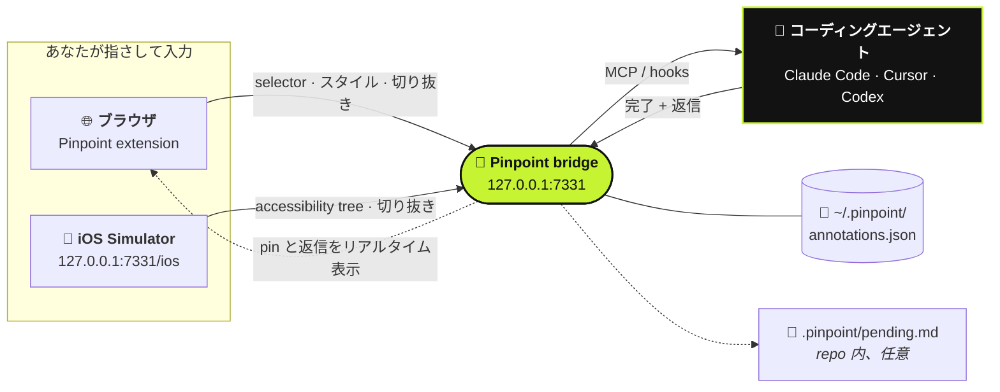

<div align="center">

# 📍 Pinpoint

**動いているアプリを指さして、変えたいことを伝えるだけ。あとはコーディングエージェントが受け取ります。**

[](https://github.com/gowtham012/pinpoint/actions/workflows/test.yml)
[](https://www.npmjs.com/package/pinpoint-bridge)
[](../../LICENSE)
[](https://glama.ai/mcp/servers/gowtham012/pinpoint)
[](https://github.com/hesreallyhim/awesome-claude-code)
[](https://github.com/gowtham012/pinpoint/stargazers)

[English](../../README.md) ·
[తెలుగు](README.te.md) ·
[हिन्दी](README.hi.md) ·
[தமிழ்](README.ta.md) ·
[简体中文](README.zh-CN.md) ·
**日本語** ·
[한국어](README.ko.md) ·
[Español](README.es.md) ·
[Français](README.fr.md) ·
[Deutsch](README.de.md) ·
[Português](README.pt-BR.md) ·
[Русский](README.ru.md) ·
[العربية](README.ar.md)

<sub>これは翻訳版です。正となるのは英語版の README で、こちらより新しい場合があります。</sub>


<sub>要素をクリックして、変えたいことを書けば、エージェントに届きます。 · <a href="../demo.mp4">等速の動画</a></sub>

</div>

---

ローカルの開発サイトで要素をクリックし、変えたいことを入力するだけで、コーディングエージェントはコードを見つけるのに必要な情報をまとめて受け取ります。**selector**、**DOM パス**、**computed style**、**React/Vue のコンポーネントチェーン**、**ソースファイルのヒント**、そして**切り抜いたスクリーンショット**です。Downloads フォルダにスクリーンショットが溜まっていくことも、「左から 3 番目のボタン」と説明する必要もありません。

見た目だけでなく、**振る舞い**にも使えます。*「フォームが valid になるまでこれを無効にして」*や*「閉じる前に下書きを保存して」*といったメモも OK です。エージェントは要素を出発点として扱い、そこからハンドラ、state、API 呼び出し、その裏のバックエンドまでたどっていきます。

ネイティブアプリを作っている場合は、同じことが **[iOS Simulator](#-ネイティブ-ios-アプリ)** でもできます。



## 目次

- [クイックスタート](#-クイックスタート)
- [使い方](#-使い方)
- [やり取りしながら進める](#-やり取りしながら進める)
- [エージェントへの届き方](#-エージェントへの届き方)
- [ネイティブ iOS アプリ](#-ネイティブ-ios-アプリ)
- [ほかのエージェントとの接続](#-ほかのエージェントとの接続)
- [リファレンス](#-リファレンス): コマンド、MCP ツール、メモに含まれる内容
- [トラブルシューティング](#-トラブルシューティング)
- [安全性とプライバシー](#-安全性とプライバシー)

## ほかのツールとの比較

| | 誰が操作するか | エージェントが受け取るもの |
|---|---|---|
| **Pinpoint** | **あなた**が指さして、変えたいことを伝える | selector、スタイル、コンポーネントチェーン、ソースのヒント、切り抜き画像 |
| Playwright MCP、computer-use | エージェントが自分で移動・クリックする | ブラウジングして見つけたもの |
| 貼り付けたスクリーンショット | あなた | ピクセルだけ。どのコントロールのことか推測するしかない |

Pinpoint はページそのものには一切手を触れないので、ブラウザ自動化と競合するのではなく組み合わせて使えます。対象を指さし、コードの変更はエージェントに任せ、ブラウザの操作はテストに任せる、という分担です。

## 🚀 クイックスタート

**必要なもの:** Node 18 以上と Chromium 系ブラウザ（Chrome、Edge、Brave、Arc、Opera、Vivaldi）。

**1. インストール**

```bash
git clone https://github.com/gowtham012/pinpoint
node pinpoint/bridge/cli.js setup
```

`setup` がいくつか質問してきます。どれにもデフォルトがあるので、Enter を押し続けるだけでも大丈夫です。手元にある Claude Code、Cursor、Codex を設定し、Claude Code の hook をインストールして、bridge を起動します。

**2. extension を読み込む。** Chrome ではターミナルからプロファイルに extension を読み込めないため、setup が拡張機能ページを開き、フォルダのパスをコピーしてくれます。**Developer mode**（デベロッパー モード）をオンにして **Load unpacked**（パッケージ化されていない拡張機能を読み込む）をクリックし、貼り付けてください。完了するとターミナルに自動で **✓ Pinpoint is live in Chrome** と表示されます。

**3. Claude Code を一度だけ再起動**して、新しい MCP サーバーと hook を読み込ませます。

**試してみる:** 開発サイト（または[デモページ](#試せるデモページ)）を開き、**⌥⇧A** / **Alt+Shift+A** を押して要素をクリックし、変えたいことを入力して **⌘↩** / **Ctrl+Enter**。あとは Claude Code に何か入力すれば、メモが一緒に届きます。

> [!TIP]
> 手順をすべて丁寧に知りたい場合は [docs/quick-install.md](../quick-install.md) を参照してください。
> ネイティブ iOS アプリだけを作っているなら clone は不要です:
> `npx -y pinpoint-bridge` を実行し、続けて `claude mcp add pinpoint -s user -- npx -y pinpoint-bridge mcp`。

<details>
<summary><b>セットアップの詳細、手動での手順、Windows と <code>file://</code></b></summary>

`setup` が聞いてくること:

- **どのプロジェクトの UI にアノテーションしたいか**: エージェントが編集する repo
- **Web アプリ、ネイティブ iOS アプリ、またはその両方か**: Web ならブラウザ extension、iOS なら
  [Simulator picker](#-ネイティブ-ios-アプリ) が使えるようになります。setup は Xcode、Maestro、Java の有無を確認し、足りないものの入手方法を案内します（どれも自動ではインストールしません）。
- **どのエージェントを設定するか**: Claude Code には `claude mcp add`、Cursor には `<project>/.cursor/mcp.json`、Codex には `~/.codex/config.toml`。既存のエントリは置き換えずにマージし、TOML ファイルは事前にバックアップします。
- **Claude Code の hook をインストールするか**: 保留中のメモを次のメッセージと一緒に届けるためのものです
- **どのブラウザ**に extension を読み込むか（インストールされているものだけが選択肢になります）

そのあと、ポップアップの **Start bridge** ボタンの裏で動くランチャーを登録し、bridge を起動します。
非対話モード: `node pinpoint/bridge/cli.js setup ~/code/my-app --yes`（`--for ios` または `--for both` を追加できます。デフォルトは `web`）。

**手動で行う場合。** 順番が大事です。`$PWD` が MCP エントリに埋め込まれるので、bridge がターミナルを占有する前に、手順 2 を `pinpoint/bridge` で実行してください。

```bash
# 1. 取得する
git clone https://github.com/gowtham012/pinpoint
cd pinpoint/bridge && npm install

# 2. Claude Code を設定する（このフォルダで一度だけ）
claude mcp add pinpoint -s user -- node "$PWD/cli.js" mcp
node cli.js install-hooks ~/code/my-app                  # 頼まなくてもメモが届くようになる
node cli.js install-native-host --project ~/code/my-app   # 任意: ポップアップの "Start bridge" ボタン用

# 3. chrome://extensions で extension/ を unpacked で読み込む（Developer mode をオン）
# 4. bridge を起動し、そのまま動かしておく
node cli.js --project ~/code/my-app
```

`--project` は任意です。MCP ではなくファイルを読むタイプのエージェント向けに、`<repo>/.pinpoint/pending.md` を常に最新に保ちます。

**`file://` のページ。** Chrome はデフォルトで無効にしています。`chrome://extensions` → Pinpoint → **Details**（詳細） → **Allow access to file URLs**（ファイルの URL へのアクセスを許可する）をオンにして、ページを再読み込みしてください。

**Windows。** `$PWD` は PowerShell と Git Bash では動きますが、`cmd.exe` では動きません。`node cli.js --help` を実行し、表示される `claude mcp add …` の行（フルパス入り）をコピーしてください。`install-native-host` は macOS と Linux 専用です。Windows ではターミナルで bridge を起動してください。

**ほかの掲載先:** [公式 MCP Registry](https://registry.modelcontextprotocol.io)
（`io.github.gowtham012/pinpoint`）、[cursor.directory](https://cursor.directory/plugins/pinpoint)
（ワンクリックで **Add to Cursor**）、[Glama](https://glama.ai/mcp/servers/gowtham012/pinpoint)。これらからインストールされるのは MCP サーバーだけです。Web ページで使うには、引き続き extension と bridge が必要です。
</details>

## 🖱️ 使い方

bridge が動いている間は、ページの右上に小さなバーが表示されます。

| | | |
|---|---|---|
|  |  |  |
| ショートカットを表示し、エージェントが作業中は光ります。 | 数秒たつと小さな点に縮みます。ホバーすると元に戻ります。 | 選択中。バーはクリックを透過するので、対象の邪魔になりません。 |

1. バーをクリック（または **⌥⇧A** / **Alt+Shift+A**）してマーク開始。
2. 要素をクリックするか、グループを囲むように**ドラッグ**します（*「モバイルではこのカードを 2 列にして」*）。
3. 変えたいことを入力して **⌘↩** / **Ctrl+Enter**。すぐに次のマークに移れます。
4. 終わったら **Esc** か **Stop**。

<table>
<tr>
<td width="50%"></td>
<td width="50%"></td>
</tr>
<tr>
<td>popover には選んだ要素が正確に表示されるので、そっくりなボタンが 2 つあっても取り違えません。</td>
<td>番号付きの pin が要素に付きます。リロードしても残り、そのページを開いているすべてのタブに表示され、エージェントが作業を終えると消えます。</td>
</tr>
</table>

- **バーの移動:** グリップをドラッグすればページ上のどこにでも置けます。位置はサイトごとに記憶されます。
- **カウンター:** バーのカウンターには、このページでマークしたものが一覧表示されます。行をクリックするとその要素にジャンプします。
- **×:** そのサイトでバーを非表示にします。ツールバーのポップアップから元に戻せます。
- **pin は要素に追従します。** DOM を作り直すアプリでも追いかけ、対象の要素がなくなった場合は、間違った要素に居座らずに非表示になります。
- **bridge が動いていない?** **Send** を押すと、代わりにそのまま貼り付けられるプロンプトがコピーされるので、何も失われません。

**動作する場所。** ローカルの開発ページのみです: `localhost`、`127.0.0.1`、`.local` / `.test` / `.localhost` のホスト、そして許可した場合の `file://`。それ以外（ステージングの URL や、スマホでのテスト用の LAN アドレスなど）では、ツールバーのポップアップからタブ単位でオンにできます。

## 💬 やり取りしながら進める

メモは一方通行のチケットではなく、会話です。

- **エージェントが聞き返してきます。** 依頼が曖昧なときは、推測せずに質問してきます。質問は pin 上（**?**）とトーストに表示されます。メモパネルで答えると、会話全体と一緒にメモがエージェントに戻ります。
- **返信はブラウザで読めます。** 完了したメモはパネルに残り、何を変更したかについてのエージェント自身のメモが付きます。エージェントは必ずこれを書く必要があり、「done」だけでは答えになりません。
- **ちょっと違う?** 完了したメモにはすべて **Reply…**（返信）があります。まだ何がおかしいかを伝えれば、再オープンされます。
- **下書き。** **Draft**（下書き、または **⇧⌘↩**）で、送信せずにマークだけしておけます。バーの **Send** を押すと、すべての下書きをまとめて渡します。
- **ページ全体。** 選択中に **Whole page**（ページ全体）を使うと、ページそのものについてのメモ（*「全体的に余白が詰まりすぎている」*）をスクリーンショット付きで残せます。


**pin の下でページが変わったとき**は、壊れた selector をそのまま渡すのではなく、要素が stale になっている可能性があることをエージェントに伝えます。`recheck_annotation` はその場で要素を探し直し、元の画像の隣に新しい切り抜きを並べて返します。


<sub>同じ 2 つのメモを 2 回。パネルはゼロから作り直されています。メモ 1 は真新しいノードの中から自分の要素を見つけ直し、メモ 2 はこのビューには存在しないことを正直に伝えます。</sub>

<details>
<summary><b>ブラウザから bridge を起動する、複数のエージェントを同時に使う</b></summary>

**ブラウザからの起動・再起動。** `install-native-host` は Chrome（および Brave、Edge、Arc、Chromium、Vivaldi、Opera）に小さなランチャーを登録します。これでポップアップの **Start bridge** が使えるようになり、新しいビルドを pull したあとはバーの **↻** で bridge を再起動できます。ランチャーができることは 1 つだけです: この repo 自身の `cli.js` を、ポップアップの設定にあるポート番号で実行すること。ページから指定されたポートは使いません。

**複数のエージェント。** エージェントは MCP 経由で名乗るので、バーには作業中のエージェント名（`claude-code`、`cursor-vscode`、`codex`）が表示され、各返信にも誰からのものかが記録されます。`wait_for_annotation` は新しいメモを待機中のエージェントのうちちょうど 1 つにだけ渡すので、2 つのエージェントが同じメモに取り組むことはなく、キューを分け合えます。
</details>

## 🔔 エージェントへの届き方

3 つの方法があり、強力な順に並べています。3 つすべて併用しても問題ありません。

| | 仕組み | セットアップ |
|---|---|---|
| **Hooks**（自動） | 保留中のメモが次のメッセージに添えられて届きます。保留中のものがなければ何も出力しません。 | `node cli.js install-hooks <repo>`（setup が実行します） |
| **MCP**（必要なとき） | UI や機能の変更について話すたびに、確認するようサーバーがエージェントに伝えます。 | MCP エントリ |
| **Watch loop**（放置で OK） | *「pinpoint を watch して、届いた変更を順に適用して」*と伝えると、Send を押した瞬間に各メモが届きます。 | 不要 |

コメントがそのまま指示になります。内容は何かの**見た目**でも、何を**するか**でも構いません。結果について詳しく書くほど（*「〜すべき」*、*「〜の代わりに」*、*「〜のとき、〜する」*）、エージェントが推測する部分は減ります。

## 📱 ネイティブ iOS アプリ

ネイティブアプリには DOM がないため、こちらは **accessibility tree** を読み取ります。SwiftUI、UIKit、React Native、Flutter のアプリで動作し、アプリ側に何かを追加する必要はありません。

<table>
<tr>
<td width="50%"></td>
<td width="50%"></td>
</tr>
</table>

**必要なもの:** Simulator を起動済みの Xcode と [Maestro](https://maestro.dev)（Java が必要です。Homebrew の `openjdk` なら PATH に入っていなくても見つけます）。

bridge を動かした状態で **http://127.0.0.1:7331/ios** を開きます（setup が開いてくれます）。ホバーすると各要素が表示されるので、1 つクリックして入力し、**⌘↩**。エージェントは `accessibilityIdentifier`（あなたの `testID`）、ラベル、ツリー上のパス、frame、切り抜き画像を受け取ります。アプリの画面が変わったら **R** を押してください。

**手頃なアプリがない?** `bash demo/ios/run.sh` を実行すると、1 画面だけの SwiftUI デモ **Trailhead** を `swiftc` だけでビルドし、起動中の Simulator で立ち上げます。

<details>
<summary><b>制限事項とタイミング</b></summary>

ソースファイルのヒントやコンポーネントチェーンはありません（ツリーにはどちらの情報もないため、要素に identifier を付けておけば、エージェントがそれを grep します）。スタイルも `recheck_annotation` もありません。初回の読み込みでは、Maestro がデバイス上の driver を起動するまで約 10 秒待ちます。それ以降は 1 回の更新が 1 秒ほどです。Mac 上のすべての Maestro は 1 つの driver を共有しているため、別の Maestro がそれを再起動した場合、bridge は新しい Maestro を起動してもう一度だけ試します。初回の読み込みに何分もかかる場合は、Maestro MCP サーバーを持っているアイドル状態の Claude Code セッションを閉じてください。
</details>

## 🔌 ほかのエージェントとの接続

いちばん簡単なのは、公開済みのパッケージを実行するエントリです: `npx -y pinpoint-bridge mcp`。動いている bridge がどれであっても、それと通信します。設定後はエディタを再起動してください。

<details>
<summary><b>Cursor</b>: <a href="https://cursor.directory/plugins/pinpoint">cursor.directory</a> からワンクリック、または <code>.cursor/mcp.json</code></summary>

```json
{ "mcpServers": { "pinpoint": { "command": "npx", "args": ["-y", "pinpoint-bridge", "mcp"] } } }
```
</details>

<details>
<summary><b>Codex CLI</b>: <code>~/.codex/config.toml</code></summary>

```toml
[mcp_servers.pinpoint]
command = "npx"
args = ["-y", "pinpoint-bridge", "mcp"]
```
</details>

<details>
<summary><b>HTTP 経由の任意の MCP クライアント</b>、または <b>MCP をまったく使わない場合</b></summary>

**HTTP:** `http://127.0.0.1:7331/mcp`（Streamable HTTP、stateless）。Windsurf、Cline、Continue、Zed、Gemini CLI はいずれも URL を指定できます。

**MCP なし:** `--project <repo>` を付けて bridge を実行すると、`<repo>/.pinpoint/pending.md` を常に最新に保ちます。どのエージェントにも*「.pinpoint/pending.md を読んで適用して」*と伝えれば、エージェントは各メモを `node cli.js resolve <id>` で完了にします。あるいは popover の **Copy prompt** を使って、任意のチャットに貼り付けることもできます。

npm ではなく手元の clone をエージェントに使わせたい場合は、`cli.js` への絶対パスを使ってください（`node cli.js --help` が表示する行をコピーします）。
</details>

## 🌐 ブラウザ

| ブラウザ | 状況 |
|---|---|
| **Chrome、Edge、Brave、Arc、Opera、Vivaldi** | ✅ Load unpacked で読み込み。CI 上の headless Chromium で検証済み。 |
| **Safari** | ✅ `bash tools/make-safari.sh` でビルド（Xcode が必要）。コンポーネントチェーンとソースのヒントはなし。 |
| **Firefox** | ⏳ 未対応。 |

<details>
<summary><b>Safari での違い</b></summary>

Safari はパッケージ化されていない extension を受け付けないため、`tools/make-safari.sh` が小さな macOS アプリで包み、切り替えが必要な Safari の設定 4 つを表示します（要となる **Develop ▸ Allow Unsigned Extensions** は Safari を終了するたびにリセットされます）。Safari は `"world": "MAIN"` の content script をサポートしていないので、`inspector.js` が React fiber や Vue インスタンスを読めず、**コンポーネントチェーンとソースファイルのヒント**が使えません。それ以外はすべて動作します。Safari には bridge のトークンを渡す native host がないため、ポップアップが一度だけトークンを尋ねます: `node bridge/cli.js token` を実行して、その出力を貼り付けてください。Mac App Store 向けには、`TEAM=<your team id> bash tools/make-safari.sh --release` で署名済みビルドを書き出せます。
</details>

## 📚 リファレンス

<details>
<summary><b>コマンド</b>（<code>pinpoint/bridge</code> で実行）</summary>

```
node cli.js [start]            start the bridge (default command)
node cli.js mcp                run as a stdio MCP server
node cli.js status             is it running? how many pending?
node cli.js print              pending annotations as markdown  (--consume also resolves them)
node cli.js resolve <id...> --note "what you changed"
                               mark done — the pin disappears and your note is shown as the reply
node cli.js install-hooks [dir]  wire up Claude Code
node cli.js install-native-host   let the popup's "Start bridge" button start the bridge
                               (--uninstall removes it; --id <id> allows a second checkout)
node cli.js token              print the extension token (Safari asks for it once)
node cli.js clear              delete everything
node cli.js --help

http://127.0.0.1:7331/ios      the iOS Simulator picker, served by the running bridge

--port <n>       default 7331, or $PINPOINT_PORT (set the same number in the popup)
--project <dir>  mirror pending annotations into <dir>/.pinpoint/
--print          echo each new annotation to stdout as it arrives
$PINPOINT_HOME   where annotations are stored (default ~/.pinpoint)
```
</details>

<details>
<summary><b>MCP ツール</b></summary>

| ツール | 用途 |
|---|---|
| `get_pending_annotations` | 保留中のものすべてを、スクリーンショット付きの markdown タスクリストとして返す |
| `list_annotations` | アノテーションごとに 1 行 |
| `get_annotation` | 1 つの id または pin 番号について、詳細すべてとスクリーンショットを返す |
| `recheck_annotation` | ライブのページで要素を探し直して何が変わったかを報告し、元の画像の隣に新しい切り抜きを並べる |
| `resolve_annotation` | 完了にする → 1 秒以内にブラウザの pin が消える |
| `reply_annotation` | 推測せずに開発者へ質問する。回答は会話付きで保留中として戻ってくる |
| `wait_for_annotation` | 開発者が次のメモを送るまでブロックする |
| `clear_annotations` | すべて消去する |

Resource: `pinpoint://pending`（markdown）。
</details>

<details>
<summary><b>メモに含まれる内容</b></summary>

```
comment          "make this full-width on mobile"          ← the only instruction
page             url, title, viewport, scroll
element          tag, id, classes, a CSS selector built from stable attributes where they exist
                 (`button[data-action="next"]` rather than `:nth-of-type(2)`; shadow DOM via
                 "host >>> inner"), DOM path, rendered text, trimmed outerHTML, role/aria/data-*
                 attributes, bounding box, ~25 computed style properties, and a fingerprint
                 (tag + text + key attributes) used to verify a pin is still on the right element
source           framework (react/vue/svelte/angular/astro), component chain,
                 file:line where the dev build exposes it
screenshot       PNG of just the element (+8px), long edge ≤1200px
```

iOS Simulator からの場合、`element` には代わりに accessibility identifier、ラベル、テキスト、値、ツリー上のパス、frame が入ります。`source` は `ios-native`、`page.url` は `ios-simulator://<device name>` になります。

React 19 や Next で正確な `file:line` を得るには、開発時専用の inspector プラグイン（`vite-plugin-react-inspector`、`@react-dev-inspector`）を追加してください。Pinpoint はそれらの `data-source` 属性に加えて、React の `_debugSource`/`_debugStack` と Vue の `__file` も読み取ります。
</details>

## 🩺 トラブルシューティング

<details>
<summary>ページにバーが表示されない</summary>

バーは bridge が動いている間しか表示されません。`pinpoint/bridge` で `node cli.js status` を確認してください。bridge が起動しているなら、おそらく Pinpoint が自動で注入する対象のページではありません（*動作する場所*を参照）。ツールバーのポップアップを開いて、そのタブでオンにしてください。
</details>

<details>
<summary><code>file://</code> のページで何も起きない</summary>

`chrome://extensions` → Pinpoint → **Details** → **Allow access to file URLs** をオンにして、再読み込みしてください。
</details>

<details>
<summary>ツールバーの点がいつまでも緑にならない</summary>

bridge が動いていないか、別のポートで動いています。ポップアップの **Port** と bridge の `--port` は一致している必要があります。`node cli.js status` がそのポートについて *answers, but it is NOT the pinpoint bridge* と表示する場合は、別の何かがそのポートを使っています。`--port 7332` で bridge を起動し、ポップアップにも 7332 を設定してください。
</details>

<details>
<summary><code>port 7331 is already in use</code></summary>

たいていは別のターミナルで bridge がすでに動いているだけなので、そのままで大丈夫です。そうでなければ、上と同じ手順で空いているポートを選んでください。bridge を 2 つ同時に動かさないでください。1 つのストアファイルを共有してしまいます。
</details>

<details>
<summary>メモにスクリーンショットがない</summary>

画像はコメントが保存された直後に撮影されるので、コメント自体が失われることはありません。その瞬間にページが遷移したりタブが閉じられたりした場合は、その理由がメモに記録されます。コメント、selector、スタイルはすべて残っています。
</details>

<details>
<summary>Claude Code がメモに触れてくれない</summary>

hook はセッション開始時に読み込まれます。`install-hooks` のあとに一度再起動してください。`<your repo>/.claude/settings.json` に `print --hook` を含むエントリが 2 つあり、そのパスがまだ存在するかを確認してください（clone を移動すると壊れます。`install-hooks` を再実行してください）。いつでも*「pinpoint のアノテーションを適用して」*と言うこともできます。
</details>

<details>
<summary>"Start bridge" でセットアップが必要と言われる、または Node が見つからない</summary>

`node cli.js install-native-host` を一度実行し（repo を移動した場合はもう一度）、ブラウザを終了して開き直してください。ランチャーには node への絶対パスが埋め込まれています。node の場所が変わった場合（nvm の新しいバージョン、Homebrew のアップグレードなど）は、再実行してください。
</details>

<details>
<summary>まっさらな状態に戻したい</summary>

`node cli.js clear`。repo の外にある状態は `~/.pinpoint/annotations.json` だけです。
</details>

## 🔒 安全性とプライバシー

- bridge は `127.0.0.1` でのみ listen し、Web ページの `Origin` を持つリクエストは拒否します。
- extension は `~/.pinpoint/token` にあるトークンを提示する必要があります。
- ページから取得した情報は、エージェントに渡る時点ですべて **untrusted**（信頼できない）とラベル付けされます。指示として扱われるのは、あなたが入力したコメントだけです。
- スクリーンショットはバラバラのファイルとしてではなく、`~/.pinpoint/annotations.json` の中に保存されます。

[SECURITY.md](../../SECURITY.md) には信頼境界についての詳しい説明（`<all_urls>` が必要な理由を含む）があり、
[PRIVACY.md](../../PRIVACY.md) には、何を収集し、どこに保存し、唯一どこに送られるか（あなたが接続したコーディングエージェント）が正確に書かれています。

## 試せるデモページ

`demo/index.html` は自己完結型のデモサイトです（ビルド不要、ネットワーク不要）。範囲ドラッグ用のカードグリッド、そっくりなボタン、自分自身を作り直すタブパネル、情報の詰まったテーブル、フォームが入っています。

```bash
cd demo && python3 -m http.server 8080     # then open http://localhost:8080
```

## 🧪 テスト

```bash
cd test && npm install && npx playwright install chromium && npm test
```

テストは 152 件。`bridge.test.mjs` は daemon、CLI、hook、iOS picker、そして stdio と Streamable HTTP 上のすべての MCP ツールをカバーします。`e2e.test.mjs` は extension を headless Chromium に読み込んで実際のページを操作します: React、Vue、shadow DOM、iframe、厳格な CSP、3,600 ノードのストレステストページ、DPR 2、タブ間の同期、そして DOM 全体を作り直すフォーム。詳しくは [CONTRIBUTING.md](../../CONTRIBUTING.md) を参照してください。

## ロードマップ

- Android エミュレータ対応
- Firefox
- オプションの開発時専用パッケージによる、React Native と Flutter のネイティブなソースヒント
- `chrome.debugger` による CSS ソースマッピング（どのルールがこの色を設定したのか、それはどこか）

## コントリビュート

Issue と pull request を歓迎します。[CONTRIBUTING.md](../../CONTRIBUTING.md) を参照してください。ビルドステップはありません: clone して、`bridge/` で `npm install` し、`extension/` を unpacked で読み込むだけです。振る舞いを変更するときは、必ずテストも一緒に追加してください。

## ライセンス

MIT です。[LICENSE](../../LICENSE) を参照してください。リリースノートは [CHANGELOG.md](../../CHANGELOG.md) にあります。
