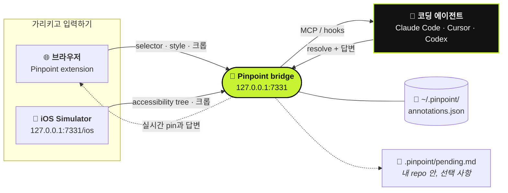

<div align="center">

# 📍 Pinpoint

**실행 중인 앱을 가리키고, 바꿀 내용을 말하세요. 코딩 에이전트가 알아서 받아 갑니다.**

[](https://github.com/gowtham012/pinpoint/actions/workflows/test.yml)
[](https://www.npmjs.com/package/pinpoint-bridge)
[](../../LICENSE)
[](https://glama.ai/mcp/servers/gowtham012/pinpoint)
[](https://github.com/hesreallyhim/awesome-claude-code)
[](https://github.com/gowtham012/pinpoint/stargazers)

[English](../../README.md) ·
[తెలుగు](README.te.md) ·
[हिन्दी](README.hi.md) ·
[தமிழ்](README.ta.md) ·
[简体中文](README.zh-CN.md) ·
[日本語](README.ja.md) ·
**한국어** ·
[Español](README.es.md) ·
[Français](README.fr.md) ·
[Deutsch](README.de.md) ·
[Português](README.pt-BR.md) ·
[Русский](README.ru.md) ·
[العربية](README.ar.md)

이 문서는 번역본입니다. 기준 문서는 영어 README이며, 영어 쪽이 더 최신일 수 있습니다.


<sub>요소를 클릭하고, 바꿀 내용을 말하면, 에이전트가 받아 갑니다. · <a href="../demo.mp4">원래 속도 영상</a></sub>

</div>

---

로컬 개발 사이트에서 요소를 클릭하고 바꿀 내용을 입력하면, 코딩 에이전트가 코드를 찾는 데 필요한 정보를
모두 함께 받습니다. **selector**, **DOM 경로**, **computed style**, **React/Vue 컴포넌트 체인**,
**소스 파일 힌트**, 그리고 **잘라 낸 스크린샷**까지요. Downloads 폴더에 스크린샷이 쌓일 일도, "왼쪽에서
세 번째 버튼"을 말로 설명할 일도 없습니다.

겉모습뿐 아니라 **동작**에도 쓸 수 있습니다. "*폼이 유효해질 때까지 이 버튼을 비활성화해 줘*"나
*"닫기 전에 초안을 저장해 줘"* 같은 노트도 괜찮습니다. 에이전트는 요소를 출발점으로 삼고, 그 뒤에 있는
handler, state, API 호출, 백엔드까지 따라 들어갑니다.

네이티브 앱을 만들고 있나요? [**iOS Simulator**](#-네이티브-ios-앱)에서도 똑같이 동작합니다.



## 목차

- [빠른 시작](#-빠른-시작)
- [사용법](#-사용법)
- [대화로 다듬기](#-대화로-다듬기)
- [에이전트가 노트를 알게 되는 방법](#-에이전트가-노트를-알게-되는-방법)
- [네이티브 iOS 앱](#-네이티브-ios-앱)
- [다른 에이전트 연결하기](#-다른-에이전트-연결하기)
- [레퍼런스](#-레퍼런스): 명령어, MCP 도구, 노트에 담기는 내용
- [문제 해결](#-문제-해결)
- [보안과 개인정보](#-보안과-개인정보)

## 다른 도구와 비교

| | 누가 주도하나 | 에이전트가 받는 것 |
|---|---|---|
| **Pinpoint** | **내가** 가리키고 바꿀 내용을 말함 | Selector, style, 컴포넌트 체인, 소스 힌트, 크롭 이미지 |
| Playwright MCP, computer-use | 에이전트가 탐색하고 클릭함 | 브라우징하면서 찾아낸 것 |
| 붙여 넣은 스크린샷 | 나 | 픽셀뿐이라, 어떤 컨트롤을 말하는지 추측해야 함 |

Pinpoint는 페이지 자체를 전혀 건드리지 않습니다. 그래서 브라우저 자동화와 경쟁하는 게 아니라 함께 쓸 수
있습니다. 대상을 가리키고, 코드는 에이전트가 고치고, 브라우저는 테스트가 돌리면 됩니다.

## 🚀 빠른 시작

**필요한 것:** Node 18+ 와 Chromium 계열 브라우저(Chrome, Edge, Brave, Arc, Opera, Vivaldi).

**1. 설치**

```bash
git clone https://github.com/gowtham012/pinpoint
node pinpoint/bridge/cli.js setup
```

`setup`이 몇 가지 질문을 합니다. 모두 기본값이 있어서 Enter만 계속 눌러도 됩니다.
Claude Code, Cursor, Codex 중 설치된 것을 연결하고, Claude Code hook을 설치한 뒤 bridge를 시작합니다.

**2. extension 로드.** Chrome은 터미널에서 프로필에 extension을 로드하는 걸 허용하지 않습니다. 그래서
setup이 extensions 페이지를 열고 폴더 경로를 복사해 둡니다. **Developer mode**(개발자 모드)를 켜고
**Load unpacked**(압축해제된 확장 프로그램을 로드합니다)를 클릭한 뒤 붙여 넣으세요. 그러면 터미널에
**✓ Pinpoint is live in Chrome**이 저절로 표시됩니다.

**3. Claude Code를 한 번 재시작**해서 새 MCP 서버와 hook을 읽어 들이게 하세요.

**써 보기:** 개발 사이트(또는 [데모 페이지](#직접-써-볼-수-있는-페이지))를 열고 **⌥⇧A** /
**Alt+Shift+A**를 누른 다음, 요소를 클릭하고 바꿀 내용을 입력한 뒤 **⌘↩** / **Ctrl+Enter**를 누르세요.
그다음 Claude Code에 아무 메시지나 입력하면 노트가 함께 전달됩니다.

> [!TIP]
> 단계별로 자세히 보고 싶다면 [docs/quick-install.md](../quick-install.md)를 참고하세요.
> 네이티브 iOS 앱만 만든다면 clone은 건너뛰어도 됩니다:
> `npx -y pinpoint-bridge`, 그다음 `claude mcp add pinpoint -s user -- npx -y pinpoint-bridge mcp`.

<details>
<summary><b>setup 자세히 보기, 수동 설정, Windows와 <code>file://</code></b></summary>

`setup`이 묻는 것:

- **어느 프로젝트의 UI에 annotation을 달지**: 에이전트가 수정할 repo
- **웹 앱, 네이티브 iOS 앱, 또는 둘 다**: 웹은 브라우저 extension을, iOS는
  [Simulator picker](#-네이티브-ios-앱)를 씁니다. setup이 Xcode, Maestro, Java가 있는지 확인하고
  없는 게 있으면 설치 방법을 알려 줍니다(직접 설치하지는 않습니다).
- **어떤 에이전트를 연결할지**: Claude Code는 `claude mcp add`, Cursor는 `<project>/.cursor/mcp.json`,
  Codex는 `~/.codex/config.toml`. 기존 항목은 덮어쓰지 않고 병합하며, TOML 파일은 먼저 백업합니다.
- **Claude Code hook을 설치할지**: 설치하면 대기 중인 노트가 다음 메시지와 함께 들어옵니다
- **어느 브라우저**에 extension을 로드할지(설치된 브라우저만 보여 줍니다)

그런 다음 popup의 **Start bridge**(bridge 시작) 버튼 뒤에서 동작하는 launcher를 등록하고 bridge를 시작합니다.
비대화형으로 실행하려면: `node pinpoint/bridge/cli.js setup ~/code/my-app --yes` (`--for ios` 또는
`--for both`를 추가할 수 있고, 기본값은 `web`입니다).

**수동 설정.** 순서가 중요합니다. `$PWD`가 MCP 항목에 그대로 박히기 때문에, bridge가 터미널을 차지하기
전에 2단계를 `pinpoint/bridge`에서 실행해야 합니다.

```bash
# 1. get it
git clone https://github.com/gowtham012/pinpoint
cd pinpoint/bridge && npm install

# 2. wire up Claude Code (once, from this folder)
claude mcp add pinpoint -s user -- node "$PWD/cli.js" mcp
node cli.js install-hooks ~/code/my-app                  # notes arrive without being asked
node cli.js install-native-host --project ~/code/my-app   # optional: the popup's "Start bridge" button

# 3. load extension/ unpacked at chrome://extensions (Developer mode on)
# 4. start the bridge, and leave it running
node cli.js --project ~/code/my-app
```

`--project`는 선택 사항입니다. MCP 대신 파일을 읽는 에이전트를 위해 `<repo>/.pinpoint/pending.md`를
최신 상태로 유지해 줍니다.

**`file://` 페이지.** Chrome은 기본적으로 막아 둡니다. `chrome://extensions` → Pinpoint → **Details**(세부정보) →
**Allow access to file URLs**(파일 URL에 대한 액세스 허용)를 켜고 새로고침하세요.

**Windows.** `$PWD`는 PowerShell과 Git Bash에서는 동작하지만 `cmd.exe`에서는 동작하지 않습니다.
`node cli.js --help`를 실행하고, 전체 경로가 들어간 `claude mcp add …` 줄을 복사해서 쓰세요.
`install-native-host`는 macOS와 Linux 전용이라, Windows에서는 터미널에서 bridge를 시작하세요.

**다른 곳에도 등록되어 있습니다:** [공식 MCP Registry](https://registry.modelcontextprotocol.io)
(`io.github.gowtham012/pinpoint`), [cursor.directory](https://cursor.directory/plugins/pinpoint)
(원클릭 **Add to Cursor**), [Glama](https://glama.ai/mcp/servers/gowtham012/pinpoint). 이곳들은
MCP 서버만 설치하므로, 웹 페이지에는 여전히 extension과 bridge가 필요합니다.
</details>

## 🖱️ 사용법

bridge가 실행 중이면 페이지 오른쪽 위에 작은 바가 나타납니다.

| | | |
|---|---|---|
|  |  |  |
| 단축키를 보여 주고, 에이전트가 작업하는 동안 불이 들어옵니다. | 몇 초 뒤 점으로 접힙니다. 마우스를 올리면 다시 펼쳐집니다. | 선택 중. 클릭이 바를 통과하므로 대상을 가리지 않습니다. |

1. 바를 클릭하거나 **⌥⇧A** / **Alt+Shift+A**를 눌러 표시를 시작합니다.
2. 요소를 클릭하거나, 여러 요소를 **드래그**로 묶어서 선택합니다(*"모바일에서 이 카드들을 두 개씩 배치해 줘"*).
3. 바꿀 내용을 입력하고 **⌘↩** / **Ctrl+Enter**를 누릅니다. 바로 다음 요소로 넘어갈 수 있습니다.
4. 끝나면 **Esc** 또는 **Stop**(중지)을 누릅니다.

<table>
<tr>
<td width="50%"></td>
<td width="50%"></td>
</tr>
<tr>
<td>popover가 선택한 요소를 정확히 이름으로 보여 주므로, 거의 똑같은 버튼 두 개를 헷갈릴 일이 없습니다.</td>
<td>번호가 붙은 pin이 요소에 붙어 있습니다. 새로고침해도 남아 있고, 같은 페이지를 연 모든 탭에 보이며, 에이전트가 작업을 끝내면 사라집니다.</td>
</tr>
</table>

- **바 옮기기:** 손잡이를 잡고 페이지 어디로든 드래그하면 됩니다. 그 사이트에서는 그 위치에 계속 머뭅니다.
- **바의 카운터**를 누르면 이 페이지에 표시한 항목이 모두 나열됩니다. 행을 클릭하면 해당 위치로 이동합니다.
- **×** 를 누르면 그 사이트에서 바가 숨겨집니다. 툴바 popup에서 다시 켤 수 있습니다.
- **pin은 요소를 따라갑니다.** DOM을 다시 그리는 앱에서도 마찬가지이고, 원래 요소가 사라지면 엉뚱한
  요소 위에 남지 않고 숨겨집니다.
- **bridge가 꺼져 있나요?** **Send**(보내기)가 대신 바로 붙여 넣을 수 있는 prompt를 복사해 주므로 잃어버리는 건 없습니다.

**동작하는 곳.** 로컬 개발 페이지에서만 동작합니다: `localhost`, `127.0.0.1`, `.local` / `.test` /
`.localhost` 호스트, 그리고 허용한 경우 `file://`. 그 밖의 주소(staging URL, 휴대폰 테스트용 LAN 주소 등)에서는
툴바 popup으로 탭 하나에 대해 켤 수 있습니다.

## 💬 대화로 다듬기

노트는 일방통행 티켓이 아니라 대화입니다.

- **에이전트가 되물을 수 있습니다.** 요청이 모호하면 추측하지 않고 질문합니다. 질문은 pin 위(**?**)와
  toast로 표시되고, notes 패널에서 답하면 노트가 대화 전체와 함께 다시 전달됩니다.
- **답변은 브라우저에서 읽습니다.** 완료된 노트는 무엇을 바꿨는지 적은 에이전트의 노트와 함께 패널에 남습니다.
  에이전트는 반드시 이걸 작성해야 합니다. "done"은 답이 아닙니다.
- **뭔가 아쉬운가요?** 완료된 노트마다 **Reply…**(답장)가 있습니다. 아직 잘못된 점을 말하면 노트가 다시 열립니다.
- **Draft.** **Draft**(임시 저장, 또는 **⇧⌘↩**)는 보내지 않고 표시만 해 둡니다. 바의 **Send**를 누르면
  모든 draft를 한 번에 넘깁니다.
- **페이지 전체.** 선택 중에 **Whole page**(페이지 전체)를 누르면 페이지 자체에 대한 노트를 스크린샷과 함께
  남길 수 있습니다(*"전체적으로 간격이 너무 빽빽해"*).


**pin 아래의 페이지가 바뀌면**, 에이전트에게 이미 깨진 selector를 넘기는 대신 요소가 오래되었을(stale) 수
있다고 알려 줍니다. `recheck_annotation`은 그 자리에서 다시 확인하고, 원본 옆에 새로 잘라 낸 이미지를 돌려줍니다.


<sub>같은 노트 두 개를 두 번 보여 줍니다. 패널이 처음부터 다시 그려지면, 노트 1은 완전히 새로운 노드들 사이에서 요소를 다시 찾고, 노트 2는 이 화면에 없다고 솔직하게 알려 줍니다.</sub>

<details>
<summary><b>브라우저에서 bridge 시작하기, 그리고 여러 에이전트 동시에 쓰기</b></summary>

**브라우저에서 시작 / 재시작.** `install-native-host`는 Chrome(그리고 Brave, Edge, Arc, Chromium,
Vivaldi, Opera)에 작은 launcher를 등록합니다. 그러면 popup의 **Start bridge**가 동작하고, 새 빌드를 pull한
뒤에는 바의 **↻** 로 bridge를 재시작할 수 있습니다. launcher가 할 수 있는 일은 딱 하나입니다. 이 repo의
`cli.js`를 popup 설정에 있는 포트 번호로 실행하는 것뿐이며, 그 번호를 페이지에서 받아 오는 일은 절대 없습니다.

**여러 에이전트.** 에이전트는 MCP로 자신을 소개하기 때문에, 바에 지금 작업 중인 에이전트 이름
(`claude-code`, `cursor-vscode`, `codex`)이 표시되고 답변마다 누가 썼는지 표시됩니다. `wait_for_annotation`은
새 노트를 대기 중인 에이전트 정확히 하나에게만 넘기므로, 두 에이전트가 같은 노트를 중복 작업하지 않고 큐를 나눠 씁니다.
</details>

## 🔔 에이전트가 노트를 알게 되는 방법

방법은 세 가지이며, 가장 확실한 것부터 나열했습니다. 셋 다 함께 써도 됩니다.

| | 방식 | 설정 |
|---|---|---|
| **Hooks** (자동) | 대기 중인 노트가 다음 메시지에 함께 실려 갑니다. 대기 중인 게 없으면 아무것도 출력하지 않습니다. | `node cli.js install-hooks <repo>` (setup이 해 줌) |
| **MCP** (요청 시) | UI나 기능 변경 이야기를 할 때마다 확인하라고 서버가 에이전트에게 알려 줍니다. | MCP 항목 |
| **Watch loop** (알아서 처리) | *"watch pinpoint and apply each change as it comes in"* 이라고 말하면, Send를 누르는 순간 노트가 하나씩 도착합니다. | 없음 |

코멘트가 곧 지시이고, 무언가가 어떻게 **보이는지**에 대한 것일 수도, 무엇을 **하는지**에 대한 것일 수도
있습니다. 결과를 구체적으로 말할수록(*"~해야 한다"*, *"~ 대신"*, *"~하면 ~한다"*) 에이전트가 추측할 부분이 줄어듭니다.

## 📱 네이티브 iOS 앱

네이티브 앱에는 DOM이 없으므로, 이 경로에서는 **accessibility tree**를 읽습니다. SwiftUI, UIKit,
React Native, Flutter 앱에서 동작하며, 앱에 아무것도 추가할 필요가 없습니다.

<table>
<tr>
<td width="50%"></td>
<td width="50%"></td>
</tr>
</table>

**필요한 것:** Simulator가 부팅된 Xcode와 [Maestro](https://maestro.dev)(Java가 필요합니다. Homebrew
`openjdk`는 PATH에 없어도 찾아냅니다).

bridge가 실행 중일 때 **http://127.0.0.1:7331/ios** 를 엽니다(setup이 대신 열어 줍니다). 마우스를 올려
각 요소를 확인하고, 하나를 클릭하고, 입력한 뒤 **⌘↩** 를 누르세요. 에이전트는 `accessibilityIdentifier`
(`testID`), label, tree 경로, frame, 크롭 이미지를 받습니다. 앱 화면이 바뀌면 **R** 을 누르세요.

**마땅한 앱이 없나요?** `bash demo/ios/run.sh`는 한 화면짜리 SwiftUI 데모 **Trailhead**를 `swiftc`만으로
빌드해서 부팅된 Simulator에 실행합니다.

<details>
<summary><b>제약 사항과 소요 시간</b></summary>

소스 파일 힌트나 컴포넌트 체인은 없습니다(tree에 그런 정보가 없기 때문입니다. 요소에 identifier를 붙여 두면
에이전트가 그걸로 grep합니다). style도, `recheck_annotation`도 없습니다. 처음 로드할 때는 Maestro가
기기 쪽 driver를 시작하느라 ~10초 정도 기다리고, 그 뒤로는 새로고침마다 1초 정도 걸립니다. Mac의 모든 Maestro가
driver 하나를 공유하므로, 다른 Maestro가 그걸 재시작하면 bridge가 새 Maestro를 띄우고 한 번 더 시도합니다.
첫 로드가 몇 분씩 걸린다면, Maestro MCP 서버가 붙어 있는 유휴 Claude Code 세션을 닫아 보세요.
</details>

## 🔌 다른 에이전트 연결하기

가장 간단한 방법은 배포된 패키지를 실행하는 것입니다: `npx -y pinpoint-bridge mcp`. 실행 중인 bridge가
무엇이든 그것과 통신합니다. 설정 후에는 에디터를 재시작하세요.

<details>
<summary><b>Cursor</b>: <a href="https://cursor.directory/plugins/pinpoint">cursor.directory</a>에서 원클릭, 또는 <code>.cursor/mcp.json</code></summary>

```json
{ "mcpServers": { "pinpoint": { "command": "npx", "args": ["-y", "pinpoint-bridge", "mcp"] } } }
```
</details>

<details>
<summary><b>Codex CLI</b>: <code>~/.codex/config.toml</code></summary>

```toml
[mcp_servers.pinpoint]
command = "npx"
args = ["-y", "pinpoint-bridge", "mcp"]
```
</details>

<details>
<summary><b>HTTP를 쓰는 모든 MCP 클라이언트</b>, 또는 <b>MCP 없이 쓰기</b></summary>

**HTTP:** `http://127.0.0.1:7331/mcp` (Streamable HTTP, stateless). Windsurf, Cline, Continue, Zed,
Gemini CLI 모두 URL을 받습니다.

**MCP 없이:** bridge를 `--project <repo>`로 실행하면 `<repo>/.pinpoint/pending.md`를 최신 상태로 유지합니다.
아무 에이전트에게나 *"read .pinpoint/pending.md and apply it"* 이라고 하면 되고, 에이전트는 각 항목을
`node cli.js resolve <id>`로 마무리합니다. 또는 popover의 **Copy prompt**(prompt 복사)를 눌러 아무 채팅에나 붙여 넣으세요.

npm 대신 내 clone을 쓰도록 에이전트를 고정하려면 `cli.js`의 절대 경로를 사용하세요
(`node cli.js --help`가 출력하는 줄을 복사하면 됩니다).
</details>

## 🌐 브라우저

| 브라우저 | 상태 |
|---|---|
| **Chrome, Edge, Brave, Arc, Opera, Vivaldi** | ✅ Load unpacked. CI에서 headless Chromium으로 검증. |
| **Safari** | ✅ `bash tools/make-safari.sh`로 빌드(Xcode 필요). 컴포넌트 체인과 소스 힌트 없음. |
| **Firefox** | ⏳ 아직 지원하지 않음. |

<details>
<summary><b>Safari에서 달라지는 점</b></summary>

Safari는 unpacked extension을 받지 않기 때문에, `tools/make-safari.sh`가 extension을 작은 macOS 앱으로 감싸고
바꿔야 할 Safari 설정 네 가지를 출력합니다(그중 핵심인 **Develop ▸ Allow Unsigned Extensions**는 Safari를
종료할 때마다 초기화됩니다). Safari는 `"world": "MAIN"` content script를 지원하지 않으므로 `inspector.js`가
React fiber나 Vue 인스턴스를 읽을 수 없습니다. 즉 **컴포넌트 체인과 소스 파일 힌트**를 쓸 수 없습니다.
나머지는 모두 동작합니다. Safari에는 bridge token을 넘겨줄 native host가 없어서 popup이 한 번 token을 묻습니다.
`node bridge/cli.js token`을 실행하고 출력값을 붙여 넣으세요. Mac App Store용으로는
`TEAM=<your team id> bash tools/make-safari.sh --release`가 서명된 빌드를 내보냅니다.
</details>

## 📚 레퍼런스

<details>
<summary><b>명령어</b> (<code>pinpoint/bridge</code>에서 실행)</summary>

```
node cli.js [start]            start the bridge (default command)
node cli.js mcp                run as a stdio MCP server
node cli.js status             is it running? how many pending?
node cli.js print              pending annotations as markdown  (--consume also resolves them)
node cli.js resolve <id...> --note "what you changed"
                               mark done — the pin disappears and your note is shown as the reply
node cli.js install-hooks [dir]  wire up Claude Code
node cli.js install-native-host   let the popup's "Start bridge" button start the bridge
                               (--uninstall removes it; --id <id> allows a second checkout)
node cli.js token              print the extension token (Safari asks for it once)
node cli.js clear              delete everything
node cli.js --help

http://127.0.0.1:7331/ios      the iOS Simulator picker, served by the running bridge

--port <n>       default 7331, or $PINPOINT_PORT (set the same number in the popup)
--project <dir>  mirror pending annotations into <dir>/.pinpoint/
--print          echo each new annotation to stdout as it arrives
$PINPOINT_HOME   where annotations are stored (default ~/.pinpoint)
```
</details>

<details>
<summary><b>MCP 도구</b></summary>

| 도구 | 용도 |
|---|---|
| `get_pending_annotations` | 대기 중인 항목 전체를 markdown 작업 목록으로, 항목마다 스크린샷 포함 |
| `list_annotations` | annotation당 한 줄 |
| `get_annotation` | id 또는 pin 번호 하나에 대한 전체 상세 정보 + 스크린샷 |
| `recheck_annotation` | 실행 중인 페이지에서 요소를 다시 찾아 무엇이 바뀌었는지 보고하고, 원본 옆에 새 크롭 이미지를 함께 제공 |
| `resolve_annotation` | 완료 처리 → 1초 안에 브라우저에서 pin이 사라짐 |
| `reply_annotation` | 추측하는 대신 개발자에게 질문. 답변은 대화와 함께 대기 상태로 돌아옴 |
| `wait_for_annotation` | 개발자가 다음 노트를 보낼 때까지 대기(block) |
| `clear_annotations` | 전부 삭제 |

Resource: `pinpoint://pending` (markdown).
</details>

<details>
<summary><b>노트에 담기는 내용</b></summary>

```
comment          "make this full-width on mobile"          ← the only instruction
page             url, title, viewport, scroll
element          tag, id, classes, a CSS selector built from stable attributes where they exist
                 (`button[data-action="next"]` rather than `:nth-of-type(2)`; shadow DOM via
                 "host >>> inner"), DOM path, rendered text, trimmed outerHTML, role/aria/data-*
                 attributes, bounding box, ~25 computed style properties, and a fingerprint
                 (tag + text + key attributes) used to verify a pin is still on the right element
source           framework (react/vue/svelte/angular/astro), component chain,
                 file:line where the dev build exposes it
screenshot       PNG of just the element (+8px), long edge ≤1200px
```

iOS Simulator에서 온 노트의 `element`에는 그 대신 accessibility identifier, label, text, value, tree 경로, frame이
담기고, `source`는 `ios-native`, `page.url`은 `ios-simulator://<device name>`입니다.

React 19나 Next에서 정확한 `file:line`을 얻으려면 개발 전용 inspector 플러그인
(`vite-plugin-react-inspector`, `@react-dev-inspector`)을 추가하세요. Pinpoint는 이 플러그인들의 `data-source`
속성은 물론, React의 `_debugSource`/`_debugStack`과 Vue의 `__file`도 읽습니다.
</details>

## 🩺 문제 해결

<details>
<summary>페이지에 바가 나타나지 않아요</summary>

바는 bridge가 실행 중일 때만 보입니다. `pinpoint/bridge`에서 `node cli.js status`를 확인하세요. bridge가
떠 있다면, 아마 Pinpoint가 자동으로 주입하는 페이지가 아닐 겁니다(*동작하는 곳* 참고). 툴바 popup을 열고
그 탭에서 켜 주세요.
</details>

<details>
<summary><code>file://</code> 페이지에서 아무것도 안 보여요</summary>

`chrome://extensions` → Pinpoint → **Details** → **Allow access to file URLs**를 켜고 새로고침하세요.
</details>

<details>
<summary>툴바의 점이 초록색으로 바뀌지 않아요</summary>

bridge가 실행 중이 아니거나 다른 포트에서 돌고 있는 경우입니다. popup의 **Port**와 bridge의 `--port`가
같아야 합니다. `node cli.js status`가 그 포트가 *answers, but it is NOT the pinpoint bridge* 라고 한다면
다른 무언가가 포트를 쓰고 있는 것입니다. bridge를 `--port 7332`로 시작하고 popup에도 7332를 설정하세요.
</details>

<details>
<summary><code>port 7331 is already in use</code></summary>

대개는 다른 터미널에서 bridge가 이미 실행 중인 것이니, 그대로 쓰면 됩니다. 아니라면 위처럼 비어 있는 포트를
고르세요. bridge 두 개를 동시에 실행하지 마세요. 저장 파일 하나를 공유합니다.
</details>

<details>
<summary>노트에 스크린샷이 없어요</summary>

스크린샷은 코멘트가 저장된 직후에 찍기 때문에 코멘트를 잃어버리는 일은 없습니다. 그 순간 페이지가 이동했거나
탭이 닫혔다면 노트에 그 이유가 기록됩니다. 코멘트, selector, style은 모두 그대로 남아 있습니다.
</details>

<details>
<summary>Claude Code가 내 노트를 언급하지 않아요</summary>

hook은 세션이 시작될 때 읽힙니다. `install-hooks` 후에 한 번 재시작하세요.
`<your repo>/.claude/settings.json`에 `print --hook`이 들어간 항목이 두 개 있는지, 그리고 그 경로가 아직
존재하는지 확인하세요(clone을 옮기면 깨집니다. `install-hooks`를 다시 실행하세요). 언제든
*"apply my pinpoint annotations"* 라고 말해도 됩니다.
</details>

<details>
<summary>"Start bridge"가 setup이 필요하다고 하거나 Node를 찾지 못해요</summary>

`node cli.js install-native-host`를 한 번 실행하고(repo를 옮겼다면 다시 실행), 브라우저를 완전히 종료했다가
다시 여세요. launcher에는 node의 절대 경로가 박혀 있으므로, node 위치가 바뀌었다면(새 nvm 버전, Homebrew
업그레이드 등) 다시 실행하세요.
</details>

<details>
<summary>처음부터 깨끗하게 시작하고 싶어요</summary>

`node cli.js clear`. repo 바깥에 있는 상태는 `~/.pinpoint/annotations.json`뿐입니다.
</details>

## 🔒 보안과 개인정보

- bridge는 `127.0.0.1`에서만 listen하고, 웹 페이지의 `Origin`이 붙은 요청은 거부합니다.
- extension은 `~/.pinpoint/token`에 있는 token을 제시해야 합니다.
- 페이지에서 수집한 모든 내용은 에이전트에 전달될 때 **untrusted**로 표시되며, 직접 입력한 코멘트만
  지시로 전달됩니다.
- 스크린샷은 별도 파일이 아니라 `~/.pinpoint/annotations.json` 안에 저장됩니다.

[SECURITY.md](../../SECURITY.md)에 trust boundary에 대한 전체 설명(`<all_urls>`가 왜 필요한지 포함)이 있고,
[PRIVACY.md](../../PRIVACY.md)에는 무엇을 수집하는지, 어디에 저장하는지, 그리고 데이터가 가는 유일한 곳인
연결된 코딩 에이전트에 대해 정확히 적혀 있습니다.

## 직접 써 볼 수 있는 페이지

`demo/index.html`은 빌드도 네트워크도 필요 없는 독립형 데모 사이트입니다. 영역 드래그용 카드 그리드,
거의 똑같은 버튼들, 스스로 다시 그려지는 탭 패널, 빽빽한 테이블, 그리고 폼이 들어 있습니다.

```bash
cd demo && python3 -m http.server 8080     # then open http://localhost:8080
```

## 🧪 테스트

```bash
cd test && npm install && npx playwright install chromium && npm test
```

테스트는 152개입니다. `bridge.test.mjs`는 daemon, CLI, hook, iOS picker, 그리고 stdio와 Streamable HTTP
위의 모든 MCP 도구를 다룹니다. `e2e.test.mjs`는 extension을 headless Chromium에 로드해서 실제 페이지를
돌립니다: React, Vue, shadow DOM, iframe, 엄격한 CSP, 3,600개 노드 스트레스 페이지, DPR 2, 탭 간 동기화,
그리고 DOM 전체를 다시 그리는 폼까지. [CONTRIBUTING.md](../../CONTRIBUTING.md)를 참고하세요.

## 로드맵

- Android 에뮬레이터 지원
- Firefox
- 선택형 개발 전용 패키지를 통한 React Native와 Flutter의 네이티브 소스 힌트
- `chrome.debugger`를 통한 CSS 소스 매핑(어떤 rule이 이 색을 지정했고, 그게 어디 있는지)

## 기여하기

Issue와 pull request 모두 환영합니다. [CONTRIBUTING.md](../../CONTRIBUTING.md)를 참고하세요. 빌드 단계는
없습니다. clone하고, `bridge/`에서 `npm install`을 실행하고, `extension/`을 unpacked로 로드하면 끝입니다.
동작이 바뀌는 변경에는 항상 테스트가 함께 들어갑니다.

## 라이선스

MIT. [LICENSE](../../LICENSE)를 참고하세요. 릴리스 노트는 [CHANGELOG.md](../../CHANGELOG.md)에 있습니다.
