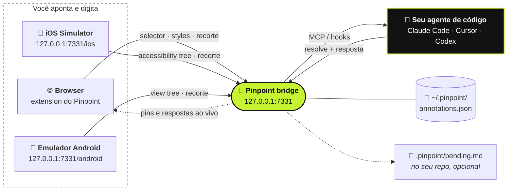

<div align="center">

#  Pinpoint

**Aponte para o seu app rodando. Diga o que deve mudar. Seu agente de código recebe tudo.**

[](https://github.com/gowtham012/pinpoint/actions/workflows/test.yml)
[](https://www.npmjs.com/package/pinpoint-bridge)
[](../../LICENSE)
[](https://glama.ai/mcp/servers/gowtham012/pinpoint)
[](https://github.com/hesreallyhim/awesome-claude-code)
[](https://github.com/gowtham012/pinpoint/stargazers)

[English](../../README.md) ·
[తెలుగు](README.te.md) ·
[हिन्दी](README.hi.md) ·
[தமிழ்](README.ta.md) ·
[简体中文](README.zh-CN.md) ·
[日本語](README.ja.md) ·
[한국어](README.ko.md) ·
[Español](README.es.md) ·
[Français](README.fr.md) ·
[Deutsch](README.de.md) ·
**Português** ·
[Русский](README.ru.md) ·
[العربية](README.ar.md)

<sub>Esta é uma tradução; o README em inglês é a referência oficial e pode estar mais atualizado.</sub>


<sub>Clique em um elemento, diga o que deve mudar e seu agente recebe. · <a href="../demo.mp4">vídeo em velocidade real</a></sub>

</div>

---

Clique em um elemento do seu site de desenvolvimento local, digite o que deve mudar, e o seu agente de
código recebe a nota com tudo o que precisa para achar o código: o **selector**, o **DOM path**, os
**computed styles**, a **cadeia de componentes React/Vue**, uma **dica do arquivo-fonte** e um
**screenshot recortado**. Nada de prints se acumulando em Downloads, nada de descrever "o terceiro botão
da esquerda".

Funciona para **comportamento**, não só para aparência. *"Desabilite isto até o formulário ser válido"*
ou *"salve o rascunho antes de fechar"* são notas perfeitamente válidas: o agente trata o elemento como
ponto de partida e segue a partir dele até os handlers, o state, as chamadas de API e o backend por trás.

Está fazendo um app nativo? O mesmo funciona no **[iOS Simulator](#-apps-nativos-de-ios)** e no
**[emulador Android](#-emulador-android)**.



## Conteúdo

- [Início rápido](#-início-rápido)
- [Como usar](#-como-usar)
- [Conversando com o agente](#-conversando-com-o-agente)
- [Como o seu agente fica sabendo](#-como-o-seu-agente-fica-sabendo)
- [Apps nativos de iOS](#-apps-nativos-de-ios)
- [Emulador Android](#-emulador-android)
- [Conectando outros agentes](#-conectando-outros-agentes)
- [Referência](#-referência): comandos, ferramentas MCP, o que uma nota contém
- [Solução de problemas](#-solução-de-problemas)
- [Segurança e privacidade](#-segurança-e-privacidade)

## Como ele se compara

| | Quem conduz | O que o agente recebe |
|---|---|---|
| **Pinpoint** | **Você** aponta e diz o que deve mudar | Selector, styles, cadeia de componentes, dica do fonte, recorte |
| Playwright MCP, computer-use | O agente navega e clica | O que ele conseguir achar navegando |
| Um screenshot colado | Você | Só pixels, então ele chuta qual controle você quis dizer |

O Pinpoint nunca mexe na página em si, então ele se soma à automação de browser em vez de competir com
ela: aponte para a coisa, deixe o agente mudar o código e deixe seus testes conduzirem o browser.

## 🚀 Início rápido

**Você precisa de** Node 18+ e um browser baseado em Chromium (Chrome, Edge, Brave, Arc, Opera, Vivaldi), ou
o [Firefox 140+](#-browsers).

**1. Instale**

```bash
git clone https://github.com/gowtham012/pinpoint
node pinpoint/bridge/cli.js setup
```

O `setup` faz algumas perguntas. Todas têm um valor padrão, então dá para ir apertando Enter até o fim.
Ele configura o Claude Code, o Cursor e o Codex (os que você tiver), instala os hooks do Claude Code e
inicia o bridge.

**2. Carregue a extension.** O Chrome não deixa um terminal carregar uma extension no seu perfil, então o
setup abre a página de extensions e copia o caminho da pasta para você: ative o **Developer mode** (modo
do desenvolvedor), clique em **Load unpacked** (carregar sem compactação) e cole. O terminal confirma
**✓ Pinpoint is live in Chrome** sozinho.

**3. Reinicie o Claude Code uma vez**, para ele ler o novo MCP server e os hooks.

**Experimente:** abra seu site de dev (ou [a página de demo](#uma-página-para-testar)), aperte **⌥⇧A** /
**Alt+Shift+A**, clique em um elemento, digite o que deve mudar e depois **⌘↩** / **Ctrl+Enter**. Digite
qualquer coisa no Claude Code e a sua nota vai junto.

> [!TIP]
> Quer cada passo detalhado? Veja [docs/quick-install.md](../quick-install.md).
> Só está fazendo um app nativo de iOS ou Android? Pule o clone:
> `npx -y pinpoint-bridge`, depois `claude mcp add pinpoint -s user -- npx -y pinpoint-bridge mcp`.

<details>
<summary><b>Setup em detalhes, fazendo na mão, Windows e <code>file://</code></b></summary>

O `setup` pergunta:

- **de qual projeto é a UI que você quer anotar**: o repo que o seu agente vai editar
- **web app, app nativo de iOS, app Android, ou ambos** (web e iOS): web recebe a extension do
  browser; iOS recebe o [picker do Simulator](#-apps-nativos-de-ios), Android o
  [picker do emulador](#-emulador-android). O setup verifica Xcode, Maestro e Java (iOS) ou adb
  (Android) e diz como obter o que estiver faltando (ele não instala nenhum deles).
- **quais agentes configurar**: `claude mcp add` para o Claude Code, `<project>/.cursor/mcp.json` para o
  Cursor, `~/.codex/config.toml` para o Codex. Entradas existentes são mescladas, nunca substituídas, e
  o arquivo TOML ganha um backup antes.
- **se deve instalar os hooks do Claude Code**, que trazem as notas pendentes junto com a sua próxima
  mensagem
- **em qual browser** carregar a extension (só os que você tem)

Depois ele registra o launcher por trás do botão **Start bridge** (iniciar bridge) do popup e inicia o
bridge. Modo não interativo: `node pinpoint/bridge/cli.js setup ~/code/my-app --yes` (adicione
`--for ios`, `--for android` ou `--for both`; o padrão é `web`).

**Na mão.** A ordem importa: o `$PWD` fica gravado na entrada do MCP, então o passo 2 roda a partir de
`pinpoint/bridge` antes de o bridge tomar conta do terminal.

```bash
# 1. get it
git clone https://github.com/gowtham012/pinpoint
cd pinpoint/bridge && npm install

# 2. wire up Claude Code (once, from this folder)
claude mcp add pinpoint -s user -- node "$PWD/cli.js" mcp
node cli.js install-hooks ~/code/my-app                  # notes arrive without being asked
node cli.js install-native-host --project ~/code/my-app   # optional: the popup's "Start bridge" button

# 3. load extension/ unpacked at chrome://extensions (Developer mode on)
# 4. start the bridge, and leave it running
node cli.js --project ~/code/my-app
```

O `--project` é opcional: ele mantém o `<repo>/.pinpoint/pending.md` atualizado para agentes que leem
um arquivo em vez de usar MCP.

**Páginas `file://`.** O Chrome as deixa bloqueadas por padrão: `chrome://extensions` → Pinpoint →
**Details** (detalhes) → **Allow access to file URLs** (permitir acesso a URLs de arquivo) e depois
recarregue.

**Windows.** O `$PWD` funciona no PowerShell e no Git Bash, mas não no `cmd.exe`; rode
`node cli.js --help` e copie a linha `claude mcp add …` que ele imprime, que já tem o caminho completo.
O `install-native-host` é só para macOS e Linux; no Windows, inicie o bridge em um terminal.

**Também está listado no** [MCP Registry oficial](https://registry.modelcontextprotocol.io)
(`io.github.gowtham012/pinpoint`), no [cursor.directory](https://cursor.directory/plugins/pinpoint)
(um clique em **Add to Cursor**) e no [Glama](https://glama.ai/mcp/servers/gowtham012/pinpoint). Eles
instalam só o MCP server; páginas web continuam precisando da extension e do bridge.
</details>

## 🖱️ Como usar

Enquanto o bridge roda, uma barrinha fica no canto superior direito da sua página.

| | | |
|---|---|---|
|  |  |  |
| Mostra o atalho e acende enquanto o seu agente trabalha. | Vira um ponto depois de alguns segundos. Passe o mouse para trazê-la de volta. | Selecionando. A barra deixa os cliques passarem, então nunca bloqueia o seu alvo. |

1. Clique na barra (ou **⌥⇧A** / **Alt+Shift+A**) para começar a marcar.
2. Clique em um elemento, ou **arraste** uma caixa em volta de um grupo (*"deixe esses cards em duas
   colunas no mobile"*).
3. Digite o que deve mudar e aperte **⌘↩** / **Ctrl+Enter**. Já pode partir para o próximo.
4. **Esc** ou **Stop** (parar) quando terminar.

<table>
<tr>
<td width="50%"></td>
<td width="50%"></td>
</tr>
<tr>
<td>O popover mostra exatamente o que você selecionou, então dois botões quase idênticos não se confundem.</td>
<td>Um pin numerado gruda no elemento. Ele sobrevive a reloads, aparece em todas as abas daquela página e some quando o agente termina.</td>
</tr>
</table>

- **Mova a barra** arrastando a alça dela para qualquer lugar da página; ela fica ali naquele site.
- **O contador** na barra lista tudo o que foi marcado nesta página. Clique em uma linha para pular até
  o item.
- **O ×** esconde a barra naquele site; o popup da toolbar traz ela de volta.
- **Os pins acompanham o elemento** em apps que reconstroem o DOM, e se escondem em vez de ficar em cima
  do elemento errado quando o deles some.
- **Nenhum bridge rodando?** O **Send** (enviar) copia um prompt pronto para colar, então nada se perde.
- **Grave os passos.** Durante a seleção, aperte **Record steps** (gravar passos) na barra e clique pelo
  bug como faria normalmente. Os cliques continuam chegando à página e cada um vira um passo (elemento,
  label, URL, um pequeno recorte), inclusive entre navegações na mesma aba. **Done** (concluir) grava uma
  nota (no máximo 10 passos); **Esc** descarta a gravação. O seu agente recebe tudo como *Steps to
  reproduce* (passos para reproduzir).
- **Dite.** Aperte o microfone na caixa de comentário e fale; o texto é adicionado ao que você digitou.
  Funciona no Chrome e no Safari em páginas seguras (localhost conta); quem faz a transcrição é o próprio
  serviço de voz do browser. Não funciona no Firefox.
- **O que deu errado vai junto.** Cada nota leva os erros não tratados e as requisições que falharam na
  página no minuto anterior à marcação, redigidos antes no próprio browser (query strings, tokens e
  segredos removidos). Só são anexados quando algo de fato deu errado.

**Onde funciona.** Só em páginas de desenvolvimento local: `localhost`, `127.0.0.1`, hosts `.local` /
`.test` / `.localhost`, e `file://` depois de liberado. Em qualquer outro lugar (uma URL de staging, um
endereço da rede local para testar no celular) o popup da toolbar liga o Pinpoint para uma aba.

## 💬 Conversando com o agente

Uma nota é uma conversa, não um ticket de mão única.

- **O agente pode perguntar de volta.** Se um pedido for ambíguo, ele pergunta em vez de chutar. A
  pergunta aparece no pin (um **?**) e como toast; responda no painel de notas e a nota volta com a
  conversa inteira.
- **Você lê a resposta no browser.** Uma nota concluída fica no painel com a observação do próprio
  agente sobre o que ele mudou. Os agentes são obrigados a escrever uma: "feito" não é resposta.
- **Accept / Not quite.** Quando o agente termina, um card mostra a resposta dele com **Accept**
  (aceitar) e **Not quite** (não é bem isso). O Not quite reabre a nota para você dizer o que ainda está
  errado.
- **Não ficou bem assim, mais tarde?** Toda nota concluída no painel tem **Reply…** (responder). Diga o
  que ainda está errado e ela é reaberta.
- **Before / After.** Alguns segundos depois de uma nota ser resolvida, o Pinpoint tira um recorte novo
  do elemento. As notas concluídas no painel mostram **Before** (antes) e **After** (depois) lado a lado.
- **Rascunhos.** **Draft** (rascunho, ou **⇧⌘↩**) marca algo sem enviar. O **Send** na barra entrega
  todos os rascunhos de uma vez.
- **A página inteira.** Durante a seleção, **Whole page** (página inteira) cria uma nota sobre a página
  em si (*"o espaçamento parece apertado em tudo"*), com um screenshot.


**Quando a página muda embaixo de um pin**, o agente é avisado de que o elemento pode estar
desatualizado, em vez de receber um selector que já não vale mais. O `recheck_annotation` olha de novo
na hora e devolve um recorte novo ao lado do original.


<sub>As mesmas duas notas, duas vezes. O painel é reconstruído do zero: a nota 1 reencontra o seu elemento entre nodes totalmente novos, a nota 2 admite que ele não está nesta view.</sub>

<details>
<summary><b>Iniciando o bridge pelo browser, e vários agentes ao mesmo tempo</b></summary>

**Iniciar / reiniciar pelo browser.** O `install-native-host` registra um launcher minúsculo no Chrome
(e no Brave, Edge, Arc, Chromium, Vivaldi, Opera) e no Firefox. Aí o **Start bridge** do popup funciona, e o **↻**
na barra reinicia o bridge depois que você puxa um build novo. O launcher só sabe fazer uma coisa: rodar
o próprio `cli.js` deste repo em um número de porta vindo da configuração do popup, nunca da página.

**Vários agentes.** Os agentes se apresentam via MCP, então a barra mostra o nome de quem está
trabalhando (`claude-code`, `cursor-vscode`, `codex`) e cada resposta vem com a autoria. O
`wait_for_annotation` entrega cada nota nova para exatamente um agente em espera, então dois agentes
dividem a fila em vez de fazerem a mesma nota.
</details>

## 🔔 Como o seu agente fica sabendo

Três formas, da mais forte para a mais fraca. Usar as três ao mesmo tempo não tem problema.

| | Como | Setup |
|---|---|---|
| **Hooks** (automático) | As notas pendentes vão de carona na sua próxima mensagem. Não imprime nada quando não há nada pendente. | `node cli.js install-hooks <repo>` (o setup já faz) |
| **MCP** (sob demanda) | O server diz ao agente para conferir sempre que você fala de uma mudança de UI ou de feature. | a entrada do MCP |
| **Watch loop** (sem intervenção) | Diga *"watch pinpoint and apply each change as it comes in"* (fique de olho no pinpoint e aplique cada mudança assim que chegar); cada nota chega no momento em que você aperta Send. | nada |

O comentário é a instrução, e ele pode ser sobre como algo **parece** ou sobre o que ele **faz**. Quanto
mais você disser sobre o resultado (*"deveria"*, *"em vez de"*, *"quando … então …"*), menos o agente
precisa chutar.

## 📱 Apps nativos de iOS

Um app nativo não tem DOM, então esse caminho lê a **accessibility tree**. Funciona com apps SwiftUI,
UIKit, React Native e Flutter, sem adicionar nada ao seu app.

<table>
<tr>
<td width="50%"></td>
<td width="50%"></td>
</tr>
</table>

**Você precisa de** Xcode com um Simulator iniciado e do [Maestro](https://maestro.dev) (que precisa de
Java; um `openjdk` do Homebrew é encontrado mesmo fora do seu PATH).

Com o bridge rodando, abra **http://127.0.0.1:7331/ios** (o setup abre para você). Passe o mouse para
ver cada elemento, clique em um, digite, **⌘↩**. O agente recebe o `accessibilityIdentifier` (o seu
`testID`), o label, o caminho na árvore, o frame e um recorte. Aperte **R** depois que o app mudar.

**Não tem um app à mão?** O `bash demo/ios/run.sh` compila o **Trailhead**, uma demo SwiftUI de uma
tela só, usando apenas o `swiftc`, e abre no Simulator iniciado.

<details>
<summary><b>Limitações e tempos</b></summary>

Não há dica de arquivo-fonte nem cadeia de componentes (a árvore não tem nenhum dos dois; dê um
identifier aos elementos e o agente faz grep por ele), não há styles e não há `recheck_annotation`. O
primeiro carregamento espera ~10 s enquanto o Maestro inicia o driver no dispositivo; depois disso, cada
refresh leva cerca de um segundo. Todos os Maestro no seu Mac compartilham um driver, então se outro
reiniciá-lo, o bridge inicia um Maestro novo e tenta mais uma vez. Se o primeiro carregamento levar
minutos, feche as sessões ociosas do Claude Code que tenham o MCP server do Maestro.
</details>

## 🤖 Emulador Android

O mesmo picker do `/ios`, lendo a **view tree** do Android pelo adb. Nada é adicionado ao seu app e não
há driver para instalar.

<table>
<tr>
<td width="50%"></td>
<td width="50%"></td>
</tr>
</table>

**Você precisa do** `adb` do Android SDK (o Android Studio instala) e de um emulador rodando.

Com o bridge rodando, abra **http://127.0.0.1:7331/android**. Passe o mouse, clique, digite, envie. O
agente recebe o `resource-id` do elemento, o content-desc, o texto, a class, a posição dele na view tree
e um recorte. O `node bridge/cli.js setup --for android` verifica o adb e aponta você para o picker.

<details>
<summary><b>Como o adb é encontrado, e qual dispositivo é lido</b></summary>

O Pinpoint procura o adb em `$ANDROID_HOME`, `$ANDROID_SDK_ROOT` e na pasta padrão do SDK do Android
Studio, e depois no seu `PATH`. Com um emulador rodando, é ele que é usado. Com vários, ou para ler um
dispositivo físico, defina `ANDROID_SERIAL` com o serial dele (como o `adb devices` lista) e reinicie o
bridge. Um celular nunca é escolhido a menos que você o indique. Assim como no iOS, não há dica de
arquivo-fonte, não há styles e não há `recheck_annotation`: dê um id às views e o agente faz grep por ele.
</details>

## 🔌 Conectando outros agentes

A entrada mais simples roda o pacote publicado: `npx -y pinpoint-bridge mcp`. Ele conversa com o bridge
que estiver rodando. Reinicie o editor depois.

<details>
<summary><b>Cursor</b>: um clique pelo <a href="https://cursor.directory/plugins/pinpoint">cursor.directory</a>, ou <code>.cursor/mcp.json</code></summary>

```json
{ "mcpServers": { "pinpoint": { "command": "npx", "args": ["-y", "pinpoint-bridge", "mcp"] } } }
```
</details>

<details>
<summary><b>Codex CLI</b>: <code>~/.codex/config.toml</code></summary>

```toml
[mcp_servers.pinpoint]
command = "npx"
args = ["-y", "pinpoint-bridge", "mcp"]
```
</details>

<details>
<summary><b>Qualquer cliente MCP via HTTP</b>, ou <b>sem MCP nenhum</b></summary>

**HTTP:** `http://127.0.0.1:7331/mcp` (Streamable HTTP, stateless). Windsurf, Cline, Continue, Zed e
Gemini CLI aceitam uma URL.

**Sem MCP:** rode o bridge com `--project <repo>` e ele mantém o `<repo>/.pinpoint/pending.md`
atualizado. Diga para qualquer agente *"read .pinpoint/pending.md and apply it"* (leia o
.pinpoint/pending.md e aplique); ele conclui cada item com `node cli.js resolve <id>`. Ou use o
**Copy prompt** (copiar prompt) no popover e cole em qualquer chat.

Para fixar um agente no seu clone em vez do npm, use o caminho absoluto do `cli.js` (copie a
linha que o `node cli.js --help` imprime).
</details>

## 🌐 Browsers

| Browser | Status |
|---|---|
| **Chrome, Brave, Arc, Opera, Vivaldi** | ✅ Load unpacked. Verificado no CI com Chromium headless. |
| **Edge** | ✅ Load unpacked: o mesmo pacote do Chrome. |
| **Firefox 140+** | ✅ Um pacote para o addons.mozilla.org gerado com `bash tools/make-firefox-zip.sh`. Listagem na loja pendente. Sem ditado. |
| **Safari** | ✅ Gerado com `bash tools/make-safari.sh` (precisa de Xcode). Sem cadeia de componentes, dica do fonte nem erros da página. |

<details>
<summary><b>Edge e Firefox</b></summary>

O **Edge** usa o pacote do Chrome como está. Para o **Start bridge**, rode
`node bridge/cli.js install-native-host --id <edge id>` uma vez (o Edge dá à extension um id próprio).

**Firefox 140+.** Enquanto a listagem no addons.mozilla.org não estiver no ar, carregue o zip por
`about:debugging` → **This Firefox** → **Load Temporary Add-on**. Se o Firefox tiver negado acesso aos
sites locais, aperte **Grant access to local sites** no popup. Depois rode
`node bridge/cli.js install-native-host` uma vez para o **Start bridge**, ou cole a saída de
`node bridge/cli.js token` no popup.
</details>

<details>
<summary><b>O que muda no Safari</b></summary>

O Safari não aceita extensions sem compactação, então o `tools/make-safari.sh` empacota a extension em
um pequeno app de macOS e imprime as quatro configurações do Safari que você precisa ativar (a
principal, **Develop ▸ Allow Unsigned Extensions**, é resetada toda vez que o Safari fecha). O Safari
não suporta content scripts com `"world": "MAIN"`, então o `inspector.js` não consegue ler React fibers
nem instâncias do Vue: você perde a **cadeia de componentes e a dica do arquivo-fonte**, e os
**erros da página** (eles também precisam do MAIN world). As requisições que falharam só vão junto onde
o Safari suporta `webRequest`. Todo o resto funciona. O Safari não tem native host para repassar o token do bridge, então o popup pede o token uma
vez: rode `node bridge/cli.js token` e cole a saída. Para a Mac App Store,
`TEAM=<your team id> bash tools/make-safari.sh --release` exporta um build assinado.
</details>

## 📚 Referência

<details>
<summary><b>Comandos</b> (rode a partir de <code>pinpoint/bridge</code>)</summary>

```
node cli.js [start]            start the bridge (default command)
node cli.js mcp                run as a stdio MCP server
node cli.js status             is it running? how many pending?
node cli.js print              pending annotations as markdown  (--consume also resolves them)
node cli.js resolve <id...> --note "what you changed"
                               mark done — the pin disappears and your note is shown as the reply
node cli.js install-hooks [dir]  wire up Claude Code
node cli.js install-native-host   let the popup's "Start bridge" button start the bridge
                               (--uninstall removes it; --id <id> allows a second checkout)
node cli.js token              print the extension token (Safari asks for it once)
node cli.js clear              delete everything
node cli.js --help

http://127.0.0.1:7331/ios      the iOS Simulator picker, served by the running bridge
http://127.0.0.1:7331/android  the Android emulator picker (needs adb)

--port <n>       default 7331, or $PINPOINT_PORT (set the same number in the popup)
--project <dir>  mirror pending annotations into <dir>/.pinpoint/
--print          echo each new annotation to stdout as it arrives
$PINPOINT_HOME   where annotations are stored (default ~/.pinpoint)
$PINPOINT_AFTER_DELAY  ms after a resolve before the After crop (default 3000, 0 turns it off)
$ANDROID_SERIAL  which Android device to read, when it isn't the one running emulator
```
</details>

<details>
<summary><b>Ferramentas MCP</b></summary>

| tool | para que serve |
|---|---|
| `get_pending_annotations` | tudo o que está pendente como uma lista de tarefas em markdown, cada item com seu screenshot |
| `list_annotations` | uma linha por anotação |
| `get_annotation` | detalhes completos + screenshot de um id ou número de pin |
| `recheck_annotation` | reencontra o elemento na página ao vivo e informa o que mudou, com um recorte novo ao lado do original |
| `resolve_annotation` | marca como concluída → o pin some no browser em até um segundo |
| `reply_annotation` | faz uma pergunta ao desenvolvedor em vez de chutar; a resposta volta como pendente, com a conversa |
| `wait_for_annotation` | bloqueia até o desenvolvedor enviar a próxima |
| `clear_annotations` | apaga tudo |

Resource: `pinpoint://pending` (markdown).
</details>

<details>
<summary><b>O que uma nota contém</b></summary>

```
comment          "make this full-width on mobile"          ← the only instruction
page             url, title, viewport, scroll
element          tag, id, classes, a CSS selector built from stable attributes where they exist
                 (`button[data-action="next"]` rather than `:nth-of-type(2)`; shadow DOM via
                 "host >>> inner"), DOM path, rendered text, trimmed outerHTML, role/aria/data-*
                 attributes, bounding box, ~25 computed style properties, and a fingerprint
                 (tag + text + key attributes) used to verify a pin is still on the right element
source           framework (react/vue/svelte/angular/astro), component chain,
                 file:line where the dev build exposes it
screenshot       PNG of just the element (+8px), long edge ≤1200px
context          only when something went wrong: uncaught errors and failed requests from the
                 minute before, redacted in the browser
steps            recorded notes only: up to 10 clicks, each with selector, label, URL and a crop
after            on done notes: a fresh crop taken after the resolve
```

No iOS Simulator, o `element` traz em vez disso o accessibility identifier, label, texto, value, caminho
na árvore e frame; o `source` é `ios-native` e o `page.url` é `ios-simulator://<device name>`. No
emulador Android, são o `resource-id`, content-desc, texto, class, caminho na árvore e bounds; o
`source` é `android-native` e o `page.url` é `android-emulator://<avd>`.

Para ter o `file:line` exato no React 19 ou no Next, adicione um plugin de inspector só para dev
(`vite-plugin-react-inspector`, `@react-dev-inspector`). O Pinpoint lê os atributos `data-source`
deles, além do `_debugSource`/`_debugStack` do React e do `__file` do Vue.
</details>

## 🩺 Solução de problemas

<details>
<summary>Nenhuma barra aparece na página</summary>

A barra só aparece enquanto o bridge está rodando. Confira com `node cli.js status` a partir de
`pinpoint/bridge`. Se o bridge estiver no ar, provavelmente a página não é uma em que o Pinpoint se
injeta automaticamente (veja *Onde funciona*): abra o popup da toolbar e ative-o para aquela aba.
</details>

<details>
<summary>Nada aparece em uma página <code>file://</code></summary>

`chrome://extensions` → Pinpoint → **Details** → **Allow access to file URLs** e depois recarregue.
</details>

<details>
<summary>O ponto da toolbar nunca fica verde</summary>

O bridge não está rodando, ou está em outra porta: o **Port** do popup e o `--port` do bridge precisam
bater. Se o `node cli.js status` disser que a porta *answers, but it is NOT the pinpoint bridge*
(responde, mas NÃO é o bridge do pinpoint), outra coisa está usando a porta: inicie o bridge com
`--port 7332` e configure 7332 no popup.
</details>

<details>
<summary><code>port 7331 is already in use</code></summary>

Geralmente o bridge já está rodando em outro terminal, então está tudo certo. Se não, escolha uma porta
livre como acima. Não rode dois bridges ao mesmo tempo: eles compartilham um mesmo arquivo de store.
</details>

<details>
<summary>Uma nota ficou sem screenshot</summary>

A imagem é capturada logo depois de o seu comentário ser salvo, então o comentário nunca se perde. Se a
página navegou ou a aba fechou nesse instante, a nota registra o motivo. O comentário, o selector e os
styles continuam todos lá.
</details>

<details>
<summary>O Claude Code não menciona minhas notas</summary>

Os hooks são lidos quando uma sessão começa: reinicie uma vez depois do `install-hooks`. Confira se o
`<your repo>/.claude/settings.json` tem duas entradas contendo `print --hook` e se o caminho delas
ainda existe (mover o seu clone quebra isso; rode o `install-hooks` de novo). Você sempre pode dizer
*"apply my pinpoint annotations"* (aplique minhas anotações do pinpoint).
</details>

<details>
<summary>O "Start bridge" diz que falta setup, ou não encontra o Node</summary>

Rode `node cli.js install-native-host` uma vez (de novo, se você moveu o repo) e depois feche e reabra
o browser. O launcher grava um caminho absoluto para o node; se o node mudou de lugar (nova versão do
nvm, upgrade do Homebrew), rode de novo.
</details>

<details>
<summary>Você quer começar do zero</summary>

`node cli.js clear`. O `~/.pinpoint/annotations.json` é o único state fora do seu repo.
</details>

## 🔒 Segurança e privacidade

- O bridge escuta apenas em `127.0.0.1` e recusa requisições que tragam o `Origin` de uma página web.
- A extension precisa apresentar o token que está em `~/.pinpoint/token`.
- Tudo o que é extraído de uma página chega ao seu agente marcado como **untrusted** (não confiável);
  só o comentário que você digitou é apresentado como instrução.
- Os screenshots ficam dentro de `~/.pinpoint/annotations.json`, não como arquivos soltos.

O [SECURITY.md](../../SECURITY.md) tem as notas completas sobre os limites de confiança (incluindo por
que o `<all_urls>` é necessário) e o [PRIVACY.md](../../PRIVACY.md) diz exatamente o que é coletado,
onde fica armazenado e o único lugar para onde vai: o agente de código que você conectar.

## Uma página para testar

O `demo/index.html` é um site de demo autocontido (sem build, sem rede) com grids de cards para
arrastar regiões, botões quase idênticos, um painel de abas que se reconstrói, uma tabela densa e um
formulário.

```bash
cd demo && python3 -m http.server 8080     # then open http://localhost:8080
```

## 🧪 Testes

```bash
cd test && npm install && npx playwright install chromium && npm test
```

210 testes. O `bridge.test.mjs` cobre o daemon, a CLI, os hooks, o picker de iOS e todas as ferramentas
MCP via stdio e Streamable HTTP. O `e2e.test.mjs` carrega a extension em um Chromium headless e conduz
páginas reais: React, Vue, shadow DOM, iframes, CSP estrita, uma página de stress com 3.600 nodes,
DPR 2, sincronização entre abas e um formulário que reconstrói o DOM inteiro.

<details>
<summary><b>As outras suítes</b></summary>

| arquivo | cobre |
|---|---|
| `android-bridge.test.mjs` | encontrar o adb, escolher o dispositivo, fazer o parse da view tree, as rotas `/android` |
| `e2e-picker.test.mjs` | as páginas de picker `/ios` e `/android` em um Chromium headless |
| `ui-bridge.test.mjs`, `ui-flow.test.mjs`, `ui-after.test.mjs` | Accept, contexto da página, passos gravados, Before / After |
| `ui-redact.test.mjs` | as regras de redação do contexto da página |
| `ship-edge.test.mjs`, `ship-firefox.test.mjs`, `e2e-ship.test.mjs` | o upload para o Edge, o pacote e o native host do Firefox, o zip da loja e os caminhos do Firefox no popup |
| `ship-windows.test.mjs` | como o setup coloca aspas nos comandos para o `cmd.exe` |
</details>

Veja o [CONTRIBUTING.md](../../CONTRIBUTING.md).

## Roadmap

- Dicas de fonte nativas para React Native e Flutter, via um pacote opcional só para dev
- Mapeamento de fonte CSS via `chrome.debugger` (qual regra definiu esta cor, e onde)

## Como contribuir

Issues e pull requests são bem-vindos; veja o [CONTRIBUTING.md](../../CONTRIBUTING.md). Não há etapa de
build: clone, rode `npm install` em `bridge/` e carregue `extension/` com Load unpacked. Toda mudança de
comportamento vem acompanhada de um teste.

## Licença

MIT, veja [LICENSE](../../LICENSE). As release notes estão no [CHANGELOG.md](../../CHANGELOG.md).
