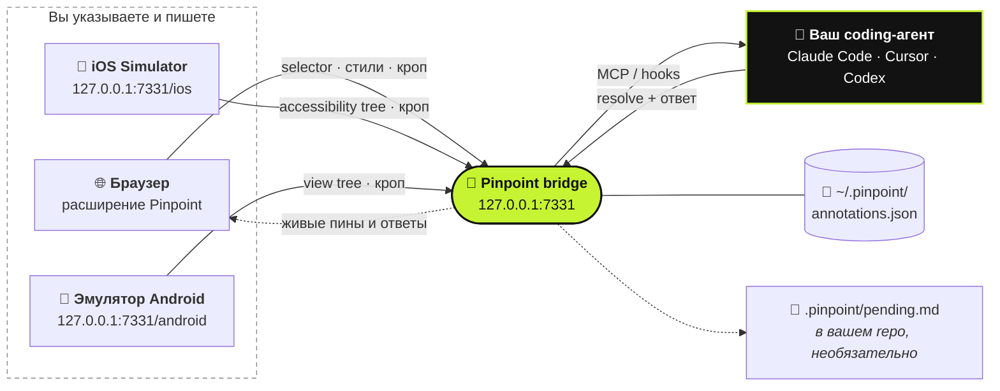

<div align="center">

# 📍 Pinpoint

**Укажите на элемент в запущенном приложении. Скажите, что поменять. Ваш coding-агент получит всё нужное.**

[](https://github.com/gowtham012/pinpoint/actions/workflows/test.yml)
[](https://www.npmjs.com/package/pinpoint-bridge)
[](../../LICENSE)
[](https://glama.ai/mcp/servers/gowtham012/pinpoint)
[](https://github.com/hesreallyhim/awesome-claude-code)
[](https://github.com/gowtham012/pinpoint/stargazers)

[English](../../README.md) ·
[తెలుగు](README.te.md) ·
[हिन्दी](README.hi.md) ·
[தமிழ்](README.ta.md) ·
[简体中文](README.zh-CN.md) ·
[日本語](README.ja.md) ·
[한국어](README.ko.md) ·
[Español](README.es.md) ·
[Français](README.fr.md) ·
[Deutsch](README.de.md) ·
[Português](README.pt-BR.md) ·
**Русский** ·
[العربية](README.ar.md)

<sub>Это перевод. Эталоном считается английский README — он может быть новее.</sub>


<sub>Кликните по элементу, скажите, что поменять, — агент всё получит. · <a href="../demo.mp4">видео в полной скорости</a></sub>

</div>

---

Кликните по элементу на своём локальном dev-сайте, напишите, что нужно изменить, и ваш coding-агент
получит это вместе со всем, что нужно для поиска кода: **selector**, **DOM-путь**, **computed styles**,
**цепочку React/Vue-компонентов**, **подсказку на исходный файл** и **обрезанный скриншот**. Никаких
скриншотов, копящихся в Downloads, и никаких описаний вроде «третья кнопка слева».

Работает и для **поведения**, а не только для внешнего вида. *«Сделай это неактивным, пока форма не заполнена правильно»* или
*«сохраняй черновик перед закрытием»* — нормальные заметки: агент воспринимает элемент как точку входа и
дальше идёт по нему в обработчики, state, API-вызовы и бэкенд.

Делаете нативное приложение? То же самое работает в **[iOS Simulator](#-нативные-ios-приложения)** и в
**[эмуляторе Android](#-эмулятор-android)**.



## Содержание

- [Быстрый старт](#-быстрый-старт)
- [Как пользоваться](#-как-пользоваться)
- [Диалог с агентом](#-диалог-с-агентом)
- [Как агент узнаёт о заметках](#-как-агент-узнаёт-о-заметках)
- [Нативные iOS-приложения](#-нативные-ios-приложения)
- [Эмулятор Android](#-эмулятор-android)
- [Подключение других агентов](#-подключение-других-агентов)
- [Справочник](#-справочник): команды, MCP-инструменты, что содержит заметка
- [Решение проблем](#-решение-проблем)
- [Безопасность и приватность](#-безопасность-и-приватность)

## Чем отличается от других

| | Кто управляет | Что получает агент |
|---|---|---|
| **Pinpoint** | **Вы** указываете и говорите, что поменять | Selector, стили, цепочку компонентов, подсказку на исходник, кроп |
| Playwright MCP, computer-use | Агент сам ходит по сайту и кликает | То, что найдёт, пока бродит по страницам |
| Вставленный скриншот | Вы | Только пиксели, так что агент гадает, какой контрол вы имели в виду |

Pinpoint никак не управляет самой страницей, поэтому он не конкурирует с браузерной автоматизацией, а
дополняет её: вы указываете на нужное место, агент меняет код, тесты гоняют браузер.

## 🚀 Быстрый старт

**Понадобятся** Node 18+ и браузер на Chromium (Chrome, Edge, Brave, Arc, Opera, Vivaldi) или
[Firefox 140+](#-браузеры).

**1. Установка**

```bash
git clone https://github.com/gowtham012/pinpoint
node pinpoint/bridge/cli.js setup
```

`setup` задаст несколько вопросов. У каждого есть значение по умолчанию, так что можно просто жать Enter
до конца. Он настроит Claude Code, Cursor и Codex (что из этого у вас есть), установит hooks для Claude
Code и запустит bridge.

**2. Загрузите extension.** Chrome не позволяет терминалу загрузить extension в ваш профиль, поэтому
setup открывает страницу расширений и копирует путь к папке за вас: включите **Developer mode** (режим
разработчика), нажмите **Load unpacked** (загрузить распакованное) и вставьте путь. Терминал сам
подтвердит: **✓ Pinpoint is live in Chrome**.

**3. Один раз перезапустите Claude Code**, чтобы он подхватил новый MCP-сервер и hooks.

**Попробуйте:** откройте свой dev-сайт (или [демо-страницу](#страница-для-экспериментов)), нажмите
**⌥⇧A** / **Alt+Shift+A**, кликните по элементу, напишите, что поменять, затем **⌘↩** / **Ctrl+Enter**.
Напишите что угодно в Claude Code — и ваша заметка придёт вместе с сообщением.

> [!TIP]
> Хотите, чтобы каждый шаг был расписан? Смотрите [docs/quick-install.md](../quick-install.md).
> Делаете только нативное приложение для iOS или Android? Клонировать не нужно:
> `npx -y pinpoint-bridge`, затем `claude mcp add pinpoint -s user -- npx -y pinpoint-bridge mcp`.

<details>
<summary><b>Подробно о setup, ручная установка, Windows и <code>file://</code></b></summary>

`setup` спрашивает:

- **UI какого проекта вы хотите аннотировать**: тот repo, который будет править агент
- **web-приложение, нативное iOS-приложение, Android-приложение или оба** (web и iOS): для web ставится
  браузерный extension, для iOS — [Simulator picker](#-нативные-ios-приложения), для Android —
  [picker эмулятора](#-эмулятор-android). Setup проверяет наличие Xcode, Maestro и Java (iOS) или adb
  (Android) и подсказывает, как поставить недостающее (сам он ничего из этого не устанавливает).
- **каких агентов подключить**: `claude mcp add` для Claude Code, `<project>/.cursor/mcp.json` для
  Cursor, `~/.codex/config.toml` для Codex. Существующие записи объединяются, а не перезаписываются, а
  TOML-файл предварительно бэкапится.
- **ставить ли hooks для Claude Code**, которые приносят ожидающие заметки вместе с вашим следующим сообщением
- **в какой браузер** загрузить extension (только из тех, что у вас установлены)

Затем он регистрирует лаунчер для кнопки **Start bridge** в popup и запускает bridge.
Без вопросов: `node pinpoint/bridge/cli.js setup ~/code/my-app --yes` (добавьте `--for ios`,
`--for android` или `--for both`; по умолчанию `web`).

**Вручную.** Порядок важен: `$PWD` зашивается в MCP-запись, поэтому шаг 2 выполняется из
`pinpoint/bridge` до того, как bridge займёт терминал.

```bash
# 1. get it
git clone https://github.com/gowtham012/pinpoint
cd pinpoint/bridge && npm install

# 2. wire up Claude Code (once, from this folder)
claude mcp add pinpoint -s user -- node "$PWD/cli.js" mcp
node cli.js install-hooks ~/code/my-app                  # notes arrive without being asked
node cli.js install-native-host --project ~/code/my-app   # optional: the popup's "Start bridge" button

# 3. load extension/ unpacked at chrome://extensions (Developer mode on)
# 4. start the bridge, and leave it running
node cli.js --project ~/code/my-app
```

`--project` необязателен: он поддерживает `<repo>/.pinpoint/pending.md` в актуальном состоянии для
агентов, которые читают файл вместо MCP.

**Страницы `file://`.** По умолчанию Chrome их блокирует: `chrome://extensions` → Pinpoint → **Details**
→ **Allow access to file URLs** (разрешить доступ к URL файлов), затем перезагрузите страницу.

**Windows.** `$PWD` работает в PowerShell и Git Bash, но не в `cmd.exe`; запустите `node cli.js --help`
и скопируйте выведенную строку `claude mcp add …` — в ней полный путь. `install-native-host` работает
только на macOS и Linux; на Windows запускайте bridge в терминале.

**Также есть в** [официальном MCP Registry](https://registry.modelcontextprotocol.io)
(`io.github.gowtham012/pinpoint`), на [cursor.directory](https://cursor.directory/plugins/pinpoint)
(в один клик через **Add to Cursor**) и на [Glama](https://glama.ai/mcp/servers/gowtham012/pinpoint).
Они ставят только MCP-сервер; для веб-страниц всё равно нужны extension и bridge.
</details>

## 🖱️ Как пользоваться

Пока работает bridge, в правом верхнем углу страницы висит небольшая панель.

| | | |
|---|---|---|
|  |  |  |
| Показывает шорткат и подсвечивается, пока агент работает. | Через несколько секунд сворачивается в точку. Наведите курсор, чтобы вернуть её. | Режим выбора. Панель пропускает клики сквозь себя, так что никогда не загораживает цель. |

1. Кликните по панели (или **⌥⇧A** / **Alt+Shift+A**), чтобы начать разметку.
2. Кликните по элементу или **протяните** рамку вокруг группы (*«сделай эти карточки по две в ряд на мобильных»*).
3. Напишите, что поменять, и нажмите **⌘↩** / **Ctrl+Enter**. Можно сразу переходить к следующему.
4. **Esc** или **Stop**, когда закончите.

<table>
<tr>
<td width="50%"></td>
<td width="50%"></td>
</tr>
<tr>
<td>Popover точно называет выбранный элемент, так что две почти одинаковые кнопки не перепутать.</td>
<td>Пронумерованный пин прилипает к элементу. Он переживает перезагрузки, виден во всех вкладках с этой страницей и исчезает, когда агент закончит.</td>
</tr>
</table>

- **Панель можно переместить**, перетащив её за ручку в любое место страницы; на этом сайте она там и останется.
- **Счётчик** на панели показывает всё, что размечено на этой странице. Кликните по строке, чтобы перейти к элементу.
- **×** скрывает панель для этого сайта; вернуть её можно через popup на тулбаре.
- **Пины следуют за своим элементом** в приложениях, которые перестраивают DOM, а если элемента больше
  нет, прячутся, а не висят на чужом.
- **Bridge не запущен?** **Send** вместо отправки скопирует готовый prompt для вставки, так что ничего не потеряется.
- **Запись шагов.** В режиме выбора нажмите **Record steps** на панели и прокликайте баг как обычно.
  Клики по-прежнему доходят до страницы, и каждый становится шагом (элемент, label, URL, небольшой кроп),
  в том числе после переходов в той же вкладке. **Done** записывает одну заметку (не больше 10 шагов);
  **Esc** выбрасывает запись. Агент получает их как *Steps to reproduce*.
- **Диктовка.** Нажмите на микрофон в поле комментария и говорите; текст добавится к тому, что вы уже
  набрали. Работает в Chrome и Safari на защищённых страницах (localhost подходит); распознаванием
  занимается собственный речевой сервис браузера. В Firefox нет.
- **Что пошло не так, приходит вместе с заметкой.** Каждая заметка несёт необработанные ошибки страницы и
  упавшие запросы за минуту до того, как вы её отметили, сначала очищенные в браузере (query strings,
  токены и секреты удаляются). Прикладываются, только если что-то действительно пошло не так.

**Где это работает.** Только на локальных dev-страницах: `localhost`, `127.0.0.1`, хосты `.local` /
`.test` / `.localhost` и `file://`, если разрешено. В любом другом месте (staging-URL, LAN-адрес для
тестов с телефона) включить его для одной вкладки можно через popup на тулбаре.

## 💬 Диалог с агентом

Заметка — это разговор, а не тикет в одну сторону.

- **Агент может переспросить.** Если запрос неоднозначный, он спрашивает, а не гадает. Вопрос появляется
  на пине (**?**) и во всплывающем уведомлении; ответьте в панели заметок, и заметка уйдёт обратно со
  всей перепиской.
- **Ответ вы читаете в браузере.** Выполненная заметка остаётся в панели вместе с комментарием агента о
  том, что он изменил. Агент обязан его написать: «готово» — это не ответ.
- **Accept / Not quite.** Когда агент заканчивает, появляется карточка с его ответом и кнопками
  **Accept** и **Not quite**. Not quite снова открывает заметку, чтобы вы написали, что всё ещё не так.
- **Не совсем то, но позже?** У каждой выполненной заметки в панели есть **Reply…**. Напишите, что всё
  ещё не так, и она откроется снова.
- **Before / After.** Через несколько секунд после того, как заметка закрыта, Pinpoint делает свежий
  кроп элемента. Выполненные заметки в панели показывают **Before** и **After** рядом.
- **Черновики.** **Draft** (или **⇧⌘↩**) размечает элемент без отправки. **Send** на панели передаёт
  все черновики разом.
- **Вся страница.** В режиме выбора **Whole page** создаёт заметку про страницу целиком (*«везде слишком
  тесные отступы»*) со скриншотом.


**Когда страница меняется под пином**, агенту сообщают, что элемент мог устареть, а не подсовывают
сломанный selector. `recheck_annotation` проверяет заново прямо сейчас и возвращает свежий кроп рядом с
исходным.


<sub>Одни и те же две заметки, дважды. Панель перестраивается с нуля: заметка 1 заново находит свой элемент среди совершенно новых узлов, заметка 2 честно признаёт, что его нет в этом представлении.</sub>

<details>
<summary><b>Запуск bridge из браузера и несколько агентов одновременно</b></summary>

**Запуск / перезапуск из браузера.** `install-native-host` регистрирует в Chrome крошечный лаунчер (а
также в Brave, Edge, Arc, Chromium, Vivaldi, Opera) и в Firefox. После этого работает кнопка **Start bridge** в
popup, а **↻** на панели перезапускает bridge, когда вы подтянули новую сборку. Лаунчер умеет ровно одно:
запускать `cli.js` из этого же repo на порту из настроек popup, и никогда — со значением со страницы.

**Несколько агентов.** Агенты представляются через MCP, поэтому панель показывает, кто сейчас работает
(`claude-code`, `cursor-vscode`, `codex`), и у каждого ответа указан автор. `wait_for_annotation` отдаёт
каждую новую заметку ровно одному ожидающему агенту, так что два агента делят очередь, а не делают одну
и ту же заметку.
</details>

## 🔔 Как агент узнаёт о заметках

Три способа, от самого надёжного. Можно использовать все три.

| | Как | Настройка |
|---|---|---|
| **Hooks** (автоматически) | Ожидающие заметки приходят вместе с вашим следующим сообщением. Если ничего не ждёт, ничего не выводится. | `node cli.js install-hooks <repo>` (setup делает это сам) |
| **MCP** (по запросу) | Сервер говорит агенту проверять заметки всякий раз, когда вы говорите об изменении UI или фичи. | MCP-запись |
| **Watch loop** (без участия) | Скажите *«watch pinpoint and apply each change as it comes in»*; каждая заметка приходит в момент, когда вы нажали Send. | ничего |

Комментарий — это и есть инструкция, и он может касаться того, как что-то **выглядит** или что оно
**делает**. Чем больше вы скажете о желаемом результате (*«должно»*, *«вместо»*, *«когда … то …»*), тем
меньше агенту придётся гадать.

## 📱 Нативные iOS-приложения

У нативного приложения нет DOM, поэтому здесь читается **accessibility tree**. Работает для приложений на
SwiftUI, UIKit, React Native и Flutter, и в само приложение ничего добавлять не нужно.

<table>
<tr>
<td width="50%"></td>
<td width="50%"></td>
</tr>
</table>

**Понадобятся** Xcode с запущенным Simulator и [Maestro](https://maestro.dev) (ему нужна Java;
`openjdk` из Homebrew находится, даже если его нет в PATH).

Запустив bridge, откройте **http://127.0.0.1:7331/ios** (setup откроет её за вас). Наводите курсор, чтобы
увидеть каждый элемент, кликните по нужному, напишите заметку, **⌘↩**. Агент получит
`accessibilityIdentifier` (ваш `testID`), label, путь в дереве, frame и кроп. Нажмите **R** после того,
как приложение изменится.

**Нет под рукой приложения?** `bash demo/ios/run.sh` собирает **Trailhead**, одноэкранное демо на
SwiftUI, одним только `swiftc` и запускает его в запущенном Simulator.

<details>
<summary><b>Ограничения и тайминги</b></summary>

Здесь нет подсказки на исходный файл и цепочки компонентов (в дереве нет ни того, ни другого; дайте
элементам идентификатор, и агент найдёт его grep'ом), нет стилей и нет `recheck_annotation`. Первая
загрузка ждёт ~10 с, пока Maestro запускает свой драйвер на устройстве; дальше каждое обновление занимает
около секунды. Все Maestro на вашем Mac используют один драйвер, так что если другой его перезапустит,
bridge поднимет свежий Maestro и попробует ещё раз. Если первая загрузка длится минутами, закройте
простаивающие сессии Claude Code с подключённым MCP-сервером Maestro.
</details>

## 🤖 Эмулятор Android

Тот же picker, что и `/ios`, но он читает **view tree** Android через adb. В приложение ничего не
добавляется, и драйвер ставить не нужно.

<table>
<tr>
<td width="50%"></td>
<td width="50%"></td>
</tr>
</table>

**Понадобятся** `adb` из Android SDK (его ставит Android Studio) и запущенный эмулятор.

Запустив bridge, откройте **http://127.0.0.1:7331/android**. Наводите курсор, кликайте, пишите,
отправляйте. Агент получит `resource-id` элемента, content-desc, текст, class, его место в view tree и
кроп. `node bridge/cli.js setup --for android` проверяет наличие adb и подсказывает, где picker.

<details>
<summary><b>Где ищется adb и какое устройство читается</b></summary>

Pinpoint ищет adb в `$ANDROID_HOME`, `$ANDROID_SDK_ROOT` и в папке SDK по умолчанию от Android Studio,
затем в `PATH`. Если запущен один эмулятор, используется он. Если их несколько или нужно читать
физическое устройство, задайте `ANDROID_SERIAL` равным его serial (как его показывает `adb devices`) и
перезапустите bridge. Телефон никогда не выбирается, пока вы его не назовёте. Как и в iOS, здесь нет
подсказки на исходный файл, нет стилей и нет `recheck_annotation`: дайте view id, и агент найдёт его
grep'ом.
</details>

## 🔌 Подключение других агентов

Проще всего запустить опубликованный пакет: `npx -y pinpoint-bridge mcp`. Он общается с тем bridge,
который запущен. После этого перезапустите редактор.

<details>
<summary><b>Cursor</b>: в один клик с <a href="https://cursor.directory/plugins/pinpoint">cursor.directory</a> или через <code>.cursor/mcp.json</code></summary>

```json
{ "mcpServers": { "pinpoint": { "command": "npx", "args": ["-y", "pinpoint-bridge", "mcp"] } } }
```
</details>

<details>
<summary><b>Codex CLI</b>: <code>~/.codex/config.toml</code></summary>

```toml
[mcp_servers.pinpoint]
command = "npx"
args = ["-y", "pinpoint-bridge", "mcp"]
```
</details>

<details>
<summary><b>Любой MCP-клиент по HTTP</b> или <b>вообще без MCP</b></summary>

**HTTP:** `http://127.0.0.1:7331/mcp` (Streamable HTTP, stateless). Windsurf, Cline, Continue, Zed и
Gemini CLI принимают URL.

**Без MCP:** запустите bridge с `--project <repo>`, и он будет поддерживать `<repo>/.pinpoint/pending.md`
в актуальном состоянии. Скажите любому агенту *«read .pinpoint/pending.md and apply it»*; каждую заметку
он закрывает через `node cli.js resolve <id>`. Или воспользуйтесь **Copy prompt** в popover и вставьте в
любой чат.

Чтобы привязать агента к вашему клону вместо npm, укажите абсолютный путь к `cli.js` (скопируйте строку,
которую выводит `node cli.js --help`).
</details>

## 🌐 Браузеры

| Браузер | Статус |
|---|---|
| **Chrome, Brave, Arc, Opera, Vivaldi** | ✅ Load unpacked. Проверено в CI на headless Chromium. |
| **Edge** | ✅ Load unpacked: тот же пакет, что и для Chrome. |
| **Firefox 140+** | ✅ Пакет для addons.mozilla.org, собирается через `bash tools/make-firefox-zip.sh`. Страница в магазине пока на рассмотрении. Без диктовки. |
| **Safari** | ✅ Собирается через `bash tools/make-safari.sh` (нужен Xcode). Без цепочки компонентов, подсказки на исходник и ошибок страницы. |

<details>
<summary><b>Edge и Firefox</b></summary>

**Edge** принимает пакет Chrome как есть. Для **Start bridge** один раз выполните
`node bridge/cli.js install-native-host --id <edge id>` (Edge выдаёт расширению собственный id).

**Firefox 140+.** Пока страница на addons.mozilla.org не опубликована, загрузите zip через
`about:debugging` → **This Firefox** → **Load Temporary Add-on**. Если Firefox не дал доступа к
локальным сайтам, нажмите **Grant access to local sites** в popup. Затем один раз выполните
`node bridge/cli.js install-native-host` для **Start bridge** или вставьте в popup вывод
`node bridge/cli.js token`.
</details>

<details>
<summary><b>Чем отличается Safari</b></summary>

Safari не принимает распакованные расширения, поэтому `tools/make-safari.sh` заворачивает extension в
небольшое macOS-приложение и выводит четыре настройки Safari, которые нужно переключить (главная из них,
**Develop ▸ Allow Unsigned Extensions**, сбрасывается каждый раз при выходе из Safari). Safari не
поддерживает content scripts с `"world": "MAIN"`, поэтому `inspector.js` не может читать React fibers и
инстансы Vue: вы теряете **цепочку компонентов и подсказку на исходный файл**, а также **ошибки страницы** (им тоже нужен MAIN
world). Упавшие запросы приходят только там, где Safari поддерживает `webRequest`. Всё остальное работает. В
Safari нет native host, чтобы передать токен bridge, поэтому popup один раз попросит его: выполните
`node bridge/cli.js token` и вставьте вывод. Для Mac App Store
`TEAM=<your team id> bash tools/make-safari.sh --release` экспортирует подписанную сборку.
</details>

## 📚 Справочник

<details>
<summary><b>Команды</b> (запускать из <code>pinpoint/bridge</code>)</summary>

```
node cli.js [start]            start the bridge (default command)
node cli.js mcp                run as a stdio MCP server
node cli.js status             is it running? how many pending?
node cli.js print              pending annotations as markdown  (--consume also resolves them)
node cli.js resolve <id...> --note "what you changed"
                               mark done — the pin disappears and your note is shown as the reply
node cli.js install-hooks [dir]  wire up Claude Code
node cli.js install-native-host   let the popup's "Start bridge" button start the bridge
                               (--uninstall removes it; --id <id> allows a second checkout)
node cli.js token              print the extension token (Safari asks for it once)
node cli.js clear              delete everything
node cli.js --help

http://127.0.0.1:7331/ios      the iOS Simulator picker, served by the running bridge
http://127.0.0.1:7331/android  the Android emulator picker (needs adb)

--port <n>       default 7331, or $PINPOINT_PORT (set the same number in the popup)
--project <dir>  mirror pending annotations into <dir>/.pinpoint/
--print          echo each new annotation to stdout as it arrives
$PINPOINT_HOME   where annotations are stored (default ~/.pinpoint)
$PINPOINT_AFTER_DELAY  ms after a resolve before the After crop (default 3000, 0 turns it off)
$ANDROID_SERIAL  which Android device to read, when it isn't the one running emulator
```
</details>

<details>
<summary><b>MCP-инструменты</b></summary>

| tool | назначение |
|---|---|
| `get_pending_annotations` | всё ожидающее в виде markdown-списка задач, у каждой свой скриншот |
| `list_annotations` | по одной строке на аннотацию |
| `get_annotation` | полная информация + скриншот по id или номеру пина |
| `recheck_annotation` | заново найти элемент на живой странице и сообщить, что изменилось, со свежим кропом рядом с исходным |
| `resolve_annotation` | отметить выполненной → пин исчезает в браузере в течение секунды |
| `reply_annotation` | задать разработчику вопрос вместо того, чтобы гадать; его ответ возвращается как ожидающий, вместе с перепиской |
| `wait_for_annotation` | блокироваться, пока разработчик не отправит следующую |
| `clear_annotations` | стереть всё |

Ресурс: `pinpoint://pending` (markdown).
</details>

<details>
<summary><b>Что содержит заметка</b></summary>

```
comment          "make this full-width on mobile"          ← the only instruction
page             url, title, viewport, scroll
element          tag, id, classes, a CSS selector built from stable attributes where they exist
                 (`button[data-action="next"]` rather than `:nth-of-type(2)`; shadow DOM via
                 "host >>> inner"), DOM path, rendered text, trimmed outerHTML, role/aria/data-*
                 attributes, bounding box, ~25 computed style properties, and a fingerprint
                 (tag + text + key attributes) used to verify a pin is still on the right element
source           framework (react/vue/svelte/angular/astro), component chain,
                 file:line where the dev build exposes it
screenshot       PNG of just the element (+8px), long edge ≤1200px
context          only when something went wrong: uncaught errors and failed requests from the
                 minute before, redacted in the browser
steps            recorded notes only: up to 10 clicks, each with selector, label, URL and a crop
after            on done notes: a fresh crop taken after the resolve
```

Из iOS Simulator в `element` вместо этого приходят accessibility identifier, label, текст, value, путь в
дереве и frame; `source` равен `ios-native`, а `page.url` — `ios-simulator://<device name>`. Из
эмулятора Android — `resource-id`, content-desc, текст, class, путь в дереве и bounds; `source` равен
`android-native`, а `page.url` — `android-emulator://<avd>`.

Чтобы получать точный `file:line` на React 19 или Next, добавьте dev-only inspector-плагин
(`vite-plugin-react-inspector`, `@react-dev-inspector`). Pinpoint читает их атрибуты `data-source`, а
также `_debugSource`/`_debugStack` из React и `__file` из Vue.
</details>

## 🩺 Решение проблем

<details>
<summary>На странице не появляется панель</summary>

Панель видна, только пока работает bridge. Проверьте `node cli.js status` из `pinpoint/bridge`. Если
bridge запущен, скорее всего, Pinpoint не встраивается на эту страницу автоматически (см.
*[Где это работает](#-как-пользоваться)*): откройте popup на тулбаре и включите его для этой вкладки.
</details>

<details>
<summary>На странице <code>file://</code> вообще ничего нет</summary>

`chrome://extensions` → Pinpoint → **Details** → **Allow access to file URLs**, затем перезагрузите страницу.
</details>

<details>
<summary>Точка на тулбаре никогда не становится зелёной</summary>

Bridge не запущен или работает на другом порту: **Port** в popup и `--port` у bridge должны совпадать.
Если `node cli.js status` пишет, что порт *answers, but it is NOT the pinpoint bridge*, его занял кто-то
другой: запустите bridge с `--port 7332` и укажите 7332 в popup.
</details>

<details>
<summary><code>port 7331 is already in use</code></summary>

Обычно это значит, что bridge уже запущен в другом терминале, — тогда всё в порядке. Иначе выберите
свободный порт, как описано выше. Не запускайте два bridge одновременно: у них общий файл хранилища.
</details>

<details>
<summary>У заметки нет скриншота</summary>

Снимок делается сразу после того, как сохранён комментарий, так что комментарий никогда не теряется.
Если в этот момент страница перешла по ссылке или вкладка закрылась, в заметке будет записана причина.
Комментарий, selector и стили всё равно на месте.
</details>

<details>
<summary>Claude Code не упоминает мои заметки</summary>

Hooks читаются при старте сессии: перезапустите один раз после `install-hooks`. Проверьте, что в
`<your repo>/.claude/settings.json` есть две записи с `print --hook` и что их путь всё ещё существует
(если переместить клон, всё ломается; запустите `install-hooks` заново). Всегда можно просто сказать
*«apply my pinpoint annotations»*.
</details>

<details>
<summary>"Start bridge" пишет, что нужен setup, или не находит Node</summary>

Выполните `node cli.js install-native-host` один раз (и ещё раз, если переместили repo), затем закройте
и снова откройте браузер. Лаунчер зашивает абсолютный путь к node; если node переехал (новая версия nvm,
обновление Homebrew), запустите команду заново.
</details>

<details>
<summary>Хочется начать с чистого листа</summary>

`node cli.js clear`. `~/.pinpoint/annotations.json` — единственное состояние за пределами вашего repo.
</details>

## 🔒 Безопасность и приватность

- Bridge слушает только `127.0.0.1` и отклоняет запросы с `Origin` веб-страницы.
- Extension должен предъявить токен из `~/.pinpoint/token`.
- Всё, что собрано со страницы, помечается как **untrusted** (недоверенное) там, где оно попадает к
  агенту; инструкцией считается только комментарий, который написали вы.
- Скриншоты хранятся внутри `~/.pinpoint/annotations.json`, а не отдельными файлами.

В [SECURITY.md](../../SECURITY.md) — полное описание границ доверия (в том числе зачем нужен
`<all_urls>`), а в [PRIVACY.md](../../PRIVACY.md) точно сказано, что собирается, где хранится и
единственное место, куда это уходит: подключённый вами coding-агент.

## Страница для экспериментов

`demo/index.html` — самодостаточный демо-сайт (без сборки, без сети) с сетками карточек для выделения
областей, почти одинаковыми кнопками, панелью вкладок, которая перестраивает себя, плотной таблицей и
формой.

```bash
cd demo && python3 -m http.server 8080     # then open http://localhost:8080
```

## 🧪 Тестирование

```bash
cd test && npm install && npx playwright install chromium && npm test
```

210 тестов. `bridge.test.mjs` покрывает демон, CLI, hooks, iOS picker и все MCP-инструменты поверх stdio
и Streamable HTTP. `e2e.test.mjs` загружает extension в headless Chromium и гоняет реальные страницы:
React, Vue, shadow DOM, iframes, строгий CSP, стресс-страницу на 3 600 узлов, DPR 2, синхронизацию между
вкладками и форму, которая перестраивает весь свой DOM.

<details>
<summary><b>Остальные наборы тестов</b></summary>

| файл | что покрывает |
|---|---|
| `android-bridge.test.mjs` | поиск adb, выбор устройства, разбор view tree, маршруты `/android` |
| `e2e-picker.test.mjs` | страницы picker'ов `/ios` и `/android` в headless Chromium |
| `ui-bridge.test.mjs`, `ui-flow.test.mjs`, `ui-after.test.mjs` | Accept, контекст страницы, записанные шаги, Before / After |
| `ui-redact.test.mjs` | правила очистки контекста страницы |
| `ship-edge.test.mjs`, `ship-firefox.test.mjs`, `e2e-ship.test.mjs` | загрузку в Edge, пакет Firefox и native host, zip для магазина и ветки popup для Firefox |
| `ship-windows.test.mjs` | как setup экранирует команды для `cmd.exe` |
</details>

Смотрите [CONTRIBUTING.md](../../CONTRIBUTING.md).

## Планы

- Нативные подсказки на исходники для React Native и Flutter через опциональный dev-only пакет
- CSS source mapping через `chrome.debugger` (какое правило задало этот цвет и где)

## Участие в разработке

Issues и pull requests приветствуются; смотрите [CONTRIBUTING.md](../../CONTRIBUTING.md). Шага сборки
нет: клонируйте, выполните `npm install` в `bridge/`, загрузите `extension/` как распакованное
расширение. Каждое изменение поведения сопровождается тестом.

## Лицензия

MIT, смотрите [LICENSE](../../LICENSE). Release notes — в [CHANGELOG.md](../../CHANGELOG.md).
