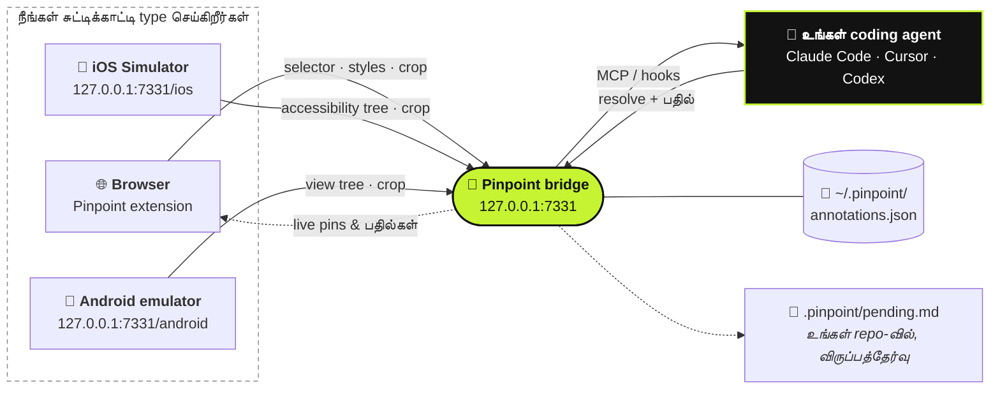

<div align="center">

#  Pinpoint

**ஓடிக்கொண்டிருக்கும் உங்கள் app-இல் ஒரு இடத்தைச் சுட்டிக்காட்டுங்கள். என்ன மாற வேண்டும் என்று சொல்லுங்கள். உங்கள் coding agent அதைப் புரிந்துகொள்ளும்.**

[](https://github.com/gowtham012/pinpoint/actions/workflows/test.yml)
[](https://www.npmjs.com/package/pinpoint-bridge)
[](../../LICENSE)
[](https://glama.ai/mcp/servers/gowtham012/pinpoint)
[](https://github.com/hesreallyhim/awesome-claude-code)
[](https://github.com/gowtham012/pinpoint/stargazers)

[English](../../README.md) ·
[తెలుగు](README.te.md) ·
[हिन्दी](README.hi.md) ·
**தமிழ்** ·
[简体中文](README.zh-CN.md) ·
[日本語](README.ja.md) ·
[한국어](README.ko.md) ·
[Español](README.es.md) ·
[Français](README.fr.md) ·
[Deutsch](README.de.md) ·
[Português](README.pt-BR.md) ·
[Русский](README.ru.md) ·
[العربية](README.ar.md)

<sub>இது ஒரு மொழிபெயர்ப்பு; அதிகாரப்பூர்வமான பதிப்பு ஆங்கில README தான், அது இதைவிடப் புதிதாக இருக்கலாம்.</sub>


<sub>ஒரு element-ஐ click செய்யுங்கள், என்ன மாற வேண்டும் என்று சொல்லுங்கள், உங்கள் agent அதைப் பெற்றுக்கொள்ளும். · <a href="../demo.mp4">முழு வேக வீடியோ</a></sub>

</div>

---

உங்கள் local dev site-இல் ஒரு element-ஐ click செய்து, என்ன மாற வேண்டும் என்று type செய்தால் போதும் — code-ஐக் கண்டுபிடிக்கத் தேவையான
எல்லாவற்றோடும் அது உங்கள் coding agent-க்குப் போய்ச் சேரும்: **selector**, **DOM path**, **computed styles**,
**React/Vue component chain**, ஒரு **source-file hint**, ஒரு **cropped screenshot**. Downloads folder-இல் screenshots
குவிய வேண்டியதில்லை, "இடது பக்கம் இருக்கும் மூன்றாவது button" என்று விளக்கிக்கொண்டிருக்கவும் வேண்டியதில்லை.

இது தோற்றத்துக்கு மட்டுமல்ல, **behaviour**-க்கும் வேலை செய்யும். *"form valid ஆகும் வரை இதை disable செய்"* அல்லது *"மூடுவதற்கு முன்
draft-ஐ save செய்"* போன்றவையும் சரியான notes தான்: agent அந்த element-ஐத் தொடக்கப் புள்ளியாக வைத்துக்கொண்டு, அதன் பின்னால் இருக்கும்
handlers, state, API calls, backend வரை பின்தொடர்ந்து செல்லும்.

Native app உருவாக்குகிறீர்களா? இதே வசதி **[iOS Simulator](#-native-ios-ஆப்கள்)**-இலும்
**[Android emulator](#-android-எமுலேட்டர்)**-இலும் வேலை செய்யும்.



## உள்ளடக்கம்

- [விரைவுத் தொடக்கம்](#-விரைவுத்-தொடக்கம்)
- [பயன்படுத்துவது எப்படி](#-பயன்படுத்துவது-எப்படி)
- [பேசித் தெளிவுபடுத்துதல்](#-பேசித்-தெளிவுபடுத்துதல்)
- [உங்கள் agent-க்கு எப்படித் தெரிய வருகிறது](#-உங்கள்-agent-க்கு-எப்படித்-தெரிய-வருகிறது)
- [Native iOS ஆப்கள்](#-native-ios-ஆப்கள்)
- [Android எமுலேட்டர்](#-android-எமுலேட்டர்)
- [மற்ற agents-ஐ இணைத்தல்](#-மற்ற-agents-ஐ-இணைத்தல்)
- [குறிப்புகள்](#-குறிப்புகள்): commands, MCP tools, ஒரு note-இல் என்ன இருக்கும்
- [பிரச்சனைகளைத் தீர்த்தல்](#-பிரச்சனைகளைத்-தீர்த்தல்)
- [பாதுகாப்பும் தனியுரிமையும்](#-பாதுகாப்பும்-தனியுரிமையும்)

## மற்ற கருவிகளுடன் ஒப்பீடு

| | யார் இயக்குகிறார்கள் | agent-க்கு என்ன கிடைக்கிறது |
|---|---|---|
| **Pinpoint** | **நீங்கள்** சுட்டிக்காட்டி, என்ன மாற வேண்டும் என்று சொல்கிறீர்கள் | Selector, styles, component chain, source hint, crop |
| Playwright MCP, computer-use | agent தானே navigate செய்து click செய்கிறது | browse செய்யும்போது அதற்கு எது கிடைக்கிறதோ அது மட்டும் |
| ஒட்டப்பட்ட ஒரு screenshot | நீங்கள் | pixels மட்டும்; நீங்கள் எந்த control-ஐச் சொன்னீர்கள் என்று அது ஊகிக்க வேண்டும் |

Pinpoint பக்கத்தைத் தானே ஒருபோதும் தொடுவதில்லை, அதனால் browser automation-உடன் போட்டி போடாமல் அதனுடன் சேர்ந்து வேலை செய்யும்:
மாற வேண்டியதைச் சுட்டிக்காட்டுங்கள், agent code-ஐ மாற்றட்டும், உங்கள் tests browser-ஐ இயக்கட்டும்.

## 🚀 விரைவுத் தொடக்கம்

**தேவையானவை:** Node 18+ மற்றும் ஒரு Chromium browser (Chrome, Edge, Brave, Arc, Opera, Vivaldi), அல்லது
[Firefox 140+](#-பிரவுசர்கள்).

**1. Install செய்யுங்கள்**

```bash
git clone https://github.com/gowtham012/pinpoint
node pinpoint/bridge/cli.js setup
```

`setup` சில கேள்விகள் கேட்கும். ஒவ்வொன்றுக்கும் ஒரு default உண்டு, அதனால் கடைசி வரை Enter அழுத்திக்கொண்டே போனாலும் சரியாக வேலை செய்யும்.
அது Claude Code, Cursor, Codex (உங்களிடம் எது இருக்கிறதோ அது) ஆகியவற்றை இணைத்து, Claude Code hooks-ஐ install செய்து,
bridge-ஐ start செய்யும்.

**2. Extension-ஐ load செய்யுங்கள்.** ஒரு terminal உங்கள் Chrome profile-க்குள் extension-ஐ load செய்ய Chrome அனுமதிப்பதில்லை, அதனால் setup
extensions பக்கத்தைத் திறந்து folder path-ஐ உங்களுக்காக copy செய்து வைக்கும்: **Developer mode**-ஐ on செய்து, **Load
unpacked**-ஐ click செய்து, paste செய்யுங்கள். **✓ Pinpoint is live in Chrome** என்று terminal தானாகவே உறுதிப்படுத்தும்.

**3. Claude Code-ஐ ஒருமுறை restart செய்யுங்கள்**, அப்போதுதான் புதிய MCP server-ஐயும் hooks-ஐயும் அது படிக்கும்.

**முயற்சி செய்து பாருங்கள்:** உங்கள் dev site-ஐ (அல்லது [demo பக்கத்தை](#முயற்சி-செய்து-பார்க்க-ஒரு-பக்கம்)) திறந்து, **⌥⇧A** /
**Alt+Shift+A** அழுத்தி, ஒரு element-ஐ click செய்து, என்ன மாற வேண்டும் என்று type செய்து, பிறகு **⌘↩** / **Ctrl+Enter** அழுத்துங்கள். Claude Code-இல்
எதையாவது type செய்தால் உங்கள் note-உம் கூடவே வந்துவிடும்.

> [!TIP]
> ஒவ்வொரு படியும் விரிவாக வேண்டுமா? [docs/quick-install.md](../quick-install.md)-ஐப் பாருங்கள்.
> Native iOS அல்லது Android app மட்டும் உருவாக்குகிறீர்களா? Clone செய்ய வேண்டியதில்லை:
> `npx -y pinpoint-bridge`, பிறகு `claude mcp add pinpoint -s user -- npx -y pinpoint-bridge mcp`.

<details>
<summary><b>Setup விரிவாக, கையால் செய்வது, Windows மற்றும் <code>file://</code></b></summary>

`setup` கேட்கும் கேள்விகள்:

- **எந்த project-இன் UI-ஐ annotate செய்ய விரும்புகிறீர்கள்**: உங்கள் agent edit செய்யப்போகும் repo
- **web app, native iOS app, Android app, அல்லது இரண்டும்** (web மற்றும் iOS): web-க்கு browser extension கிடைக்கும்;
  iOS-க்கு [Simulator picker](#-native-ios-ஆப்கள்), Android-க்கு [emulator picker](#-android-எமுலேட்டர்) கிடைக்கும்.
  Setup, Xcode, Maestro, Java (iOS) அல்லது adb (Android) இருக்கிறதா என்று சரிபார்த்து, இல்லாதவற்றை
  எப்படிப் பெறுவது என்று சொல்லும் (அவற்றில் எதையும் அது install செய்யாது).
- **எந்த agents-ஐ இணைக்க வேண்டும்**: Claude Code-க்கு `claude mcp add`, Cursor-க்கு `<project>/.cursor/mcp.json`,
  Codex-க்கு `~/.codex/config.toml`. ஏற்கனவே இருக்கும் entries merge செய்யப்படும், ஒருபோதும் replace செய்யப்படாது; TOML
  file முதலில் backup எடுக்கப்படும்.
- **Claude Code hooks-ஐ install செய்ய வேண்டுமா**: இவை pending notes-ஐ உங்கள் அடுத்த message-உடன் சேர்த்துக் கொண்டுவரும்
- **எந்த browser**-இல் extension-ஐ load செய்ய வேண்டும் (உங்களிடம் இருப்பவை மட்டும்)

பிறகு popup-இல் உள்ள **Start bridge** button-க்குப் பின்னால் இருக்கும் launcher-ஐ register செய்து, bridge-ஐ start செய்யும்.
Non-interactive முறை: `node pinpoint/bridge/cli.js setup ~/code/my-app --yes` (`--for ios`,
`--for android` அல்லது `--for both` சேர்க்கலாம்; default `web`).

**கையால் செய்வது.** வரிசை முக்கியம்: `$PWD` MCP entry-க்குள் பதிக்கப்படுகிறது, அதனால் bridge terminal-ஐ எடுத்துக்கொள்வதற்கு முன்பே
step 2-ஐ `pinpoint/bridge`-இலிருந்து run செய்ய வேண்டும்.

```bash
# 1. get it
git clone https://github.com/gowtham012/pinpoint
cd pinpoint/bridge && npm install

# 2. wire up Claude Code (once, from this folder)
claude mcp add pinpoint -s user -- node "$PWD/cli.js" mcp
node cli.js install-hooks ~/code/my-app                  # notes arrive without being asked
node cli.js install-native-host --project ~/code/my-app   # optional: the popup's "Start bridge" button

# 3. load extension/ unpacked at chrome://extensions (Developer mode on)
# 4. start the bridge, and leave it running
node cli.js --project ~/code/my-app
```

`--project` கட்டாயமில்லை: MCP-க்குப் பதிலாக ஒரு file-ஐப் படிக்கும் agents-க்காக இது `<repo>/.pinpoint/pending.md`-ஐ
எப்போதும் புதுப்பித்து வைக்கும்.

**`file://` பக்கங்கள்.** Chrome இவற்றை default-ஆக அனுமதிப்பதில்லை: `chrome://extensions` → Pinpoint → **Details** →
**Allow access to file URLs**, பிறகு reload செய்யுங்கள்.

**Windows.** `$PWD` PowerShell, Git Bash-இல் வேலை செய்யும், ஆனால் `cmd.exe`-இல் வேலை செய்யாது; `node cli.js --help` run செய்து,
அது print செய்யும் `claude mcp add …` வரியை copy செய்யுங்கள் — அதில் முழு path இருக்கும். `install-native-host` macOS,
Linux-இல் மட்டுமே; Windows-இல் bridge-ஐ ஒரு terminal-இல் start செய்யுங்கள்.

**இவற்றிலும் பட்டியலிடப்பட்டுள்ளது:** [official MCP Registry](https://registry.modelcontextprotocol.io)
(`io.github.gowtham012/pinpoint`), [cursor.directory](https://cursor.directory/plugins/pinpoint)
(ஒரே click-இல் **Add to Cursor**), [Glama](https://glama.ai/mcp/servers/gowtham012/pinpoint). இவை
MCP server-ஐ மட்டுமே install செய்யும்; web பக்கங்களுக்கு இன்னும் extension-உம் bridge-உம் தேவை.
</details>

## 🖱️ பயன்படுத்துவது எப்படி

Bridge ஓடிக்கொண்டிருக்கும்போது, உங்கள் பக்கத்தின் மேல்-வலது மூலையில் ஒரு சிறிய bar இருக்கும்.

| | | |
|---|---|---|
|  |  |  |
| Shortcut-ஐக் காட்டும்; உங்கள் agent வேலை செய்யும்போது ஒளிரும். | சில நொடிகளில் ஒரு புள்ளியாகச் சுருங்கும். Hover செய்தால் மீண்டும் வரும். | தேர்ந்தெடுக்கும் நிலை. Bar clicks-ஐ ஊடுருவ விடுவதால் உங்கள் target-ஐ ஒருபோதும் மறைக்காது. |

1. Mark செய்யத் தொடங்க bar-ஐ click செய்யுங்கள் (அல்லது **⌥⇧A** / **Alt+Shift+A**).
2. ஒரு element-ஐ click செய்யுங்கள், அல்லது ஒரு குழுவைச் சுற்றி ஒரு box-ஐ **drag** செய்யுங்கள் (*"mobile-இல் இந்த cards-ஐ வரிசைக்கு இரண்டாகக் காட்டு"*).
3. என்ன மாற வேண்டும் என்று type செய்து **⌘↩** / **Ctrl+Enter** அழுத்துங்கள். அடுத்ததற்கு நீங்கள் தயார்.
4. முடிந்ததும் **Esc** அல்லது **Stop**.

<table>
<tr>
<td width="50%"></td>
<td width="50%"></td>
</tr>
<tr>
<td>நீங்கள் எதைத் தேர்ந்தெடுத்தீர்கள் என்பதை popover துல்லியமாகப் பெயரிட்டுக் காட்டும், அதனால் கிட்டத்தட்ட ஒரே மாதிரியான இரண்டு buttons குழம்ப வாய்ப்பில்லை.</td>
<td>எண்ணிடப்பட்ட ஒரு pin element-இல் ஒட்டிக்கொள்ளும். Reload-க்குப் பிறகும் இருக்கும், அந்தப் பக்கத்தின் ஒவ்வொரு tab-இலும் தெரியும், agent வேலையை முடித்ததும் மறைந்துவிடும்.</td>
</tr>
</table>

- **Bar-ஐ நகர்த்த** அதன் grip-ஐப் பிடித்துப் பக்கத்தில் எங்கு வேண்டுமானாலும் drag செய்யுங்கள்; அந்த site-இல் அது அங்கேயே இருக்கும்.
- Bar-இல் உள்ள **counter** இந்தப் பக்கத்தில் mark செய்த எல்லாவற்றையும் பட்டியலிடும். ஒரு row-ஐ click செய்தால் அதற்குத் தாவும்.
- **×** அந்த site-க்கு bar-ஐ மறைக்கும்; toolbar popup அதை மீண்டும் கொண்டுவரும்.
- தங்கள் DOM-ஐ மீண்டும் கட்டும் apps-இல் **pins தங்கள் element-ஐப் பின்தொடரும்**; அவற்றின் element இல்லாமல் போனால் தவறான
  element மீது உட்கார்வதற்குப் பதிலாக மறைந்துவிடும்.
- **Bridge ஓடவில்லையா?** **Send** அதற்குப் பதிலாக paste செய்யத் தயாரான ஒரு prompt-ஐ copy செய்யும், அதனால் எதுவும் தொலையாது.
- **Steps-ஐப் பதிவு செய்தல்.** தேர்ந்தெடுக்கும்போது bar-இல் **Record steps** அழுத்தி, வழக்கம்போல bug வரை click செய்துகொண்டே
  போங்கள். Clicks பக்கத்தை அடையும், ஒவ்வொன்றும் ஒரு step ஆகும் (element, label, URL, ஒரு சிறிய crop), அதே tab-இல்
  navigate ஆனாலும் தொடரும். **Done** ஒரே ஒரு note-ஐ எழுதும் (அதிகபட்சம் 10 steps); **Esc** பதிவை நீக்கிவிடும்.
  உங்கள் agent-க்கு இவை *Steps to reproduce* ஆகக் கிடைக்கும்.
- **குரல் மூலம் சொல்லுங்கள்.** Comment box-இல் உள்ள mic-ஐ அழுத்திப் பேசுங்கள்; நீங்கள் type செய்ததுடன் text சேர்க்கப்படும்.
  Secure பக்கங்களில் Chrome, Safari-இல் வேலை செய்யும் (localhost-உம் அதில் அடங்கும்); transcribe செய்வது browser-இன் சொந்த speech service.
  Firefox-இல் கிடையாது.
- **என்ன தவறு நடந்தது என்பதும் கூடவே வரும்.** நீங்கள் mark செய்வதற்கு முந்தைய ஒரு நிமிடத்தில் பக்கத்தில் நடந்த uncaught errors,
  failed requests ஒவ்வொரு note-உடனும் வரும்; முதலில் browser-இலேயே redact செய்யப்படும் (query strings, tokens, secrets நீக்கப்படும்).
  உண்மையில் ஏதாவது தவறு நடந்தால் மட்டுமே இவை சேர்க்கப்படும்.

**எங்கே வேலை செய்யும்.** Local development பக்கங்களில் மட்டும்: `localhost`, `127.0.0.1`, `.local` / `.test` /
`.localhost` hosts, மற்றும் அனுமதி கொடுத்த பிறகு `file://`. மற்ற இடங்களில் (staging URL, phone testing-க்கான LAN address)
toolbar popup மூலம் ஒரு tab-க்கு மட்டும் இதை on செய்யலாம்.

## 💬 பேசித் தெளிவுபடுத்துதல்

ஒரு note என்பது ஒரு உரையாடல், ஒருவழி ticket அல்ல.

- **Agent திருப்பிக் கேள்வி கேட்கலாம்.** ஒரு request தெளிவில்லாமல் இருந்தால், ஊகிக்காமல் அது கேட்கும். அந்தக் கேள்வி pin மீது
  (**?** ஆக) மற்றும் ஒரு toast ஆகத் தெரியும்; notes panel-இல் பதில் சொன்னால், அந்த note முழு உரையாடலுடன் திரும்பிப் போகும்.
- **பதிலை browser-இலேயே படிக்கலாம்.** முடிந்த ஒரு note, agent என்ன மாற்றியது என்ற அதன் சொந்தக் குறிப்புடன் panel-இல் இருக்கும்.
  Agents கட்டாயம் அதை எழுத வேண்டும்: "done" என்பது பதில் அல்ல.
- **Accept / Not quite.** Agent வேலையை முடித்ததும், அதன் பதிலை **Accept**, **Not quite** buttons-உடன் ஒரு card காட்டும்.
  Not quite அந்த note-ஐ மீண்டும் திறக்கும், அதனால் இன்னும் என்ன தவறாக இருக்கிறது என்று சொல்லலாம்.
- **பிறகு சரியில்லை என்று தோன்றினால்?** Panel-இல் முடிந்த ஒவ்வொரு note-க்கும் **Reply…** button உண்டு. இன்னும் என்ன தவறாக இருக்கிறது
  என்று சொன்னால் அது மீண்டும் திறக்கும்.
- **Before / After.** ஒரு note resolve ஆன சில நொடிகளுக்குப் பிறகு, Pinpoint அந்த element-இன் புதிய crop ஒன்றை எடுக்கும்.
  Panel-இல் முடிந்த notes **Before**, **After** இரண்டையும் பக்கம் பக்கமாகக் காட்டும்.
- **Drafts.** **Draft** (அல்லது **⇧⌘↩**) ஒன்றை அனுப்பாமல் mark செய்து வைக்கும். Bar-இல் உள்ள **Send** எல்லா
  drafts-ஐயும் ஒரே நேரத்தில் ஒப்படைக்கும்.
- **முழுப் பக்கம்.** தேர்ந்தெடுக்கும்போது, **Whole page** பக்கத்தைப் பற்றியே ஒரு note-ஐ உருவாக்கும் (*"எல்லா இடத்திலும்
  spacing நெருக்கமாக இருக்கிறது"*), ஒரு screenshot-உடன்.


**ஒரு pin-க்குக் கீழே பக்கம் மாறிவிட்டால்**, கெட்டுப்போன ஒரு selector-ஐக் கொடுப்பதற்குப் பதிலாக, element பழையதாக (stale) இருக்கலாம்
என்று agent-க்குச் சொல்லப்படும். `recheck_annotation` இப்போதே மீண்டும் பார்த்து, original-க்கு அருகில் ஒரு புதிய crop-ஐத் திருப்பித் தரும்.


<sub>அதே இரண்டு notes, இரண்டு முறை. Panel முழுவதுமாகப் புதிதாகக் கட்டப்படுகிறது: note 1 புத்தம் புதிய nodes மத்தியில் தன் element-ஐ மீண்டும் கண்டுபிடிக்கிறது, note 2 அது இந்த view-இல் இல்லை என்று ஒப்புக்கொள்கிறது.</sub>

<details>
<summary><b>Browser-இலிருந்தே bridge-ஐ start செய்வது, மற்றும் ஒரே நேரத்தில் பல agents</b></summary>

**Browser-இலிருந்து start / restart.** `install-native-host` ஒரு சிறிய launcher-ஐ Chrome-இல் register செய்யும்
(Brave, Edge, Arc, Chromium, Vivaldi, Opera-விலும்), Firefox-இலும். அதன் பிறகு popup-இன் **Start bridge** வேலை செய்யும்; புதிய build-ஐ pull செய்த பிறகு
bar-இல் உள்ள **↻** bridge-ஐ restart செய்யும். Launcher ஒரே ஒரு வேலையைத்தான் செய்ய முடியும்: இந்த repo-வின் சொந்த `cli.js`-ஐ
popup setting-இல் உள்ள port எண்ணில் run செய்வது — page-இலிருந்து வரும் எண்ணில் ஒருபோதும் அல்ல.

**பல agents.** Agents MCP மூலம் தங்களை அறிமுகப்படுத்திக்கொள்கின்றன, அதனால் எது வேலை செய்கிறது என்று bar பெயரிட்டுக் காட்டும்
(`claude-code`, `cursor-vscode`, `codex`), ஒவ்வொரு பதிலும் யாருடையது என்றும் குறிக்கப்படும். `wait_for_annotation` ஒவ்வொரு
புதிய note-ஐயும் காத்திருக்கும் ஒரே ஒரு agent-க்கு மட்டுமே கொடுக்கும், அதனால் இரண்டு agents ஒரே note-ஐச் செய்யாமல் queue-ஐப் பகிர்ந்துகொள்ளும்.
</details>

## 🔔 உங்கள் agent-க்கு எப்படித் தெரிய வருகிறது

மூன்று வழிகள், வலிமையானது முதலில். மூன்றையும் சேர்த்துப் பயன்படுத்தலாம்.

| | எப்படி | Setup |
|---|---|---|
| **Hooks** (தானியங்கி) | Pending notes உங்கள் அடுத்த message-உடன் கூடவே வரும். எதுவும் pending இல்லையென்றால் எதையும் print செய்யாது. | `node cli.js install-hooks <repo>` (setup இதைச் செய்யும்) |
| **MCP** (கேட்கும்போது) | நீங்கள் ஒரு UI அல்லது feature மாற்றம் பற்றிப் பேசும்போதெல்லாம் check செய்யும்படி server agent-க்குச் சொல்லும். | MCP entry |
| **Watch loop** (கை வைக்காமல்) | *"watch pinpoint and apply each change as it comes in"* என்று சொல்லுங்கள்; Send அழுத்திய நொடியே ஒவ்வொரு note-உம் வந்து சேரும். | எதுவும் தேவையில்லை |

Comment தான் instruction; அது ஒன்று எப்படி **தெரிகிறது** என்பதைப் பற்றியோ, அது என்ன **செய்கிறது** என்பதைப் பற்றியோ இருக்கலாம்.
விளைவைப் பற்றி நீங்கள் எவ்வளவு அதிகம் சொல்கிறீர்களோ (*"இப்படி இருக்க வேண்டும்"*, *"அதற்குப் பதிலாக"*, *"எப்போது … அப்போது …"*),
அவ்வளவு குறைவாக agent ஊகிக்கும்.

## 📱 Native iOS ஆப்கள்

Native app-இல் DOM இல்லை, அதனால் இந்த வழி **accessibility tree**-ஐப் படிக்கும். SwiftUI, UIKit,
React Native, Flutter apps-இல் வேலை செய்யும் — உங்கள் app-இல் எதையும் சேர்க்க வேண்டியதில்லை.

<table>
<tr>
<td width="50%"></td>
<td width="50%"></td>
</tr>
</table>

**தேவையானவை:** boot செய்யப்பட்ட Simulator-உடன் Xcode, மற்றும் [Maestro](https://maestro.dev) (அதற்கு Java தேவை;
Homebrew `openjdk` உங்கள் PATH-இல் இல்லாவிட்டாலும் கண்டுபிடிக்கப்படும்).

Bridge ஓடிக்கொண்டிருக்கும்போது **http://127.0.0.1:7331/ios**-ஐத் திறங்கள் (setup உங்களுக்காக இதைத் திறக்கும்). Hover செய்தால் ஒவ்வொரு
element-உம் தெரியும்; ஒன்றை click செய்து, type செய்து, **⌘↩**. Agent-க்கு `accessibilityIdentifier` (உங்கள் `testID`), label,
tree path, frame, ஒரு crop கிடைக்கும். App மாறிய பிறகு **R** அழுத்துங்கள்.

**கையில் app இல்லையா?** `bash demo/ios/run.sh`, **Trailhead** என்ற ஒரு-screen SwiftUI demo-வை `swiftc` மட்டும் வைத்து build செய்து,
boot செய்யப்பட்ட Simulator-இல் launch செய்யும்.

<details>
<summary><b>வரம்புகளும் நேரமும்</b></summary>

Source-file hint-ஓ component chain-ஓ கிடையாது (tree-இல் இரண்டும் இல்லை; elements-க்கு ஒரு identifier கொடுங்கள், agent அதை grep செய்யும்),
styles கிடையாது, `recheck_annotation`-உம் கிடையாது. Maestro தன் on-device driver-ஐ start செய்வதால் முதல் load ~10 s காத்திருக்கும்;
அதன் பிறகு ஒவ்வொரு refresh-உம் சுமார் ஒரு நொடி எடுக்கும். உங்கள் Mac-இல் உள்ள எல்லா Maestro-க்களும் ஒரே driver-ஐப் பகிர்ந்துகொள்கின்றன,
அதனால் வேறொன்று அதை restart செய்தால், bridge ஒரு புதிய Maestro-வை start செய்து இன்னொரு முறை முயற்சிக்கும். முதல் load
நிமிடக்கணக்கில் எடுத்தால், Maestro MCP server உள்ள சும்மா இருக்கும் Claude Code sessions-ஐ மூடுங்கள்.
</details>

## 🤖 Android எமுலேட்டர்

`/ios`-இல் உள்ள அதே picker தான், adb மூலம் Android **view tree**-ஐப் படிக்கும். உங்கள் app-இல் எதுவும் சேர்க்கப்படுவதில்லை,
install செய்ய driver-உம் கிடையாது.

<table>
<tr>
<td width="50%"></td>
<td width="50%"></td>
</tr>
</table>

**தேவையானவை:** Android SDK-இலிருந்து `adb` (Android Studio அதை install செய்யும்), மற்றும் ஓடிக்கொண்டிருக்கும் ஒரு emulator.

Bridge ஓடிக்கொண்டிருக்கும்போது **http://127.0.0.1:7331/android**-ஐத் திறங்கள். Hover, click, type, send. Agent-க்கு element-இன்
`resource-id`, content-desc, text, class, view tree-இல் அதன் இடம், ஒரு crop கிடைக்கும்.
`node bridge/cli.js setup --for android` adb இருக்கிறதா என்று சரிபார்த்து, picker-க்கு வழிகாட்டும்.

<details>
<summary><b>adb-ஐக் கண்டுபிடிப்பது, எந்த device படிக்கப்படுகிறது</b></summary>

Pinpoint, adb-ஐ `$ANDROID_HOME`, `$ANDROID_SDK_ROOT`, Android Studio-வின் default SDK folder ஆகியவற்றில் தேடும்,
பிறகு உங்கள் `PATH`-இல். ஒரு emulator மட்டும் ஓடினால், அதுவே பயன்படுத்தப்படும். பல emulators ஓடினால், அல்லது ஒரு
physical device-ஐப் படிக்க வேண்டுமென்றால், `ANDROID_SERIAL`-ஐ அதன் serial-க்கு (`adb devices` காட்டுவது போல) அமைத்து bridge-ஐ
restart செய்யுங்கள். நீங்கள் பெயர் சொல்லாதவரை ஒரு phone ஒருபோதும் தேர்ந்தெடுக்கப்படாது. iOS போலவே, source-file hint-ஓ styles-ஓ
`recheck_annotation`-ஓ கிடையாது: views-க்கு ஒரு id கொடுங்கள், agent அதை grep செய்யும்.
</details>

## 🔌 மற்ற agents-ஐ இணைத்தல்

எளிமையான entry, publish செய்யப்பட்ட package-ஐ run செய்யும்: `npx -y pinpoint-bridge mcp`. எந்த bridge ஓடிக்கொண்டிருக்கிறதோ
அதனுடன் அது பேசும். அதன் பிறகு editor-ஐ restart செய்யுங்கள்.

<details>
<summary><b>Cursor</b>: <a href="https://cursor.directory/plugins/pinpoint">cursor.directory</a>-இலிருந்து ஒரே click, அல்லது <code>.cursor/mcp.json</code></summary>

```json
{ "mcpServers": { "pinpoint": { "command": "npx", "args": ["-y", "pinpoint-bridge", "mcp"] } } }
```
</details>

<details>
<summary><b>Codex CLI</b>: <code>~/.codex/config.toml</code></summary>

```toml
[mcp_servers.pinpoint]
command = "npx"
args = ["-y", "pinpoint-bridge", "mcp"]
```
</details>

<details>
<summary><b>HTTP மூலம் எந்த MCP client-உம்</b>, அல்லது <b>MCP இல்லாமலேயே</b></summary>

**HTTP:** `http://127.0.0.1:7331/mcp` (Streamable HTTP, stateless). Windsurf, Cline, Continue, Zed,
Gemini CLI எல்லாமே ஒரு URL-ஐ ஏற்றுக்கொள்ளும்.

**MCP இல்லாமல்:** bridge-ஐ `--project <repo>`-உடன் run செய்தால் அது `<repo>/.pinpoint/pending.md`-ஐப் புதுப்பித்து வைக்கும்.
எந்த agent-இடமும் *"read .pinpoint/pending.md and apply it"* என்று சொல்லுங்கள்; ஒவ்வொன்றையும் அது
`node cli.js resolve <id>` மூலம் முடிக்கும். அல்லது popover-இல் உள்ள **Copy prompt**-ஐப் பயன்படுத்தி எந்த chat-இலும் paste செய்யுங்கள்.

ஒரு agent-ஐ npm-க்குப் பதிலாக உங்கள் clone-உடன் நிலையாக இணைக்க, `cli.js`-க்கான absolute path-ஐப் பயன்படுத்துங்கள்
(`node cli.js --help` print செய்யும் வரியை copy செய்யுங்கள்).
</details>

## 🌐 பிரவுசர்கள்

| Browser | நிலை |
|---|---|
| **Chrome, Brave, Arc, Opera, Vivaldi** | ✅ Load unpacked. Headless Chromium-இல் CI மூலம் சரிபார்க்கப்பட்டது. |
| **Edge** | ✅ Load unpacked: Chrome-இன் அதே package. |
| **Firefox 140+** | ✅ `bash tools/make-firefox-zip.sh` build செய்யும் addons.mozilla.org package. Store listing இன்னும் வரவில்லை. Dictation கிடையாது. |
| **Safari** | ✅ `bash tools/make-safari.sh` மூலம் build செய்யப்படுகிறது (Xcode தேவை). Component chain, source hint, page errors கிடையாது. |

<details>
<summary><b>Edge மற்றும் Firefox</b></summary>

**Edge** Chrome package-ஐ அப்படியே ஏற்கும். **Start bridge**-க்கு,
`node bridge/cli.js install-native-host --id <edge id>`-ஐ ஒருமுறை run செய்யுங்கள் (Edge extension-க்குத் தனி id கொடுக்கும்).

**Firefox 140+.** addons.mozilla.org listing live ஆகும் வரை, zip-ஐ
`about:debugging` → **This Firefox** → **Load Temporary Add-on** மூலம் load செய்யுங்கள். Firefox local sites-க்கான
அனுமதியைத் தர மறுத்திருந்தால், popup-இல் **Grant access to local sites** அழுத்துங்கள். பிறகு **Start bridge**-க்கு
`node bridge/cli.js install-native-host`-ஐ ஒருமுறை run செய்யுங்கள், அல்லது `node bridge/cli.js token`-இன் output-ஐ popup-இல் paste செய்யுங்கள்.
</details>

<details>
<summary><b>Safari-இல் என்ன வித்தியாசம்</b></summary>

Safari unpacked extensions-ஐ ஏற்காது, அதனால் `tools/make-safari.sh` அதை ஒரு சிறிய macOS app-க்குள் wrap செய்து,
மாற்ற வேண்டிய நான்கு Safari settings-ஐ print செய்யும் (முக்கியமானது **Develop ▸ Allow Unsigned Extensions**; Safari-ஐ quit செய்யும்
ஒவ்வொரு முறையும் அது reset ஆகிவிடும்). Safari `"world": "MAIN"` content scripts-ஐ support செய்வதில்லை, அதனால் `inspector.js`
React fibers-ஐயோ Vue instances-ஐயோ படிக்க முடியாது: **component chain, source-file hint** இரண்டும் கிடைக்காது,
**page errors**-உம் கிடைக்காது (அவற்றுக்கும் MAIN world தேவை). Safari `webRequest`-ஐ support செய்யும் இடங்களில் மட்டுமே
failed requests கூடவே வரும். மற்ற எல்லாமே வேலை செய்யும். Bridge token-ஐ ஒப்படைக்க Safari-இல் native host கிடையாது, அதனால் popup அதை ஒருமுறை கேட்கும்:
`node bridge/cli.js token` run செய்து output-ஐ paste செய்யுங்கள். Mac App Store-க்கு,
`TEAM=<your team id> bash tools/make-safari.sh --release` ஒரு signed build-ஐ export செய்யும்.
</details>

## 📚 குறிப்புகள்

<details>
<summary><b>Commands</b> (<code>pinpoint/bridge</code>-இலிருந்து run செய்யுங்கள்)</summary>

```
node cli.js [start]            start the bridge (default command)
node cli.js mcp                run as a stdio MCP server
node cli.js status             is it running? how many pending?
node cli.js print              pending annotations as markdown  (--consume also resolves them)
node cli.js resolve <id...> --note "what you changed"
                               mark done — the pin disappears and your note is shown as the reply
node cli.js install-hooks [dir]  wire up Claude Code
node cli.js install-native-host   let the popup's "Start bridge" button start the bridge
                               (--uninstall removes it; --id <id> allows a second checkout)
node cli.js token              print the extension token (Safari asks for it once)
node cli.js clear              delete everything
node cli.js --help

http://127.0.0.1:7331/ios      the iOS Simulator picker, served by the running bridge
http://127.0.0.1:7331/android  the Android emulator picker (needs adb)

--port <n>       default 7331, or $PINPOINT_PORT (set the same number in the popup)
--project <dir>  mirror pending annotations into <dir>/.pinpoint/
--print          echo each new annotation to stdout as it arrives
$PINPOINT_HOME   where annotations are stored (default ~/.pinpoint)
$PINPOINT_AFTER_DELAY  ms after a resolve before the After crop (default 3000, 0 turns it off)
$ANDROID_SERIAL  which Android device to read, when it isn't the one running emulator
```
</details>

<details>
<summary><b>MCP tools</b></summary>

| tool | பயன் |
|---|---|
| `get_pending_annotations` | pending ஆக உள்ள எல்லாவற்றையும் ஒரு markdown task list ஆக, ஒவ்வொன்றும் அதன் screenshot-உடன் |
| `list_annotations` | ஒவ்வொரு annotation-க்கும் ஒரு வரி |
| `get_annotation` | ஒரு id அல்லது pin எண்ணுக்கான முழு விவரம் + screenshot |
| `recheck_annotation` | live page-இல் element-ஐ மீண்டும் கண்டுபிடித்து, என்ன மாறியது என்று, original-க்கு அருகில் ஒரு புதிய crop-உடன் சொல்லும் |
| `resolve_annotation` | முடிந்ததாக mark செய்யும் → ஒரு நொடிக்குள் browser-இல் pin மறைந்துவிடும் |
| `reply_annotation` | ஊகிப்பதற்குப் பதிலாக developer-இடம் ஒரு கேள்வி கேட்கும்; அவர்களின் பதில் உரையாடலுடன் pending ஆகத் திரும்பி வரும் |
| `wait_for_annotation` | developer அடுத்ததை அனுப்பும் வரை காத்திருக்கும் (block) |
| `clear_annotations` | எல்லாவற்றையும் அழித்துவிடும் |

Resource: `pinpoint://pending` (markdown).
</details>

<details>
<summary><b>ஒரு note-இல் என்ன இருக்கும்</b></summary>

```
comment          "make this full-width on mobile"          ← the only instruction
page             url, title, viewport, scroll
element          tag, id, classes, a CSS selector built from stable attributes where they exist
                 (`button[data-action="next"]` rather than `:nth-of-type(2)`; shadow DOM via
                 "host >>> inner"), DOM path, rendered text, trimmed outerHTML, role/aria/data-*
                 attributes, bounding box, ~25 computed style properties, and a fingerprint
                 (tag + text + key attributes) used to verify a pin is still on the right element
source           framework (react/vue/svelte/angular/astro), component chain,
                 file:line where the dev build exposes it
screenshot       PNG of just the element (+8px), long edge ≤1200px
context          only when something went wrong: uncaught errors and failed requests from the
                 minute before, redacted in the browser
steps            recorded notes only: up to 10 clicks, each with selector, label, URL and a crop
after            on done notes: a fresh crop taken after the resolve
```

iOS Simulator-இலிருந்து வரும்போது, `element`-இல் அதற்குப் பதிலாக accessibility identifier, label, text, value, tree path,
frame இருக்கும்; `source` என்பது `ios-native`, `page.url` என்பது `ios-simulator://<device name>`. Android emulator-இலிருந்து வரும்போது அது
`resource-id`, content-desc, text, class, tree path, bounds; `source` என்பது `android-native`, `page.url` என்பது
`android-emulator://<avd>`.

React 19 அல்லது Next-இல் துல்லியமான `file:line` வேண்டுமென்றால், dev-only inspector plugin ஒன்றைச் சேர்க்கவும்
(`vite-plugin-react-inspector`, `@react-dev-inspector`). Pinpoint அவற்றின் `data-source`
attributes-ஐயும், React-இன் `_debugSource`/`_debugStack`, Vue-இன் `__file`-ஐயும் படிக்கும்.
</details>

## 🩺 பிரச்சனைகளைத் தீர்த்தல்

<details>
<summary>பக்கத்தில் bar தெரியவில்லை</summary>

Bridge ஓடிக்கொண்டிருக்கும்போது மட்டுமே bar தெரியும். `pinpoint/bridge`-இலிருந்து `node cli.js status`-ஐ check செய்யுங்கள். Bridge
ஓடிக்கொண்டிருந்தால், அந்தப் பக்கம் Pinpoint தானாக inject செய்யும் பக்கங்களில் ஒன்றாக இருக்காது (*எங்கே வேலை செய்யும்* பார்க்கவும்):
toolbar popup-ஐத் திறந்து அந்த tab-க்கு அதை on செய்யுங்கள்.
</details>

<details>
<summary><code>file://</code> பக்கத்தில் எதுவுமே இல்லை</summary>

`chrome://extensions` → Pinpoint → **Details** → **Allow access to file URLs**, பிறகு reload செய்யுங்கள்.
</details>

<details>
<summary>Toolbar புள்ளி ஒருபோதும் பச்சையாக மாறவில்லை</summary>

Bridge ஓடவில்லை, அல்லது வேறொரு port-இல் ஓடுகிறது: popup-இன் **Port**-உம் bridge-இன் `--port`-உம்
ஒன்றாக இருக்க வேண்டும். `node cli.js status`, அந்த port *answers, but it is NOT the pinpoint bridge* என்று சொன்னால்,
வேறு ஏதோ ஒன்று அதைப் பயன்படுத்துகிறது: bridge-ஐ `--port 7332`-உடன் start செய்து, popup-இல் 7332 என அமைக்கவும்.
</details>

<details>
<summary><code>port 7331 is already in use</code></summary>

பொதுவாக bridge ஏற்கனவே வேறொரு terminal-இல் ஓடிக்கொண்டிருக்கும், அப்படியென்றால் வேறு எதுவும் செய்ய வேண்டியதில்லை. இல்லையென்றால் மேலே
சொன்னபடி ஒரு free port-ஐத் தேர்ந்தெடுங்கள். ஒரே நேரத்தில் இரண்டு bridges-ஐ run செய்யாதீர்கள்: அவை ஒரே store file-ஐப் பகிர்ந்துகொள்கின்றன.
</details>

<details>
<summary>ஒரு note-இல் screenshot இல்லை</summary>

உங்கள் comment சேமிக்கப்பட்ட உடனேயே படம் எடுக்கப்படுகிறது, அதனால் comment ஒருபோதும் தொலையாது. அந்த நொடியில் பக்கம்
வேறு இடத்துக்கு navigate ஆனாலோ tab மூடப்பட்டாலோ, ஏன் என்று note பதிவு செய்யும். Comment, selector, styles
எல்லாமே அப்படியே இருக்கும்.
</details>

<details>
<summary>Claude Code என் notes-ஐப் பற்றிச் சொல்லவே இல்லை</summary>

Session தொடங்கும்போதுதான் hooks படிக்கப்படுகின்றன: `install-hooks`-க்குப் பிறகு ஒருமுறை restart செய்யுங்கள்.
`<your repo>/.claude/settings.json`-இல் `print --hook` கொண்ட இரண்டு entries இருக்கின்றனவா, அவற்றின் path இன்னும்
இருக்கிறதா என்று பாருங்கள் (உங்கள் clone-ஐ வேறு இடத்துக்கு நகர்த்தினால் அது உடைந்துவிடும்; `install-hooks`-ஐ மீண்டும் run செய்யுங்கள்). எப்போது வேண்டுமானாலும் *"apply my pinpoint
annotations"* என்று சொல்லலாம்.
</details>

<details>
<summary>"Start bridge" setup தேவை என்கிறது, அல்லது Node-ஐக் கண்டுபிடிக்க முடியவில்லை</summary>

`node cli.js install-native-host`-ஐ ஒருமுறை run செய்யுங்கள் (repo-வை நகர்த்தியிருந்தால் மீண்டும்), பிறகு browser-ஐ quit செய்து மீண்டும்
திறங்கள். Launcher, node-க்கான absolute path-ஐப் பதித்து வைக்கிறது; node இடம் மாறியிருந்தால் (புதிய nvm version, Homebrew
upgrade), அதை மீண்டும் run செய்யுங்கள்.
</details>

<details>
<summary>எல்லாவற்றையும் சுத்தமாக அழித்துப் புதிதாகத் தொடங்க வேண்டும்</summary>

`node cli.js clear`. உங்கள் repo-வுக்கு வெளியே உள்ள ஒரே state `~/.pinpoint/annotations.json` மட்டும்தான்.
</details>

## 🔒 பாதுகாப்பும் தனியுரிமையும்

- Bridge `127.0.0.1`-இல் மட்டுமே listen செய்யும்; ஒரு web page-இன் `Origin` கொண்ட requests-ஐ நிராகரிக்கும்.
- Extension, `~/.pinpoint/token`-இல் உள்ள token-ஐக் காட்ட வேண்டும்.
- ஒரு பக்கத்திலிருந்து scrape செய்யப்படும் அனைத்தும் உங்கள் agent-ஐ அடையும் இடத்தில் **untrusted** என்று label செய்யப்படும்; நீங்கள் type செய்த
  comment மட்டுமே instruction ஆகக் காட்டப்படும்.
- Screenshots தனித்தனி files ஆக இல்லாமல் `~/.pinpoint/annotations.json`-க்குள் இருக்கும்.

[SECURITY.md](../../SECURITY.md)-இல் முழு trust-boundary குறிப்புகளும் உள்ளன (`<all_urls>` ஏன் தேவை என்பது உட்பட);
[PRIVACY.md](../../PRIVACY.md) என்ன சேகரிக்கப்படுகிறது, எங்கே சேமிக்கப்படுகிறது, அது போகும் ஒரே இடம் எது என்பதைத் துல்லியமாகச் சொல்கிறது:
நீங்கள் இணைக்கும் coding agent.

## முயற்சி செய்து பார்க்க ஒரு பக்கம்

`demo/index.html` ஒரு self-contained demo site (build இல்லை, network இல்லை): region drags-க்கான card grids,
கிட்டத்தட்ட ஒரே மாதிரியான buttons, தன்னைத் தானே மீண்டும் கட்டும் ஒரு tab panel, அடர்த்தியான ஒரு table, ஒரு form ஆகியவை இதில் உள்ளன.

```bash
cd demo && python3 -m http.server 8080     # then open http://localhost:8080
```

## 🧪 டெஸ்டிங்

```bash
cd test && npm install && npx playwright install chromium && npm test
```

210 tests. `bridge.test.mjs`, daemon, CLI, hooks, iOS picker, மற்றும் stdio, Streamable HTTP மூலம் ஒவ்வொரு MCP tool-ஐயும்
cover செய்கிறது. `e2e.test.mjs` extension-ஐ headless Chromium-இல் load செய்து உண்மையான பக்கங்களை இயக்குகிறது: React, Vue, shadow DOM,
iframes, strict CSP, 3,600-node stress page, DPR 2, cross-tab sync, தன் முழு DOM-ஐயும் மீண்டும் கட்டும் ஒரு form.

<details>
<summary><b>மற்ற test suites</b></summary>

| file | எதை cover செய்கிறது |
|---|---|
| `android-bridge.test.mjs` | adb-ஐக் கண்டுபிடித்தல், device-ஐத் தேர்ந்தெடுத்தல், view tree-ஐ parse செய்தல், `/android` routes |
| `e2e-picker.test.mjs` | headless Chromium-இல் `/ios`, `/android` picker பக்கங்கள் |
| `ui-bridge.test.mjs`, `ui-flow.test.mjs`, `ui-after.test.mjs` | Accept, page context, பதிவு செய்த steps, Before / After |
| `ui-redact.test.mjs` | page context-க்கான redaction விதிகள் |
| `ship-edge.test.mjs`, `ship-firefox.test.mjs`, `e2e-ship.test.mjs` | Edge upload, Firefox package மற்றும் native host, store zip, popup-இன் Firefox paths |
| `ship-windows.test.mjs` | `cmd.exe`-க்காக setup commands-ஐ எப்படி quote செய்கிறது |
</details>

[CONTRIBUTING.md](../../CONTRIBUTING.md)-ஐப் பாருங்கள்.

## எதிர்காலத் திட்டங்கள்

- React Native, Flutter-க்கு native source hints, ஒரு optional dev-only package மூலம்
- `chrome.debugger` மூலம் CSS source mapping (எந்த rule இந்த நிறத்தை அமைத்தது, எங்கே)

## பங்களிப்பு

Issues, pull requests வரவேற்கப்படுகின்றன; [CONTRIBUTING.md](../../CONTRIBUTING.md)-ஐப் பாருங்கள். Build step எதுவும் இல்லை:
clone செய்து, `bridge/`-இல் `npm install` செய்து, `extension/`-ஐ unpacked ஆக load செய்யுங்கள். ஒவ்வொரு behaviour மாற்றத்துடனும் ஒரு test வர வேண்டும்.

## உரிமம்

MIT, [LICENSE](../../LICENSE)-ஐப் பாருங்கள். Release notes [CHANGELOG.md](../../CHANGELOG.md)-இல் உள்ளன.
