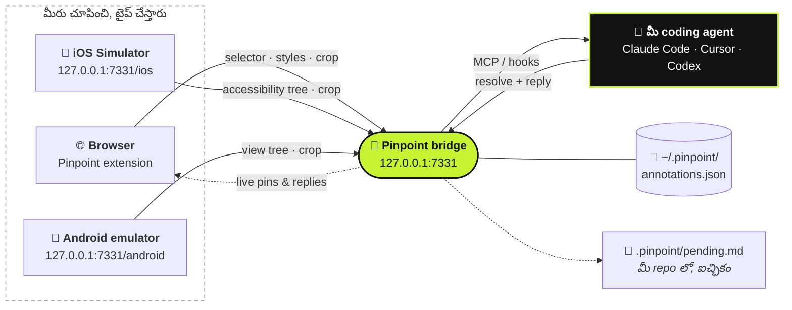

<div align="center">

# 📍 Pinpoint

**రన్ అవుతున్న మీ app లో ఒక element ని చూపించండి. ఏం మారాలో చెప్పండి. మీ coding agent కి అది చేరిపోతుంది.**

[](https://github.com/gowtham012/pinpoint/actions/workflows/test.yml)
[](https://www.npmjs.com/package/pinpoint-bridge)
[](../../LICENSE)
[](https://glama.ai/mcp/servers/gowtham012/pinpoint)
[](https://github.com/hesreallyhim/awesome-claude-code)
[](https://github.com/gowtham012/pinpoint/stargazers)

[English](../../README.md) ·
**తెలుగు** ·
[हिन्दी](README.hi.md) ·
[தமிழ்](README.ta.md) ·
[简体中文](README.zh-CN.md) ·
[日本語](README.ja.md) ·
[한국어](README.ko.md) ·
[Español](README.es.md) ·
[Français](README.fr.md) ·
[Deutsch](README.de.md) ·
[Português](README.pt-BR.md) ·
[Русский](README.ru.md) ·
[العربية](README.ar.md)

<sub>ఇది అనువాదం; ప్రామాణికమైనది ఇంగ్లీష్ README, అది దీనికంటే తాజాగా ఉండొచ్చు.</sub>


<sub>ఒక element మీద క్లిక్ చేయండి, ఏం మారాలో చెప్పండి, మీ agent కి అది చేరుతుంది. · <a href="../demo.mp4">పూర్తి వేగంలో వీడియో</a></sub>

</div>

---

మీ లోకల్ dev సైట్‌లో ఒక element మీద క్లిక్ చేసి, ఏం మారాలో టైప్ చేయండి. కోడ్‌ని వెతకడానికి కావాల్సినవన్నీ
మీ coding agent కి అందుతాయి: **selector**, **DOM path**, **computed styles**,
**React/Vue component chain**, ఒక **source-file hint**, ఇంకా ఒక **cropped screenshot**. Downloads ఫోల్డర్‌లో
screenshots పోగుపడవు, "ఎడమవైపు మూడో button" అని వివరించాల్సిన పనీ ఉండదు.

ఇది కేవలం రూపురేఖలకే కాదు, **behaviour** కి కూడా పనిచేస్తుంది. *"form valid అయ్యేదాకా దీన్ని disable చేయి"* లేదా
*"close చేసే ముందు draft ని save చేయి"* లాంటివి కూడా చక్కటి notes: agent ఆ element ని మొదలుపెట్టే చోటుగా తీసుకుని,
దాని వెనకున్న handlers, state, API calls, backend దాకా వెళ్తుంది.

Native app తయారు చేస్తున్నారా? ఇదే **[iOS Simulator](#-నేటివ్-ios-యాప్స్)** మీద, ఇంకా
**[Android emulator](#-android-ఎమ్యులేటర్)** మీద కూడా పనిచేస్తుంది.



## విషయ సూచిక

- [త్వరగా మొదలుపెట్టండి](#-త్వరగా-మొదలుపెట్టండి)
- [ఎలా వాడాలి](#-ఎలా-వాడాలి)
- [మాట్లాడుకుంటూ సరిచేయడం](#-మాట్లాడుకుంటూ-సరిచేయడం)
- [మీ agent కి ఎలా తెలుస్తుంది](#-మీ-agent-కి-ఎలా-తెలుస్తుంది)
- [నేటివ్ iOS యాప్స్](#-నేటివ్-ios-యాప్స్)
- [Android ఎమ్యులేటర్](#-android-ఎమ్యులేటర్)
- [ఇతర agents ని కనెక్ట్ చేయడం](#-ఇతర-agents-ని-కనెక్ట్-చేయడం)
- [రిఫరెన్స్](#-రిఫరెన్స్): commands, MCP tools, ఒక note లో ఏముంటుంది
- [సమస్యల పరిష్కారం](#-సమస్యల-పరిష్కారం)
- [భద్రత మరియు ప్రైవసీ](#-భద్రత-మరియు-ప్రైవసీ)

## ఇతర టూల్స్ తో పోలిక

| | ఎవరు నడిపిస్తారు | Agent కి ఏం అందుతుంది |
|---|---|---|
| **Pinpoint** | **మీరే** చూపించి, ఏం మారాలో చెప్తారు | Selector, styles, component chain, source hint, crop |
| Playwright MCP, computer-use | Agent తనే navigate చేసి క్లిక్ చేస్తుంది | Browse చేస్తూ దానికి ఏది దొరికితే అది |
| Paste చేసిన screenshot | మీరు | కేవలం pixels, కాబట్టి మీరు ఏ control గురించి అన్నారో అది ఊహించుకోవాలి |

Pinpoint పేజీని ఎప్పుడూ ముట్టుకోదు, కాబట్టి browser automation తో పోటీ పడకుండా దానితో కలిసి పనిచేస్తుంది:
మీరు ఆ విషయాన్ని చూపించండి, agent కోడ్ మార్చనివ్వండి, మీ tests browser ని నడిపించనివ్వండి.

## 🚀 త్వరగా మొదలుపెట్టండి

**మీకు కావాల్సినవి:** Node 18+ ఇంకా ఒక Chromium browser (Chrome, Edge, Brave, Arc, Opera, Vivaldi), లేదా
[Firefox 140+](#-బ్రౌజర్లు).

**1. Install చేయండి**

```bash
git clone https://github.com/gowtham012/pinpoint
node pinpoint/bridge/cli.js setup
```

`setup` కొన్ని ప్రశ్నలు అడుగుతుంది. ప్రతిదానికీ ఒక default ఉంది, కాబట్టి చివరిదాకా Enter నొక్కుకుంటూ వెళ్ళినా సరిపోతుంది.
ఇది Claude Code, Cursor, Codex (మీ దగ్గర ఏవి ఉంటే అవి) ని wire up చేస్తుంది, Claude Code hooks ని install చేస్తుంది,
ఆ తర్వాత bridge ని start చేస్తుంది.

**2. Extension ని load చేయండి.** మీ profile లోకి terminal నుంచి extension ని load చేయడానికి Chrome ఒప్పుకోదు, అందుకే setup
extensions పేజీని తెరిచి, folder path ని మీకోసం copy చేస్తుంది: **Developer mode** ఆన్ చేసి, **Load
unpacked** క్లిక్ చేసి, paste చేయండి. **✓ Pinpoint is live in Chrome** అని terminal తనంతట తానే నిర్ధారిస్తుంది.

**3. Claude Code ని ఒక్కసారి restart చేయండి**, అప్పుడు అది కొత్త MCP server ని, hooks ని చదువుతుంది.

**ప్రయత్నించండి:** మీ dev సైట్ (లేదా [demo పేజీ](#ప్రయత్నించడానికి-ఒక-పేజీ)) తెరిచి, **⌥⇧A** /
**Alt+Shift+A** నొక్కండి, ఒక element మీద క్లిక్ చేసి, ఏం మారాలో టైప్ చేసి, **⌘↩** / **Ctrl+Enter** నొక్కండి. ఆ తర్వాత
Claude Code లో ఏదైనా టైప్ చేస్తే, మీ note దానితో పాటే వెళ్తుంది.

> [!TIP]
> ప్రతి step వివరంగా కావాలా? [docs/quick-install.md](../quick-install.md) చూడండి.
> కేవలం native iOS లేదా Android app మాత్రమే తయారు చేస్తున్నారా? Clone అవసరం లేదు:
> `npx -y pinpoint-bridge`, ఆ తర్వాత `claude mcp add pinpoint -s user -- npx -y pinpoint-bridge mcp`.

<details>
<summary><b>Setup వివరంగా, చేతితో చేయడం, Windows ఇంకా <code>file://</code></b></summary>

`setup` ఇవి అడుగుతుంది:

- **ఏ project UI ని annotate చేయాలనుకుంటున్నారు**: మీ agent edit చేసే repo
- **web app, native iOS app, Android app, లేదా రెండూ** (web ఇంకా iOS): web కి browser extension వస్తుంది;
  iOS కి [Simulator picker](#-నేటివ్-ios-యాప్స్), Android కి [emulator picker](#-android-ఎమ్యులేటర్) వస్తాయి.
  Setup Xcode, Maestro, Java (iOS) లేదా adb (Android) ఉన్నాయో లేదో చూసి, ఏది లేకపోతే దాన్ని ఎలా తెచ్చుకోవాలో
  చెప్తుంది (వీటిలో దేన్నీ అది install చేయదు).
- **ఏ agents ని wire up చేయాలి**: Claude Code కి `claude mcp add`, Cursor కి `<project>/.cursor/mcp.json`,
  Codex కి `~/.codex/config.toml`. ఇప్పటికే ఉన్న entries ని merge చేస్తుంది, ఎప్పుడూ replace చేయదు, ఇంకా TOML
  file ని ముందుగా backup తీసుకుంటుంది.
- **Claude Code hooks ని install చేయాలా వద్దా**: ఇవి pending notes ని మీ తర్వాతి message తో పాటు తీసుకొస్తాయి
- **ఏ browser** లోకి extension ని load చేయాలి (మీ దగ్గర ఉన్నవి మాత్రమే చూపిస్తుంది)

ఆ తర్వాత popup లోని **Start bridge** button వెనకాల ఉండే launcher ని register చేసి, bridge ని start చేస్తుంది.
ప్రశ్నలు లేకుండా: `node pinpoint/bridge/cli.js setup ~/code/my-app --yes` (`--for ios`,
`--for android` లేదా `--for both` జోడించండి; default `web`).

**చేతితో చేయడం.** ఇక్కడ క్రమం ముఖ్యం: `$PWD` MCP entry లో అలాగే స్థిరపడిపోతుంది, కాబట్టి bridge terminal ని
ఆక్రమించే ముందే step 2 ని `pinpoint/bridge` నుంచి రన్ చేయాలి.

```bash
# 1. get it
git clone https://github.com/gowtham012/pinpoint
cd pinpoint/bridge && npm install

# 2. wire up Claude Code (once, from this folder)
claude mcp add pinpoint -s user -- node "$PWD/cli.js" mcp
node cli.js install-hooks ~/code/my-app                  # notes arrive without being asked
node cli.js install-native-host --project ~/code/my-app   # optional: the popup's "Start bridge" button

# 3. load extension/ unpacked at chrome://extensions (Developer mode on)
# 4. start the bridge, and leave it running
node cli.js --project ~/code/my-app
```

`--project` తప్పనిసరి కాదు: MCP బదులు file చదివే agents కోసం ఇది `<repo>/.pinpoint/pending.md` ని
ఎప్పటికప్పుడు అప్‌డేట్ చేస్తుంది.

**`file://` పేజీలు.** Chrome వీటిని default గా ఆపేస్తుంది: `chrome://extensions` → Pinpoint → **Details** →
**Allow access to file URLs**, ఆ తర్వాత reload చేయండి.

**Windows.** `$PWD` PowerShell, Git Bash లో పనిచేస్తుంది కానీ `cmd.exe` లో పనిచేయదు; `node cli.js --help` రన్ చేసి,
అది print చేసే `claude mcp add …` line ని copy చేసుకోండి, దాంట్లో పూర్తి path ఉంటుంది. `install-native-host` కేవలం macOS,
Linux లకు మాత్రమే; Windows లో bridge ని terminal లో start చేయండి.

**ఇక్కడ కూడా లిస్ట్ అయి ఉంది:** [official MCP Registry](https://registry.modelcontextprotocol.io)
(`io.github.gowtham012/pinpoint`), [cursor.directory](https://cursor.directory/plugins/pinpoint)
(ఒక్క క్లిక్‌తో **Add to Cursor**), ఇంకా [Glama](https://glama.ai/mcp/servers/gowtham012/pinpoint). ఇవి
కేవలం MCP server ని మాత్రమే install చేస్తాయి; web పేజీలకు ఇంకా extension, bridge రెండూ అవసరం.
</details>

## 🖱️ ఎలా వాడాలి

Bridge రన్ అవుతున్నంత సేపు, మీ పేజీ పైన కుడి మూలలో ఒక చిన్న bar కనిపిస్తుంది.

| | | |
|---|---|---|
|  |  |  |
| Shortcut ని చూపిస్తుంది, మీ agent పనిచేస్తున్నప్పుడు వెలుగుతుంది. | కొన్ని సెకన్ల తర్వాత ఒక చుక్కలా ముడుచుకుంటుంది. Hover చేస్తే మళ్ళీ వస్తుంది. | Picking జరుగుతోంది. Bar క్లిక్‌లను దాటి వెళ్ళనిస్తుంది, కాబట్టి మీ target కి ఎప్పుడూ అడ్డు రాదు. |

1. Marking మొదలుపెట్టడానికి bar మీద క్లిక్ చేయండి (లేదా **⌥⇧A** / **Alt+Shift+A**).
2. ఒక element మీద క్లిక్ చేయండి, లేదా ఒక group చుట్టూ box ని **drag** చేయండి (*"mobile లో ఈ cards ని రెండేసి చొప్పున పెట్టు"*).
3. ఏం మారాలో టైప్ చేసి **⌘↩** / **Ctrl+Enter** నొక్కండి. తర్వాతి దానికి మీరు రెడీ.
4. పని అయిపోయాక **Esc** లేదా **Stop**.

<table>
<tr>
<td width="50%"></td>
<td width="50%"></td>
</tr>
<tr>
<td>మీరు ఏది ఎంచుకున్నారో popover కచ్చితంగా పేరుతో చూపిస్తుంది, కాబట్టి దాదాపు ఒకేలా ఉన్న రెండు buttons కలగలిసిపోవు.</td>
<td>నంబర్ ఉన్న ఒక pin ఆ element కి అతుక్కుంటుంది. Reload చేసినా ఉంటుంది, ఆ పేజీ తెరిచిన ప్రతి tab లోనూ కనిపిస్తుంది, agent పని పూర్తి చేయగానే మాయమవుతుంది.</td>
</tr>
</table>

- **Bar ని జరపడానికి** దాని grip ని పట్టుకుని పేజీలో ఎక్కడికైనా drag చేయండి; ఆ సైట్‌లో అది అక్కడే ఉంటుంది.
- Bar మీది **counter** ఈ పేజీలో mark చేసినవన్నీ లిస్ట్ చేస్తుంది. ఒక row మీద క్లిక్ చేస్తే దాని దగ్గరకు వెళ్తుంది.
- **×** ఆ సైట్‌కి bar ని దాచేస్తుంది; toolbar popup దాన్ని మళ్ళీ తెస్తుంది.
- DOM ని మళ్ళీ మళ్ళీ rebuild చేసే apps లో **pins తమ element ని అనుసరిస్తాయి**, తమ element పోయినప్పుడు తప్పు
  element మీద కూర్చోకుండా దాక్కుంటాయి.
- **Bridge రన్ అవ్వడం లేదా?** అప్పుడు **Send** paste చేయడానికి రెడీగా ఉన్న ఒక prompt ని copy చేస్తుంది, కాబట్టి ఏదీ పోదు.
- **Steps record చేయడం.** Picking జరుగుతున్నప్పుడు bar మీది **Record steps** నొక్కి, మామూలుగా చేసినట్టే bug దాకా
  క్లిక్ చేసుకుంటూ వెళ్ళండి. క్లిక్‌లు పేజీకి చేరుతూనే ఉంటాయి, ప్రతి క్లిక్ ఒక step అవుతుంది (element, label, URL, ఒక చిన్న
  crop), అదే tab లో వేరే పేజీలకు navigate అయినా సరే. **Done** ఒకే note రాస్తుంది (గరిష్ఠంగా 10 steps); **Esc**
  recording ని పడేస్తుంది. మీ agent కి ఇవి *Steps to reproduce* గా అందుతాయి.
- **మాట్లాడి చెప్పడం (dictation).** Comment box లోని mic నొక్కి మాట్లాడండి; ఆ text మీరు టైప్ చేసిన దానికి జోడించబడుతుంది.
  Secure పేజీల మీద Chrome, Safari లో పనిచేస్తుంది (localhost కూడా లెక్కే); transcribe చేసేది browser సొంత speech
  service. Firefox లో లేదు.
- **ఏం తప్పు జరిగిందో కూడా వెంట వస్తుంది.** మీరు mark చేయడానికి ముందు నిమిషంలో పేజీలో వచ్చిన uncaught errors, failed
  requests ప్రతి note తో పాటు వస్తాయి, ముందుగా browser లోనే redact చేయబడి (query strings, tokens, secrets తీసేసి).
  నిజంగా ఏదైనా తప్పు జరిగినప్పుడు మాత్రమే జతచేయబడతాయి.

**ఎక్కడ పనిచేస్తుంది.** కేవలం లోకల్ development పేజీల్లో మాత్రమే: `localhost`, `127.0.0.1`, `.local` / `.test` /
`.localhost` hosts, ఇంకా అనుమతి ఇచ్చాక `file://`. మిగతా చోట్ల (ఒక staging URL, phone testing కోసం LAN address)
toolbar popup తో ఒక tab కోసం దాన్ని ఆన్ చేయొచ్చు.

## 💬 మాట్లాడుకుంటూ సరిచేయడం

ఒక note అంటే సంభాషణ, ఒకవైపు నుంచి మాత్రమే వెళ్ళే ticket కాదు.

- **Agent తిరిగి ప్రశ్న అడగగలదు.** ఒక request అస్పష్టంగా ఉంటే, అది ఊహించకుండా అడుగుతుంది. ఆ ప్రశ్న pin మీద
  (ఒక **?**) ఇంకా ఒక toast గా కనిపిస్తుంది; notes panel లో జవాబు ఇవ్వండి, note మొత్తం సంభాషణతో కలిపి తిరిగి వెళ్తుంది.
- **జవాబు మీరు browser లోనే చదువుతారు.** పూర్తయిన note, agent తను ఏం మార్చిందో రాసిన సొంత note తో పాటు panel లో
  ఉంటుంది. Agents తప్పకుండా ఒకటి రాయాలి: "done" అనేది జవాబు కాదు.
- **Accept / Not quite.** Agent పని పూర్తి చేయగానే, దాని reply తో పాటు **Accept**, **Not quite** ఉన్న ఒక card
  కనిపిస్తుంది. Not quite ఆ note ని మళ్ళీ తెరుస్తుంది, ఇంకా ఏం తప్పుగా ఉందో మీరు చెప్పొచ్చు.
- **తర్వాత చూస్తే సరిగ్గా లేదా?** Panel లో పూర్తయిన ప్రతి note కీ **Reply…** ఉంటుంది. ఇంకా ఏం తప్పుగా ఉందో
  చెప్పండి, అది మళ్ళీ తెరుచుకుంటుంది.
- **Before / After.** ఒక note resolve అయిన కొన్ని సెకన్ల తర్వాత, Pinpoint ఆ element ని మళ్ళీ కొత్తగా crop చేస్తుంది.
  Panel లో పూర్తయిన notes **Before**, **After** ని పక్కపక్కనే చూపిస్తాయి.
- **Drafts.** **Draft** (లేదా **⇧⌘↩**) పంపకుండానే ఏదైనా mark చేస్తుంది. Bar మీది **Send** అన్ని drafts ని
  ఒకేసారి అప్పగిస్తుంది.
- **మొత్తం పేజీ.** Picking జరుగుతున్నప్పుడు, **Whole page** పేజీ గురించే ఒక note చేస్తుంది (*"అంతటా spacing
  ఇరుకుగా అనిపిస్తోంది"*), ఒక screenshot తో సహా.


**Pin కింద ఉన్న పేజీ మారిపోతే**, పాడైపోయిన selector ని చేతిలో పెట్టకుండా, element stale అయి ఉండొచ్చని agent కి
చెప్తుంది. `recheck_annotation` ఇప్పుడే మళ్ళీ చూసి, అసలు crop పక్కన ఒక కొత్త crop ని ఇస్తుంది.


<sub>అవే రెండు notes, రెండుసార్లు. Panel మొదటి నుంచీ మళ్ళీ build అవుతుంది: note 1 పూర్తిగా కొత్త nodes మధ్య తన element ని మళ్ళీ వెతుక్కుంటుంది, note 2 తాను ఈ view లో లేనని ఒప్పుకుంటుంది.</sub>

<details>
<summary><b>Browser నుంచే bridge ని start చేయడం, ఇంకా ఒకేసారి చాలా agents</b></summary>

**Browser నుంచి start / restart.** `install-native-host` Chrome తో (ఇంకా Brave, Edge, Arc, Chromium, Vivaldi, Opera తో), అలాగే Firefox తో
ఒక చిన్న launcher ని register చేస్తుంది. అప్పుడు popup లోని **Start bridge** పనిచేస్తుంది, ఇంకా bar మీది
**↻** కొత్త build ని pull చేశాక bridge ని restart చేస్తుంది. Launcher ఒకే ఒక్క పని చేయగలదు: popup setting లోని port
నంబర్ మీద ఈ repo సొంత `cli.js` ని రన్ చేయడం, పేజీ నుంచి వచ్చిన నంబర్ మీద ఎప్పుడూ కాదు.

**చాలా agents.** Agents MCP ద్వారా తమను తాము పరిచయం చేసుకుంటాయి, కాబట్టి ఏది పనిచేస్తోందో bar పేరుతో చూపిస్తుంది
(`claude-code`, `cursor-vscode`, `codex`), ప్రతి reply ఎవరిదో కూడా చూపిస్తుంది. `wait_for_annotation` ప్రతి
కొత్త note ని వేచి ఉన్న ఒకే ఒక్క agent కి అప్పగిస్తుంది, కాబట్టి రెండు agents ఒకే note ని చేయకుండా queue ని పంచుకుంటాయి.
</details>

## 🔔 మీ agent కి ఎలా తెలుస్తుంది

మూడు మార్గాలు, బలమైనది ముందు. మూడూ వాడినా పర్వాలేదు.

| | ఎలా | Setup |
|---|---|---|
| **Hooks** (ఆటోమేటిక్) | Pending notes మీ తర్వాతి message తో పాటు వెళ్తాయి. ఏదీ pending లో లేకపోతే ఏమీ print చేయదు. | `node cli.js install-hooks <repo>` (setup ఇది చేస్తుంది) |
| **MCP** (అడిగినప్పుడు) | మీరు UI లేదా feature మార్పు గురించి మాట్లాడినప్పుడల్లా check చేయమని server agent కి చెప్తుంది. | MCP entry |
| **Watch loop** (చేతులు ముట్టకుండా) | *"watch pinpoint and apply each change as it comes in"* అని చెప్పండి; మీరు Send నొక్కిన క్షణమే ప్రతి note చేరుతుంది. | ఏమీ అవసరం లేదు |

మీ comment నే agent instruction గా తీసుకుంటుంది; అది ఏదైనా ఎలా **కనిపిస్తుంది** అనే దాని గురించి కావచ్చు, లేదా అది ఏం **చేస్తుంది** అనే దాని గురించి కావచ్చు.
ఫలితం గురించి మీరు ఎంత ఎక్కువ చెప్తే (*"should"*, *"instead of"*, *"when … then …"*), agent అంత తక్కువ
ఊహించాల్సి వస్తుంది.

## 📱 నేటివ్ iOS యాప్స్

Native app కి DOM ఉండదు, కాబట్టి ఈ దారి **accessibility tree** ని చదువుతుంది. ఇది SwiftUI, UIKit,
React Native, Flutter apps కి పనిచేస్తుంది, మీ app లో ఏమీ జోడించాల్సిన పనిలేదు.

<table>
<tr>
<td width="50%"></td>
<td width="50%"></td>
</tr>
</table>

**మీకు కావాల్సినవి:** boot అయిన Simulator తో Xcode, ఇంకా [Maestro](https://maestro.dev) (దీనికి Java అవసరం;
Homebrew `openjdk` మీ PATH లో లేకపోయినా దొరుకుతుంది).

Bridge రన్ అవుతున్నప్పుడు, **http://127.0.0.1:7331/ios** తెరవండి (setup దీన్ని మీకోసం తెరుస్తుంది). ప్రతి element ని
చూడటానికి hover చేయండి, ఒకదాని మీద క్లిక్ చేసి, టైప్ చేసి, **⌘↩** నొక్కండి. Agent కి `accessibilityIdentifier` (మీ `testID`), label,
tree path, frame ఇంకా ఒక crop అందుతాయి. App మారిన తర్వాత **R** నొక్కండి.

**చేతిలో app లేదా?** `bash demo/ios/run.sh` కేవలం `swiftc` తోనే **Trailhead** అనే ఒక-screen SwiftUI demo ని build చేసి,
boot అయిన Simulator మీద launch చేస్తుంది.

<details>
<summary><b>పరిమితులు మరియు సమయం</b></summary>

ఇక్కడ source-file hint గానీ component chain గానీ ఉండవు (tree లో ఈ రెండూ ఉండవు; elements కి ఒక identifier ఇవ్వండి,
agent దాని కోసం grep చేస్తుంది), styles ఉండవు, `recheck_annotation` కూడా ఉండదు. Maestro తన on-device driver ని
start చేస్తున్నప్పుడు మొదటి load ~10 s వేచి ఉంటుంది; ఆ తర్వాత ప్రతి refresh కి సుమారు ఒక సెకను పడుతుంది. మీ Mac లోని
ప్రతి Maestro ఒకే driver ని పంచుకుంటుంది, కాబట్టి ఇంకొకటి దాన్ని restart చేస్తే, bridge ఒక కొత్త Maestro ని start చేసి
ఇంకోసారి ప్రయత్నిస్తుంది. మొదటి load కి నిమిషాలు పడుతుంటే, Maestro MCP server ఉన్న, ఖాళీగా ఉన్న Claude Code
sessions ని మూసేయండి.
</details>

## 🤖 Android ఎమ్యులేటర్

`/ios` లాంటి picker నే, adb ద్వారా Android **view tree** ని చదువుతుంది. మీ app లో ఏమీ జోడించాల్సిన పనిలేదు, install
చేయాల్సిన driver కూడా లేదు.

<table>
<tr>
<td width="50%"></td>
<td width="50%"></td>
</tr>
</table>

**మీకు కావాల్సినవి:** Android SDK లోని `adb` (Android Studio దాన్ని install చేస్తుంది), ఇంకా రన్ అవుతున్న ఒక emulator.

Bridge రన్ అవుతున్నప్పుడు, **http://127.0.0.1:7331/android** తెరవండి. Hover చేయండి, క్లిక్ చేయండి, టైప్ చేయండి, పంపండి.
Agent కి element యొక్క `resource-id`, content-desc, text, class, view tree లో దాని స్థానం ఇంకా ఒక crop అందుతాయి.
`node bridge/cli.js setup --for android` adb ఉందో లేదో చూసి, మిమ్మల్ని picker దగ్గరకు పంపుతుంది.

<details>
<summary><b>adb ని వెతకడం, ఏ device ని చదువుతుంది</b></summary>

Pinpoint adb కోసం `$ANDROID_HOME`, `$ANDROID_SDK_ROOT`, Android Studio యొక్క default SDK folder లో, ఆ తర్వాత మీ
`PATH` లో వెతుకుతుంది. ఒకే emulator రన్ అవుతుంటే, అదే వాడబడుతుంది. చాలా ఉంటే, లేదా ఒక physical device ని చదవాలంటే,
`ANDROID_SERIAL` ని దాని serial కి (`adb devices` చూపించినట్టు) set చేసి bridge ని restart చేయండి. మీరు పేరు
చెప్పకపోతే phone ని ఎప్పుడూ ఎంచుకోదు. iOS లాగే, ఇక్కడ source-file hint, styles, `recheck_annotation` ఉండవు: views కి
ఒక id ఇవ్వండి, agent దాని కోసం grep చేస్తుంది.
</details>

## 🔌 ఇతర agents ని కనెక్ట్ చేయడం

అన్నిటికంటే సులభమైన entry published package ని రన్ చేస్తుంది: `npx -y pinpoint-bridge mcp`. ఏ bridge రన్ అవుతుంటే
దానితో అది మాట్లాడుతుంది. ఆ తర్వాత editor ని restart చేయండి.

<details>
<summary><b>Cursor</b>: <a href="https://cursor.directory/plugins/pinpoint">cursor.directory</a> నుంచి ఒక్క క్లిక్, లేదా <code>.cursor/mcp.json</code></summary>

```json
{ "mcpServers": { "pinpoint": { "command": "npx", "args": ["-y", "pinpoint-bridge", "mcp"] } } }
```
</details>

<details>
<summary><b>Codex CLI</b>: <code>~/.codex/config.toml</code></summary>

```toml
[mcp_servers.pinpoint]
command = "npx"
args = ["-y", "pinpoint-bridge", "mcp"]
```
</details>

<details>
<summary>HTTP ద్వారా <b>ఏ MCP client అయినా</b>, లేదా <b>MCP అసలే లేకుండా</b></summary>

**HTTP:** `http://127.0.0.1:7331/mcp` (Streamable HTTP, stateless). Windsurf, Cline, Continue, Zed, ఇంకా
Gemini CLI అన్నీ URL ని తీసుకుంటాయి.

**MCP లేకుండా:** bridge ని `--project <repo>` తో రన్ చేయండి, అది `<repo>/.pinpoint/pending.md` ని ఎప్పటికప్పుడు అప్‌డేట్ చేస్తుంది.
ఏ agent కైనా *"read .pinpoint/pending.md and apply it"* అని చెప్పండి; అది ప్రతిదాన్నీ
`node cli.js resolve <id>` తో పూర్తి చేస్తుంది. లేదా popover లోని **Copy prompt** వాడి, ఏ chat లోనైనా paste చేయండి.

ఒక agent ని npm కి బదులు మీ clone కి కట్టేయాలంటే, `cli.js` కి absolute path వాడండి (`node cli.js --help` print చేసే
line ని copy చేసుకోండి).
</details>

## 🌐 బ్రౌజర్లు

| Browser | స్థితి |
|---|---|
| **Chrome, Brave, Arc, Opera, Vivaldi** | ✅ Load unpacked. Headless Chromium మీద CI లో verify చేయబడింది. |
| **Edge** | ✅ Load unpacked: Chrome కి ఉన్న package నే. |
| **Firefox 140+** | ✅ `bash tools/make-firefox-zip.sh` build చేసే addons.mozilla.org package. Store listing ఇంకా pending. Dictation ఉండదు. |
| **Safari** | ✅ `bash tools/make-safari.sh` తో build చేయాలి (Xcode అవసరం). Component chain, source hint, page errors ఉండవు. |

<details>
<summary><b>Edge ఇంకా Firefox</b></summary>

**Edge** Chrome package ని ఉన్నది ఉన్నట్టే తీసుకుంటుంది. **Start bridge** కోసం,
`node bridge/cli.js install-native-host --id <edge id>` ని ఒక్కసారి రన్ చేయండి (Edge extension కి తన సొంత id ఇస్తుంది).

**Firefox 140+.** addons.mozilla.org listing live అయ్యేదాకా, zip ని
`about:debugging` → **This Firefox** → **Load Temporary Add-on** నుంచి load చేయండి. Firefox లోకల్ సైట్లకు access
ఆపి ఉంచితే, popup లోని **Grant access to local sites** నొక్కండి. ఆ తర్వాత **Start bridge** కోసం
`node bridge/cli.js install-native-host` ని ఒక్కసారి రన్ చేయండి, లేదా `node bridge/cli.js token` output ని popup లో
paste చేయండి.
</details>

<details>
<summary><b>Safari లో ఏం తేడా ఉంటుంది</b></summary>

Safari unpacked extensions ని తీసుకోదు, కాబట్టి `tools/make-safari.sh` దాన్ని ఒక చిన్న macOS app లో చుట్టి,
మార్చాల్సిన నాలుగు Safari settings ని print చేస్తుంది (వాటిలో ముఖ్యమైనది, **Develop ▸ Allow Unsigned Extensions**, Safari
quit అయిన ప్రతిసారీ reset అవుతుంది). Safari `"world": "MAIN"` content scripts ని support చేయదు, కాబట్టి `inspector.js`
React fibers ని గానీ Vue instances ని గానీ చదవలేదు: మీరు **component chain, source-file hint** ని, ఇంకా
**page errors** ని (వాటికీ MAIN world అవసరం) కోల్పోతారు. Safari `webRequest` ని support చేసే చోట మాత్రమే failed
requests వెంట వస్తాయి. మిగతాదంతా పనిచేస్తుంది. Bridge token ని అప్పగించడానికి Safari లో native host లేదు, కాబట్టి popup దాన్ని
ఒక్కసారి అడుగుతుంది: `node bridge/cli.js token` రన్ చేసి output ని paste చేయండి. Mac App Store కోసం,
`TEAM=<your team id> bash tools/make-safari.sh --release` ఒక signed build ని export చేస్తుంది.
</details>

## 📚 రిఫరెన్స్

<details>
<summary><b>Commands</b> (<code>pinpoint/bridge</code> నుంచి రన్ చేయండి)</summary>

```
node cli.js [start]            start the bridge (default command)
node cli.js mcp                run as a stdio MCP server
node cli.js status             is it running? how many pending?
node cli.js print              pending annotations as markdown  (--consume also resolves them)
node cli.js resolve <id...> --note "what you changed"
                               mark done — the pin disappears and your note is shown as the reply
node cli.js install-hooks [dir]  wire up Claude Code
node cli.js install-native-host   let the popup's "Start bridge" button start the bridge
                               (--uninstall removes it; --id <id> allows a second checkout)
node cli.js token              print the extension token (Safari asks for it once)
node cli.js clear              delete everything
node cli.js --help

http://127.0.0.1:7331/ios      the iOS Simulator picker, served by the running bridge
http://127.0.0.1:7331/android  the Android emulator picker (needs adb)

--port <n>       default 7331, or $PINPOINT_PORT (set the same number in the popup)
--project <dir>  mirror pending annotations into <dir>/.pinpoint/
--print          echo each new annotation to stdout as it arrives
$PINPOINT_HOME   where annotations are stored (default ~/.pinpoint)
$PINPOINT_AFTER_DELAY  ms after a resolve before the After crop (default 3000, 0 turns it off)
$ANDROID_SERIAL  which Android device to read, when it isn't the one running emulator
```
</details>

<details>
<summary><b>MCP tools</b></summary>

| tool | ఉపయోగం |
|---|---|
| `get_pending_annotations` | pending లో ఉన్నవన్నీ ఒక markdown task list గా, ప్రతిదానికీ దాని screenshot తో |
| `list_annotations` | ఒక్కో annotation కి ఒక line |
| `get_annotation` | ఒక id లేదా pin నంబర్ కి పూర్తి వివరాలు + screenshot |
| `recheck_annotation` | live పేజీలో element ని మళ్ళీ వెతికి ఏం మారిందో చెప్తుంది, అసలు crop పక్కన ఒక కొత్త crop తో |
| `resolve_annotation` | పూర్తయినట్టు mark చేస్తుంది → ఒక సెకనులోపే browser లో pin మాయమవుతుంది |
| `reply_annotation` | ఊహించకుండా developer ని ఒక ప్రశ్న అడుగుతుంది; వారి జవాబు సంభాషణతో పాటు pending గా తిరిగి వస్తుంది |
| `wait_for_annotation` | developer తర్వాతిది పంపేదాకా block అయి వేచి ఉంటుంది |
| `clear_annotations` | అన్నిటినీ తుడిచేస్తుంది |

Resource: `pinpoint://pending` (markdown).
</details>

<details>
<summary><b>ఒక note లో ఏముంటుంది</b></summary>

```
comment          "make this full-width on mobile"          ← the only instruction
page             url, title, viewport, scroll
element          tag, id, classes, a CSS selector built from stable attributes where they exist
                 (`button[data-action="next"]` rather than `:nth-of-type(2)`; shadow DOM via
                 "host >>> inner"), DOM path, rendered text, trimmed outerHTML, role/aria/data-*
                 attributes, bounding box, ~25 computed style properties, and a fingerprint
                 (tag + text + key attributes) used to verify a pin is still on the right element
source           framework (react/vue/svelte/angular/astro), component chain,
                 file:line where the dev build exposes it
screenshot       PNG of just the element (+8px), long edge ≤1200px
context          only when something went wrong: uncaught errors and failed requests from the
                 minute before, redacted in the browser
steps            recorded notes only: up to 10 clicks, each with selector, label, URL and a crop
after            on done notes: a fresh crop taken after the resolve
```

iOS Simulator నుంచి వస్తే, `element` లో దానికి బదులుగా accessibility identifier, label, text, value, tree path,
frame ఉంటాయి; `source` విలువ `ios-native`, `page.url` విలువ `ios-simulator://<device name>`. Android
emulator నుంచి వస్తే అది `resource-id`, content-desc, text, class, tree path, bounds; `source` విలువ `android-native`,
`page.url` విలువ `android-emulator://<avd>`.

React 19 లేదా Next లో కచ్చితమైన `file:line` కావాలంటే, dev-only inspector plugin ఒకటి జోడించండి
(`vite-plugin-react-inspector`, `@react-dev-inspector`). Pinpoint వాటి `data-source`
attributes ని, అలాగే React యొక్క `_debugSource`/`_debugStack` ని, Vue యొక్క `__file` ని చదువుతుంది.
</details>

## 🩺 సమస్యల పరిష్కారం

<details>
<summary>పేజీ మీద bar కనిపించడం లేదు</summary>

Bridge రన్ అవుతున్నప్పుడు మాత్రమే bar కనిపిస్తుంది. `pinpoint/bridge` నుంచి `node cli.js status` తో check చేయండి.
Bridge రన్ అవుతుంటే, బహుశా ఆ పేజీ Pinpoint ఆటోమేటిక్‌గా inject అయ్యే పేజీల్లో ఒకటి కాకపోవచ్చు (పైన *ఎక్కడ పనిచేస్తుంది* చూడండి):
toolbar popup తెరిచి ఆ tab కోసం దాన్ని ఆన్ చేయండి.
</details>

<details>
<summary><code>file://</code> పేజీలో అసలు ఏమీ కనిపించడం లేదు</summary>

`chrome://extensions` → Pinpoint → **Details** → **Allow access to file URLs**, ఆ తర్వాత reload చేయండి.
</details>

<details>
<summary>Toolbar లోని చుక్క ఎప్పటికీ ఆకుపచ్చగా మారడం లేదు</summary>

Bridge రన్ అవ్వడం లేదు, లేదా వేరే port మీద ఉంది: popup లోని **Port**, bridge యొక్క `--port`
రెండూ ఒకటే ఉండాలి. `node cli.js status` ఆ port *answers, but it is NOT the pinpoint bridge* అని చెప్తే,
దాన్ని ఇంకేదో వాడుకుంటోంది: bridge ని `--port 7332` తో start చేసి, popup లో 7332 పెట్టండి.
</details>

<details>
<summary><code>port 7331 is already in use</code></summary>

సాధారణంగా bridge ఇప్పటికే ఇంకో terminal లో రన్ అవుతూ ఉంటుంది, కాబట్టి మీ పని అయిపోయినట్టే. లేకపోతే పైన చెప్పినట్టు
ఒక ఖాళీ port ఎంచుకోండి. ఒకేసారి రెండు bridges రన్ చేయకండి: అవి ఒకే store file ని పంచుకుంటాయి.
</details>

<details>
<summary>ఒక note కి screenshot లేదు</summary>

మీ comment store అయిన వెంటనే screenshot తీస్తుంది, కాబట్టి comment ఎప్పుడూ పోదు. ఆ క్షణంలోనే పేజీ వేరే చోటికి
navigate అయినా లేదా tab మూసుకుపోయినా, ఎందుకో note లో రాసి ఉంటుంది. Comment, selector, styles అన్నీ
అలాగే ఉంటాయి.
</details>

<details>
<summary>Claude Code నా notes గురించి ప్రస్తావించడం లేదు</summary>

Session మొదలయ్యేటప్పుడే hooks ని చదువుతుంది: `install-hooks` తర్వాత ఒక్కసారి restart చేయండి.
`<your repo>/.claude/settings.json` లో `print --hook` ఉన్న రెండు entries ఉన్నాయో, వాటి path ఇంకా
ఉందో check చేయండి (మీ clone ని వేరే చోటికి జరిపితే అది పాడవుతుంది; `install-hooks` మళ్ళీ రన్ చేయండి). మీరు ఎప్పుడైనా *"apply my pinpoint
annotations"* అని చెప్పొచ్చు.
</details>

<details>
<summary>"Start bridge" setup అవసరమని చెప్తోంది, లేదా Node దొరకడం లేదు</summary>

`node cli.js install-native-host` ని ఒక్కసారి రన్ చేయండి (repo ని జరిపితే మళ్ళీ), ఆ తర్వాత browser ని quit చేసి మళ్ళీ
తెరవండి. Launcher లో node కి absolute path స్థిరంగా ఉంటుంది; node వేరే చోటికి వెళ్తే (కొత్త nvm version, Homebrew
upgrade), దాన్ని మళ్ళీ రన్ చేయండి.
</details>

<details>
<summary>అంతా మొదటి నుంచి శుభ్రంగా కావాలి</summary>

`node cli.js clear`. మీ repo బయట ఉండే state కేవలం `~/.pinpoint/annotations.json` ఒక్కటే.
</details>

## 🔒 భద్రత మరియు ప్రైవసీ

- Bridge కేవలం `127.0.0.1` మీద మాత్రమే listen చేస్తుంది, web page యొక్క `Origin` ఉన్న requests ని తిరస్కరిస్తుంది.
- Extension తప్పనిసరిగా `~/.pinpoint/token` లోని token ని చూపించాలి.
- పేజీ నుంచి తీసుకున్నదంతా మీ agent కి చేరే చోట **untrusted** అని label చేయబడి ఉంటుంది; మీరు టైప్ చేసిన
  comment మాత్రమే instruction గా ఇవ్వబడుతుంది.
- Screenshots విడి files గా కాకుండా `~/.pinpoint/annotations.json` లోపలే ఉంటాయి.

[SECURITY.md](../../SECURITY.md) లో పూర్తి trust-boundary notes ఉన్నాయి (`<all_urls>` ఎందుకు అవసరమో సహా), ఇంకా
[PRIVACY.md](../../PRIVACY.md) ఏం సేకరిస్తారో, ఎక్కడ store చేస్తారో, అది వెళ్ళే ఒకే ఒక్క చోటు ఏదో కచ్చితంగా చెప్తుంది:
మీరు కనెక్ట్ చేసే coding agent.

## ప్రయత్నించడానికి ఒక పేజీ

`demo/index.html` ఒక self-contained demo సైట్ (build లేదు, network లేదు). ఇందులో region drags కోసం card grids,
దాదాపు ఒకేలా ఉండే buttons, తనను తాను rebuild చేసుకునే ఒక tab panel, ఒక dense table, ఇంకా ఒక form ఉన్నాయి.

```bash
cd demo && python3 -m http.server 8080     # then open http://localhost:8080
```

## 🧪 టెస్టింగ్

```bash
cd test && npm install && npx playwright install chromium && npm test
```

210 tests. `bridge.test.mjs` daemon, CLI, hooks, iOS picker, ఇంకా ప్రతి MCP tool ని stdio, Streamable HTTP
రెండింటి మీదా cover చేస్తుంది. `e2e.test.mjs` extension ని headless Chromium లోకి load చేసి నిజమైన
పేజీలను నడిపిస్తుంది: React, Vue, shadow DOM, iframes, strict CSP, 3,600-node stress పేజీ, DPR 2, cross-tab sync, ఇంకా
తన మొత్తం DOM ని rebuild చేసుకునే ఒక form.

<details>
<summary><b>మిగతా suites</b></summary>

| file | ఏం cover చేస్తుంది |
|---|---|
| `android-bridge.test.mjs` | adb ని వెతకడం, device ని ఎంచుకోవడం, view tree ని parse చేయడం, `/android` routes |
| `e2e-picker.test.mjs` | headless Chromium లో `/ios`, `/android` picker పేజీలు |
| `ui-bridge.test.mjs`, `ui-flow.test.mjs`, `ui-after.test.mjs` | Accept, page context, record చేసిన steps, Before / After |
| `ui-redact.test.mjs` | page-context redaction నియమాలు |
| `ship-edge.test.mjs`, `ship-firefox.test.mjs`, `e2e-ship.test.mjs` | Edge upload, Firefox package ఇంకా native host, store zip, popup లోని Firefox దారులు |
| `ship-windows.test.mjs` | `cmd.exe` కోసం setup commands ని ఎలా quote చేస్తుంది |
</details>

[CONTRIBUTING.md](../../CONTRIBUTING.md) చూడండి.

## రోడ్ మ్యాప్

- React Native, Flutter కోసం native source hints, ఒక optional dev-only package ద్వారా
- `chrome.debugger` ద్వారా CSS source mapping (ఈ రంగుని ఏ rule పెట్టింది, ఎక్కడ)

## సహకరించడం

Issues, pull requests కి స్వాగతం; [CONTRIBUTING.md](../../CONTRIBUTING.md) చూడండి. Build step ఏదీ లేదు:
clone చేసి, `bridge/` లో `npm install` చేసి, `extension/` ని unpacked గా load చేయండి. ప్రతి behaviour మార్పుతో పాటు ఒక test ఉండాలి.

## లైసెన్స్

MIT, [LICENSE](../../LICENSE) చూడండి. Release notes [CHANGELOG.md](../../CHANGELOG.md) లో ఉన్నాయి.
