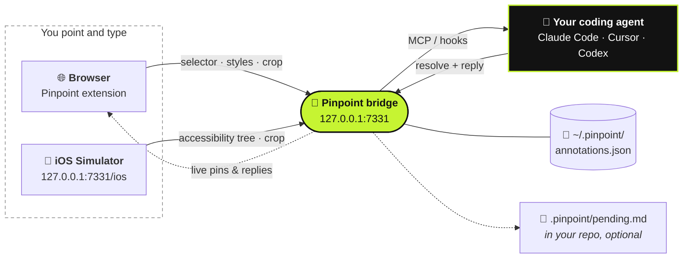

<div align="center">

# 📍 Pinpoint

**指着正在运行的应用，说出要改什么，你的 coding agent 就能收到。**

[](https://github.com/gowtham012/pinpoint/actions/workflows/test.yml)
[](https://www.npmjs.com/package/pinpoint-bridge)
[](../../LICENSE)
[](https://glama.ai/mcp/servers/gowtham012/pinpoint)
[](https://github.com/hesreallyhim/awesome-claude-code)
[](https://github.com/gowtham012/pinpoint/stargazers)

[English](../../README.md) ·
[తెలుగు](README.te.md) ·
[हिन्दी](README.hi.md) ·
[தமிழ்](README.ta.md) ·
**简体中文** ·
[日本語](README.ja.md) ·
[한국어](README.ko.md) ·
[Español](README.es.md) ·
[Français](README.fr.md) ·
[Deutsch](README.de.md) ·
[Português](README.pt-BR.md) ·
[Русский](README.ru.md) ·
[العربية](README.ar.md)

<sub>本文为译文，请以英文版 README 为准，英文版可能更新。</sub>


<sub>点一下元素，说出要改什么，agent 就能收到。 · <a href="../demo.mp4">原速视频</a></sub>

</div>

---

在本地开发站点上点一下某个元素，输入要改的内容，你的 coding agent 就会收到它，连同定位代码所需的一切：**selector**、**DOM 路径**、**computed styles（计算样式）**、**React/Vue 组件链**、**源文件提示**，以及一张**裁剪好的截图**。Downloads 文件夹里不会再堆满截图，也不用再费劲描述“左边第三个按钮”。

它不只管**外观**，也管**行为**。*“表单校验通过之前禁用这个按钮”*、*“关闭前先保存草稿”* 都是合格的备注：agent 会把这个元素当作切入点，再顺着它追到背后的事件处理函数、state、API 调用和后端逻辑。

在做原生应用？同样的流程也适用于 **[iOS Simulator](#-原生-ios-应用)**。



## 目录

- [快速上手](#-快速上手)
- [使用方法](#-使用方法)
- [来回沟通](#-来回沟通)
- [agent 如何得知](#-agent-如何得知)
- [原生 iOS 应用](#-原生-ios-应用)
- [接入其他 agent](#-接入其他-agent)
- [参考](#-参考)：命令、MCP 工具、备注里包含什么
- [故障排查](#-故障排查)
- [安全与隐私](#-安全与隐私)

## 横向对比

| | 谁来主导 | agent 拿到什么 |
|---|---|---|
| **Pinpoint** | **你**指出元素并说明要改什么 | selector、样式、组件链、源码提示、裁剪截图 |
| Playwright MCP、computer-use | agent 自己导航和点击 | 浏览过程中碰巧找到的东西 |
| 粘贴一张截图 | 你 | 只有像素，只能猜你指的是哪个控件 |

Pinpoint 从不操作页面本身，所以它和浏览器自动化是互补关系而非竞争关系：你指出目标，agent 改代码，测试去驱动浏览器。

## 🚀 快速上手

**前置要求：** Node 18+，以及一款 Chromium 内核浏览器（Chrome、Edge、Brave、Arc、Opera、Vivaldi）。

**1. 安装**

```bash
git clone https://github.com/gowtham012/pinpoint
node pinpoint/bridge/cli.js setup
```

`setup` 会问几个问题，每个都有默认值，一路回车也没问题。它会接入 Claude Code、Cursor 和 Codex（装了哪个就接哪个），安装 Claude Code hooks，并启动 bridge。

**2. 加载 extension。** Chrome 不允许终端把 extension 装进你的浏览器配置，所以 setup 会帮你打开扩展程序页面并复制好文件夹路径：打开 **Developer mode**（开发者模式），点击 **Load unpacked**（加载已解压的扩展程序），粘贴路径即可。终端会自动提示 **✓ Pinpoint is live in Chrome**。

**3. 重启一次 Claude Code**，让它读取新的 MCP server 和 hooks。

**试一下：** 打开你的开发站点（或者[演示页面](#找个页面试试)），按 **⌥⇧A** / **Alt+Shift+A**，点一个元素，输入要改的内容，再按 **⌘↩** / **Ctrl+Enter**。之后在 Claude Code 里随便输入点什么，你的备注就会一起带过去。

> [!TIP]
> 想看每一步的详细说明？请看 [docs/quick-install.md](../quick-install.md)。
> 只做原生 iOS 应用？可以跳过 clone：
> `npx -y pinpoint-bridge`，然后 `claude mcp add pinpoint -s user -- npx -y pinpoint-bridge mcp`。

<details>
<summary><b>Setup 详解、手动安装、Windows 与 <code>file://</code></b></summary>

`setup` 会问：

- **你要标注哪个项目的 UI**：也就是 agent 要修改的那个 repo
- **Web 应用、原生 iOS 应用，还是两者都要**：Web 使用浏览器 extension；iOS 使用 [Simulator 选择器](#-原生-ios-应用)。Setup 会检查 Xcode、Maestro 和 Java，缺哪个就告诉你怎么装（它自己一个都不装）。
- **要接入哪些 agent**：Claude Code 用 `claude mcp add`，Cursor 用 `<project>/.cursor/mcp.json`，Codex 用 `~/.codex/config.toml`。已有配置只会合并、绝不覆盖，TOML 文件会先备份。
- **是否安装 Claude Code hooks**：装了之后，待处理的备注会随你的下一条消息一起带进去
- **把 extension 装进哪个浏览器**（只列出你已安装的）

之后它会注册 popup 里 **Start bridge**（启动 bridge）按钮背后的启动器，并启动 bridge。
非交互模式：`node pinpoint/bridge/cli.js setup ~/code/my-app --yes`（可加 `--for ios` 或 `--for both`；默认是 `web`）。

**手动安装。** 顺序很重要：`$PWD` 会被写进 MCP 配置，所以第 2 步要在 bridge 占用终端之前、在 `pinpoint/bridge` 目录下执行。

```bash
# 1. get it
git clone https://github.com/gowtham012/pinpoint
cd pinpoint/bridge && npm install

# 2. wire up Claude Code (once, from this folder)
claude mcp add pinpoint -s user -- node "$PWD/cli.js" mcp
node cli.js install-hooks ~/code/my-app                  # notes arrive without being asked
node cli.js install-native-host --project ~/code/my-app   # optional: the popup's "Start bridge" button

# 3. load extension/ unpacked at chrome://extensions (Developer mode on)
# 4. start the bridge, and leave it running
node cli.js --project ~/code/my-app
```

`--project` 是可选的：它会持续更新 `<repo>/.pinpoint/pending.md`，供那些读文件而不走 MCP 的 agent 使用。

**`file://` 页面。** Chrome 默认不允许：`chrome://extensions` → Pinpoint → **Details**（详情）→ **Allow access to file URLs**（允许访问文件网址），然后刷新页面。

**Windows。** `$PWD` 在 PowerShell 和 Git Bash 里能用，在 `cmd.exe` 里不行；请运行 `node cli.js --help`，复制它打印出来的那行 `claude mcp add …`，里面是完整路径。`install-native-host` 只支持 macOS 和 Linux；在 Windows 上请在终端里启动 bridge。

**也已上架** [官方 MCP Registry](https://registry.modelcontextprotocol.io)（`io.github.gowtham012/pinpoint`）、[cursor.directory](https://cursor.directory/plugins/pinpoint)（一键 **Add to Cursor**）和 [Glama](https://glama.ai/mcp/servers/gowtham012/pinpoint)。这些渠道只安装 MCP server；Web 页面仍然需要 extension 和 bridge。
</details>

## 🖱️ 使用方法

bridge 运行期间，页面右上角会出现一个小工具条。

| | | |
|---|---|---|
|  |  |  |
| 显示快捷键，agent 工作时会亮起。 | 几秒后收起成一个圆点，鼠标悬停即可恢复。 | 选取中。工具条会让点击穿透过去，绝不会挡住目标元素。 |

1. 点击工具条（或按 **⌥⇧A** / **Alt+Shift+A**）开始标记。
2. 点击一个元素，或者**拖拽**框选一组元素（*“这些卡片在移动端改成一行两个”*）。
3. 输入要改的内容，按 **⌘↩** / **Ctrl+Enter**，就可以接着标下一个了。
4. 完成后按 **Esc** 或点 **Stop**（停止）。

<table>
<tr>
<td width="50%"></td>
<td width="50%"></td>
</tr>
<tr>
<td>弹窗会准确写出你选中的是哪个元素，两个几乎一模一样的按钮也不会搞混。</td>
<td>编号图钉会贴在元素上。刷新后依然在，同一页面的所有标签页都能看到，agent 处理完后自动消失。</td>
</tr>
</table>

- **移动工具条**：拖动它的把手放到页面任意位置；在该站点上会一直停在那里。
- **计数器**：工具条上的计数器列出本页所有已标记内容，点击某一行即可跳转过去。
- **×**：在该站点隐藏工具条；通过浏览器工具栏的 popup 可以重新打开。
- **图钉会跟随元素**：在会重建 DOM 的应用里也一样；如果对应元素没了，图钉会隐藏，而不是错贴到别的元素上。
- **bridge 没在运行？** **Send**（发送）会改为复制一段可直接粘贴的 prompt，什么都不会丢。

**在哪些页面生效。** 只在本地开发页面上：`localhost`、`127.0.0.1`、`.local` / `.test` / `.localhost` 域名，以及授权后的 `file://`。其他地址（staging URL、用于手机测试的局域网地址）可以通过工具栏 popup 针对单个标签页开启。

## 💬 来回沟通

一条备注是一段对话，而不是一张单向工单。

- **agent 可以反问。** 需求有歧义时，它会提问而不是瞎猜。问题会显示在图钉上（一个 **?**），同时弹出 toast 提示；在备注面板里回答后，备注会连同完整对话一起发回去。
- **在浏览器里看回复。** 已完成的备注会留在面板里，附上 agent 写的改动说明。agent 必须写这条说明：只回一句“done”不算数。
- **改得不太对？** 每条已完成的备注都有 **Reply…**（回复）。说明哪里还不对，它就会重新打开。
- **草稿。** **Draft**（草稿，或 **⇧⌘↩**）只做标记、不发送。工具条上的 **Send** 会一次性把所有草稿交出去。
- **整个页面。** 选取时点 **Whole page**（整个页面）可以针对页面本身写备注（*“整体间距都太挤了”*），并附带截图。


**当图钉下方的页面发生变化时**，agent 会被告知该元素可能已过期，而不是拿到一个已经失效的 selector。`recheck_annotation` 会立即重新查找，并返回一张新的裁剪截图，与原图并排对比。


<sub>同样的两条备注，演示两遍。面板被完全重建：备注 1 在全新节点中重新找到了自己的元素，备注 2 则如实说明它不在当前视图里。</sub>

<details>
<summary><b>从浏览器启动 bridge，以及同时使用多个 agent</b></summary>

**从浏览器启动 / 重启。** `install-native-host` 会向 Chrome（以及 Brave、Edge、Arc、Chromium、Vivaldi、Opera）注册一个很小的启动器。之后 popup 里的 **Start bridge** 就能用了，工具条上的 **↻** 可以在你拉取新版本后重启 bridge。这个启动器只能做一件事：用 popup 设置里的端口号（绝不会来自页面）运行本 repo 自带的 `cli.js`。

**多个 agent。** agent 会通过 MCP 自报家门，所以工具条会显示当前在干活的是哪个（`claude-code`、`cursor-vscode`、`codex`），每条回复也会注明来源。`wait_for_annotation` 会把每条新备注只交给一个正在等待的 agent，这样两个 agent 共享同一个队列，不会重复处理同一条备注。
</details>

## 🔔 Agent 如何得知

三种方式，按可靠程度从高到低排列。三种一起用也完全没问题。

| | 方式 | 配置 |
|---|---|---|
| **Hooks**（自动） | 待处理的备注会随你的下一条消息一起带过去。没有待处理内容时什么都不输出。 | `node cli.js install-hooks <repo>`（setup 会自动完成） |
| **MCP**（按需） | 每当你聊到 UI 或功能改动时，server 会提醒 agent 去检查一下。 | MCP 配置项 |
| **监听循环**（全自动） | 对 agent 说 *“watch pinpoint and apply each change as it comes in”*；你一点 Send，备注就立刻送达。 | 无需配置 |

备注本身就是指令，可以关于某个东西**看起来**怎样，也可以关于它**做**什么。你对预期结果描述得越具体（*“应该”*、*“而不是”*、*“当……时，就……”*），agent 需要猜的就越少。

## 📱 原生 iOS 应用

原生应用没有 DOM，所以这条路径读取的是 **accessibility tree（无障碍树）**。它适用于 SwiftUI、UIKit、React Native 和 Flutter 应用，无需在你的应用里添加任何东西。

<table>
<tr>
<td width="50%"></td>
<td width="50%"></td>
</tr>
</table>

**前置要求：** Xcode 并已启动一个 Simulator，以及 [Maestro](https://maestro.dev)（它依赖 Java；即使 Homebrew 安装的 `openjdk` 不在 PATH 里也能找到）。

bridge 运行时，打开 **http://127.0.0.1:7331/ios**（setup 会帮你打开）。鼠标悬停查看各个元素，点击一个，输入内容，按 **⌘↩**。agent 会拿到 `accessibilityIdentifier`（也就是你的 `testID`）、label、树路径、frame 和一张裁剪截图。应用界面变化后按 **R** 刷新。

**手边没有应用？** `bash demo/ios/run.sh` 只用 `swiftc` 就能构建 **Trailhead**（一个单屏 SwiftUI 演示应用），并在已启动的 Simulator 上运行。

<details>
<summary><b>限制与耗时</b></summary>

这里没有源文件提示和组件链（无障碍树里两者都没有；给元素加上 identifier，agent 就能 grep 到它），没有样式，也没有 `recheck_annotation`。首次加载需要等待约 10 秒，因为 Maestro 要启动设备端 driver；之后每次刷新大约一秒。你 Mac 上所有的 Maestro 共用一个 driver，如果别的 Maestro 重启了它，bridge 会启动一个新的 Maestro 并重试一次。如果首次加载要好几分钟，请关掉那些挂着 Maestro MCP server 的闲置 Claude Code 会话。
</details>

## 🔌 接入其他 Agent

最简单的配置是直接运行已发布的包：`npx -y pinpoint-bridge mcp`。它会连接当前正在运行的 bridge。配置完成后重启编辑器。

<details>
<summary><b>Cursor</b>：在 <a href="https://cursor.directory/plugins/pinpoint">cursor.directory</a> 一键安装，或使用 <code>.cursor/mcp.json</code></summary>

```json
{ "mcpServers": { "pinpoint": { "command": "npx", "args": ["-y", "pinpoint-bridge", "mcp"] } } }
```
</details>

<details>
<summary><b>Codex CLI</b>：<code>~/.codex/config.toml</code></summary>

```toml
[mcp_servers.pinpoint]
command = "npx"
args = ["-y", "pinpoint-bridge", "mcp"]
```
</details>

<details>
<summary><b>任何通过 HTTP 连接的 MCP 客户端</b>，或<b>完全不用 MCP</b></summary>

**HTTP：** `http://127.0.0.1:7331/mcp`（Streamable HTTP，无状态）。Windsurf、Cline、Continue、Zed 和 Gemini CLI 都支持填写 URL。

**不用 MCP：** 用 `--project <repo>` 启动 bridge，它会持续更新 `<repo>/.pinpoint/pending.md`。对任意 agent 说 *“read .pinpoint/pending.md and apply it”*；它每处理完一条就执行 `node cli.js resolve <id>`。或者在弹窗里点 **Copy prompt**（复制 prompt），粘贴到任意聊天窗口。

如果想让 agent 固定使用你本地 clone 的版本而不是 npm 上的包，请使用 `cli.js` 的绝对路径（复制 `node cli.js --help` 打印出来的那一行）。
</details>

## 🌐 浏览器

| 浏览器 | 状态 |
|---|---|
| **Chrome, Edge, Brave, Arc, Opera, Vivaldi** | ✅ 使用 Load unpacked 加载。已在 CI 中通过 headless Chromium 验证。 |
| **Safari** | ✅ 用 `bash tools/make-safari.sh` 构建（需要 Xcode）。没有组件链和源码提示。 |
| **Firefox** | ⏳ 暂不支持。 |

<details>
<summary><b>Safari 上有哪些不同</b></summary>

Safari 不支持加载未打包的 extension，所以 `tools/make-safari.sh` 会把它包装进一个小型 macOS 应用，并打印出需要打开的四项 Safari 设置（其中最关键的 **Develop ▸ Allow Unsigned Extensions** 每次退出 Safari 都会被重置）。Safari 不支持 `"world": "MAIN"` 的 content script，所以 `inspector.js` 无法读取 React fiber 或 Vue 实例：你会失去**组件链和源文件提示**。其他功能都正常。Safari 没有 native host 来传递 bridge token，所以 popup 会让你手动输入一次：运行 `node bridge/cli.js token` 并粘贴输出结果。如需上架 Mac App Store，`TEAM=<your team id> bash tools/make-safari.sh --release` 会导出一个已签名的构建。
</details>

## 📚 参考

<details>
<summary><b>命令</b>（在 <code>pinpoint/bridge</code> 目录下运行）</summary>

```
node cli.js [start]            start the bridge (default command)
node cli.js mcp                run as a stdio MCP server
node cli.js status             is it running? how many pending?
node cli.js print              pending annotations as markdown  (--consume also resolves them)
node cli.js resolve <id...> --note "what you changed"
                               mark done — the pin disappears and your note is shown as the reply
node cli.js install-hooks [dir]  wire up Claude Code
node cli.js install-native-host   let the popup's "Start bridge" button start the bridge
                               (--uninstall removes it; --id <id> allows a second checkout)
node cli.js token              print the extension token (Safari asks for it once)
node cli.js clear              delete everything
node cli.js --help

http://127.0.0.1:7331/ios      the iOS Simulator picker, served by the running bridge

--port <n>       default 7331, or $PINPOINT_PORT (set the same number in the popup)
--project <dir>  mirror pending annotations into <dir>/.pinpoint/
--print          echo each new annotation to stdout as it arrives
$PINPOINT_HOME   where annotations are stored (default ~/.pinpoint)
```
</details>

<details>
<summary><b>MCP 工具</b></summary>

| 工具 | 用途 |
|---|---|
| `get_pending_annotations` | 以 markdown 任务列表的形式返回所有待处理项，每项附带截图 |
| `list_annotations` | 每条标注一行 |
| `get_annotation` | 按 id 或图钉编号返回单条标注的完整详情 + 截图 |
| `recheck_annotation` | 在实时页面中重新查找元素并报告变化，附上一张新的裁剪截图与原图对比 |
| `resolve_annotation` | 标记完成 → 一秒内浏览器中的图钉就会消失 |
| `reply_annotation` | 向开发者提问而不是瞎猜；对方的回答会连同对话一起以待处理状态返回 |
| `wait_for_annotation` | 阻塞等待，直到开发者发送下一条 |
| `clear_annotations` | 清空所有内容 |

Resource：`pinpoint://pending`（markdown）。
</details>

<details>
<summary><b>一条备注里包含什么</b></summary>

```
comment          "make this full-width on mobile"          ← the only instruction
page             url, title, viewport, scroll
element          tag, id, classes, a CSS selector built from stable attributes where they exist
                 (`button[data-action="next"]` rather than `:nth-of-type(2)`; shadow DOM via
                 "host >>> inner"), DOM path, rendered text, trimmed outerHTML, role/aria/data-*
                 attributes, bounding box, ~25 computed style properties, and a fingerprint
                 (tag + text + key attributes) used to verify a pin is still on the right element
source           framework (react/vue/svelte/angular/astro), component chain,
                 file:line where the dev build exposes it
screenshot       PNG of just the element (+8px), long edge ≤1200px
```

来自 iOS Simulator 时，`element` 里携带的是 accessibility identifier、label、文本、value、树路径和 frame；`source` 为 `ios-native`，`page.url` 为 `ios-simulator://<device name>`。

如果想在 React 19 或 Next 上拿到精确的 `file:line`，请添加一个仅用于开发环境的 inspector 插件（`vite-plugin-react-inspector`、`@react-dev-inspector`）。Pinpoint 会读取它们的 `data-source` 属性，也会读取 React 的 `_debugSource`/`_debugStack` 和 Vue 的 `__file`。
</details>

## 🩺 故障排查

<details>
<summary>页面上没有出现工具条</summary>

工具条只在 bridge 运行时显示。在 `pinpoint/bridge` 目录下运行 `node cli.js status` 检查一下。如果 bridge 已经启动，那这个页面多半不在 Pinpoint 自动注入的范围内（见上文 *在哪些页面生效*）：打开工具栏 popup，为该标签页开启即可。
</details>

<details>
<summary><code>file://</code> 页面上什么都没有</summary>

`chrome://extensions` → Pinpoint → **Details** → **Allow access to file URLs**，然后刷新页面。
</details>

<details>
<summary>工具栏上的圆点一直不变绿</summary>

bridge 没有运行，或者它运行在别的端口上：popup 里的 **Port** 必须和 bridge 的 `--port` 一致。如果 `node cli.js status` 提示该端口 *answers, but it is NOT the pinpoint bridge*，说明端口被别的程序占用了：用 `--port 7332` 启动 bridge，并在 popup 里设置为 7332。
</details>

<details>
<summary><code>port 7331 is already in use</code></summary>

通常是 bridge 已经在另一个终端里运行了，那就不用管了。否则按上面的方法换一个空闲端口。不要同时运行两个 bridge：它们共用同一个存储文件。
</details>

<details>
<summary>备注没有截图</summary>

截图是在你的备注保存之后才拍的，所以备注本身永远不会丢。如果在那一瞬间页面跳转了或标签页被关了，备注里会记录原因。备注内容、selector 和样式都还在。
</details>

<details>
<summary>Claude Code 没有提到我的备注</summary>

hooks 是在会话启动时读取的：执行 `install-hooks` 后要重启一次。检查 `<your repo>/.claude/settings.json` 里是否有两条包含 `print --hook` 的配置，并且其中的路径仍然存在（移动 clone 目录会导致路径失效；重新运行 `install-hooks` 即可）。你也随时可以直接说 *“apply my pinpoint annotations”*。
</details>

<details>
<summary>“Start bridge” 提示需要先 setup，或者找不到 Node</summary>

运行一次 `node cli.js install-native-host`（如果你移动过 repo，就再运行一次），然后完全退出并重新打开浏览器。启动器里写死了 node 的绝对路径；如果 node 的位置变了（换了新的 nvm 版本、Homebrew 升级），请重新运行它。
</details>

<details>
<summary>想要从头开始</summary>

`node cli.js clear`。`~/.pinpoint/annotations.json` 是你 repo 之外唯一的状态文件。
</details>

## 🔒 安全与隐私

- bridge 只监听 `127.0.0.1`，并拒绝携带网页 `Origin` 的请求。
- extension 必须出示 `~/.pinpoint/token` 中的 token。
- 从页面抓取的所有内容在送达 agent 时都会被标记为 **untrusted**（不可信）；只有你亲手输入的备注才会作为指令呈现。
- 截图保存在 `~/.pinpoint/annotations.json` 内部，而不是散落的文件。

[SECURITY.md](../../SECURITY.md) 里有完整的信任边界说明（包括为什么需要 `<all_urls>`），[PRIVACY.md](../../PRIVACY.md) 则写明了收集哪些数据、存储在哪里，以及数据唯一的去向：你所连接的 coding agent。

## 找个页面试试

`demo/index.html` 是一个自包含的演示站点（无需构建、无需联网），里面有用于框选的卡片网格、几乎一模一样的按钮、会自我重建的标签面板、一个密集的表格和一个表单。

```bash
cd demo && python3 -m http.server 8080     # then open http://localhost:8080
```

## 🧪 测试

```bash
cd test && npm install && npx playwright install chromium && npm test
```

共 152 个测试。`bridge.test.mjs` 覆盖了守护进程、CLI、hooks、iOS 选择器，以及通过 stdio 和 Streamable HTTP 调用的每个 MCP 工具。`e2e.test.mjs` 会把 extension 加载到 headless Chromium 中并驱动真实页面：React、Vue、shadow DOM、iframe、严格 CSP、一个 3,600 节点的压力测试页面、DPR 2、跨标签页同步，以及一个会重建整个 DOM 的表单。详见 [CONTRIBUTING.md](../../CONTRIBUTING.md)。

## 路线图

- 支持 Android 模拟器
- Firefox
- 通过一个可选的、仅用于开发环境的包，为 React Native 和 Flutter 提供原生源码提示
- 通过 `chrome.debugger` 实现 CSS 源码映射（是哪条规则设置了这个颜色，在哪里）

## 参与贡献

欢迎提交 issue 和 pull request；请参阅 [CONTRIBUTING.md](../../CONTRIBUTING.md)。项目没有构建步骤：clone 下来，在 `bridge/` 里执行 `npm install`，以未打包方式加载 `extension/` 即可。每一处行为变更都要附带测试。

## 许可证

MIT，详见 [LICENSE](../../LICENSE)。发布说明见 [CHANGELOG.md](../../CHANGELOG.md)。
